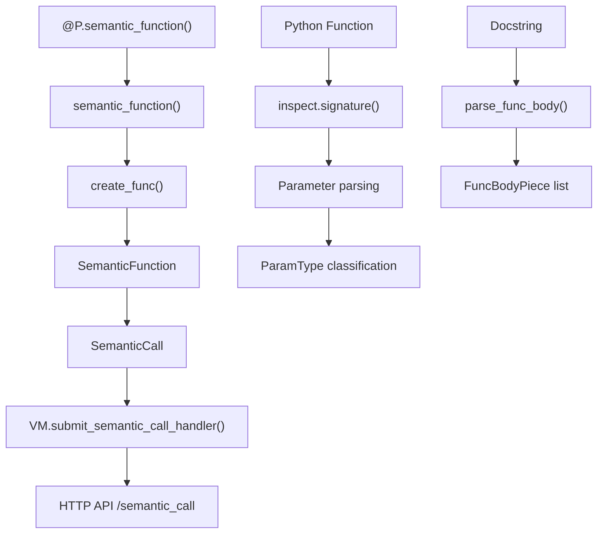
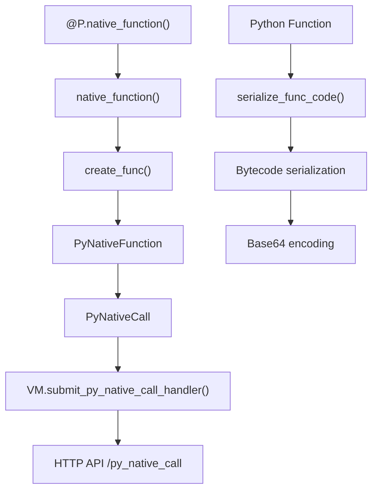
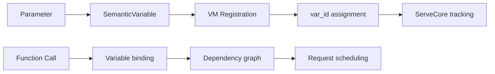
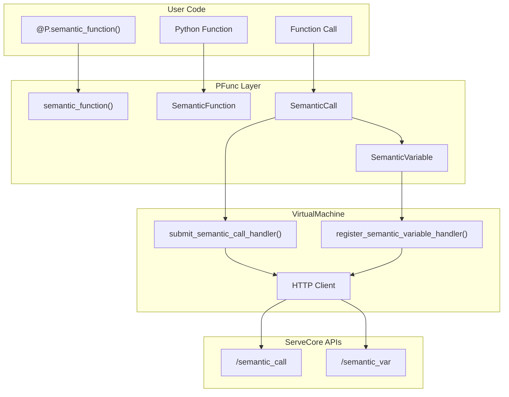
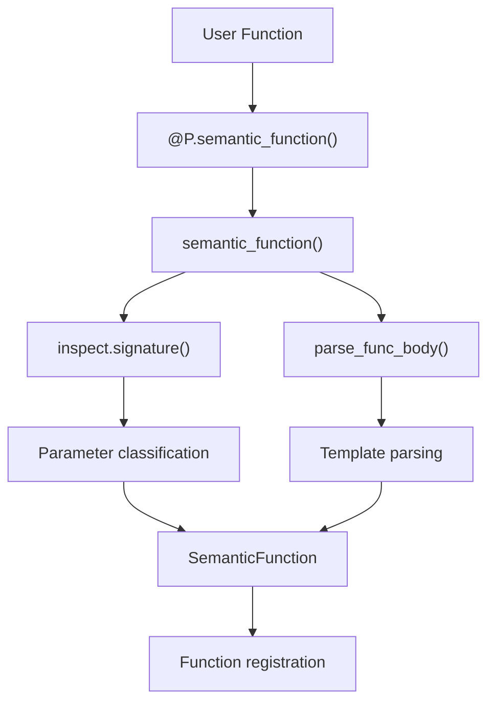
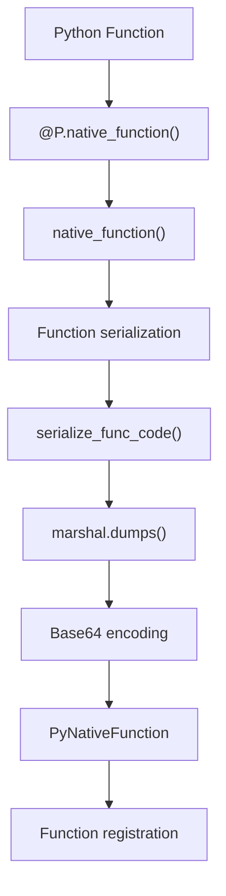
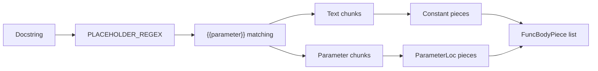
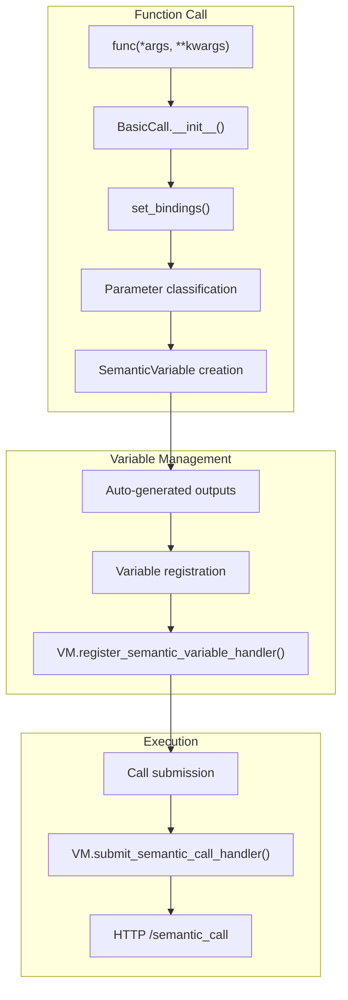

<!-- source: DeepWiki mcp.deepwiki.com · repo microsoft/ParrotServe · page 3.1 PFunc API · fetched 2026-10-26 -->

# PFunc API

<details>
<summary>Relevant source files</summary>

The following files were used as context for generating this wiki page:

- [.env-dev](.env-dev)
- [.gitignore](.gitignore)
- [CONTRIBUTING.md](CONTRIBUTING.md)
- [README.md](README.md)
- [TRANSPARENCY.md](TRANSPARENCY.md)
- [benchmark/bench_kernel.py](benchmark/bench_kernel.py)
- [docs/README.md](docs/README.md)
- [docs/get_started/launch_server.md](docs/get_started/launch_server.md)
- [docs/sys_design/serve_layer/graph.md](docs/sys_design/serve_layer/graph.md)
- [docs/user_docs/parrot_apis.md](docs/user_docs/parrot_apis.md)
- [docs/user_docs/pfunc.md](docs/user_docs/pfunc.md)
- [docs/version_drafts/v3.md](docs/version_drafts/v3.md)
- [parrot/__init__.py](parrot/__init__.py)
- [parrot/constants.py](parrot/constants.py)
- [parrot/engine/config.py](parrot/engine/config.py)
- [parrot/engine/engine_creator.py](parrot/engine/engine_creator.py)
- [parrot/frontend/pfunc/function.py](parrot/frontend/pfunc/function.py)
- [parrot/frontend/pfunc/interface.py](parrot/frontend/pfunc/interface.py)
- [parrot/frontend/pfunc/semantic_variable.py](parrot/frontend/pfunc/semantic_variable.py)
- [parrot/frontend/pfunc/vm.py](parrot/frontend/pfunc/vm.py)
- [parrot/serve/backend_repr/model.py](parrot/serve/backend_repr/model.py)
- [parrot/serve/config.py](parrot/serve/config.py)
- [parrot/serve/http_server.py](parrot/serve/http_server.py)
- [parrot/testing/localhost_server_daemon.py](parrot/testing/localhost_server_daemon.py)
- [requirements.txt](requirements.txt)
- [setup.py](setup.py)
- [tests/engine/builtin/test_llama.py](tests/engine/builtin/test_llama.py)
- [tests/engine/builtin/test_sampler.py](tests/engine/builtin/test_sampler.py)
- [tests/engine/test_engine.py](tests/engine/test_engine.py)
- [tests/engine/test_http_server.py](tests/engine/test_http_server.py)

</details>


This document provides detailed documentation of the PFunc (Parrot-Function) API decorators and interfaces for defining LLM applications. PFunc serves as the primary user-facing programming interface that transforms standard Python functions into Parrot semantic and native functions through decorators.

For information about the VirtualMachine session management, see [VirtualMachine](#3.2). For complete application examples, see [Example Applications](#3.3).

## Purpose and Scope

The PFunc API enables developers to define LLM-based applications using familiar Python syntax enhanced with special decorators and parameter annotations. The core functionality includes:

- `@P.semantic_function()` decorator for LLM-powered functions with prompt templates
- `@P.native_function()` decorator for Python functions that operate on semantic variables  
- Parameter annotations (`P.Input`, `P.Output`) for defining function interfaces
- Integration with the `SemanticVariable` abstraction for dependency tracking

## Core Decorators

### @semantic_function Decorator

The `semantic_function` decorator transforms a Python function into a `SemanticFunction` that executes prompts on LLM engines. The function's docstring serves as the prompt template with `{{placeholder}}` syntax for variable substitution.



**Decorator Implementation Flow**

Sources: [parrot/frontend/pfunc/interface.py:38-106](), [parrot/frontend/pfunc/function.py:225-271]()

The decorator accepts several parameters:
- `formatter`: Optional prompt formatting pipeline 
- `conversation_template`: Optional conversation template transformer
- `try_register`: Whether to automatically register with the VirtualMachine
- `**semantic_func_metadata`: Additional metadata like `remove_pure_fill`, `models`, etc.

### @native_function Decorator  

The `native_function` decorator creates a `PyNativeFunction` that executes Python code on the server side, operating on semantic variables as string content.



**Native Function Code Serialization**

Sources: [parrot/frontend/pfunc/interface.py:108-148](), [parrot/frontend/pfunc/function.py:461-486]()

## Parameter Annotations

### P.Input

The `Input` annotation marks function parameters as input semantic variables or Python objects. During function parsing, parameters are classified into:

- `ParamType.INPUT_LOC`: Semantic variable inputs that participate in dependency tracking
- `ParamType.INPUT_PYOBJ`: Regular Python objects converted to strings via `__str__()`

```python
def example_func(topic: P.Input, max_length: int):
    # topic becomes INPUT_LOC, max_length becomes INPUT_PYOBJ  
```

Sources: [parrot/frontend/pfunc/interface.py:23-25](), [parrot/frontend/pfunc/function_body.py:1-50]()

### P.Output

The `Output` annotation marks parameters as output locations where generated content will be stored. Output parameters can specify sampling configuration:

```python 
class Output:
    def __init__(self, sampling_config: Optional[SamplingConfig] = None):
        self.sampling_config = sampling_config
```

Output parameters are automatically assigned `SamplingConfig()` if not specified during semantic function creation.

Sources: [parrot/frontend/pfunc/interface.py:27-36](), [parrot/sampling_config.py:1-50]()

## SemanticVariable Integration

All `P.Input` and `P.Output` parameters are bound to `SemanticVariable` instances that provide:

- Automatic registration with the current VirtualMachine session
- Content storage and retrieval through `.get()` and `.set()` methods  
- Dependency tracking across function calls via variable IDs
- Performance criteria specification (`THROUGHPUT` vs `LATENCY`)



**SemanticVariable Lifecycle in Function Calls**

Sources: [parrot/frontend/pfunc/semantic_variable.py:15-142](), [parrot/frontend/pfunc/function.py:116-149]()

## Function Calling Patterns

### Synchronous Calls

Functions return `SemanticVariable` instances immediately, but content retrieval blocks until execution completes:

```python
joke = tell_me_a_joke(topic="programming")
content = joke.get()  # Blocks until LLM generates response
```

### Asynchronous Calls  

The `ainvoke()` method and `aget()` provide non-blocking execution:

```python
joke = await tell_me_a_joke.ainvoke(topic="programming") 
content = await joke.aget()  # Non-blocking retrieval
```

Sources: [parrot/frontend/pfunc/function.py:330-382](), [parrot/frontend/pfunc/semantic_variable.py:132-141]()

## Implementation Architecture



**PFunc API Architecture and Data Flow**

Sources: [parrot/frontend/pfunc/interface.py:1-165](), [parrot/frontend/pfunc/vm.py:183-273](), [parrot/serve/http_server.py:85-137]()

## Core Classes and Methods

| Class | Purpose | Key Methods |
|-------|---------|-------------|
| `SemanticFunction` | LLM-powered function with prompt template | `__call__()`, `ainvoke()`, `to_template_str()` |
| `PyNativeFunction` | Python function operating on semantic variables | `__call__()`, `get_pyfunc()` |
| `SemanticCall` | Represents a call to a semantic function | `to_request_payload()`, `update_var_ids()` |
| `SemanticVariable` | Container for text content with dependency tracking | `get()`, `aget()`, `set()` |
| `Parameter` | Function parameter with type and sampling config | `get_param_str()`, `is_output` |

Sources: [parrot/frontend/pfunc/function.py:34-600](), [parrot/frontend/pfunc/semantic_variable.py:15-142]()

## Examples

### Basic Semantic Function

```python
@P.semantic_function()
def tell_me_a_joke(topic: P.Input, joke: P.Output):
    """Tell me a joke about {{topic}}: {{joke}}."""

# Usage
joke_var = tell_me_a_joke(topic="programming")
joke_content = joke_var.get()
```

### Multi-Output Function

```python  
@P.semantic_function()
def analyze_code(
    code: P.Input, 
    summary: P.Output,
    issues: P.Output(sampling_config=SamplingConfig(max_gen_length=200))
):
    """Analyze this code: {{code}}
    
    Summary: {{summary}}
    Issues found: {{issues}}"""

# Usage returns tuple of SemanticVariables
summary, issues = analyze_code(code="def hello(): print('hi')")
```

### Native Function Usage

```python
@P.native_function()
def format_response(raw_text: P.Input, formatted: P.Output):
    cleaned = raw_text.strip().upper()
    formatted.set(f"RESULT: {cleaned}")

# Chain with semantic function
joke = tell_me_a_joke(topic="cats")
formatted_joke = format_response(joke)
final_result = formatted_joke.get()
```

Sources: [README.md:14-31](), [docs/user_docs/pfunc.md:16-72]()

# PFunc API

The PFunc API serves as the primary client programming interface for Parrot, enabling developers to define LLM applications using Python decorators and semantic variable abstractions. This document covers the `@semantic_function` and `@native_function` decorators that transform regular Python functions into Parrot-compatible functions.

For session management and execution context, see [VirtualMachine](#3.2). For complete application walkthroughs, see [Example Applications](#3.3).

## Purpose and Scope

PFunc (Parrot-Function) provides a Python-native way to define LLM applications through:

- **Semantic Functions**: LLM-powered functions using prompt templates with placeholder syntax
- **Native Functions**: Python functions that operate on semantic variables 
- **Parameter Annotations**: Type system for inputs (`P.Input`) and outputs (`P.Output`)
- **Semantic Variables**: Dependency-tracked containers for text content

The API abstracts away HTTP requests and session management while exposing application-level optimization opportunities to the Parrot system.

## Core Decorators

### @semantic_function Decorator

The `@P.semantic_function()` decorator transforms Python functions into `SemanticFunction` instances that execute LLM requests. The function's docstring becomes the prompt template, with `{{parameter}}` placeholders for variable substitution.



**Semantic Function Creation Pipeline**

The decorator implementation in [parrot/frontend/pfunc/interface.py:38-106]() performs:

1. **Parameter Analysis**: Uses `inspect.signature()` to extract function parameters
2. **Type Classification**: Maps annotations to `ParamType` enum values:
   - `P.Input` → `ParamType.INPUT_LOC` 
   - `P.Output` → `ParamType.OUTPUT_LOC`
   - No annotation → `ParamType.INPUT_PYOBJ`
3. **Template Parsing**: Converts docstring to `FuncBodyPiece` list via `parse_func_body()`
4. **Function Creation**: Instantiates `SemanticFunction` with parsed components

**Decorator Parameters**:
- `formatter`: Optional `Sequential` transformer for prompt formatting
- `conversation_template`: Optional `FuncMutator` for model-specific templates  
- `try_register`: Boolean to control automatic VM registration
- `**semantic_func_metadata`: Additional metadata (models, remove_pure_fill, etc.)

Sources: [parrot/frontend/pfunc/interface.py:38-106](), [parrot/frontend/pfunc/function.py:225-271]()

### @native_function Decorator

The `@P.native_function()` decorator creates `PyNativeFunction` instances that execute Python code server-side, operating on semantic variables as string content.



**Native Function Serialization Pipeline**

The implementation serializes the function's bytecode for server-side execution:

1. **Code Extraction**: Accesses `pyfunc.__code__` attribute
2. **Serialization**: Uses `marshal.dumps()` to convert bytecode to bytes
3. **Encoding**: Base64 encodes for HTTP transport
4. **Storage**: Stores in `PyNativeFunction.pyfunc_code_dumped`

Native functions execute in a sandboxed environment on the ServeCore, accessing semantic variables through their string content.

Sources: [parrot/frontend/pfunc/interface.py:108-148](), [parrot/frontend/pfunc/function.py:461-486](), [parrot/utils/serialize_utils.py:1-50]()

## Parameter Annotations

### P.Input Annotation

The `Input` class marks function parameters as semantic variable inputs. During parameter classification, `P.Input` parameters become `ParamType.INPUT_LOC`, enabling dependency tracking across function calls.

```python
class Input:
    """Annotate the Input semantic variable in the Parrot function signature."""
```

Input parameters can accept:
- **SemanticVariable instances**: Direct variable references for dependency chaining
- **Python objects**: Converted to string via `__str__()` and wrapped in new SemanticVariable

Sources: [parrot/frontend/pfunc/interface.py:23-25](), [parrot/frontend/pfunc/function.py:116-133]()

### P.Output Annotation

The `Output` class marks parameters as output locations where generated content will be stored. Output parameters optionally specify sampling configuration for LLM generation.

```python
class Output:
    def __init__(self, sampling_config: Optional[SamplingConfig] = None):
        self.sampling_config = sampling_config
```

Output parameters are automatically assigned default `SamplingConfig()` during `SemanticFunction` creation if not explicitly provided.

**Usage Patterns**:
```python
# Default sampling config
result: P.Output

# Custom sampling config  
result: P.Output(sampling_config=SamplingConfig(max_gen_length=100))
```

Sources: [parrot/frontend/pfunc/interface.py:27-36](), [parrot/sampling_config.py:1-50]()

## Function Body Parsing

Semantic functions use a template parsing system that converts docstrings into structured `FuncBodyPiece` sequences for execution.



**Template Parsing Process**

The `parse_func_body()` function in [parrot/frontend/pfunc/function.py:176-223]() implements:

1. **Regex Matching**: Uses pattern `{{[a-zA-Z_][a-zA-Z0-9_]*}}` to find placeholders
2. **Chunk Creation**: Alternates between `Constant` (text) and `ParameterLoc` (placeholder) pieces
3. **Validation**: Ensures placeholder names match declared parameters
4. **Output Constraints**: Prevents adjacent output locations and duplicate output usage

Sources: [parrot/frontend/pfunc/function.py:176-223](), [parrot/frontend/pfunc/function_body.py:1-50]()

## Function Calling Mechanics

### Call Creation and Binding

When a decorated function is called, it creates a `SemanticCall` or `PyNativeCall` instance that handles parameter binding and variable management.



**Parameter Binding Process**

The binding logic in [parrot/frontend/pfunc/function.py:77-149]() handles:

1. **Positional Arguments**: Mapped to input parameters in declaration order
2. **Keyword Arguments**: Mapped by parameter name, including pre-allocated outputs
3. **Output Creation**: Auto-generates `SemanticVariable` instances for unspecified outputs
4. **Type Conversion**: Converts Python objects to strings for `INPUT_PYOBJ` parameters

### Variable Registration and ID Assignment

SemanticVariables undergo registration and ID assignment during function execution:

```python
# Variable registration flow
var_id = vm.register_semantic_variable_handler(var_name)
semantic_variable.assign_id(var_id)

# Content retrieval  
content = vm.get_semantic_variable_handler(var_id, criteria)
```

The registration process enables dependency tracking and optimization in the ServeCore layer.

Sources: [parrot/frontend/pfunc/function.py:142-149](), [parrot/frontend/pfunc/semantic_variable.py:54-82]()

## Return Value Patterns

Functions return `SemanticVariable` instances or tuples based on output parameter count:

```python
# Single output - returns SemanticVariable
joke = tell_me_a_joke(topic="cats")

# Multiple outputs - returns tuple  
summary, analysis = analyze_text(content="Hello world")

# No outputs - returns empty tuple (rare)
```

The unpacking logic in [parrot/frontend/pfunc/function.py:360-364]() ensures consistent return patterns.

## Integration with VirtualMachine

PFunc functions require a `VirtualMachine` context for execution. The VM provides:

- **Session Management**: HTTP session with ServeCore
- **Variable Registration**: Semantic variable tracking
- **Request Submission**: HTTP API calls for function execution
- **Error Handling**: Graceful degradation when VM context unavailable

```python
vm = VirtualMachine(core_http_addr="http://localhost:9000")
with vm.running_scope():
    result = my_semantic_function(input_data)
    content = result.get()
```

Sources: [parrot/frontend/pfunc/vm.py:367-456](), [parrot/frontend/pfunc/function.py:55-62]()

## Core API Classes

| Class | File Location | Purpose |
|-------|---------------|---------|
| `SemanticFunction` | [parrot/frontend/pfunc/function.py:226-397]() | LLM-powered function with prompt template |
| `PyNativeFunction` | [parrot/frontend/pfunc/function.py:461-587]() | Python function operating on semantic variables |
| `SemanticCall` | [parrot/frontend/pfunc/function.py:399-456]() | Execution context for semantic function calls |
| `PyNativeCall` | [parrot/frontend/pfunc/function.py:589-620]() | Execution context for native function calls |
| `SemanticVariable` | [parrot/frontend/pfunc/semantic_variable.py:15-142]() | Variable container with dependency tracking |
| `Parameter` | [parrot/frontend/pfunc/function_body.py:15-50]() | Function parameter with type and sampling config |

Sources: [parrot/frontend/pfunc/function.py:1-650](), [parrot/frontend/pfunc/semantic_variable.py:1-142]()

---

