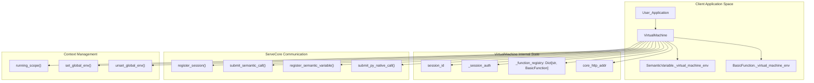
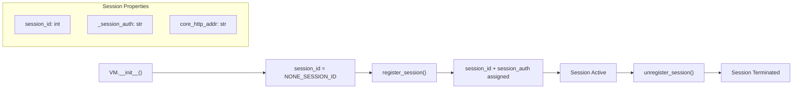
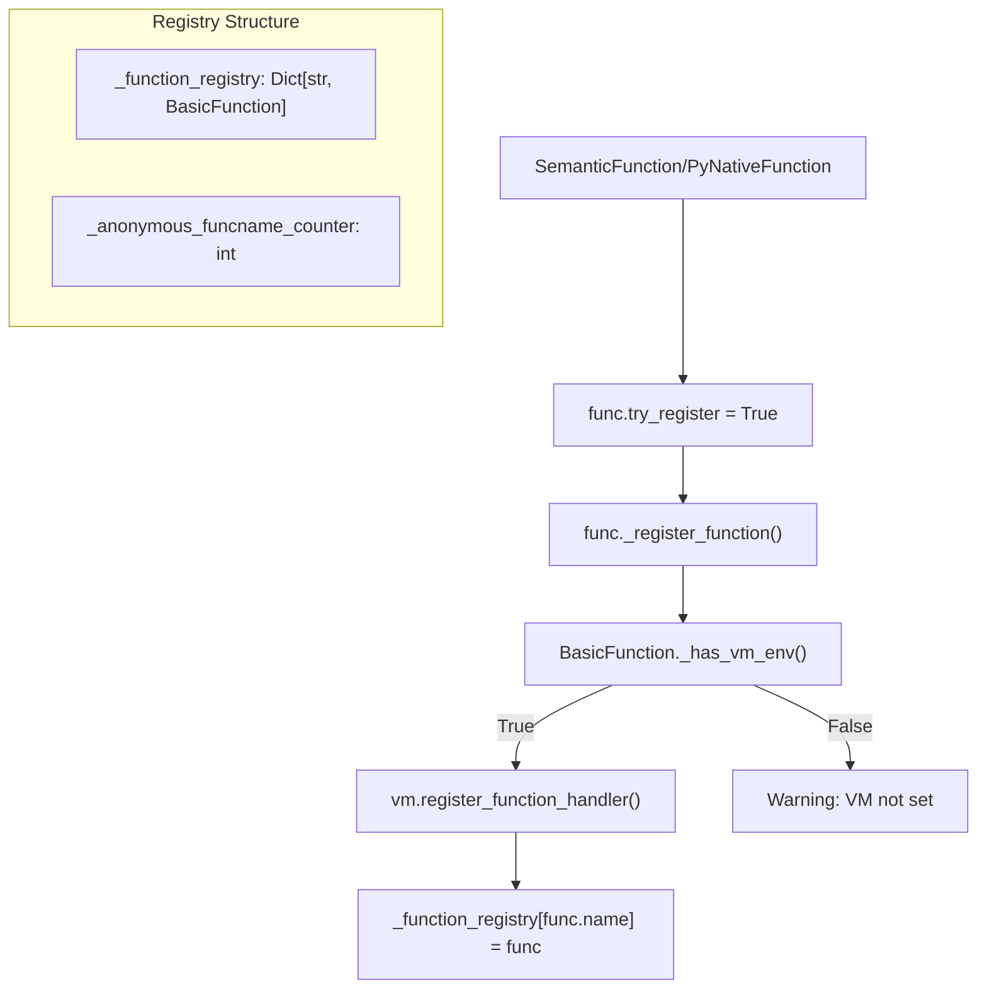
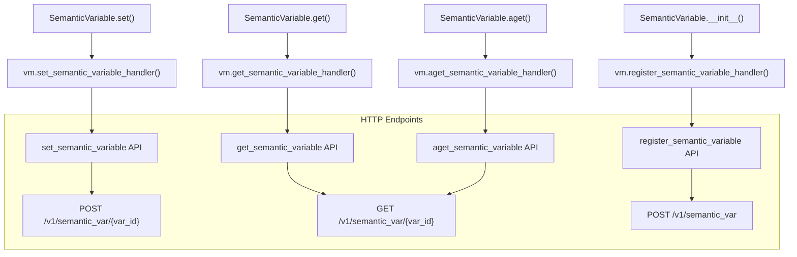
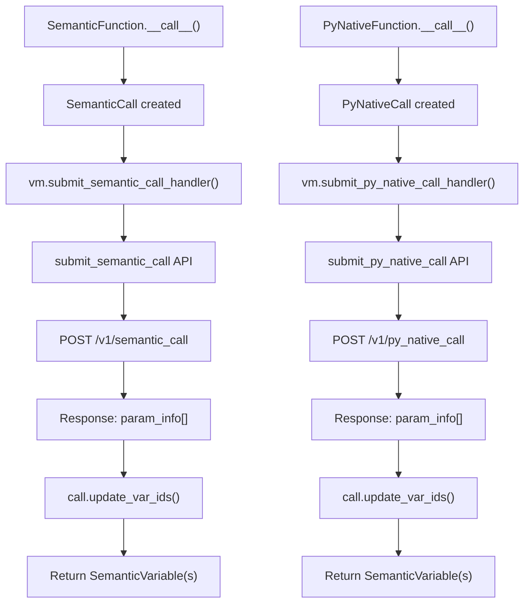
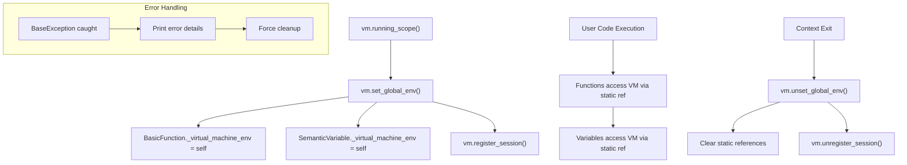
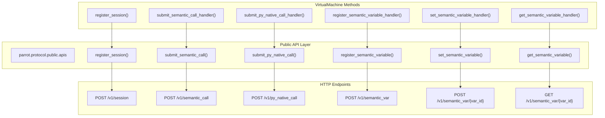

<!-- source: DeepWiki mcp.deepwiki.com · repo microsoft/ParrotServe · page 3.2 VirtualMachine · fetched 2026-10-26 -->

# VirtualMachine

Relevant source files

The following files were used as context for generating this wiki page:

- [parrot/__init__.py](parrot/__init__.py)
- [parrot/constants.py](parrot/constants.py)
- [parrot/engine/config.py](parrot/engine/config.py)
- [parrot/engine/engine_creator.py](parrot/engine/engine_creator.py)
- [parrot/frontend/pfunc/function.py](parrot/frontend/pfunc/function.py)
- [parrot/frontend/pfunc/interface.py](parrot/frontend/pfunc/interface.py)
- [parrot/frontend/pfunc/semantic_variable.py](parrot/frontend/pfunc/semantic_variable.py)
- [parrot/frontend/pfunc/vm.py](parrot/frontend/pfunc/vm.py)
- [parrot/serve/backend_repr/model.py](parrot/serve/backend_repr/model.py)
- [parrot/serve/config.py](parrot/serve/config.py)
- [parrot/serve/http_server.py](parrot/serve/http_server.py)
- [parrot/testing/localhost_server_daemon.py](parrot/testing/localhost_server_daemon.py)
- [tests/engine/builtin/test_llama.py](tests/engine/builtin/test_llama.py)
- [tests/engine/builtin/test_sampler.py](tests/engine/builtin/test_sampler.py)
- [tests/engine/test_engine.py](tests/engine/test_engine.py)
- [tests/engine/test_http_server.py](tests/engine/test_http_server.py)

The `VirtualMachine` class provides the client-side abstraction for session management and function execution in ParrotServe's semantic programming environment. It serves as the primary interface between user applications and the ServeCore layer, managing the lifecycle of sessions, function registrations, semantic variables, and execution contexts.

For information about the underlying PFunc API decorators and function definitions, see [PFunc API](#3.1). For examples of applications built using VirtualMachine, see [Example Applications](#3.3).

## Core Architecture

The VirtualMachine acts as a session proxy that maintains state and coordinates communication between client applications and the ServeCore. It implements the client-side portion of ParrotServe's distributed architecture.

### VirtualMachine Class Structure

Sources: [parrot/frontend/pfunc/vm.py:49-481](), [parrot/frontend/pfunc/semantic_variable.py:22](), [parrot/frontend/pfunc/function.py:37]()

## Session Management

The VirtualMachine manages user sessions with the ServeCore, handling registration, authentication, and cleanup. Each VM instance represents exactly one session in the distributed system.

### Session Lifecycle

| Method | Purpose | HTTP API Called |
|--------|---------|----------------|
| `register_session()` | Create new session with ServeCore | `POST /{API_VERSION}/session` |
| `unregister_session()` | Clean up session resources | `DELETE /{API_VERSION}/session/{session_id}` |
| `session_registered` | Check if session is active | Property check |

Sources: [parrot/frontend/pfunc/vm.py:281-308](), [parrot/constants.py:39](), [parrot/protocol/public/apis.py:15-27]()

## Function Registry

The VirtualMachine maintains a local registry of functions that can be called within the session context. This registry supports both semantic functions and native Python functions.

### Function Registration Process

The registry stores functions by name and prevents duplicate registrations. Anonymous functions receive auto-generated names using the counter.

Sources: [parrot/frontend/pfunc/vm.py:170-181](), [parrot/frontend/pfunc/function.py:55-62](), [parrot/frontend/pfunc/vm.py:318-337]()

## Semantic Variable Operations

The VirtualMachine provides handlers for semantic variable lifecycle management, acting as the bridge between client-side `SemanticVariable` objects and server-side variable storage.

### Variable Handler Methods

| Handler Method | Purpose | Returns |
|----------------|---------|---------|
| `register_semantic_variable_handler()` | Register new variable with ServeCore | `var_id: str` |
| `set_semantic_variable_handler()` | Set variable content | `None` |
| `get_semantic_variable_handler()` | Fetch variable content (blocking) | `content: str` |
| `aget_semantic_variable_handler()` | Fetch variable content (async) | `content: str` |

Sources: [parrot/frontend/pfunc/vm.py:85-168](), [parrot/frontend/pfunc/semantic_variable.py:54-93]()

## Call Handling

The VirtualMachine processes function calls by converting them into HTTP requests to the ServeCore and managing the response data for variable ID assignments.

### Call Submission Flow

Both semantic and native calls follow similar patterns:
1. Create call object with function and arguments
2. Submit to ServeCore via VM handler
3. Receive parameter info with variable IDs
4. Update local SemanticVariable objects with server-assigned IDs
5. Return variables to caller

Sources: [parrot/frontend/pfunc/vm.py:183-273](), [parrot/frontend/pfunc/function.py:275-382](), [parrot/frontend/pfunc/function.py:487-575]()

## Execution Context Management

The VirtualMachine provides a context manager that establishes the global environment for semantic programming execution, ensuring proper setup and teardown of system state.

### Global Environment Setup

### VM Execution Methods

| Method | Purpose | Usage |
|--------|---------|-------|
| `set_global_env()` | Establish VM as global context | Called at scope entry |
| `unset_global_env()` | Clear global context | Called at scope exit |
| `running_scope()` | Context manager for execution | `with vm.running_scope():` |
| `run()` | Execute program with context | Both sync/async functions |
| `profile()` | Benchmark program execution | Performance measurement |

The context manager handles both synchronous and asynchronous program execution, automatically managing event loops for coroutine-based programs.

Sources: [parrot/frontend/pfunc/vm.py:367-481](), [parrot/frontend/pfunc/vm.py:420-456]()

## API Integration

The VirtualMachine integrates with ServeCore through a comprehensive set of HTTP APIs, providing seamless communication between client and server components.

### HTTP Communication Architecture

All HTTP communication includes session authentication via `session_id` and `session_auth` parameters, ensuring proper isolation between different VM instances.

Sources: [parrot/frontend/pfunc/vm.py:57-61](), [parrot/protocol/public/apis.py](), [parrot/serve/http_server.py:66-143]()

---

