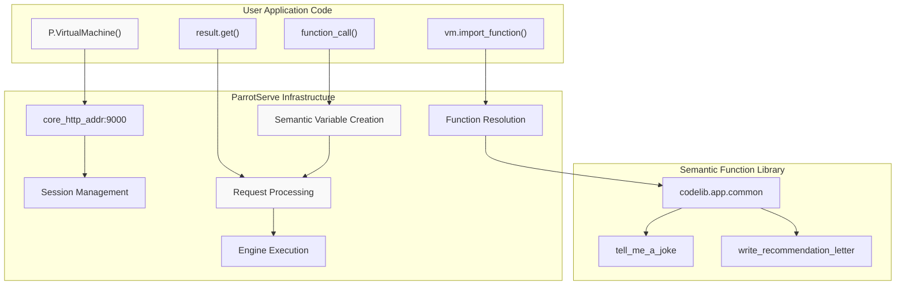
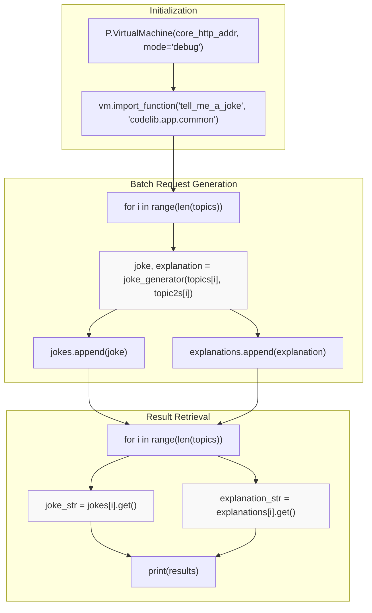
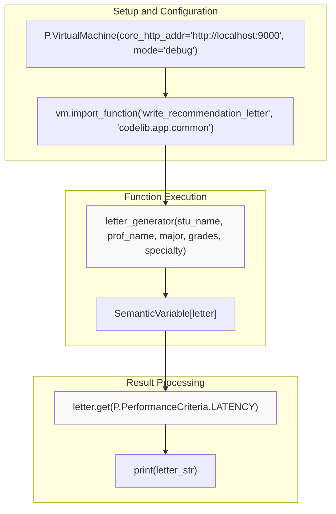
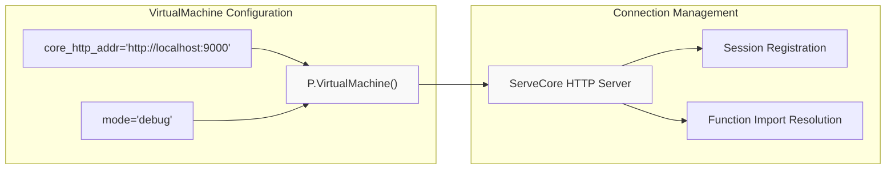

<!-- source: DeepWiki mcp.deepwiki.com · repo microsoft/ParrotServe · page 3.3 Example Applications · fetched 2026-10-26 -->

# Example Applications

<details>
<summary>Relevant source files</summary>

The following files were used as context for generating this wiki page:

- [examples/tell_me_a_joke.py](examples/tell_me_a_joke.py)
- [examples/write_recommendation_letter.py](examples/write_recommendation_letter.py)

</details>


This page demonstrates how to build applications using ParrotServe's client programming interface through real-world examples. The examples show how to use the `P.VirtualMachine` abstraction and semantic functions to create LLM-powered applications with automatic optimization and parallelization.

For detailed information about the underlying programming abstractions, see [PFunc API](#3.1) and [VirtualMachine](#3.2). For information about how these applications are executed by the system, see [Request Processing Pipeline](#2.3).

## Overview

ParrotServe includes several example applications that demonstrate key features:

| Application | File | Purpose | Key Features |
|-------------|------|---------|--------------|
| Joke Generator | `examples/tell_me_a_joke.py` | Generate jokes and explanations | Batch processing, semantic variables, async execution |
| Recommendation Letter | `examples/write_recommendation_letter.py` | Generate academic recommendation letters | Performance criteria, single function calls |

## Application Architecture Pattern

All example applications follow a consistent pattern that leverages ParrotServe's semantic programming model:



**Sources:** [examples/tell_me_a_joke.py:10-20](), [examples/write_recommendation_letter.py:8-18]()

## Joke Generator Application

The joke generator demonstrates batch processing and asynchronous semantic variable handling. It generates multiple jokes simultaneously and retrieves results efficiently.

### Application Flow



**Sources:** [examples/tell_me_a_joke.py:13-57]()

### Key Implementation Details

The joke generator showcases several important patterns:

#### Batch Processing
The application processes multiple topics simultaneously by calling the semantic function in a loop [examples/tell_me_a_joke.py:42-45](). This creates multiple semantic variables that can be executed in parallel by the ParrotServe runtime.

#### Semantic Variable Management
The application demonstrates proper semantic variable lifecycle:
- **Creation Phase**: Semantic variables are created through function calls [examples/tell_me_a_joke.py:43]()
- **Collection Phase**: Variables are stored in lists for batch management [examples/tell_me_a_joke.py:44-45]()
- **Retrieval Phase**: Results are retrieved using `.get()` method [examples/tell_me_a_joke.py:48,54]()

#### Topic Configuration
The application uses predefined topic lists for demonstration:
```python
topics = ["student", "machine learning", "human being", "a programmer", "a mathematician", "a physicist"]
topic2s = ["homework", "monkey", "robot", "bug", "iPhone", "cat"]
```

**Sources:** [examples/tell_me_a_joke.py:23-38]()

## Recommendation Letter Application

The recommendation letter generator demonstrates single function calls and performance criteria specification.

### Application Structure



**Sources:** [examples/write_recommendation_letter.py:10-34]()

### Performance Criteria Usage

The recommendation letter application demonstrates explicit performance optimization by specifying `P.PerformanceCriteria.LATENCY` when retrieving results [examples/write_recommendation_letter.py:29](). This instructs ParrotServe to optimize for response time rather than throughput.

### Parameter Passing

The application shows how to pass structured parameters to semantic functions:

| Parameter | Value | Purpose |
|-----------|-------|---------|
| `stu_name` | "John" | Student name |
| `prof_name` | "Prof. Smith" | Professor name |  
| `major` | "Computer Science" | Academic major |
| `grades` | "3.8" | GPA information |
| `specialty` | Basketball team leadership | Special achievements |

**Sources:** [examples/write_recommendation_letter.py:21-27]()

## VirtualMachine Configuration

Both applications use identical `P.VirtualMachine` configuration patterns:



**Sources:** [examples/tell_me_a_joke.py:13-16](), [examples/write_recommendation_letter.py:10-13]()

### Configuration Parameters

- **`core_http_addr`**: Specifies the ServeCore endpoint URL for client-server communication
- **`mode="debug"`**: Enables debug mode for enhanced logging and error reporting during development

## Function Import Pattern

Both applications use the `vm.import_function()` method to resolve semantic functions from the shared codebase:

```python
# Joke generator
joke_generator = vm.import_function("tell_me_a_joke", "codelib.app.common")

# Recommendation letter
letter_generator = vm.import_function("write_recommendation_letter", "codelib.app.common")
```

This pattern allows applications to reference semantic functions defined in the `codelib.app.common` module without direct imports, enabling dynamic function resolution through the ParrotServe runtime.

**Sources:** [examples/tell_me_a_joke.py:19](), [examples/write_recommendation_letter.py:15-17]()

## Execution Model

Both applications use the `vm.run()` method to execute their main logic within the ParrotServe runtime environment:

```python
vm.run(main)
```

This execution model ensures proper session management and resource cleanup while providing access to the semantic programming environment.

**Sources:** [examples/tell_me_a_joke.py:57](), [examples/write_recommendation_letter.py:34]()

---

