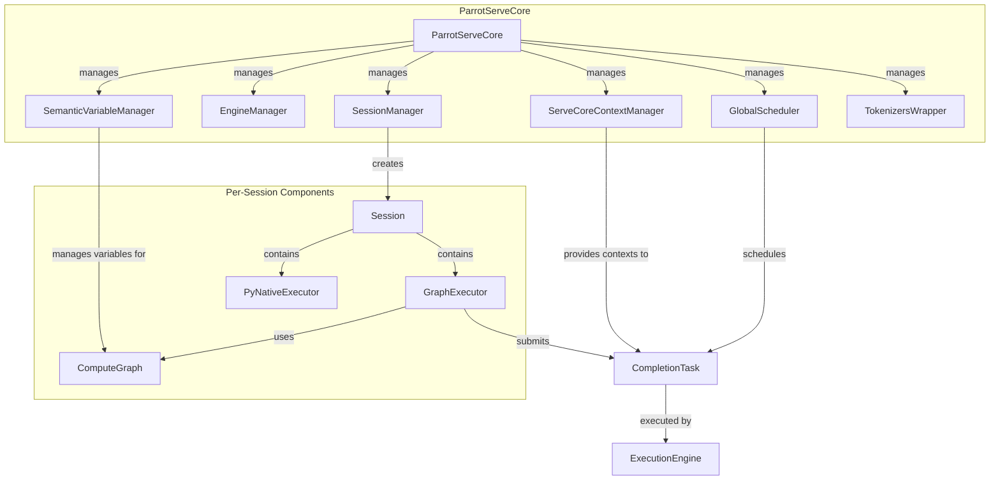
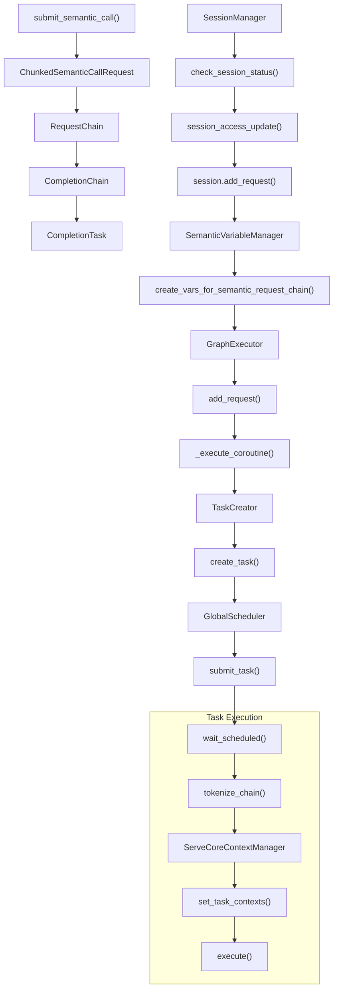
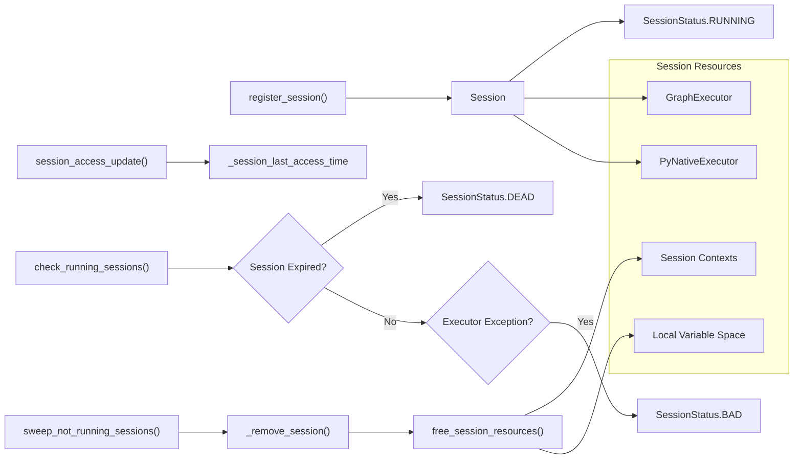
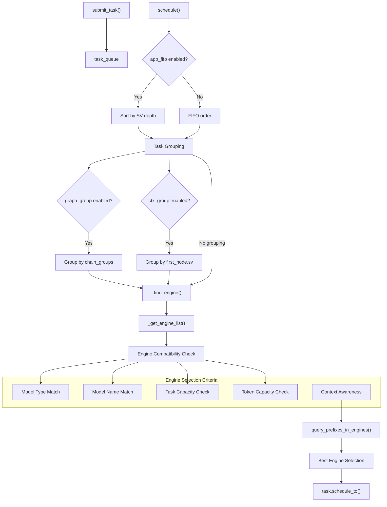
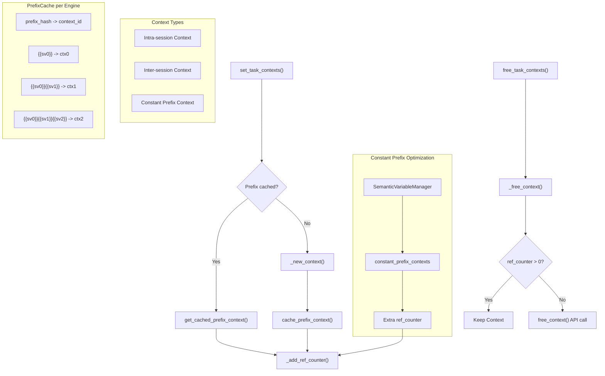
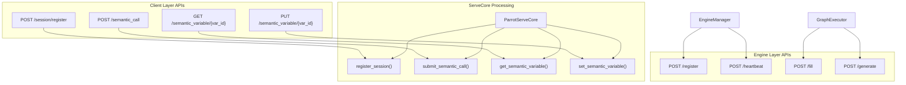

<!-- source: DeepWiki mcp.deepwiki.com · repo microsoft/ParrotServe · page 4 ServeCore Layer · fetched 2026-10-26 -->

# ServeCore Layer

Relevant source files

The following files were used as context for generating this wiki page:

- [parrot/serve/backend_repr/engine.py](parrot/serve/backend_repr/engine.py)
- [parrot/serve/context_manager.py](parrot/serve/context_manager.py)
- [parrot/serve/core.py](parrot/serve/core.py)
- [parrot/serve/engine_manager.py](parrot/serve/engine_manager.py)
- [parrot/serve/scheduler/__init__.py](parrot/serve/scheduler/__init__.py)
- [parrot/serve/scheduler/completion_task.py](parrot/serve/scheduler/completion_task.py)
- [parrot/serve/scheduler/global_scheduler.py](parrot/serve/scheduler/global_scheduler.py)
- [parrot/serve/session/graph_executor.py](parrot/serve/session/graph_executor.py)
- [parrot/serve/session/session.py](parrot/serve/session/session.py)
- [parrot/serve/session_manager.py](parrot/serve/session_manager.py)
- [parrot/serve/variable_manager.py](parrot/serve/variable_manager.py)
- [tests/serve/test_context.py](tests/serve/test_context.py)
- [tests/serve/test_graph.py](tests/serve/test_graph.py)
- [tests/serve/test_prefix_matcher.py](tests/serve/test_prefix_matcher.py)
- [tests/serve/test_session.py](tests/serve/test_session.py)
- [tests/serve/test_sv.py](tests/serve/test_sv.py)
- [tests/serve/test_tokenizer.py](tests/serve/test_tokenizer.py)

The ServeCore layer is the central orchestration component of ParrotServe, responsible for coordinating all distributed LLM serving operations. It acts as the intermediary between client applications and the engine layer, managing sessions, scheduling computation graphs, and optimizing resource utilization through sophisticated context management.

For information about the client-facing programming interfaces, see [Client Programming Interface](#3). For details about the backend LLM engines, see [Engine Layer](#5).

## Overview

The ServeCore layer implements a distributed orchestration architecture centered around the `ParrotServeCore` class. It manages multiple concurrent user sessions, each containing computation graphs that represent LLM request dependencies. The core innovation is its ability to automatically parallelize and optimize LLM requests through semantic variable abstraction and shared context management.

**Core Components Architecture**

Sources: [parrot/serve/core.py:34-89](), [parrot/serve/session/session.py:43-84](), [parrot/serve/session/graph_executor.py:32-60]()

## Request Processing Pipeline

The ServeCore processes requests through a multi-stage pipeline that transforms client semantic function calls into schedulable engine tasks. This pipeline enables automatic parallelization and optimization of LLM requests.

**Request Flow Through ServeCore**

Sources: [parrot/serve/core.py:198-225](), [parrot/serve/session/session.py:103-134](), [parrot/serve/session/graph_executor.py:103-116]()

The pipeline handles both semantic function calls and Python native function calls through separate but parallel processing paths. Each request is converted into a computation graph where nodes represent either constant text fills or placeholder generations.

| Stage | Component | Responsibility |
|-------|-----------|----------------|
| Request Parsing | `ChunkedSemanticCallRequest` | Parse template and parameters |
| Graph Construction | `RequestChain` | Convert to node sequence |
| Variable Assignment | `SemanticVariableManager` | Create/assign semantic variables |
| Task Creation | `TaskCreator` | Create schedulable tasks |
| Scheduling | `GlobalScheduler` | Assign tasks to engines |
| Context Assignment | `ServeCoreContextManager` | Optimize memory usage |
| Execution | `GraphExecutor` | Execute Fill/Generate primitives |

## Session Management

The `SessionManager` maintains isolated execution environments for each connected client application. Sessions provide namespace isolation for semantic variables while enabling global optimizations across sessions through shared constant prefixes.

**Session Lifecycle Management**

Sources: [parrot/serve/session_manager.py:22-156](), [parrot/serve/session/session.py:192-208]()

Each session contains its own `GraphExecutor` for managing computation graphs and `PyNativeExecutor` for Python function execution. Sessions automatically expire after a configurable timeout period, triggering cleanup of all associated resources including contexts and semantic variables.

## Global Task Scheduling 

The `GlobalScheduler` implements sophisticated algorithms to distribute completion tasks across available engines while considering model compatibility, capacity constraints, and context optimization opportunities.

**Scheduling Algorithm Flow**

Sources: [parrot/serve/scheduler/global_scheduler.py:32-254](), [parrot/serve/scheduler/completion_task.py:66-76]()

The scheduler supports multiple optimization strategies:

- **Application FIFO**: Prioritizes tasks by semantic variable depth to minimize end-to-end latency
- **Graph Grouping**: Batches tasks sharing common chain groups for improved throughput  
- **Context Grouping**: Batches tasks with shared prefixes to leverage cached contexts
- **Context Awareness**: Prefers engines already containing relevant cached prefixes

## Context Management and Optimization

The `ServeCoreContextManager` implements advanced memory management through prefix caching and reference counting. It enables significant performance improvements by sharing cached KV contexts across requests and sessions.

**Context Sharing and Caching Strategy**

Sources: [parrot/serve/context_manager.py:77-379](), [parrot/serve/variable_manager.py:154-164]()

The context manager implements several key optimizations:

- **Prefix Hashing**: Maps content-based hashes to cached contexts using format `{{var_id}}{{var_id2}}`
- **Reference Counting**: Tracks context usage across multiple tasks and sessions  
- **Constant Prefix Variables**: Maintains global cache for frequently used text prefixes
- **Hierarchical Context Forking**: Creates parent-child context relationships for efficient memory usage

## Integration Points

The ServeCore coordinates with other system layers through well-defined interfaces:

**Layer Communication Protocols**

Sources: [parrot/serve/core.py:99-133](), [parrot/serve/core.py:198-331](), [parrot/serve/session/graph_executor.py:158-241]()

The ServeCore maintains engine connectivity through heartbeat monitoring and automatic failure detection. When engines become unresponsive, the `EngineManager` marks them as dead and removes them from the scheduling pool, ensuring system resilience.

| Interface | Direction | Purpose |
|-----------|-----------|---------|
| HTTP REST APIs | Client → ServeCore | Session and variable management |
| Primitive APIs | ServeCore → Engine | Fill/Generate/Free operations |
| Registration | Engine → ServeCore | Engine discovery and capabilities |
| Heartbeat | Engine → ServeCore | Health monitoring and runtime info |

---

