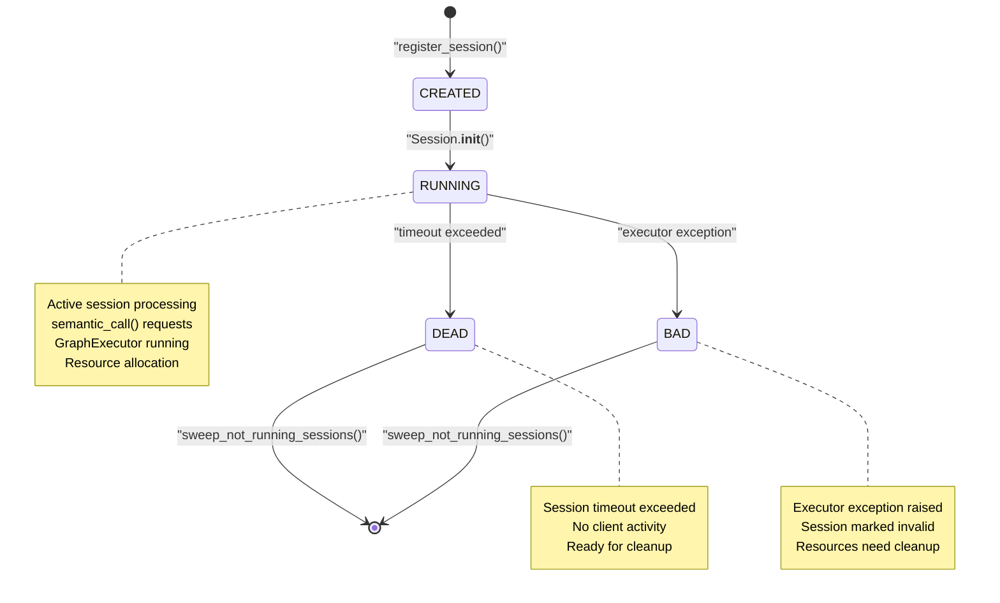
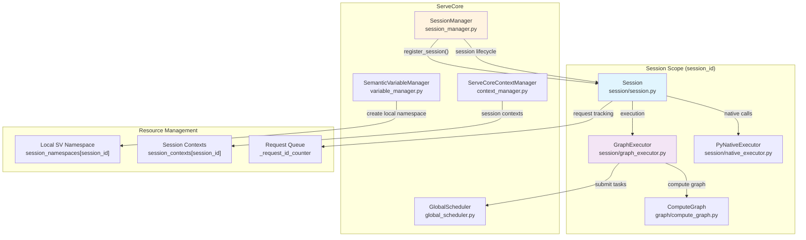
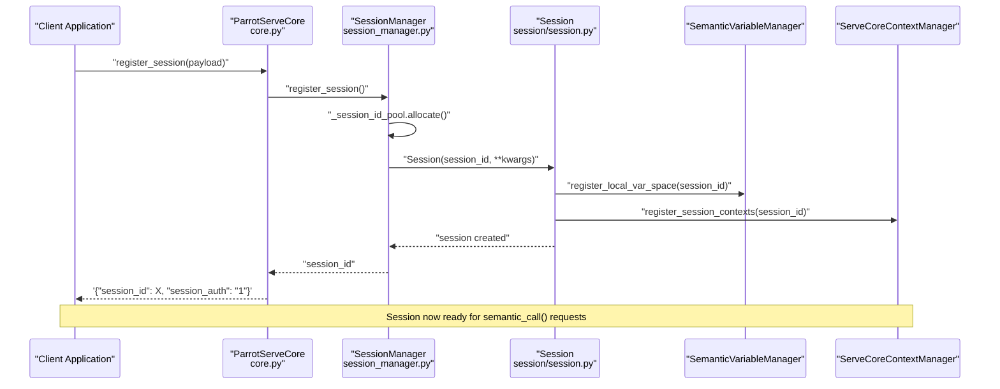
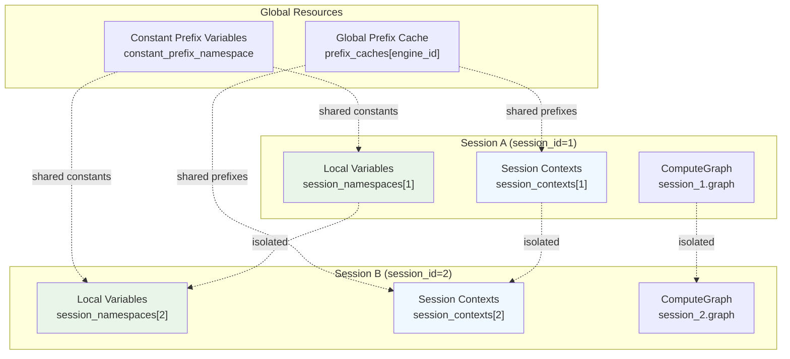
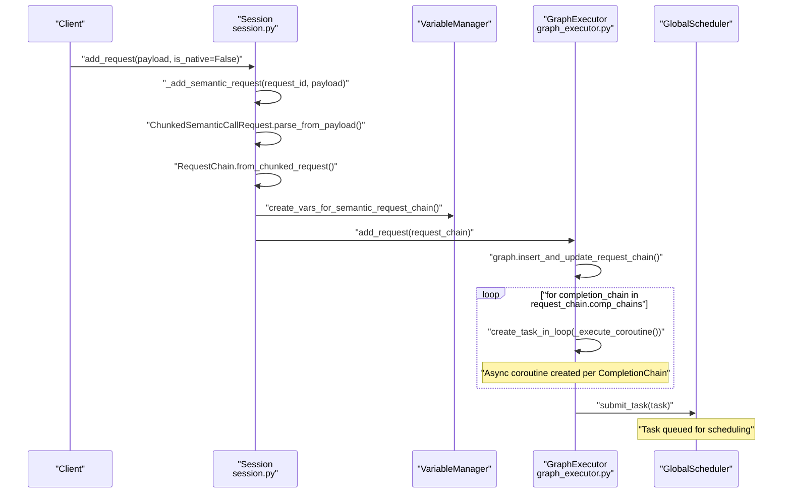
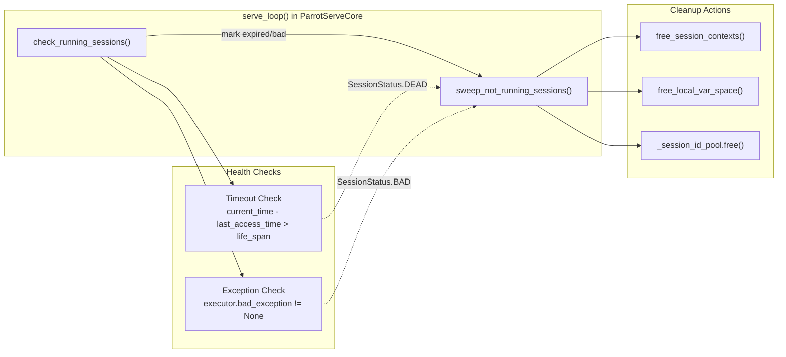

<!-- source: DeepWiki mcp.deepwiki.com · repo microsoft/ParrotServe · page 4.1 Session Management · fetched 2026-10-26 -->

# Session Management

Relevant source files

The following files were used as context for generating this wiki page:

- [parrot/serve/backend_repr/engine.py](parrot/serve/backend_repr/engine.py)
- [parrot/serve/context_manager.py](parrot/serve/context_manager.py)
- [parrot/serve/core.py](parrot/serve/core.py)
- [parrot/serve/engine_manager.py](parrot/serve/engine_manager.py)
- [parrot/serve/scheduler/__init__.py](parrot/serve/scheduler/__init__.py)
- [parrot/serve/scheduler/completion_task.py](parrot/serve/scheduler/completion_task.py)
- [parrot/serve/scheduler/global_scheduler.py](parrot/serve/scheduler/global_scheduler.py)
- [parrot/serve/session/graph_executor.py](parrot/serve/session/graph_executor.py)
- [parrot/serve/session/session.py](parrot/serve/session/session.py)
- [parrot/serve/session_manager.py](parrot/serve/session_manager.py)
- [parrot/serve/variable_manager.py](parrot/serve/variable_manager.py)
- [tests/serve/test_context.py](tests/serve/test_context.py)
- [tests/serve/test_graph.py](tests/serve/test_graph.py)
- [tests/serve/test_prefix_matcher.py](tests/serve/test_prefix_matcher.py)
- [tests/serve/test_session.py](tests/serve/test_session.py)
- [tests/serve/test_sv.py](tests/serve/test_sv.py)
- [tests/serve/test_tokenizer.py](tests/serve/test_tokenizer.py)

Session Management handles the lifecycle, isolation, and resource management of user sessions within ParrotServe. A session represents a stateful connection from a client application and provides an isolated execution environment for semantic function calls and compute graph operations. For information about the overall ServeCore architecture, see [ServeCore Layer](#4). For details about graph execution algorithms, see [Graph Execution](#4.2).

## Session Lifecycle Overview

Sessions in ParrotServe follow a managed lifecycle from registration through execution to cleanup. The `SessionManager` coordinates session creation and tracks session health, while individual `Session` objects encapsulate execution state and resources.

### Session Lifecycle States

Sources: [parrot/serve/session/session.py:37-41](), [parrot/serve/session_manager.py:127-147]()

## Session Management Architecture

The session management system consists of a two-tier architecture with global session coordination and per-session execution environments.

Sources: [parrot/serve/core.py:79-88](), [parrot/serve/session/session.py:51-84](), [parrot/serve/session_manager.py:22-38]()

### Core Session Management Components

| Component | Responsibility | Key Methods |
|-----------|---------------|-------------|
| `SessionManager` | Global session coordination | `register_session()`, `remove_session()`, `check_running_sessions()` |
| `Session` | Per-session execution environment | `add_request()`, `free_session_resources()` |
| `GraphExecutor` | Compute graph execution | `add_request()`, `_execute_coroutine()` |
| `PyNativeExecutor` | Python native function execution | `add_native_func()`, `_execute_native_func()` |

Sources: [parrot/serve/session_manager.py:49-156](), [parrot/serve/session/session.py:43-208]()

## Session Registration and Authentication

Session registration follows a simple token-based authentication model with automatic ID allocation and resource initialization.

The session registration process allocates a unique `session_id` from a `RecyclePool` and initializes isolated resource namespaces for variables and contexts.

Sources: [parrot/serve/core.py:138-149](), [parrot/serve/session_manager.py:49-65](), [parrot/serve/session/session.py:192-194]()

## Session Isolation and Resource Management

Each session maintains isolated namespaces for semantic variables and execution contexts to prevent cross-session interference.

### Resource Isolation Model

### Session Resource Types

- **Local Variable Namespace**: Session-scoped semantic variables created via `SemanticVariableManager.session_namespaces[session_id]`
- **Session Contexts**: Execution contexts managed through `ServeCoreContextManager.session_contexts[session_id]`
- **Compute Graph**: Per-session DAG tracking request dependencies in `GraphExecutor.graph`
- **Request Counter**: Monotonic request ID generation via `Session._request_id_counter`

Sources: [parrot/serve/variable_manager.py:142-143](), [parrot/serve/context_manager.py:91-92](), [parrot/serve/session/session.py:89-91]()

## Request Processing Within Sessions

Sessions handle two types of requests: semantic function calls processed through `GraphExecutor` and Python native function calls processed through `PyNativeExecutor`.

### Semantic Request Processing Flow

Sources: [parrot/serve/session/session.py:103-134](), [parrot/serve/session/graph_executor.py:103-115]()

### Session Request Lifecycle

1. **Request Parsing**: Convert HTTP payload to `ChunkedSemanticCallRequest` [parrot/serve/session/session.py:105-109]()
2. **Chain Construction**: Build `RequestChain` with fill/generate nodes [parrot/serve/session/session.py:114]()
3. **Variable Assignment**: Create semantic variables in session namespace [parrot/serve/session/session.py:117-119]()
4. **Graph Insertion**: Add request to session's compute graph [parrot/serve/session/graph_executor.py:111]()
5. **Async Execution**: Create coroutines for each completion chain [parrot/serve/session/graph_executor.py:114-115]()

## Session Expiration and Cleanup

Sessions are automatically cleaned up based on configurable timeouts and health monitoring performed by the `SessionManager`.

### Session Health Monitoring

### Session Cleanup Process

When a session is marked for removal, the cleanup process ensures all allocated resources are properly freed:

1. **Context Cleanup**: Free all session contexts via `ServeCoreContextManager.free_session_contexts()` [parrot/serve/session/session.py:200]()
2. **Variable Cleanup**: Remove local variable namespace via `SemanticVariableManager.free_local_var_space()` [parrot/serve/session/session.py:203]()
3. **ID Recycling**: Return session ID to pool via `SessionManager._session_id_pool.free()` [parrot/serve/session_manager.py:43]()

Sources: [parrot/serve/core.py:339-353](), [parrot/serve/session_manager.py:127-156](), [parrot/serve/session/session.py:196-207]()

### Session Configuration Parameters

| Parameter | Purpose | Default/Range |
|-----------|---------|---------------|
| `life_span` | Session timeout in seconds | Configurable per deployment |
| `session_id` | Unique identifier from `RecyclePool` | Auto-allocated integer |
| `session_auth` | Simple authentication token | Currently hardcoded as "1" |

Sources: [parrot/serve/session/session.py:64-65](), [parrot/serve/core.py:149]()

---

