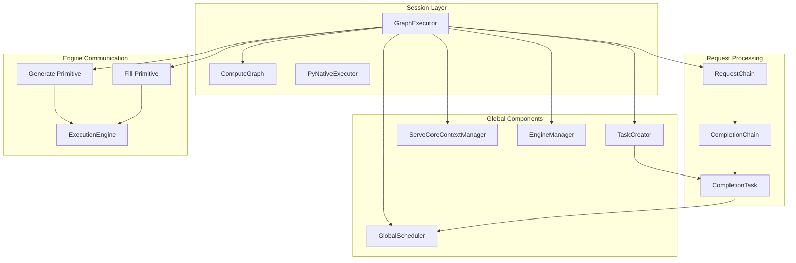
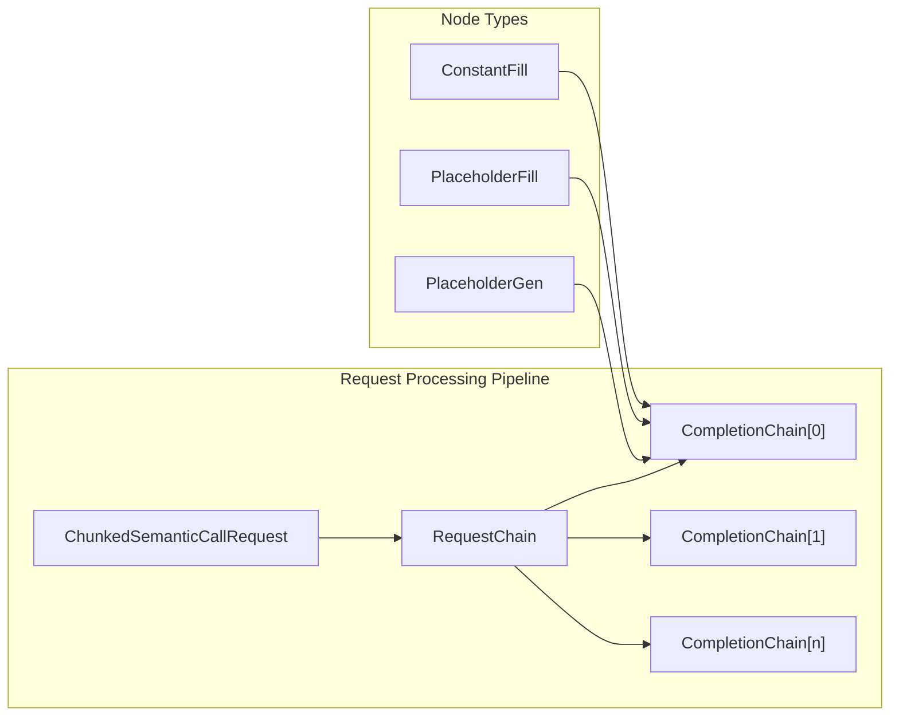
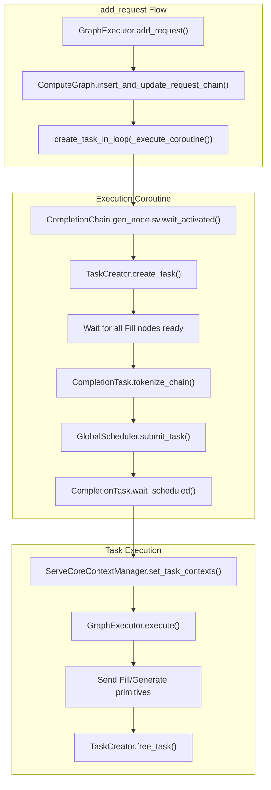
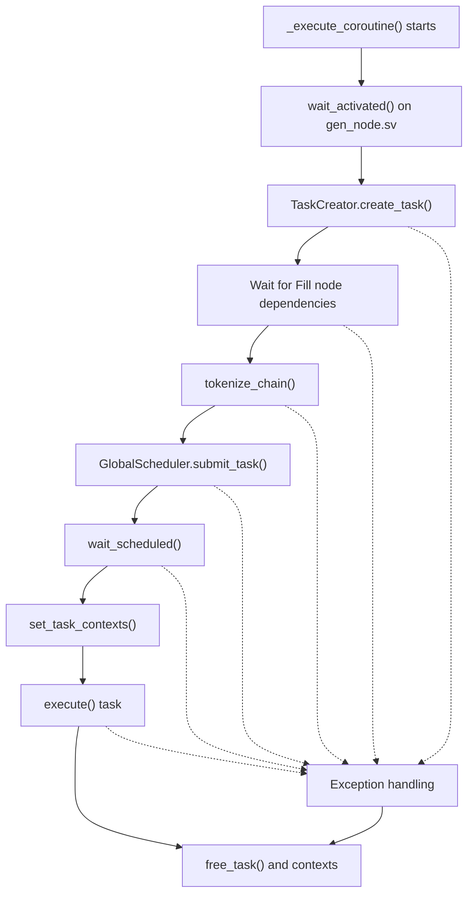
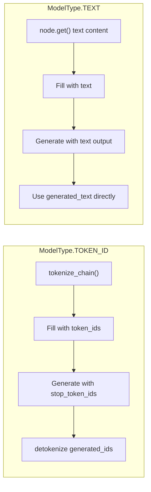
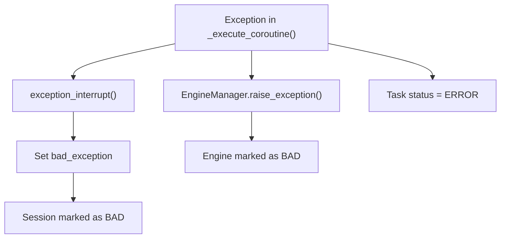

<!-- source: DeepWiki mcp.deepwiki.com · repo microsoft/ParrotServe · page 4.2 Graph Execution · fetched 2026-10-26 -->

# Graph Execution

Relevant source files

The following files were used as context for generating this wiki page:

- [parrot/protocol/public/apis.py](parrot/protocol/public/apis.py)
- [parrot/serve/backend_repr/engine.py](parrot/serve/backend_repr/engine.py)
- [parrot/serve/context_manager.py](parrot/serve/context_manager.py)
- [parrot/serve/core.py](parrot/serve/core.py)
- [parrot/serve/engine_manager.py](parrot/serve/engine_manager.py)
- [parrot/serve/graph/__init__.py](parrot/serve/graph/__init__.py)
- [parrot/serve/graph/graph.py](parrot/serve/graph/graph.py)
- [parrot/serve/graph/graph_traverse.py](parrot/serve/graph/graph_traverse.py)
- [parrot/serve/graph/semantic_variable.py](parrot/serve/graph/semantic_variable.py)
- [parrot/serve/graph/visualize_utils.py](parrot/serve/graph/visualize_utils.py)
- [parrot/serve/scheduler/__init__.py](parrot/serve/scheduler/__init__.py)
- [parrot/serve/scheduler/completion_task.py](parrot/serve/scheduler/completion_task.py)
- [parrot/serve/scheduler/global_scheduler.py](parrot/serve/scheduler/global_scheduler.py)
- [parrot/serve/scheduler/task_creator.py](parrot/serve/scheduler/task_creator.py)
- [parrot/serve/session/graph_executor.py](parrot/serve/session/graph_executor.py)
- [parrot/serve/session/session.py](parrot/serve/session/session.py)
- [parrot/serve/session_manager.py](parrot/serve/session_manager.py)
- [parrot/serve/variable_manager.py](parrot/serve/variable_manager.py)
- [parrot/testing/fake_core_server.py](parrot/testing/fake_core_server.py)
- [tests/serve/test_scheduler.py](tests/serve/test_scheduler.py)
- [tests/test_protocol.py](tests/test_protocol.py)

This document covers the compute graph construction, execution, and dependency management within ParrotServe's session layer. The `GraphExecutor` is responsible for coordinating the execution of LLM computation graphs by converting requests into schedulable tasks and managing their lifecycle through primitive operations.

For information about the overall session management, see [Session Management](#4.1). For details about the global scheduling algorithms, see [Global Scheduling](#4.3). For context management and KV cache optimization, see [Context Management](#4.4).

## Architecture Overview

The graph execution system operates within individual sessions and coordinates with the global scheduler to execute computation graphs efficiently.

**Graph Execution Architecture**: The `GraphExecutor` manages computation graphs within sessions, converting request chains into tasks and coordinating with global components for execution.

Sources: [parrot/serve/session/graph_executor.py:32-60](), [parrot/serve/core.py:34-89]()

## Core Components

### GraphExecutor Class

The `GraphExecutor` is the central orchestrator for graph execution within a session. It maintains a `ComputeGraph` and coordinates with global components to execute computation chains.

| Component | Type | Purpose |
|-----------|------|---------|
| `session_id` | int | Session identifier for this executor |
| `graph` | `ComputeGraph` | The computation graph for this session |
| `task_creator` | `TaskCreator` | Creates schedulable tasks from completion chains |
| `scheduler` | `GlobalScheduler` | Global task scheduler |
| `engine_mgr` | `EngineManager` | Manages available execution engines |
| `context_mgr` | `ServeCoreContextManager` | Manages KV cache contexts |
| `tokenizers_wrapper` | `TokenizersWrapper` | Handles tokenization for different models |

Sources: [parrot/serve/session/graph_executor.py:38-56]()

### Request Chain Processing

Request chains represent the structured breakdown of LLM requests into semantic components that can be executed as computation graphs.

**Request Chain Processing**: Requests are parsed into chains containing different node types, which are then grouped into completion chains for scheduling.

Sources: [parrot/serve/graph/graph.py:157-252](), [parrot/serve/session/graph_executor.py:103-116]()

## Execution Flow

The graph execution follows a precise pipeline from request submission to primitive execution on engines.

**Graph Execution Flow**: The complete flow from request addition through task creation, scheduling, and execution.

Sources: [parrot/serve/session/graph_executor.py:103-116](), [parrot/serve/session/graph_executor.py:61-98]()

### Request Addition Process

When a new request is added to the `GraphExecutor`, it follows this sequence:

1. **Graph Insertion**: The `RequestChain` is inserted into the `ComputeGraph` via `insert_and_update_request_chain()`
2. **Coroutine Creation**: For each `CompletionChain` in the request, an execution coroutine is created using `create_task_in_loop()`
3. **Async Execution**: Each coroutine handles the lifecycle of its completion chain independently

Sources: [parrot/serve/session/graph_executor.py:103-116]()

### Execution Coroutine Lifecycle

The `_execute_coroutine()` method manages the complete lifecycle of a completion chain:

**Execution Coroutine Lifecycle**: Each completion chain is handled by an independent coroutine that manages the full execution pipeline.

Sources: [parrot/serve/session/graph_executor.py:61-98]()

## Task Execution Mechanics

### Primitive Operations

The `execute()` method converts computation tasks into primitive operations that engines can process:

| Primitive Type | Purpose | Key Fields |
|----------------|---------|------------|
| `Fill` | Prefill phase for constant text or placeholder content | `token_ids`, `text`, `context_id` |
| `Generate` | Decode phase for generating new content | `sampling_config`, `context_id` |

### Token ID vs Text Processing

The system handles two model types differently:

**Model Type Processing**: Different processing paths for token-based vs text-based models.

Sources: [parrot/serve/session/graph_executor.py:124-133](), [parrot/serve/session/graph_executor.py:150-194]()

### Context Management Integration

The execution process integrates tightly with context management for optimization:

1. **Context Assignment**: `set_task_contexts()` assigns contexts before execution
2. **Fill Fusion**: Multiple fill nodes can share contexts when `fuse_fill` is enabled
3. **Context Lifecycle**: Contexts are freed after task completion

Sources: [parrot/serve/session/graph_executor.py:90-98](), [parrot/serve/context_manager.py:206-266]()

## Error Handling and Recovery

### Exception Propagation

The `GraphExecutor` implements comprehensive error handling:

**Error Handling Flow**: Exceptions are propagated to mark sessions and engines as bad, preventing further task assignment.

Sources: [parrot/serve/session/graph_executor.py:82-87](), [parrot/serve/session/graph_executor.py:247-254]()

### Session State Management

The `SessionManager` monitors `GraphExecutor` health and removes bad sessions:

- **Exception Detection**: `executor.bad_exception` is checked periodically
- **Session Cleanup**: Bad sessions are marked and swept during the core loop
- **Resource Cleanup**: Session resources are freed when sessions are removed

Sources: [parrot/serve/session_manager.py:127-147](), [parrot/serve/core.py:335-354]()

---

