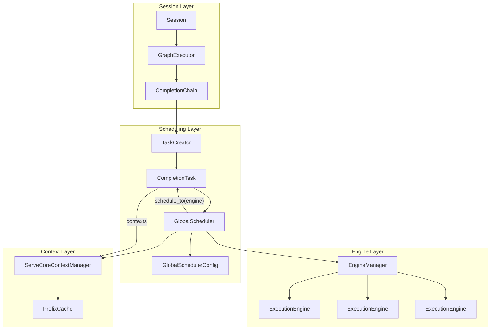
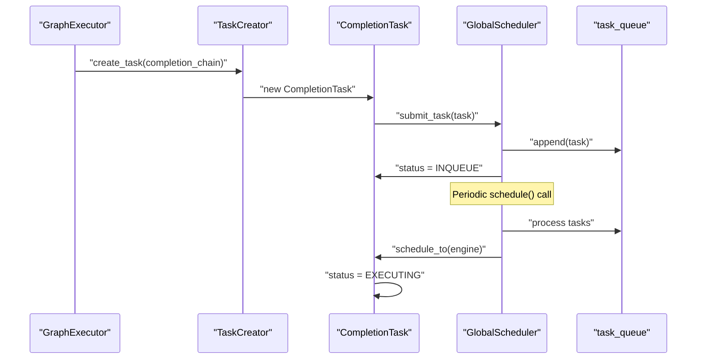
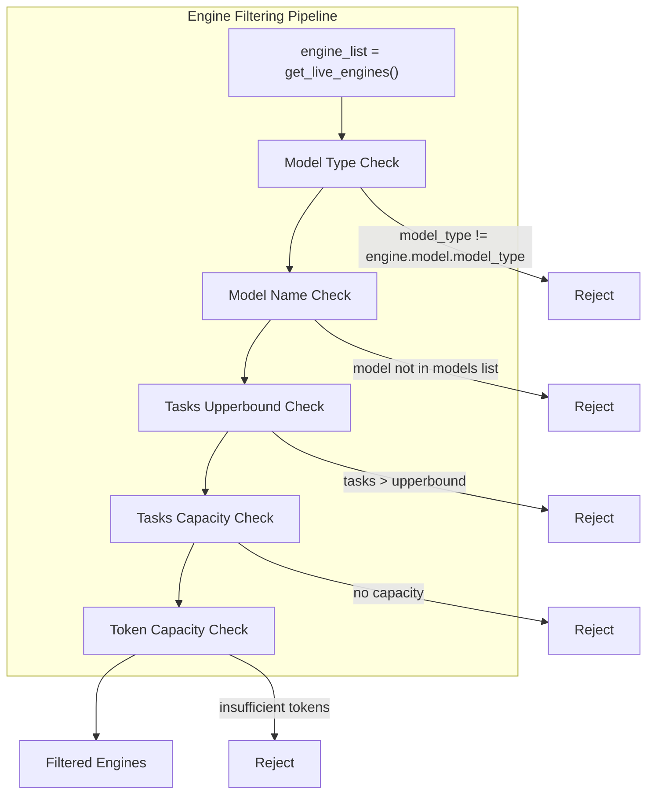
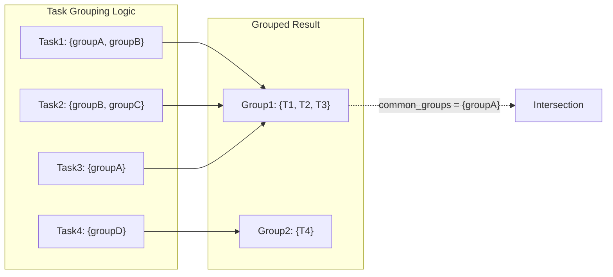
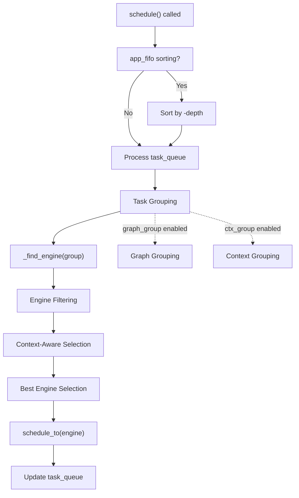
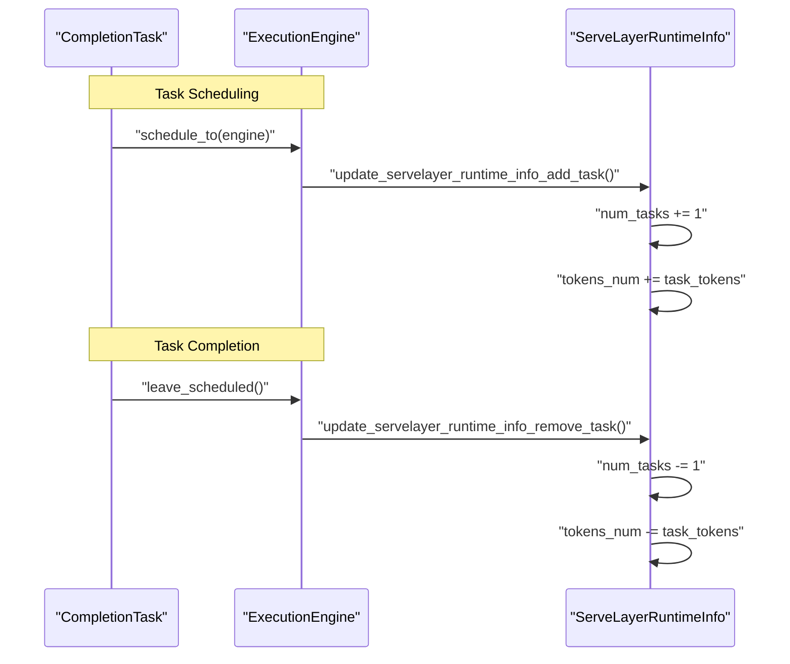

<!-- source: DeepWiki mcp.deepwiki.com · repo microsoft/ParrotServe · page 4.3 Global Scheduling · fetched 2026-10-26 -->

# Global Scheduling

<details>
<summary>Relevant source files</summary>

The following files were used as context for generating this wiki page:

- [parrot/serve/backend_repr/engine.py](parrot/serve/backend_repr/engine.py)
- [parrot/serve/context_manager.py](parrot/serve/context_manager.py)
- [parrot/serve/core.py](parrot/serve/core.py)
- [parrot/serve/engine_manager.py](parrot/serve/engine_manager.py)
- [parrot/serve/scheduler/__init__.py](parrot/serve/scheduler/__init__.py)
- [parrot/serve/scheduler/completion_task.py](parrot/serve/scheduler/completion_task.py)
- [parrot/serve/scheduler/global_scheduler.py](parrot/serve/scheduler/global_scheduler.py)
- [parrot/serve/session/graph_executor.py](parrot/serve/session/graph_executor.py)
- [parrot/serve/session/session.py](parrot/serve/session/session.py)
- [parrot/serve/session_manager.py](parrot/serve/session_manager.py)
- [parrot/serve/variable_manager.py](parrot/serve/variable_manager.py)
- [tests/serve/test_context.py](tests/serve/test_context.py)
- [tests/serve/test_graph.py](tests/serve/test_graph.py)
- [tests/serve/test_prefix_matcher.py](tests/serve/test_prefix_matcher.py)
- [tests/serve/test_session.py](tests/serve/test_session.py)
- [tests/serve/test_sv.py](tests/serve/test_sv.py)
- [tests/serve/test_tokenizer.py](tests/serve/test_tokenizer.py)

</details>


This document covers the Global Scheduling system in ParrotServe, which handles task distribution and engine selection across the distributed serving cluster. The `GlobalScheduler` coordinates task execution by matching `CompletionTask` objects with available `ExecutionEngine` instances based on capacity, context awareness, and performance criteria.

For session-level graph execution, see [Graph Execution](#4.2). For engine management and lifecycle, see [Engine Management](#5.4). For context management and prefix sharing, see [Context Management](#4.4).

## Purpose and Architecture

The Global Scheduling system serves as the central orchestrator for distributing computational tasks across heterogeneous LLM engines. It implements sophisticated scheduling algorithms that consider engine capacity, context locality, task grouping, and performance criteria to optimize both throughput and latency.



**Sources:** [parrot/serve/scheduler/global_scheduler.py:32-255](), [parrot/serve/session/graph_executor.py:32-116](), [parrot/serve/core.py:73-77]()

## Core Components

### GlobalScheduler Class

The `GlobalScheduler` class implements the main scheduling logic with configurable behavior through `GlobalSchedulerConfig`:

| Configuration | Purpose | Default |
|---------------|---------|---------|
| `app_fifo` | Priority scheduling by task depth | `False` |
| `graph_group` | Group tasks by shared graph groups | `False` |
| `ctx_group` | Group tasks by shared context | `False` |
| `ctx_aware` | Prefer engines with cached prefixes | `False` |
| `max_queue_size` | Maximum tasks in queue | `1024` |

The scheduler maintains a task queue and processes tasks through the main `schedule()` method, which runs periodically in the ServeCore loop.

**Sources:** [parrot/serve/scheduler/global_scheduler.py:23-30](), [parrot/serve/core.py:350-351]()

### Task Submission and Queuing



**Sources:** [parrot/serve/session/graph_executor.py:69-81](), [parrot/serve/scheduler/global_scheduler.py:162-180]()

## Engine Selection Algorithm

### Engine Filtering

The scheduler filters available engines through multiple criteria in `_get_engine_list()`:



**Sources:** [parrot/serve/scheduler/global_scheduler.py:49-96]()

### Context-Aware Engine Selection

When `ctx_aware` is enabled, the scheduler queries the `ServeCoreContextManager` to find engines with cached prefixes:

```python
# Query engines with cached prefixes
engine_ids_with_prefixes = self.context_mgr.query_prefixes_in_engines(tasks[0])

# Prefer engines with cached context
if (engine.engine_id in engine_ids_with_prefixes and 
    best_engine.engine_id not in engine_ids_with_prefixes):
    best_engine = engine
```

**Sources:** [parrot/serve/scheduler/global_scheduler.py:124-140](), [parrot/serve/context_manager.py:297-327]()

## Task Grouping Strategies

### Graph-Based Grouping

Tasks sharing common `chain_groups` can be grouped together for batch processing:



**Sources:** [parrot/serve/scheduler/global_scheduler.py:214-220]()

### Context-Based Grouping

Tasks sharing the same first semantic variable can be grouped to leverage shared context:

```python
# Context group check
if ctx_group_enabled:
    if task.chain.first_node.sv == task_j.chain.first_node.sv:
        cur_group.append(task_j)
```

**Sources:** [parrot/serve/scheduler/global_scheduler.py:222-226]()

## Scheduling Process Flow



**Sources:** [parrot/serve/scheduler/global_scheduler.py:182-254]()

## Capacity Management

### Engine Capacity Tracking

Each `ExecutionEngine` maintains runtime information for scheduling decisions:

| Capacity Type | Method | Purpose |
|--------------|--------|----------|
| Tasks | `get_remain_tasks_capacity()` | Available task slots |
| Tokens | `get_remain_tokens_capacity()` | Available token budget |
| Upperbound | `get_tasks_num_upperbound()` | Maximum concurrent tasks |

```python
# Capacity checks in engine filtering
if len(tasks) > engine.get_remain_tasks_capacity():
    return False

if total_tokens_num > engine.get_remain_tokens_capacity():
    return False
```

**Sources:** [parrot/serve/backend_repr/engine.py:126-153](), [parrot/serve/scheduler/global_scheduler.py:81-92]()

### Task Resource Updates

When tasks are scheduled or completed, engine capacity is updated:



**Sources:** [parrot/serve/backend_repr/engine.py:159-203](), [parrot/serve/scheduler/completion_task.py:66-85]()

## Performance Optimization Features

### Priority Scheduling

When `app_fifo` is enabled, tasks are sorted by semantic variable depth to prioritize dependencies:

```python
# Sort tasks by depth (deeper chains have higher priority)
self.task_queue.sort(key=lambda x: -x.chain.gen_node.sv.depth)
```

This ensures that tasks with more downstream dependencies are scheduled first to minimize overall latency.

**Sources:** [parrot/serve/scheduler/global_scheduler.py:185-188]()

### Batching and Grouping

The scheduler supports batching compatible tasks to improve throughput:

- **Graph Grouping**: Tasks from the same computation graph
- **Context Grouping**: Tasks sharing initial context
- **Model Grouping**: Tasks requiring the same model type

**Sources:** [parrot/serve/scheduler/global_scheduler.py:199-227]()

---

