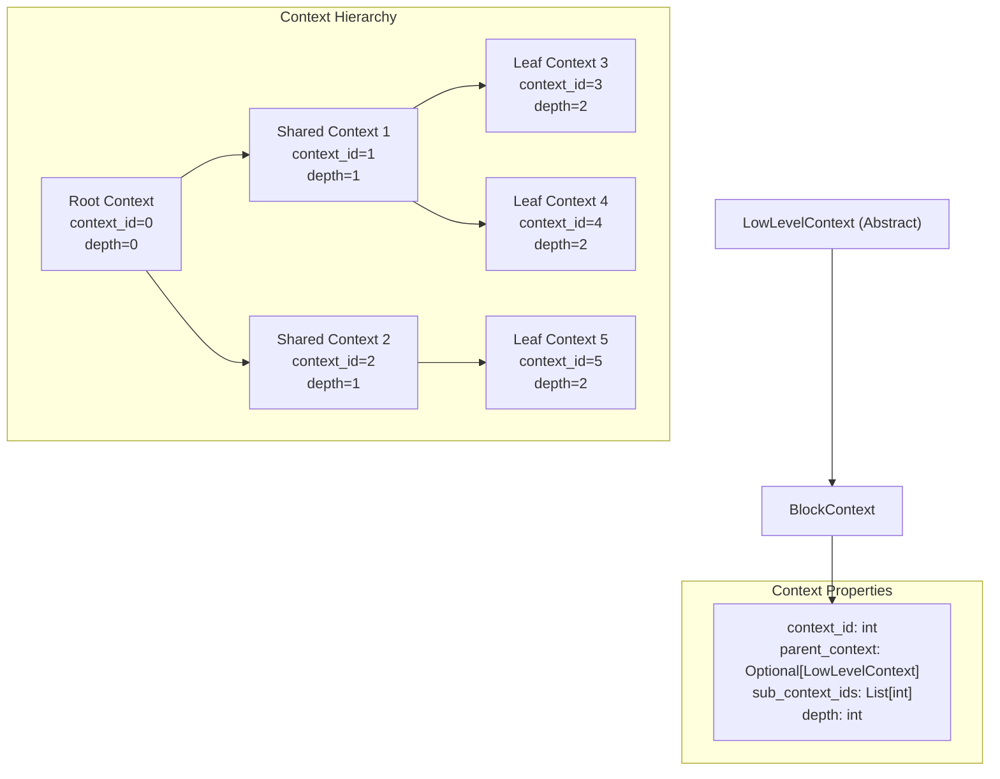
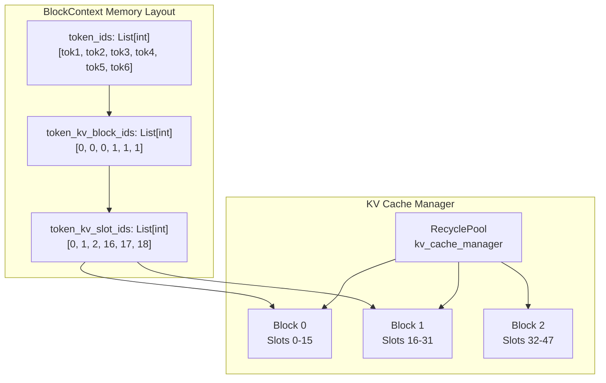
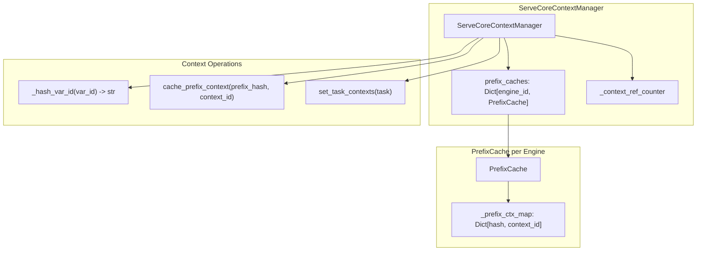
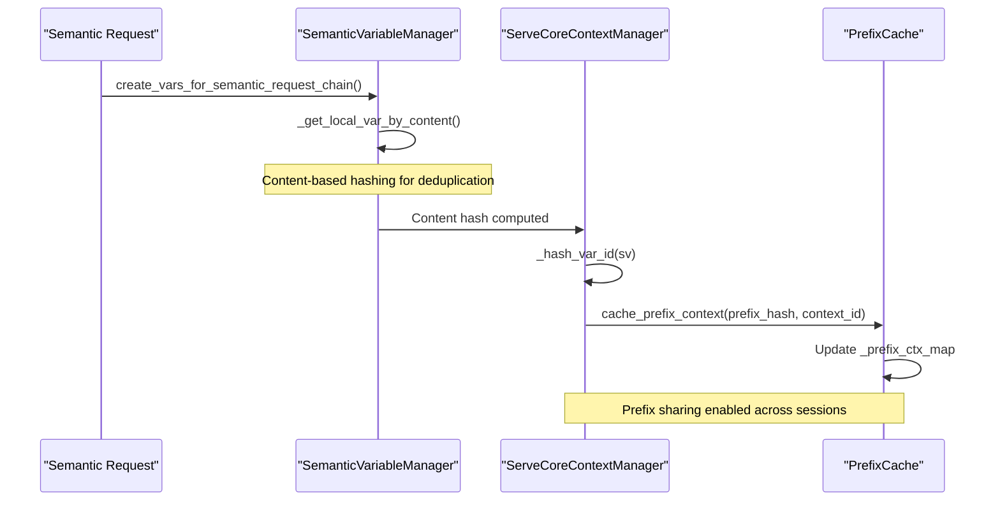
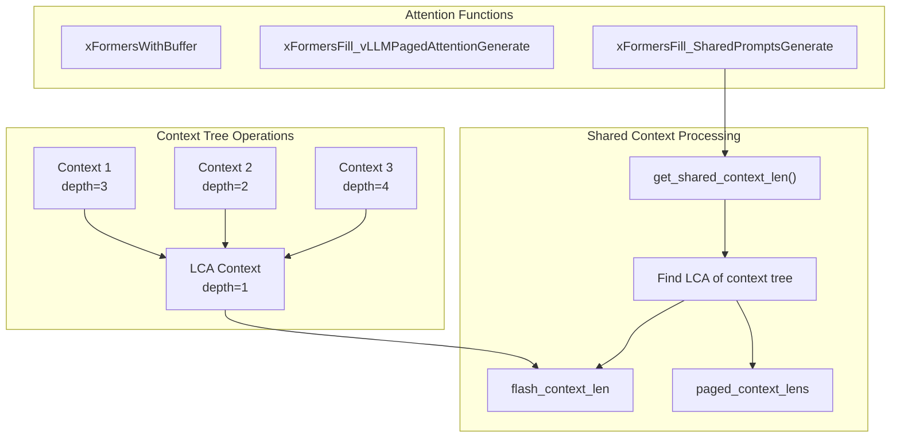
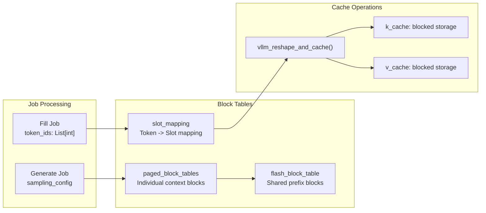
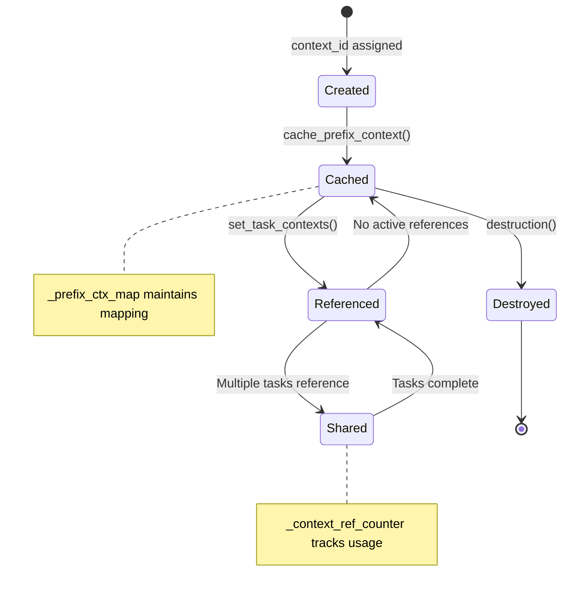
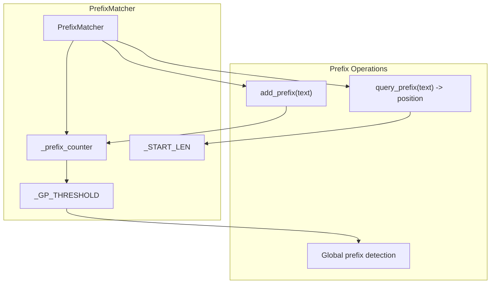
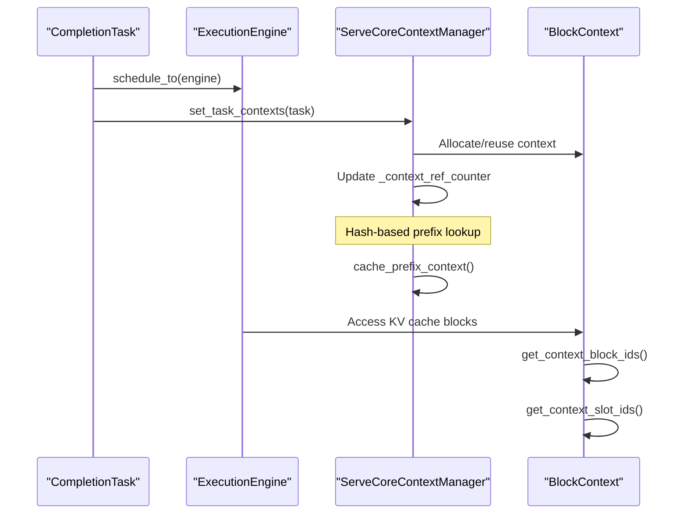

<!-- source: DeepWiki mcp.deepwiki.com · repo microsoft/ParrotServe · page 4.4 Context Management · fetched 2026-10-26 -->

# Context Management

Relevant source files

The following files were used as context for generating this wiki page:

- [parrot/engine/builtin/attn_func.py](parrot/engine/builtin/attn_func.py)
- [parrot/engine/builtin/kernels/shared_flash_decoding.py](parrot/engine/builtin/kernels/shared_flash_decoding.py)
- [parrot/engine/context/block_context.py](parrot/engine/context/block_context.py)
- [parrot/engine/context/low_level_context.py](parrot/engine/context/low_level_context.py)
- [tests/engine/builtin/test_shared_prefix.py](tests/engine/builtin/test_shared_prefix.py)
- [tests/serve/test_context.py](tests/serve/test_context.py)
- [tests/serve/test_graph.py](tests/serve/test_graph.py)
- [tests/serve/test_prefix_matcher.py](tests/serve/test_prefix_matcher.py)
- [tests/serve/test_session.py](tests/serve/test_session.py)
- [tests/serve/test_sv.py](tests/serve/test_sv.py)
- [tests/serve/test_tokenizer.py](tests/serve/test_tokenizer.py)

Context Management is responsible for efficiently managing Key-Value (KV) cache memory, enabling prefix sharing optimizations, and handling context lifecycles across user sessions in ParrotServe. This system allows multiple LLM requests to share common prompt prefixes, significantly reducing memory usage and improving performance through sophisticated caching mechanisms.

For information about session-level resource management, see [Session Management](#4.1). For details about how contexts integrate with task scheduling, see [Global Scheduling](#4.3).

## Context Hierarchy and Architecture

ParrotServe implements a hierarchical context system where contexts can have parent-child relationships, enabling efficient sharing of common prompt prefixes across multiple requests.

### Context Types and Structure

**Sources**: [parrot/engine/context/low_level_context.py:14-61](), [parrot/engine/context/block_context.py:13-136]()

The `LowLevelContext` abstract base class defines the core context interface with hierarchical relationships. Each context maintains references to its parent and child contexts, enabling efficient traversal and shared resource management.

### Block-Based Memory Management

**Sources**: [parrot/engine/context/block_context.py:40-69](), [parrot/engine/context/block_context.py:92-125]()

`BlockContext` implements paged attention concepts by organizing KV cache into fixed-size blocks. Each token is assigned to a specific block and slot within that block, enabling efficient memory allocation and sharing.

## Prefix Caching and Sharing

The context management system implements sophisticated prefix caching to share common prompt prefixes across multiple requests, reducing memory usage and computation overhead.

### ServeCoreContextManager Architecture

**Sources**: [tests/serve/test_context.py:9](), [tests/serve/test_context.py:23-31](), [tests/serve/test_context.py:68-74]()

### Content-Based Hashing and Deduplication

**Sources**: [tests/serve/test_sv.py:15-23](), [tests/serve/test_context.py:28]()

The system uses content-based hashing to identify identical variable contents and prefixes, enabling automatic deduplication and sharing across different sessions and requests.

## Attention Integration and Shared Prompts

Context management is tightly integrated with the attention mechanisms to enable efficient computation on shared prefixes.

### Shared Prefix Attention Architecture

**Sources**: [parrot/engine/builtin/attn_func.py:408-459](), [parrot/engine/builtin/attn_func.py:440-459]()

The `xFormersFill_SharedPromptsGenerate` attention function implements a sophisticated algorithm to find the Lowest Common Ancestor (LCA) of multiple contexts, enabling efficient shared prefix computation.

### Context Block Management in Attention

**Sources**: [parrot/engine/builtin/attn_func.py:489-600](), [parrot/engine/builtin/attn_func.py:614-621]()

## Context Lifecycle Management

### Context Creation and Registration

| Operation | Description | Implementation |
|-----------|-------------|----------------|
| `register_engine_prefix_cache()` | Register prefix cache for engine | Creates `PrefixCache` per engine |
| `set_task_contexts()` | Associate contexts with tasks | Updates reference counters |
| `cache_prefix_context()` | Cache computed prefix | Stores hash->context mapping |
| `_hash_var_id()` | Generate content hash | Enables deduplication |

**Sources**: [tests/serve/test_context.py:69-70]()

### Reference Counting and Memory Management

**Sources**: [tests/serve/test_context.py:72](), [parrot/engine/context/low_level_context.py:32-40]()

The system maintains reference counters to track context usage and automatically manages memory allocation and deallocation based on usage patterns.

### Prefix Matching and Global Optimization

**Sources**: [tests/serve/test_prefix_matcher.py:4-20](), [parrot/serve/prefix_matcher.py (referenced)]()

The `PrefixMatcher` identifies frequently occurring prefixes that exceed a threshold, promoting them to global shared prefixes for system-wide optimization.

## Integration with Task Execution

Context management integrates closely with the task execution pipeline to provide efficient context allocation and sharing.

### Task-Context Assignment Flow

**Sources**: [tests/serve/test_context.py:59-74](), [parrot/engine/context/block_context.py:110-124]()

This system enables ParrotServe to efficiently manage memory resources while providing significant performance improvements through intelligent context sharing and caching mechanisms.

---

