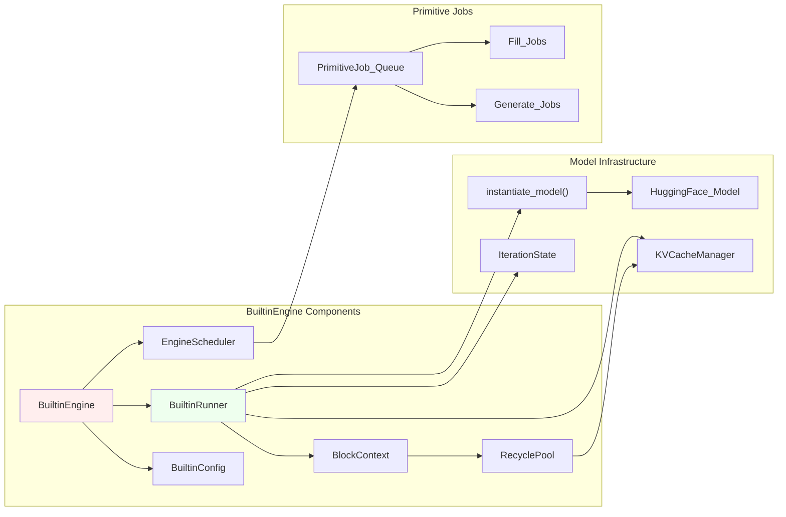
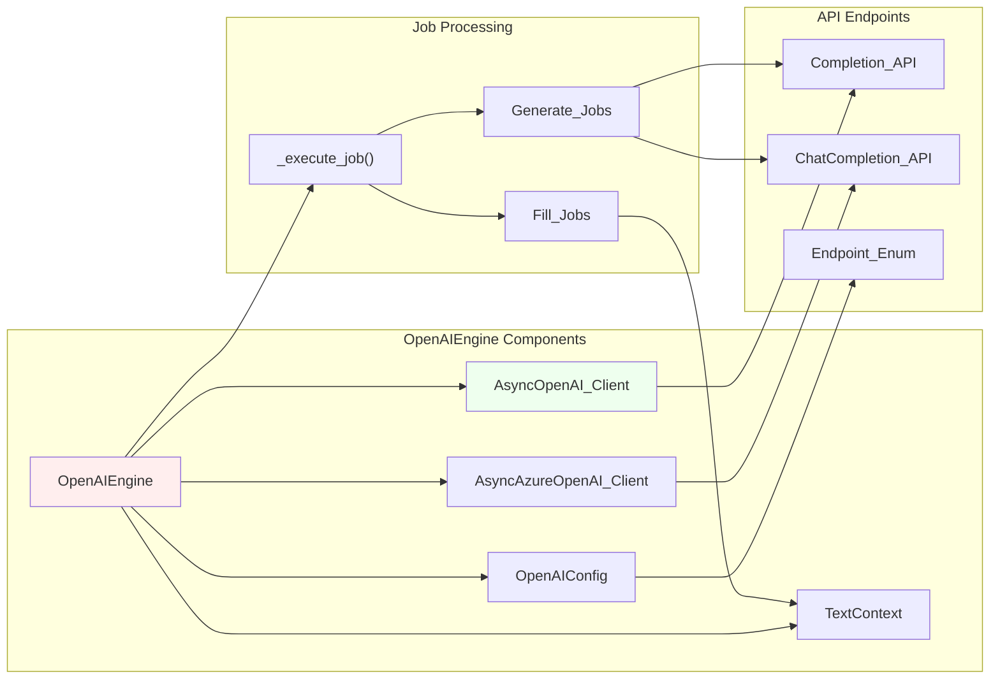
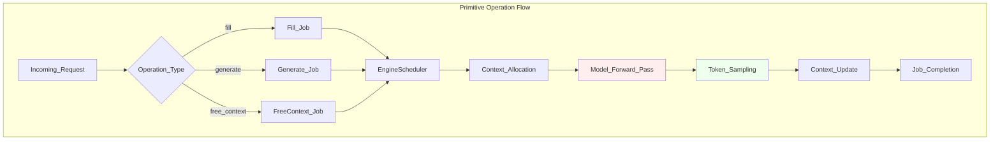
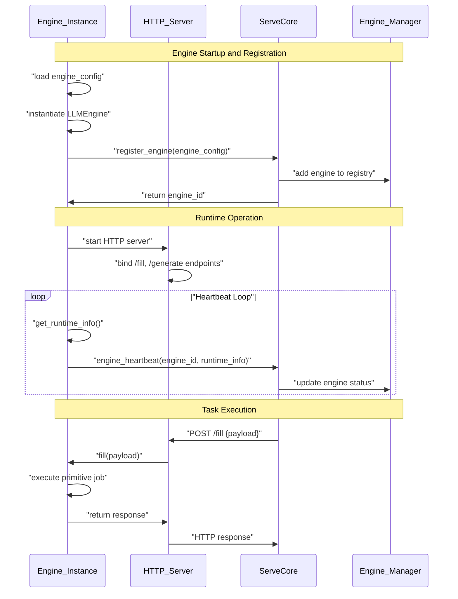
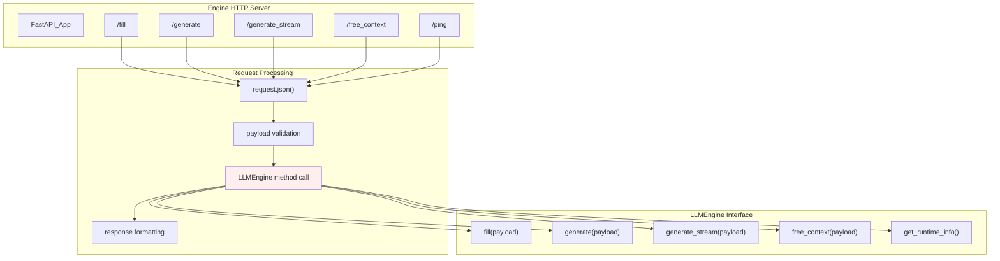

<!-- source: DeepWiki mcp.deepwiki.com · repo microsoft/ParrotServe · page 5 Engine Layer · fetched 2026-10-26 -->

# Engine Layer

<details>
<summary>Relevant source files</summary>

The following files were used as context for generating this wiki page:

- [examples/hello_world.py](examples/hello_world.py)
- [parrot/engine/builtin/builtin_engine.py](parrot/engine/builtin/builtin_engine.py)
- [parrot/engine/builtin/builtin_runner.py](parrot/engine/builtin/builtin_runner.py)
- [parrot/engine/http_server.py](parrot/engine/http_server.py)
- [parrot/engine/llm_engine.py](parrot/engine/llm_engine.py)
- [parrot/engine/openai/openai_engine.py](parrot/engine/openai/openai_engine.py)
- [parrot/serve/backend_repr/__init__.py](parrot/serve/backend_repr/__init__.py)
- [parrot/utils/__init__.py](parrot/utils/__init__.py)
- [parrot/utils/async_utils.py](parrot/utils/async_utils.py)
- [parrot/utils/misc.py](parrot/utils/misc.py)
- [parrot/utils/recycle_pool.py](parrot/utils/recycle_pool.py)
- [sample_configs/engine/openai-example-config.json](sample_configs/engine/openai-example-config.json)

</details>


The Engine Layer provides LLM inference backends that handle actual model execution and provide different types of language model services. Engines are distributed components that register with ServeCore and execute primitive operations (`Fill`, `Generate`, `FreeContext`) on behalf of user requests.

For information about how engines integrate with the overall system architecture, see [Architecture](#2). For details about client-facing APIs, see [HTTP APIs](#6). For engine configuration and deployment, see [Configuration and Deployment](#7).

## Engine Architecture Overview

The Engine Layer implements a pluggable architecture where different inference backends can be integrated through a common `LLMEngine` interface. Each engine runs as an independent HTTP server that registers with ServeCore and processes primitive jobs.

### Engine Component Architecture

```mermaid
graph TB
    subgraph "Engine HTTP Server"
        A[http_server.py]
        B["/fill endpoint"]
        C["/generate endpoint"]  
        D["/generate_stream endpoint"]
        E["/free_context endpoint"]
        F["/ping endpoint"]
    end
    
    subgraph "LLMEngine Interface"
        G[LLMEngine_ABC]
        H["fill()"]
        I["generate()"]
        J["generate_stream()"]
        K["free_context()"]
        L["get_runtime_info()"]
    end
    
    subgraph "Engine Implementations"
        M[BuiltinEngine]
        N[OpenAIEngine]
        O[MLCEngine]
    end
    
    subgraph "Engine Components"
        P[EngineScheduler]
        Q[EngineContextManager]
        R[PrimitiveJob]
        S[IterationState]
    end
    
    subgraph "ServeCore Communication"
        T["register_engine()"]
        U["engine_heartbeat()"]
        V[EngineRuntimeInfo]
    end
    
    A --> B
    A --> C
    A --> D
    A --> E
    A --> F
    
    B --> H
    C --> I
    D --> J
    E --> K
    F --> L
    
    G --> H
    G --> I
    G --> J
    G --> K
    G --> L
    
    M --> G
    N --> G
    O --> G
    
    M --> P
    M --> Q
    N --> P
    N --> Q
    
    P --> R
    Q --> R
    M --> S
    
    M --> T
    N --> T
    M --> U
    N --> U
    U --> V
    
    style G fill:#ffeeee
    style A fill:#eeeeff
    style P fill:#eeffee
```



**Engine Layer Architecture**

Sources: [parrot/engine/llm_engine.py:22-170](), [parrot/engine/http_server.py:25-97](), [parrot/engine/builtin/builtin_engine.py:24-201](), [parrot/engine/openai/openai_engine.py:28-234]()

## Engine Types and Implementations

### LLMEngine Abstract Base Class

The `LLMEngine` class defines the common interface that all engine implementations must implement:

| Method | Purpose | Returns |
|--------|---------|---------|
| `fill()` | Prefill operation - processes input tokens | Dict with filled length |
| `generate()` | Generation operation - produces output tokens | Dict with generated text/tokens |
| `generate_stream()` | Streaming generation | AsyncGenerator for real-time output |
| `free_context()` | Release context resources | Dict with context length |
| `get_runtime_info()` | Engine status and metrics | EngineRuntimeInfo object |

Sources: [parrot/engine/llm_engine.py:61-114]()

### BuiltinEngine Implementation

`BuiltinEngine` provides local LLM inference with fine-grained optimization capabilities:



**BuiltinEngine Architecture**

Key features:
- **Local Model Execution**: Loads and runs models locally using PyTorch
- **Block-based KV Cache**: Efficient memory management with `RecyclePool` 
- **Batch Processing**: Combines Fill and Generate jobs in single forward passes
- **Memory Tracking**: GPU/CPU memory usage monitoring with `MemTracker`

Sources: [parrot/engine/builtin/builtin_engine.py:24-201](), [parrot/engine/builtin/builtin_runner.py:35-200](), [parrot/utils/recycle_pool.py:11-66]()

### OpenAIEngine Implementation  

`OpenAIEngine` provides API-based inference for OpenAI and Azure OpenAI services:



**OpenAIEngine Architecture**

Key features:
- **API Integration**: Supports both OpenAI and Azure OpenAI endpoints
- **Unlimited Batching**: No token or batch size limits (delegated to API)
- **Async Execution**: Non-blocking API calls with background job processing  
- **Text Context**: Maintains conversation history in text format

Sources: [parrot/engine/openai/openai_engine.py:28-234](), [sample_configs/engine/openai-example-config.json:1-25]()

## Primitive Operations

Engines execute three core primitive operations that form the building blocks of LLM inference:

### Fill Operation
**Purpose**: Prefill phase - processes input tokens to build KV cache
- Extends context with new input tokens
- Updates KV cache with computed attention states  
- Returns length of filled content

### Generate Operation  
**Purpose**: Decode phase - generates output tokens one by one
- Samples next token from model logits
- Extends context with generated token
- Continues until stop condition (EOS, max length, etc.)

### Free Context Operation
**Purpose**: Resource cleanup - releases allocated context memory
- Frees KV cache blocks associated with context
- Returns freed context length
- Prevents memory leaks in long-running engines



**Primitive Operations Execution Flow**

Sources: [parrot/engine/builtin/builtin_runner.py:69-200](), [parrot/engine/openai/openai_engine.py:86-128](), [parrot/engine/llm_engine.py:61-107]()

## Engine Management and Registration

### Engine Registration Process

Engines register with ServeCore during startup and maintain connectivity through heartbeat messages:



**Engine Registration and Lifecycle**

### Runtime Information Reporting

Engines report detailed runtime metrics through `EngineRuntimeInfo`:

| Metric | BuiltinEngine | OpenAIEngine | Purpose |
|--------|---------------|--------------|---------|
| `num_cached_tokens` | Block count × block size | UNKNOWN | KV cache utilization |
| `num_running_jobs` | Active job count | Active job count | Current load |
| `cache_mem` | Calculated from blocks | UNKNOWN | Memory usage (MiB) |
| `model_mem` | PyTorch model size | UNKNOWN | Model memory (MiB) |
| `recent_average_latency` | Tracked per iteration | 0 | Performance monitoring |

Sources: [parrot/engine/llm_engine.py:43-170](), [parrot/engine/builtin/builtin_engine.py:145-186](), [parrot/engine/openai/openai_engine.py:181-199]()

## HTTP Server Interface

Each engine runs an independent FastAPI HTTP server that exposes the primitive operations as REST endpoints:

### Engine HTTP Endpoints



**Engine HTTP API Architecture**

### Payload Structure

Engine endpoints accept JSON payloads with the following structure:

**Fill Payload:**
```json
{
  "session_id": "string",
  "task_id": "string", 
  "context_id": "string",
  "parent_context_id": "string",
  "text": "string",           // OpenAIEngine
  "token_ids": [int],     // BuiltinEngine
  "end_flag": boolean
}
```

**Generate Payload:**
```json
{
  "session_id": "string",
  "task_id": "string",
  "context_id": "string", 
  "parent_context_id": "string",
  "sampling_config": {
    "temperature": 0.7,
    "max_tokens": 100
  },
  "end_flag": boolean
}
```

### Engine Server Startup

The engine server startup process is managed by `start_server()` in [parrot/engine/http_server.py:70-97]():

1. **Engine Creation**: Load configuration and instantiate appropriate `LLMEngine`
2. **Event Loop Setup**: Create asyncio event loop for concurrent request handling  
3. **Engine Loop**: Start background `engine_loop()` for job processing
4. **HTTP Server**: Start uvicorn server to handle incoming requests

Sources: [parrot/engine/http_server.py:32-68](), [parrot/engine/http_server.py:70-97](), [examples/hello_world.py:13-16]()

---

