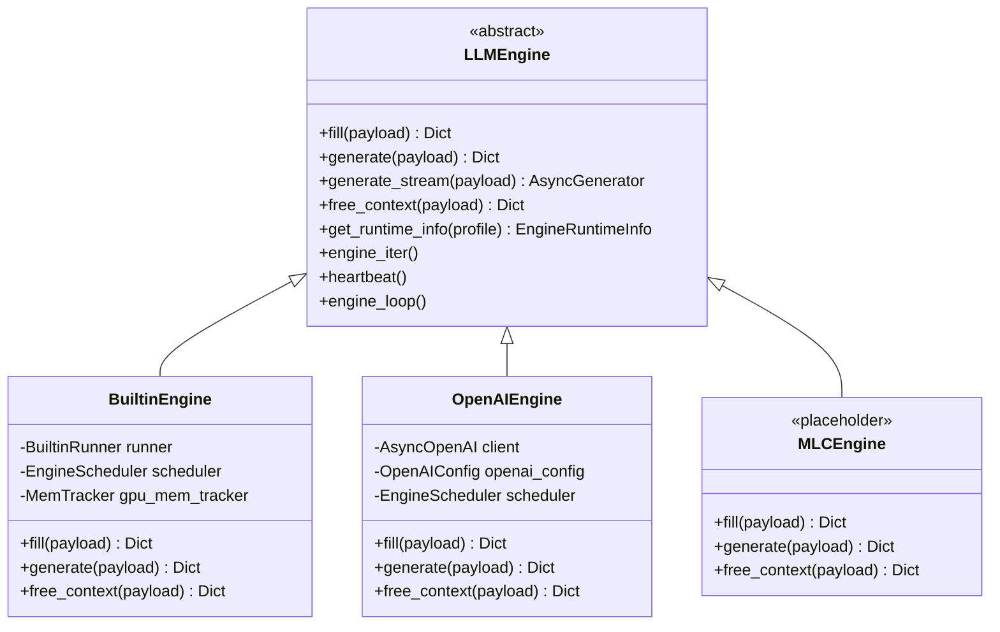
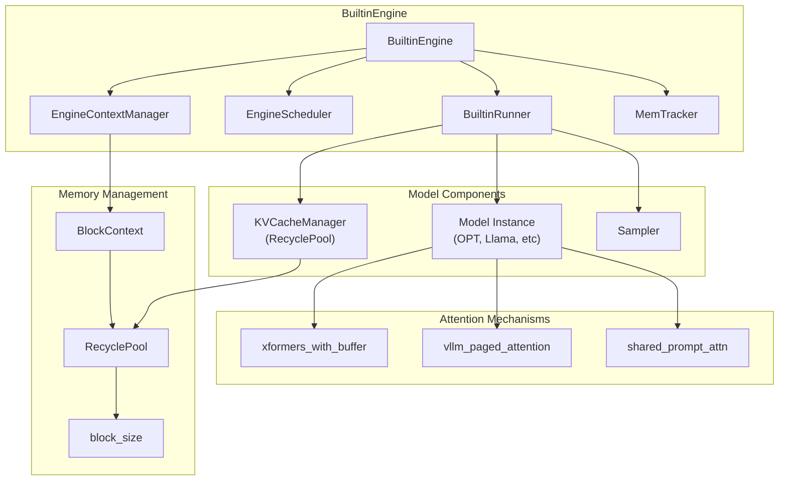
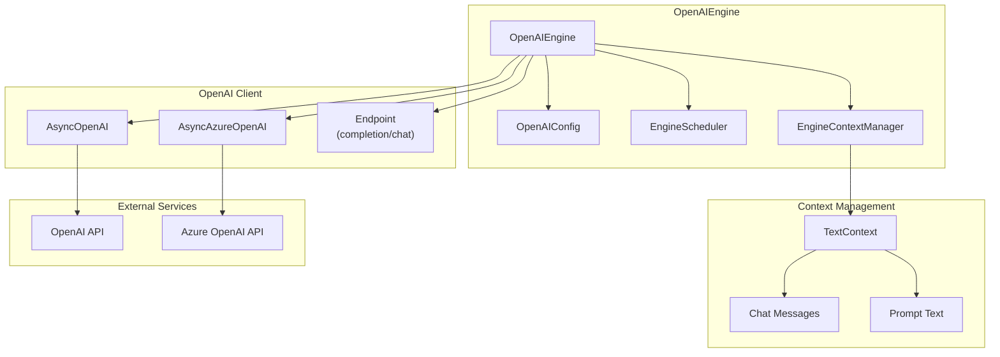
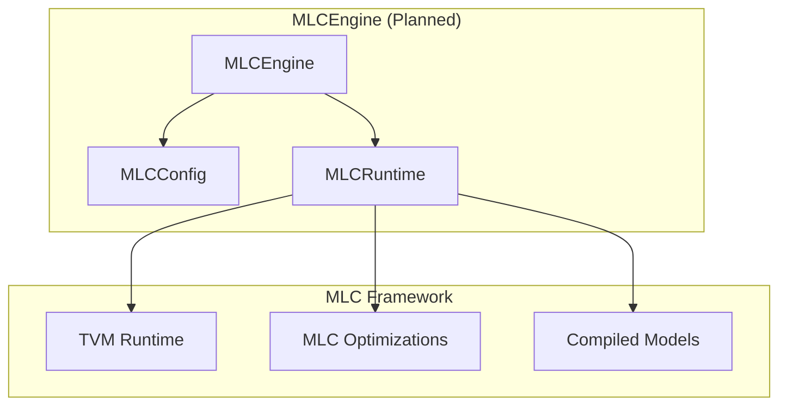
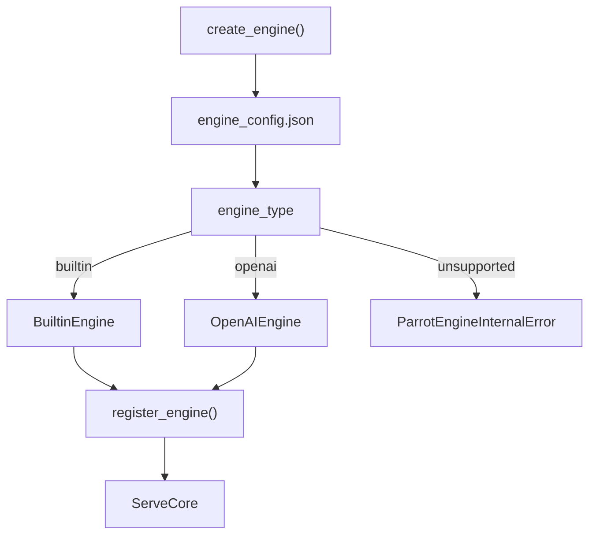
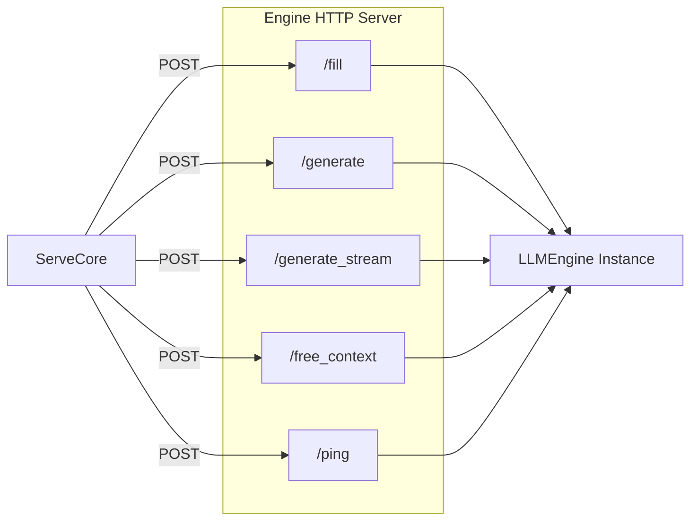

<!-- source: DeepWiki mcp.deepwiki.com · repo microsoft/ParrotServe · page 5.1 Engine Types · fetched 2026-10-26 -->

# Engine Types

Relevant source files

The following files were used as context for generating this wiki page:

- [examples/hello_world.py](examples/hello_world.py)
- [parrot/engine/builtin/builtin_engine.py](parrot/engine/builtin/builtin_engine.py)
- [parrot/engine/builtin/builtin_runner.py](parrot/engine/builtin/builtin_runner.py)
- [parrot/engine/engine_creator.py](parrot/engine/engine_creator.py)
- [parrot/engine/http_server.py](parrot/engine/http_server.py)
- [parrot/engine/llm_engine.py](parrot/engine/llm_engine.py)
- [parrot/engine/openai/openai_engine.py](parrot/engine/openai/openai_engine.py)
- [parrot/frontend/pfunc/function.py](parrot/frontend/pfunc/function.py)
- [parrot/frontend/pfunc/interface.py](parrot/frontend/pfunc/interface.py)
- [parrot/frontend/pfunc/vm.py](parrot/frontend/pfunc/vm.py)
- [parrot/serve/backend_repr/__init__.py](parrot/serve/backend_repr/__init__.py)
- [parrot/testing/localhost_server_daemon.py](parrot/testing/localhost_server_daemon.py)
- [parrot/utils/__init__.py](parrot/utils/__init__.py)
- [parrot/utils/async_utils.py](parrot/utils/async_utils.py)
- [parrot/utils/misc.py](parrot/utils/misc.py)
- [parrot/utils/recycle_pool.py](parrot/utils/recycle_pool.py)
- [sample_configs/engine/openai-example-config.json](sample_configs/engine/openai-example-config.json)
- [tests/engine/builtin/test_llama.py](tests/engine/builtin/test_llama.py)
- [tests/engine/builtin/test_sampler.py](tests/engine/builtin/test_sampler.py)
- [tests/engine/test_engine.py](tests/engine/test_engine.py)
- [tests/engine/test_http_server.py](tests/engine/test_http_server.py)

This page documents the different types of LLM engines available in ParrotServe and their specific implementations. Engine types define how ParrotServe executes LLM inference - whether locally on GPU hardware, through external APIs, or via specialized frameworks.

For information about engine primitive operations (Fill, Generate, Free Context), see [5.2](#5.2). For details on attention mechanisms and optimization techniques, see [5.3](#5.3). For engine lifecycle management and registration, see [5.4](#5.4).

## Engine Architecture Overview

ParrotServe implements a pluggable engine architecture where different LLM backends integrate through a common `LLMEngine` abstract interface. Each engine type handles model execution differently while providing the same primitive operations to the ServeCore layer.

**Engine Type Hierarchy**

Sources: [parrot/engine/llm_engine.py:22-170](), [parrot/engine/builtin/builtin_engine.py:24-201](), [parrot/engine/openai/openai_engine.py:28-234]()

## Engine Type Implementations

### BuiltinEngine

The `BuiltinEngine` provides local LLM inference with fine-grained optimization capabilities. It directly loads and executes language models on local GPU hardware using optimized attention mechanisms and memory management.

**BuiltinEngine Architecture**

Key characteristics:
- **Local Execution**: Runs models directly on GPU hardware with CUDA support
- **Block-based Memory**: Uses `RecyclePool` for efficient KV cache block allocation  
- **Multiple Attention Backends**: Supports `xformers_with_buffer`, `vllm_paged_attention`, and shared prompt optimizations
- **Detailed Metrics**: Provides GPU memory usage, cache statistics, and latency profiling
- **Batch Processing**: Optimized scheduler for batching Fill and Generate operations

Sources: [parrot/engine/builtin/builtin_engine.py:24-201](), [parrot/engine/builtin/builtin_runner.py:35-200](), [parrot/engine/config.py]()

### OpenAIEngine

The `OpenAIEngine` provides LLM inference through external API calls to OpenAI or Azure OpenAI services. It handles authentication, request formatting, and response parsing for cloud-based inference.

**OpenAIEngine Architecture**

Key characteristics:
- **API Integration**: Supports both OpenAI and Azure OpenAI endpoints
- **Async Processing**: Uses `AsyncOpenAI` client for non-blocking API calls
- **Text Context**: Manages conversation history as text rather than token sequences
- **Unlimited Capacity**: No local memory constraints, limited only by API quotas
- **Multiple Endpoints**: Supports both completion and chat completion API formats

Sources: [parrot/engine/openai/openai_engine.py:28-234](), [parrot/engine/openai/api_endpoint.py]()

### MLCEngine

The `MLCEngine` is designed to integrate with the MLC (Machine Learning Compilation) framework for optimized model execution. This engine type is referenced in system diagrams but may not be fully implemented.

Sources: Referenced in system architecture diagrams

## Engine Creation and Factory Pattern

The `create_engine` function implements a factory pattern for instantiating the appropriate engine type based on configuration.

**Engine Creation Flow**

The factory function validates configuration and creates the appropriate engine instance:

| Engine Type | Constant | Implementation Class | Use Case |
|-------------|----------|---------------------|----------|
| `builtin` | `ENGINE_TYPE_BUILTIN` | `BuiltinEngine` | Local GPU inference |
| `openai` | `ENGINE_TYPE_OPENAI` | `OpenAIEngine` | API-based inference |

Sources: [parrot/engine/engine_creator.py:22-59](), [parrot/constants.py]()

## Engine Configuration

Each engine type uses specific configuration schemas defined in JSON files:

**BuiltinEngine Configuration**
- `model`: HuggingFace model path
- `instance.device`: CUDA device specification  
- `instance.attn_func`: Attention mechanism selection
- `instance.block_size`: KV cache block size
- `scheduler.max_batch_size`: Maximum batch size

**OpenAIEngine Configuration**  
- `model`: OpenAI model name or Azure deployment name
- `instance.api_key`: Authentication key
- `instance.is_azure`: Azure OpenAI flag
- `instance.azure_endpoint`: Azure endpoint URL
- `instance.api_endpoint`: completion vs chat endpoint

Sources: [sample_configs/engine/openai-example-config.json:1-25](), [parrot/engine/config.py]()

## Engine HTTP Interface

All engines expose a consistent HTTP API through FastAPI servers for communication with ServeCore:

**Engine HTTP Endpoints**

Sources: [parrot/engine/http_server.py:32-68]()

---

