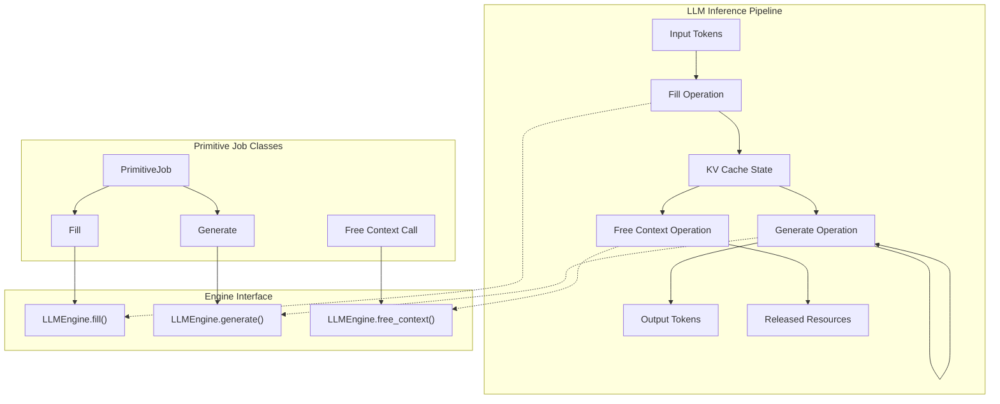
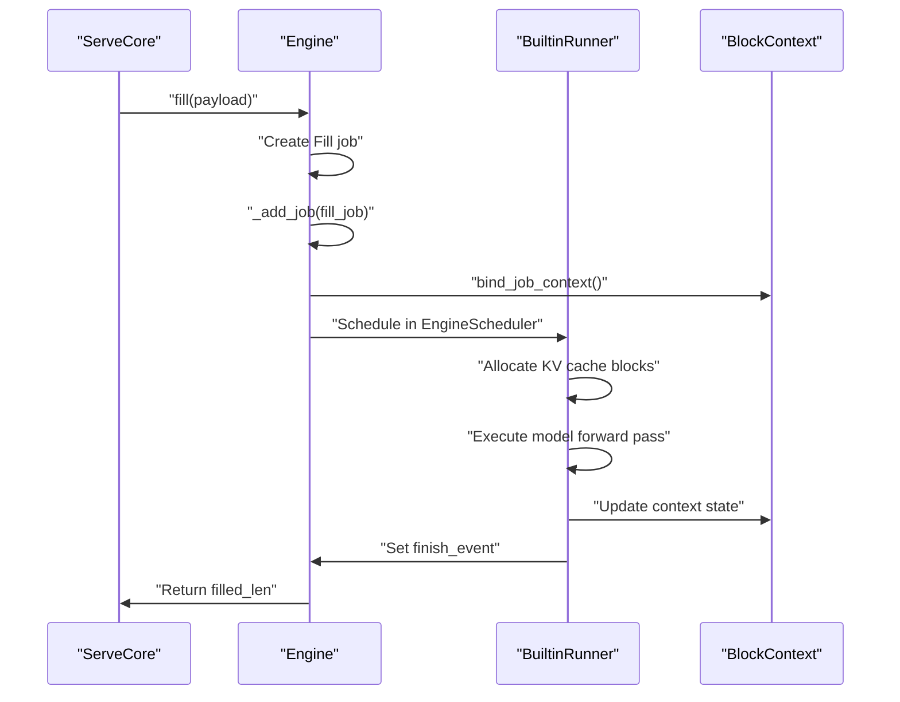
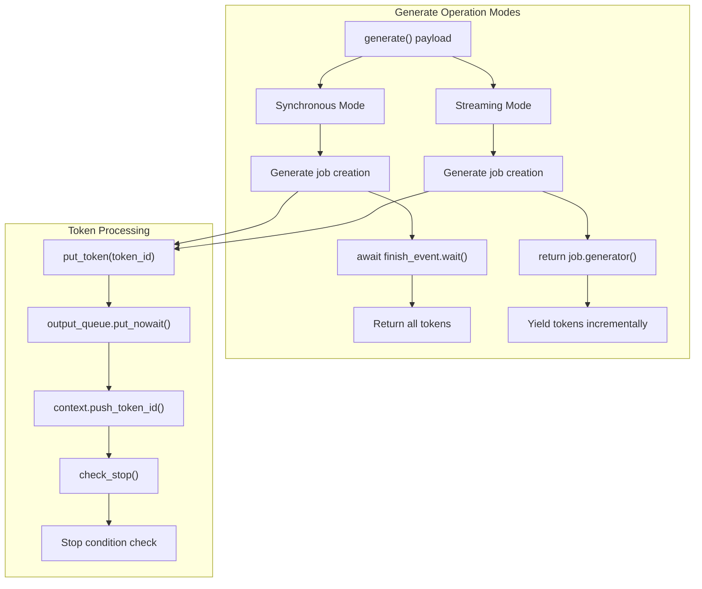
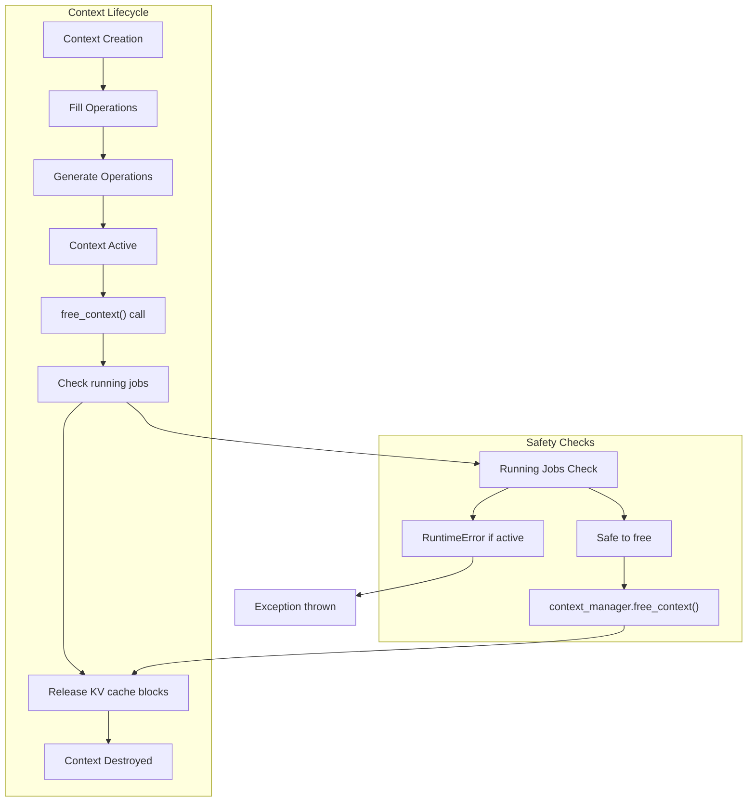
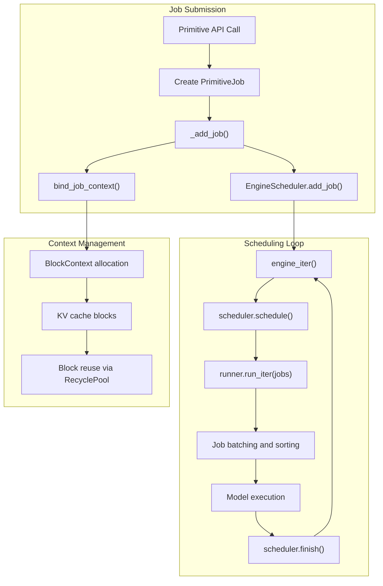
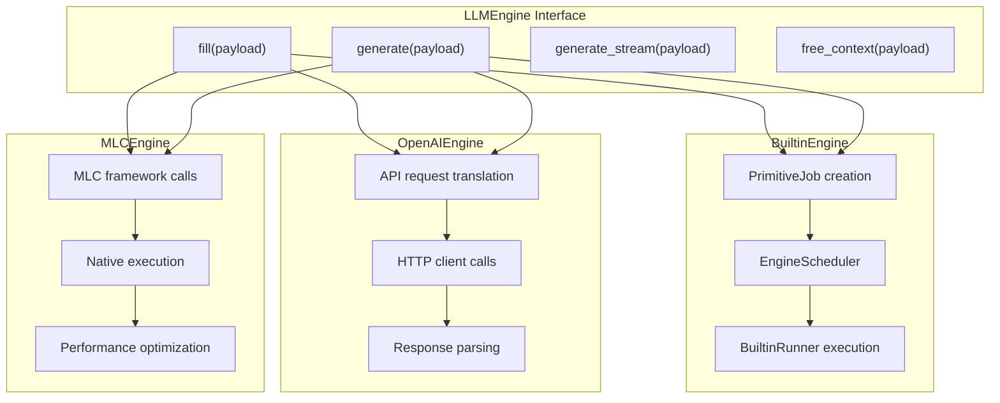

<!-- source: DeepWiki mcp.deepwiki.com · repo microsoft/ParrotServe · page 5.2 Primitive Operations · fetched 2026-10-26 -->

# Primitive Operations

<details>
<summary>Relevant source files</summary>

The following files were used as context for generating this wiki page:

- [parrot/engine/builtin/builtin_engine.py](parrot/engine/builtin/builtin_engine.py)
- [parrot/engine/builtin/builtin_runner.py](parrot/engine/builtin/builtin_runner.py)
- [parrot/engine/primitive_job.py](parrot/engine/primitive_job.py)
- [parrot/utils/__init__.py](parrot/utils/__init__.py)
- [parrot/utils/async_utils.py](parrot/utils/async_utils.py)
- [parrot/utils/misc.py](parrot/utils/misc.py)
- [parrot/utils/recycle_pool.py](parrot/utils/recycle_pool.py)

</details>


## Purpose and Scope

This document describes the three core primitive operations that form the foundation of all LLM engines in ParrotServe: **Fill**, **Generate**, and **Free Context**. These operations correspond to the fundamental phases of LLM inference - prefill, decode, and resource cleanup. All engine implementations must support these primitives to participate in the distributed serving system.

For information about specific engine implementations that execute these primitives, see [Engine Types](#5.1). For attention mechanism optimizations that enhance primitive performance, see [Attention Mechanisms](#5.3). For engine lifecycle and registration processes, see [Engine Management](#5.4).

## Primitive Operations Overview

ParrotServe abstracts all LLM inference into three fundamental operations that engines must implement. These primitives enable the system to orchestrate complex multi-step LLM computations while maintaining engine-agnostic scheduling and optimization.



**Primitive Operations Flow Diagram**

Sources: [parrot/engine/primitive_job.py:13-35](), [parrot/engine/llm_engine.py]()

## Fill Operation

The **Fill** primitive corresponds to the prefill phase in LLM inference, where input token sequences are processed to populate the KV cache. This operation extends the context state with new input tokens and prepares the model for generation.

### Fill Job Structure

| Field | Type | Purpose |
|-------|------|---------|
| `session_id` | int | Session identifier for isolation |
| `task_id` | int | Unique task identifier |
| `context_id` | int | Context instance identifier |
| `parent_context_id` | int | Parent context for sharing |
| `token_ids` | List[int] | Input tokens to process |
| `text` | str | Alternative text input |
| `end_flag` | bool | Completion marker |

### Fill Execution Flow



**Fill Operation Sequence Diagram**

The `Fill` class encapsulates prefill operations with token sequences that extend the context:

```python
# From parrot/engine/primitive_job.py:36-64
class Fill(PrimitiveJob):
    """Fill primitive is corresponding to the `prefill` stage in LLM.

    Its mission is to fill the KV cache in the execution engine, extending the context
    using the input tokens.
    """
```

### Fill Implementation in BuiltinEngine

The `BuiltinEngine.fill()` method processes fill requests by creating job instances and coordinating execution:

- Creates `Fill` job with payload parameters [parrot/engine/builtin/builtin_engine.py:72-85]()
- Binds job to `BlockContext` for KV cache management [parrot/engine/builtin/builtin_engine.py:61-66]()
- Schedules job through `EngineScheduler` [parrot/engine/builtin/builtin_engine.py:58-60]()
- Returns filled token count upon completion [parrot/engine/builtin/builtin_engine.py:83-85]()

Sources: [parrot/engine/primitive_job.py:36-64](), [parrot/engine/builtin/builtin_engine.py:71-85](), [parrot/engine/builtin/builtin_runner.py:97-100]()

## Generate Operation

The **Generate** primitive corresponds to the decode phase in LLM inference, where the model produces output tokens autoregressively based on the current context state. This operation supports both synchronous and streaming generation modes.

### Generate Job Structure

| Field | Type | Purpose |
|-------|------|---------|
| `session_id` | int | Session identifier |
| `task_id` | int | Task identifier |
| `context_id` | int | Context identifier |
| `sampling_config` | SamplingConfig | Generation parameters |
| `output_queue` | AsyncQueue[int] | Streaming token output |
| `gen_text` | str | Generated text accumulator |
| `gen_length` | int | Generated token count |

### Generation Modes



**Generate Operation Modes Diagram**

### Generation Control Flow

The `Generate` class manages autoregressive token production with configurable stopping conditions:

```python
# From parrot/engine/primitive_job.py:105-112
def check_stop(self) -> bool:
    token_id = self.context.get_last_token_id()
    return (
        token_id in self.sampling_config.stop_token_ids
        or self.gen_length >= self.sampling_config.max_gen_length
    )
```

### Streaming Generation

The `generate_stream()` method provides real-time token streaming through async generators:

- Creates `Generate` job with streaming configuration [parrot/engine/builtin/builtin_engine.py:119-127]()
- Returns async generator for incremental token access [parrot/engine/builtin/builtin_engine.py:129]()
- Supports real-time response streaming via `AsyncQueue` [parrot/engine/primitive_job.py:114-123]()

Sources: [parrot/engine/primitive_job.py:66-123](), [parrot/engine/builtin/builtin_engine.py:88-129](), [parrot/engine/builtin/builtin_runner.py:100-107]()

## Free Context Operation

The **Free Context** primitive handles resource cleanup by releasing KV cache blocks and context state when they are no longer needed. This operation is critical for memory management in long-running services.

### Context Lifecycle Management



**Context Lifecycle and Free Operation Diagram**

### Free Context Implementation

The `free_context()` method ensures safe resource deallocation:

```python
# From parrot/engine/builtin/builtin_engine.py:132-142
async def free_context(self, payload: Dict) -> Dict:
    context_id = payload["context_id"]
    for job in self.scheduler.running_jobs:
        if job.context_id == context_id:
            raise RuntimeError(f"Context {context_id} is still running.")
    
    context_len = self.runner.context_manager.free_context(context_id)
    return {"context_len": context_len}
```

### Memory Management Integration

- Validates no active jobs use the context [parrot/engine/builtin/builtin_engine.py:134-137]()
- Delegates to `EngineContextManager` for actual cleanup [parrot/engine/builtin/builtin_engine.py:139]()
- Returns released context length for accounting [parrot/engine/builtin/builtin_engine.py:140-142]()
- Integrates with `RecyclePool` for KV cache block reuse [parrot/utils/recycle_pool.py:47-55]()

Sources: [parrot/engine/builtin/builtin_engine.py:132-142](), [parrot/utils/recycle_pool.py:47-55]()

## Job Scheduling and Execution

The primitive operations are executed through a sophisticated scheduling system that batches jobs, manages resources, and coordinates execution across multiple contexts.

### Job Execution Pipeline



**Job Scheduling and Execution Pipeline Diagram**

### Batch Execution Strategy

The `BuiltinRunner.run_iter()` method implements efficient batch processing:

1. **Job Sorting**: Fill jobs are prioritized before Generate jobs [parrot/engine/builtin/builtin_runner.py:76]()
2. **Context Allocation**: KV cache blocks are allocated per job [parrot/engine/builtin/builtin_runner.py:94-109]()
3. **First Sampling**: Pre-computed hidden states enable immediate token generation [parrot/engine/builtin/builtin_runner.py:112-124]()
4. **Batch Execution**: Combined forward pass for all jobs [parrot/engine/builtin/builtin_runner.py:162-164]()
5. **Result Distribution**: Outputs are distributed to respective jobs [parrot/engine/builtin/builtin_runner.py:178-188]()

### Resource Management

The scheduling system integrates with several resource management components:

| Component | Purpose | Integration Point |
|-----------|---------|------------------|
| `RecyclePool` | KV cache block allocation | [parrot/utils/recycle_pool.py:30-45]() |
| `BlockContext` | Context state management | [parrot/engine/builtin/builtin_runner.py:87-92]() |
| `EngineScheduler` | Job queue and batching | [parrot/engine/builtin/builtin_engine.py:42]() |
| `LatencyAnalyzer` | Performance tracking | [parrot/engine/builtin/builtin_engine.py:199]() |

Sources: [parrot/engine/builtin/builtin_runner.py:69-200](), [parrot/engine/builtin/builtin_engine.py:58-66](), [parrot/utils/recycle_pool.py:30-45]()

## Cross-Engine Primitive Implementation

While the specific implementation details vary across engine types, all engines must implement the same primitive operation interface defined in the `LLMEngine` abstract base class.

### Engine-Specific Adaptations



**Cross-Engine Primitive Implementation Diagram**

Each engine type adapts the primitive operations to its execution model:

- **BuiltinEngine**: Direct model execution with fine-grained optimization [parrot/engine/builtin/builtin_engine.py:24-25]()
- **OpenAIEngine**: API translation and HTTP request management
- **MLCEngine**: MLC framework integration with native performance
- **NativeEngine**: Python function execution for non-LLM operations

The uniform primitive interface enables the ServeCore to schedule tasks across heterogeneous engines while maintaining consistent semantics and resource management.

Sources: [parrot/engine/builtin/builtin_engine.py:24-201](), [parrot/engine/llm_engine.py]()

---

