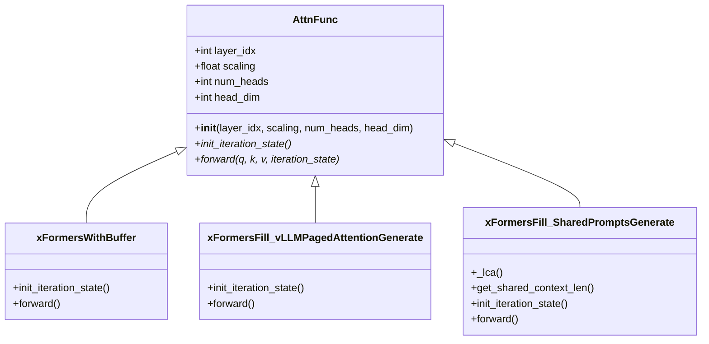
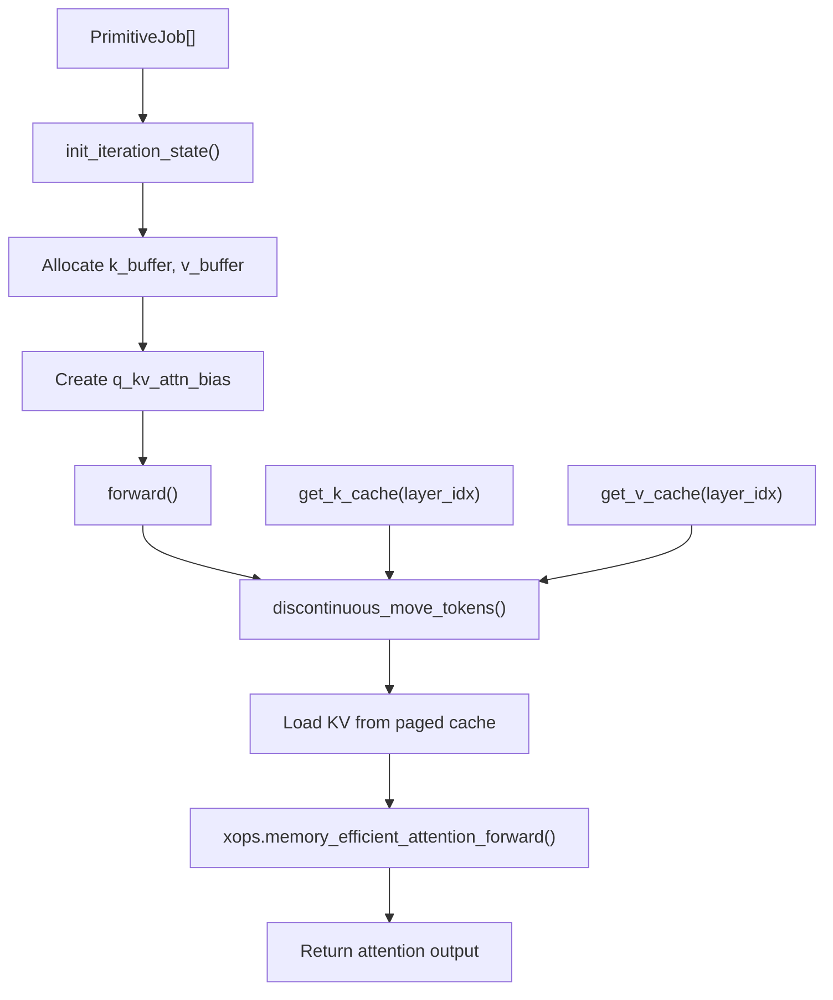
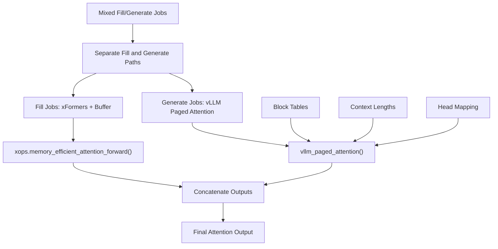
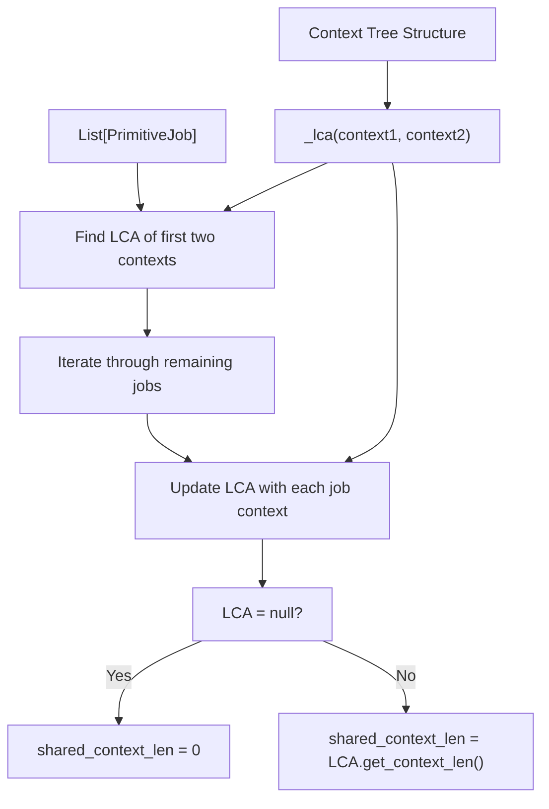
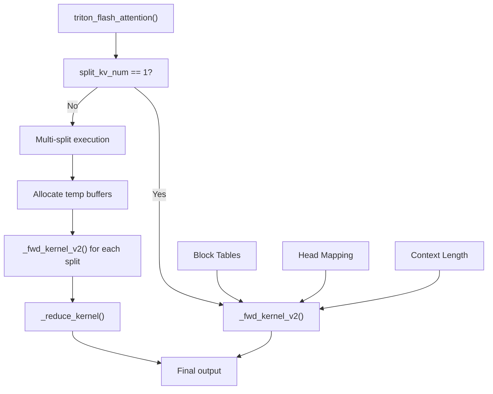
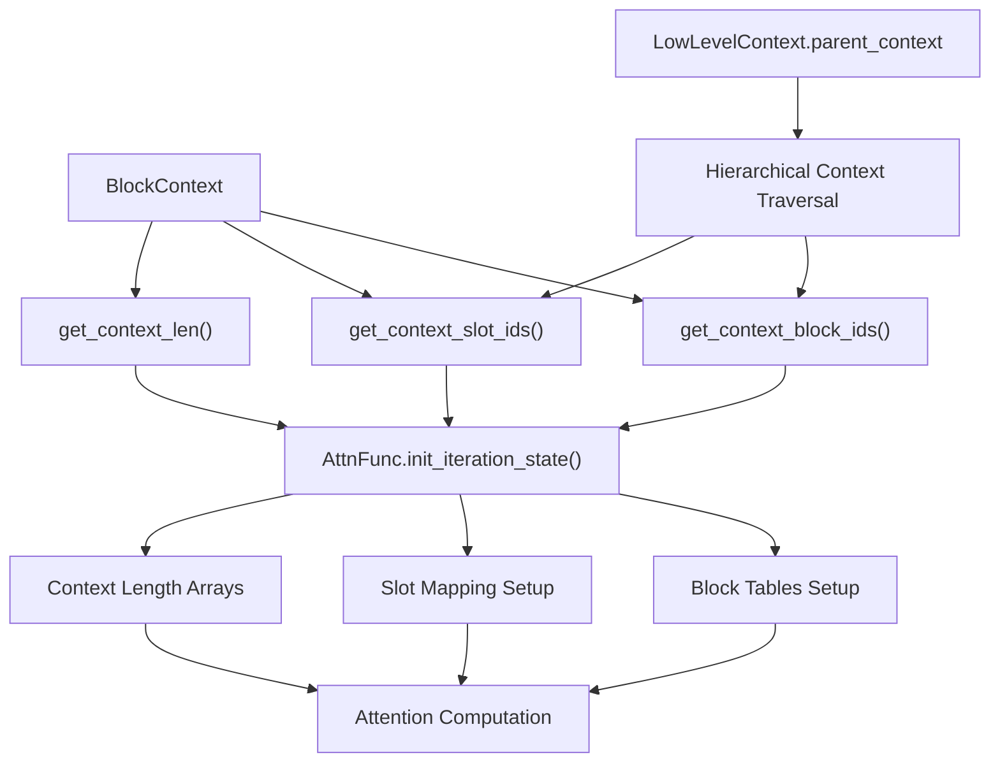
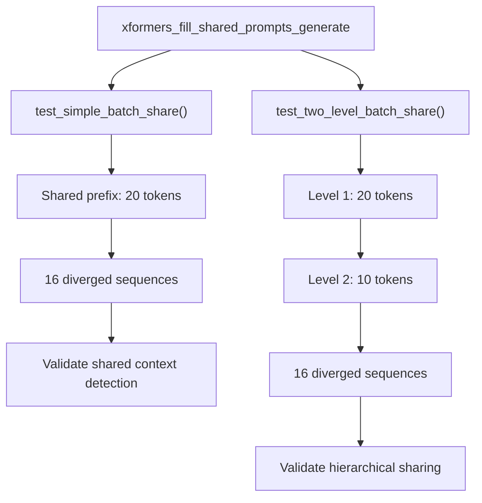

<!-- source: DeepWiki mcp.deepwiki.com · repo microsoft/ParrotServe · page 5.3 Attention Mechanisms · fetched 2026-10-26 -->

# Attention Mechanisms

Relevant source files

The following files were used as context for generating this wiki page:

- [parrot/engine/builtin/attn_func.py](parrot/engine/builtin/attn_func.py)
- [parrot/engine/builtin/kernels/shared_flash_decoding.py](parrot/engine/builtin/kernels/shared_flash_decoding.py)
- [parrot/engine/context/block_context.py](parrot/engine/context/block_context.py)
- [parrot/engine/context/low_level_context.py](parrot/engine/context/low_level_context.py)
- [tests/engine/builtin/test_shared_prefix.py](tests/engine/builtin/test_shared_prefix.py)

## Purpose and Scope

This document covers the optimized attention mechanism implementations in ParrotServe's Engine Layer. These mechanisms handle the core attention computation for LLM inference, providing different optimization strategies for memory efficiency and computational performance. For general engine architecture and primitive operations, see [Engine Types](#5.1) and [Primitive Operations](#5.2). For KV cache management and context sharing, see [Context Management](#4.4).

The attention mechanisms in ParrotServe are designed to work with the system's paged KV cache architecture and support advanced optimizations like shared prefix caching and batched inference across multiple concurrent requests.

## Attention Function Architecture

ParrotServe implements multiple attention function strategies through a common `AttnFunc` interface, allowing the system to choose the most appropriate implementation based on workload characteristics and hardware capabilities.

### AttnFunc Base Class Design

**Sources:** [parrot/engine/builtin/attn_func.py:31-56]()

### Attention Function Selection

The system provides three main attention implementations, each optimized for different scenarios:

| Implementation | Use Case | Performance Trade-off |
|---|---|---|
| `xFormersWithBuffer` | Reference implementation | Slow but correct, uses contiguous buffers |
| `xFormersFill_vLLMPagedAttentionGenerate` | vLLM-style optimization | Fast generation, no Fill/Generate fusion |
| `xFormersFill_SharedPromptsGenerate` | Shared prefix optimization | Optimized for shared prompts across requests |

**Sources:** [parrot/engine/builtin/attn_func.py:704-737]()

## xFormers with Buffer Implementation

The `xFormersWithBuffer` class provides a reference implementation that loads paged KV cache into contiguous buffers before performing attention computation using xFormers operators.

### Buffer-Based Attention Flow

**Sources:** [parrot/engine/builtin/attn_func.py:58-189]()

### Buffer Allocation Strategy

The buffer allocation handles both Fill and Generate jobs by:

1. Computing total buffer size based on KV sequence lengths
2. Creating block diagonal causal masks for attention
3. Managing index tensors for discontinuous memory access

**Sources:** [parrot/engine/builtin/attn_func.py:98-130]()

## vLLM Paged Attention Integration

The `xFormersFill_vLLMPagedAttentionGenerate` class integrates vLLM's paged attention mechanism, separating Fill operations (using xFormers) from Generate operations (using paged attention).

### Hybrid Attention Architecture

**Sources:** [parrot/engine/builtin/attn_func.py:195-406]()

### Block Table Management

The implementation maintains separate data structures for paged attention:

- `block_tables`: Logical to physical block ID mapping for generation sequences
- `slot_mapping`: Token position to slot ID mapping for all tokens
- `context_lens`: Sequence lengths for generation jobs

**Sources:** [parrot/engine/builtin/attn_func.py:214-315]()

## Shared Prompts Optimization

The `xFormersFill_SharedPromptsGenerate` class implements advanced shared prefix optimization by detecting common prompt prefixes across multiple requests and using specialized kernels for efficient computation.

### Shared Context Detection Algorithm

**Sources:** [parrot/engine/builtin/attn_func.py:440-459]()

### Shared Prefix Memory Layout

The shared prompts implementation splits the attention computation into two phases:

1. **Flash Attention Phase**: Compute attention for shared prefix using flash attention kernels
2. **Paged Attention Phase**: Handle individual sequence continuations using paged attention

**Sources:** [parrot/engine/builtin/attn_func.py:684-696]()

## Triton Flash Attention Kernels

ParrotServe includes custom Triton kernels for flash attention that support paged KV caches and shared prefix optimization.

### Flash Attention Kernel Architecture

**Sources:** [parrot/engine/builtin/kernels/shared_flash_decoding.py:202-283]()

### Kernel Optimization Parameters

The Triton kernels use adaptive block sizes based on sequence length:

| Sequence Range | BLOCK_M | BLOCK_N | NUM_WARPS | NUM_STAGES |
|---|---|---|---|---|
| ≤ 16 | 16 | 32 | 4 | 6 |
| ≤ 32 | 32 | 32 | 4 | 6 |
| ≤ 64 | 64 | 64 | 4 | 4 |
| > 64 | 128 | 64 | 4 | 4 |

**Sources:** [parrot/engine/builtin/kernels/shared_flash_decoding.py:220-239]()

## Integration with Context Management

The attention mechanisms work closely with ParrotServe's hierarchical context system, leveraging the block-based memory management for efficient KV cache access.

### Context-Attention Integration

**Sources:** [parrot/engine/context/block_context.py:110-125](), [parrot/engine/context/low_level_context.py:42-46]()

### Memory Management Integration

The attention functions coordinate with the RecyclePool-based KV cache manager to:

1. Access cached KV states through block IDs
2. Handle memory allocation for new tokens
3. Support context sharing across multiple requests

**Sources:** [parrot/engine/context/block_context.py:50-91]()

## Performance Testing and Validation

The system includes comprehensive testing for shared prefix optimizations and attention kernel correctness.

### Shared Prefix Test Scenarios

**Sources:** [tests/engine/builtin/test_shared_prefix.py:7-119]()

The testing framework validates that the shared prompt optimization correctly identifies common prefixes and maintains computational correctness across different batching scenarios.

---

