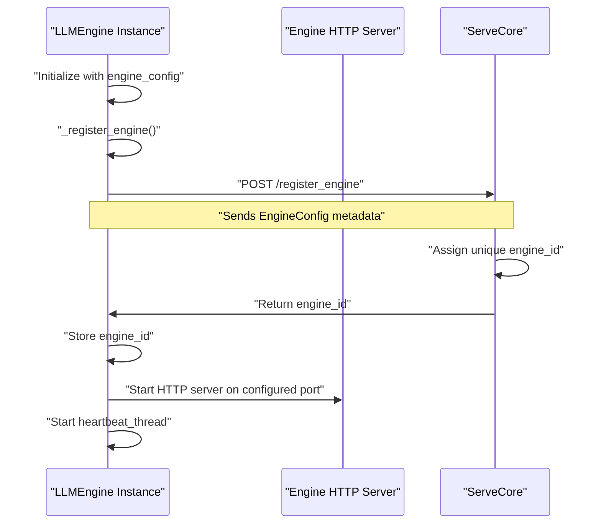
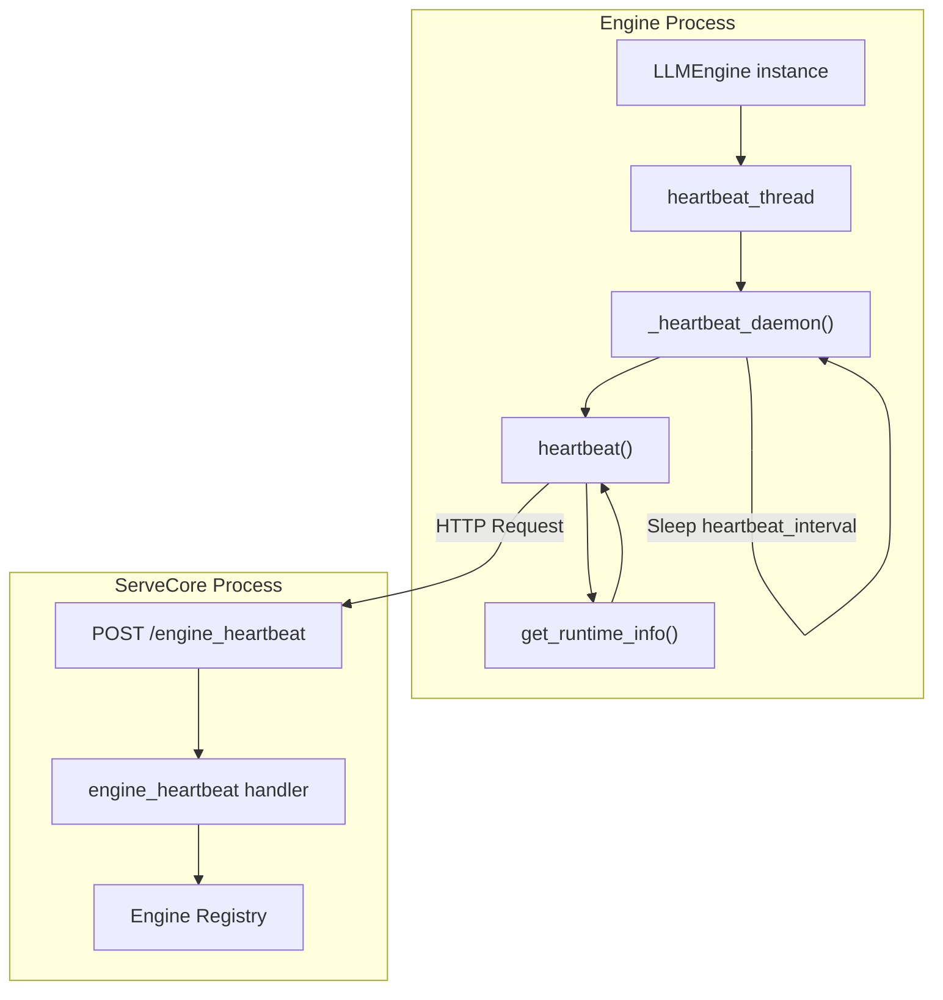
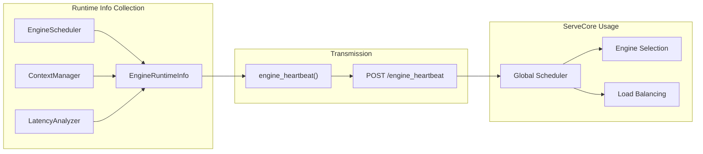
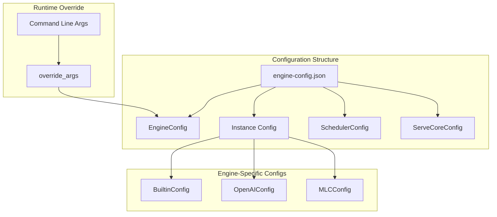
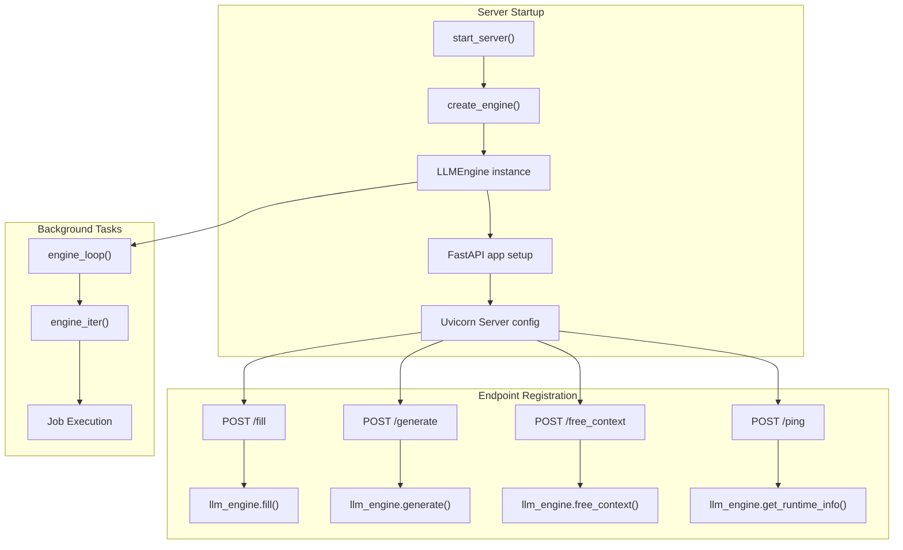
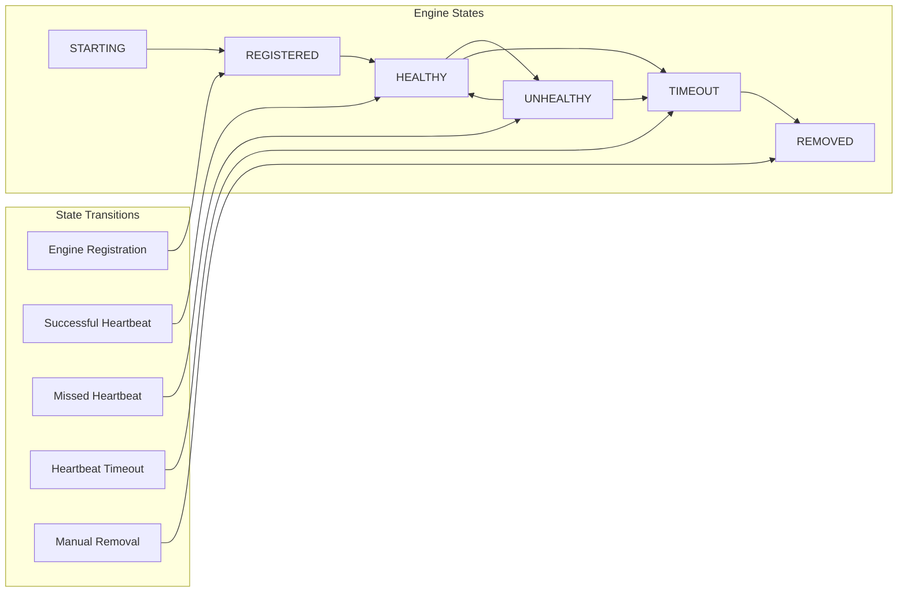

<!-- source: DeepWiki mcp.deepwiki.com · repo microsoft/ParrotServe · page 5.4 Engine Management · fetched 2026-10-26 -->

# Engine Management

Relevant source files

The following files were used as context for generating this wiki page:

- [examples/hello_world.py](examples/hello_world.py)
- [parrot/__init__.py](parrot/__init__.py)
- [parrot/constants.py](parrot/constants.py)
- [parrot/engine/config.py](parrot/engine/config.py)
- [parrot/engine/http_server.py](parrot/engine/http_server.py)
- [parrot/engine/llm_engine.py](parrot/engine/llm_engine.py)
- [parrot/engine/openai/openai_engine.py](parrot/engine/openai/openai_engine.py)
- [parrot/frontend/pfunc/semantic_variable.py](parrot/frontend/pfunc/semantic_variable.py)
- [parrot/serve/backend_repr/__init__.py](parrot/serve/backend_repr/__init__.py)
- [parrot/serve/backend_repr/model.py](parrot/serve/backend_repr/model.py)
- [parrot/serve/config.py](parrot/serve/config.py)
- [parrot/serve/http_server.py](parrot/serve/http_server.py)
- [sample_configs/engine/openai-example-config.json](sample_configs/engine/openai-example-config.json)

Engine Management handles the lifecycle of LLM inference engines within the ParrotServe distributed system. This includes engine registration with ServeCore, continuous heartbeat monitoring to track engine health, runtime information reporting for scheduling decisions, and configuration management for different engine types.

For information about the different types of engines and their implementations, see [Engine Types](#5.1). For details about the primitive operations engines execute, see [Primitive Operations](#5.2).

## Engine Registration Process

When an engine starts, it must register itself with the ServeCore to become available for task scheduling. The registration process establishes the engine's identity and capabilities within the distributed system.

The registration occurs in the `LLMEngine.__init__()` method, where engines call `_register_engine()` to establish their connection to ServeCore. The registration payload includes engine configuration details such as model name, capacity, and server endpoints.

Sources: [parrot/engine/llm_engine.py:47-58](), [parrot/serve/http_server.py:157-162]()

## Heartbeat System

Engines maintain continuous communication with ServeCore through a heartbeat mechanism that ensures engine availability and provides real-time status updates for scheduling decisions.

The heartbeat system operates through several key components:

- **Heartbeat Thread**: A daemon thread started in `engine_loop()` that runs the heartbeat cycle
- **Heartbeat Interval**: Configurable interval (default 3 seconds) defined in `EngineConfig.heartbeat_interval`
- **Runtime Information**: Each heartbeat includes current engine status via `get_runtime_info()`

Sources: [parrot/engine/llm_engine.py:151-156](), [parrot/engine/llm_engine.py:123-149](), [parrot/engine/config.py:114]()

## Runtime Information Reporting

Engines report detailed runtime statistics to enable intelligent scheduling and resource management decisions by ServeCore.

| Field | Description | Source |
|-------|-------------|---------|
| `num_cached_tokens` | Number of tokens currently in KV cache | Engine-specific implementation |
| `num_running_jobs` | Active jobs being processed | `EngineScheduler.num_running_jobs` |
| `num_total_jobs` | Total jobs processed since startup | `EngineScheduler.num_total_jobs` |
| `cache_mem` | Memory used by KV cache (bytes) | Engine-specific implementation |
| `model_mem` | Memory used by model weights (bytes) | Engine-specific implementation |
| `recent_average_latency` | Moving average of recent job latencies | `LatencyAnalyzer.get_average_latency()` |

Different engine types report different levels of detail. For example, `OpenAIEngine` sets memory-related fields to `UNKNOWN_DATA_FIELD` since it cannot access OpenAI API infrastructure details, while `BuiltinEngine` provides detailed memory usage statistics.

Sources: [parrot/engine/llm_engine.py:110-114](), [parrot/engine/openai/openai_engine.py:181-199](), [parrot/constants.py:42]()

## Configuration Management

Engine configuration is managed through a hierarchical JSON-based system that supports different engine types and deployment scenarios.

Configuration examples for different engine types:

**Core Engine Configuration** (`EngineConfig`):
- `model`: Model identifier (e.g., "gpt-3.5-turbo", "facebook/opt-13b")
- `engine_name`: Human-readable engine identifier
- `engine_type`: Engine type ("builtin", "openai")
- `host`/`port`: HTTP server binding configuration
- `heartbeat_interval`: Heartbeat frequency in seconds
- `tasks_capacity`: Maximum concurrent tasks

**Engine-Specific Configuration**:
- `OpenAIConfig`: API keys, endpoints, Azure configuration
- `BuiltinConfig`: Memory allocation, attention mechanisms, device settings
- `SchedulerConfig`: Batch sizes, token limits, scheduling policies

Sources: [parrot/engine/config.py:101-143](), [sample_configs/engine/openai-example-config.json:1-25](), [parrot/engine/config.py:28-57]()

## HTTP Server Lifecycle

Each engine runs its own HTTP server to handle requests from ServeCore, providing endpoints for primitive operations and status monitoring.

The HTTP server lifecycle involves several key phases:

1. **Initialization**: `start_server()` creates the engine instance and FastAPI application
2. **Endpoint Setup**: Standard endpoints for primitive operations are registered
3. **Background Loop**: `engine_loop()` runs concurrently to process jobs and send heartbeats
4. **Request Handling**: Incoming requests are dispatched to the appropriate engine methods

The server supports command-line overrides for deployment flexibility, allowing operators to override configuration file settings for host, port, engine name, and device allocation.

Sources: [parrot/engine/http_server.py:70-97](), [parrot/engine/http_server.py:32-68](), [parrot/engine/llm_engine.py:158-169]()

## Engine Status Monitoring

ServeCore maintains a registry of all engines and their current status for scheduling and fault tolerance purposes.

Engine monitoring involves several timeout mechanisms:

- **Heartbeat Timeout**: Engines that fail to send heartbeats within `engine_heartbeat_timeout` (default 600 seconds) are marked as unavailable
- **Connection Timeout**: Failed registration attempts or network issues trigger retry logic
- **Health Assessment**: ServeCore evaluates engine health based on heartbeat frequency and reported runtime information

The monitoring system enables ServeCore to make informed scheduling decisions, automatically excluding unhealthy engines from task assignment and providing operators with visibility into system health.

Sources: [parrot/serve/config.py:20](), [parrot/serve/http_server.py:150-155](), [parrot/constants.py:16-19]()

---

