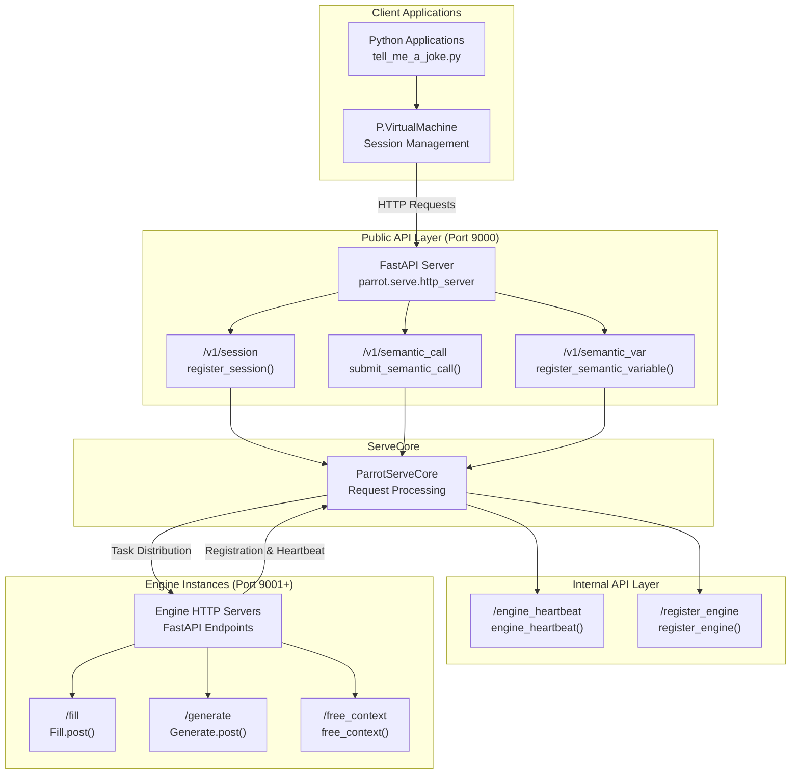
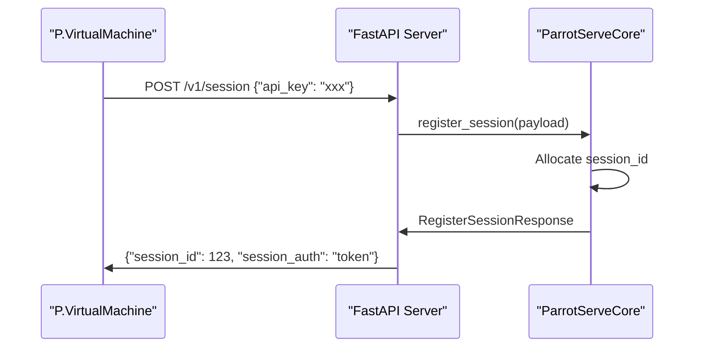
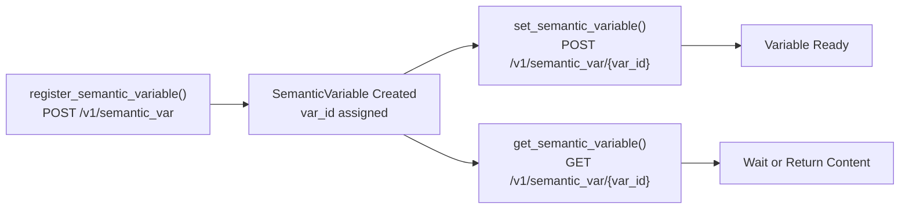
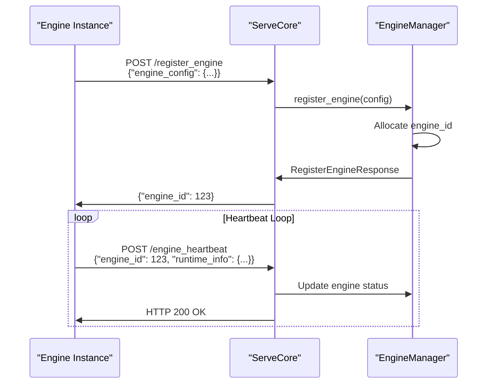
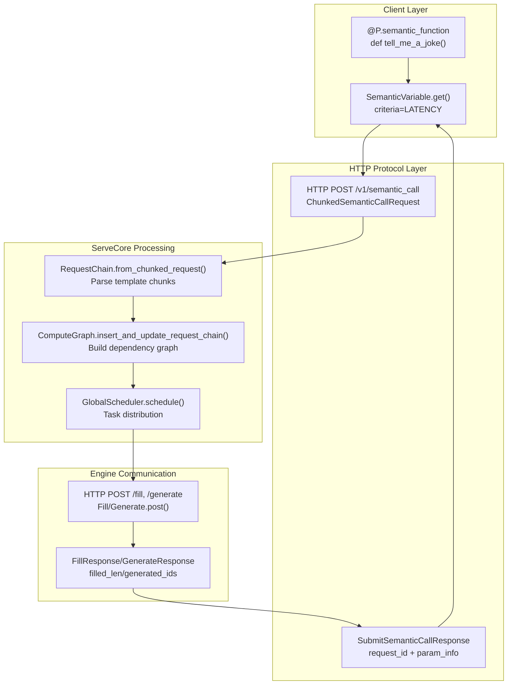

<!-- source: DeepWiki mcp.deepwiki.com · repo microsoft/ParrotServe · page 6 HTTP APIs · fetched 2026-10-26 -->

# HTTP APIs

Relevant source files

The following files were used as context for generating this wiki page:

- [parrot/__init__.py](parrot/__init__.py)
- [parrot/constants.py](parrot/constants.py)
- [parrot/engine/config.py](parrot/engine/config.py)
- [parrot/frontend/pfunc/semantic_variable.py](parrot/frontend/pfunc/semantic_variable.py)
- [parrot/protocol/public/apis.py](parrot/protocol/public/apis.py)
- [parrot/serve/backend_repr/model.py](parrot/serve/backend_repr/model.py)
- [parrot/serve/config.py](parrot/serve/config.py)
- [parrot/serve/graph/__init__.py](parrot/serve/graph/__init__.py)
- [parrot/serve/graph/graph.py](parrot/serve/graph/graph.py)
- [parrot/serve/graph/graph_traverse.py](parrot/serve/graph/graph_traverse.py)
- [parrot/serve/graph/semantic_variable.py](parrot/serve/graph/semantic_variable.py)
- [parrot/serve/graph/visualize_utils.py](parrot/serve/graph/visualize_utils.py)
- [parrot/serve/http_server.py](parrot/serve/http_server.py)
- [parrot/serve/scheduler/task_creator.py](parrot/serve/scheduler/task_creator.py)
- [parrot/testing/fake_core_server.py](parrot/testing/fake_core_server.py)
- [tests/serve/test_scheduler.py](tests/serve/test_scheduler.py)
- [tests/test_protocol.py](tests/test_protocol.py)

This document describes the HTTP API interfaces in ParrotServe, covering both public client-facing APIs and internal layer-to-layer communication protocols. These REST endpoints enable distributed communication between the client applications, ServeCore orchestrator, and Engine instances.

For information about the client programming interfaces that use these APIs, see [Client Programming Interface](#3). For details about internal engine management, see [Engine Management](#5.4).

## API Architecture Overview

ParrotServe implements a two-tier HTTP API architecture with distinct endpoint categories for different communication layers:

**Sources:** [parrot/serve/http_server.py:1-271](), [parrot/constants.py:9-14](), [parrot/protocol/public/apis.py:1-310]()

## Public APIs

The public APIs are exposed by ServeCore on the default port 9000 and follow RESTful conventions with versioned endpoints under `/v1/`.

### Session Management APIs

| Endpoint | Method | Function | Purpose |
|----------|--------|----------|---------|
| `/v1/session` | POST | `register_session()` | Create new user session |
| `/v1/session/{session_id}` | DELETE | `remove_session()` | Remove existing session |
| `/v1/session/{session_id}` | GET | `get_session_info()` | Get session information |

**Session Registration Flow:**

The `RegisterSessionResponse` class defines the response structure with `session_id` and `session_auth` fields for subsequent authenticated requests.

**Sources:** [parrot/serve/http_server.py:66-82](), [parrot/protocol/public/apis.py:41-90]()

### Function Call APIs

| Endpoint | Method | Function | Purpose |
|----------|--------|----------|---------|
| `/v1/semantic_call` | POST | `submit_semantic_call()` | Submit LLM function call |
| `/v1/py_native_call` | POST | `submit_py_native_call()` | Submit Python function call |

**Semantic Call Request Structure:**
The semantic call payload includes:
- `template`: Prompt template with placeholders like `"Hello {{name}}"`
- `placeholders`: Array of parameter definitions with `is_output` flags
- `models`: List of target model names
- `model_type`: Either `"token_id"` or `"text"`

**Sources:** [parrot/serve/http_server.py:85-116](), [tests/test_protocol.py:51-83]()

### Semantic Variable APIs

| Endpoint | Method | Function | Purpose |
|----------|--------|----------|---------|
| `/v1/semantic_var` | POST | `register_semantic_variable()` | Create new semantic variable |
| `/v1/semantic_var/{var_id}` | POST | `set_semantic_variable()` | Set variable content |
| `/v1/semantic_var/{var_id}` | GET | `get_semantic_variable()` | Get variable content |
| `/v1/semantic_var` | GET | `get_semantic_variable_list()` | List session variables |

**Variable Lifecycle Diagram:**

**Sources:** [parrot/serve/http_server.py:119-142](), [parrot/protocol/public/apis.py:205-309]()

## Internal APIs

Internal APIs facilitate communication between ServeCore and Engine instances without versioning prefixes.

### Engine Management APIs

| Endpoint | Method | Function | Purpose |
|----------|--------|----------|---------|
| `/register_engine` | POST | `register_engine()` | Register new engine instance |
| `/engine_heartbeat` | POST | `engine_heartbeat()` | Send engine health status |

**Engine Registration Process:**

The `EngineRuntimeInfo` class contains metrics like task counts, memory usage, and performance statistics that engines report during heartbeat.

**Sources:** [parrot/serve/http_server.py:150-161](), [tests/test_protocol.py:164-197]()

### Primitive Operation APIs

Engines expose endpoints for the three primitive LLM operations:

| Endpoint | Method | Class | Purpose |
|----------|--------|-------|---------|
| `/fill` | POST | `Fill` | Prefill context with tokens |
| `/generate` | POST | `Generate` | Generate new tokens |
| `/free_context` | POST | N/A | Free allocated context memory |
| `/ping` | GET | N/A | Health check endpoint |

**Primitive Request Structure:**
Both `Fill` and `Generate` classes inherit common fields:
- `session_id`: User session identifier
- `task_id`: Unique task identifier  
- `context_id`: Context memory identifier
- `parent_context_id`: Parent context for sharing
- `end_flag`: Indicates final chunk in sequence

**Sources:** [tests/test_protocol.py:200-271](), [parrot/protocol/internal/primitive_request.py]()

## HTTP Request/Response Flow

The following diagram shows the complete request processing pipeline from client to engine:

**Error Handling:**
The FastAPI server implements exception handlers for `ParrotCoreUserError` and `ParrotCoreInternalError` classes, returning structured JSON responses with error details and optional traceback information in debug mode.

**Sources:** [parrot/serve/http_server.py:40-58](), [parrot/serve/graph/graph.py:254-305](), [parrot/serve/scheduler/task_creator.py:41-72]()

## API Versioning and Constants

ParrotServe uses semantic versioning with the current API version defined in `API_VERSION`. All public endpoints are prefixed with this version string for backwards compatibility.

**Default Configuration:**
- ServeCore HTTP Server: `localhost:9000`
- Engine HTTP Servers: `localhost:9001+`
- API Version: `/v1/`

The system supports configurable host and port settings through `ServeCoreConfig` and `EngineConfig` classes, enabling distributed deployment across multiple machines.

**Sources:** [parrot/constants.py:9-14](), [parrot/protocol/public/api_version.py](), [parrot/serve/config.py:11-22]()

---

