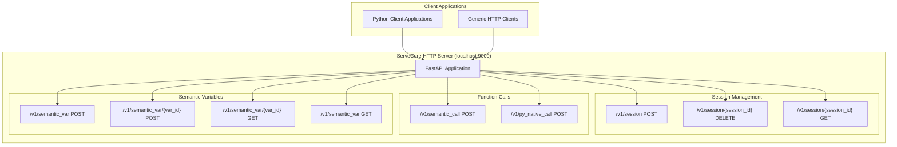
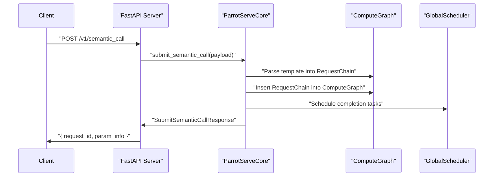
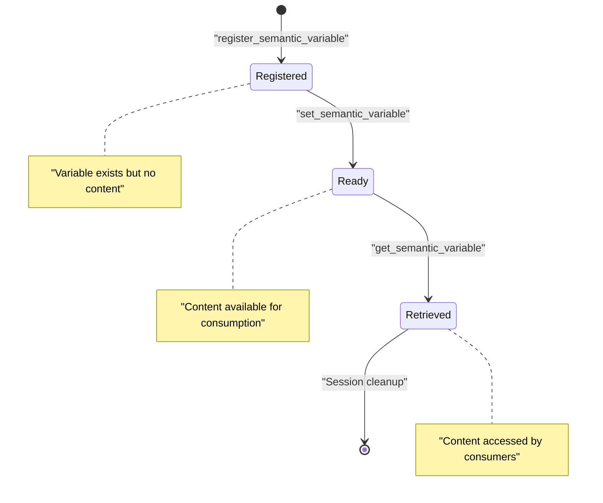

<!-- source: DeepWiki mcp.deepwiki.com · repo microsoft/ParrotServe · page 6.1 Public APIs · fetched 2026-10-26 -->

# Public APIs

<details>
<summary>Relevant source files</summary>

The following files were used as context for generating this wiki page:

- [parrot/__init__.py](parrot/__init__.py)
- [parrot/constants.py](parrot/constants.py)
- [parrot/engine/config.py](parrot/engine/config.py)
- [parrot/frontend/pfunc/semantic_variable.py](parrot/frontend/pfunc/semantic_variable.py)
- [parrot/protocol/public/apis.py](parrot/protocol/public/apis.py)
- [parrot/serve/backend_repr/model.py](parrot/serve/backend_repr/model.py)
- [parrot/serve/config.py](parrot/serve/config.py)
- [parrot/serve/graph/__init__.py](parrot/serve/graph/__init__.py)
- [parrot/serve/graph/graph.py](parrot/serve/graph/graph.py)
- [parrot/serve/graph/graph_traverse.py](parrot/serve/graph/graph_traverse.py)
- [parrot/serve/graph/semantic_variable.py](parrot/serve/graph/semantic_variable.py)
- [parrot/serve/graph/visualize_utils.py](parrot/serve/graph/visualize_utils.py)
- [parrot/serve/http_server.py](parrot/serve/http_server.py)
- [parrot/serve/scheduler/task_creator.py](parrot/serve/scheduler/task_creator.py)
- [parrot/testing/fake_core_server.py](parrot/testing/fake_core_server.py)
- [tests/serve/test_scheduler.py](tests/serve/test_scheduler.py)
- [tests/test_protocol.py](tests/test_protocol.py)

</details>


This document describes the client-facing REST APIs provided by ParrotServe's ServeCore layer. These APIs enable external applications to create sessions, submit semantic function calls, and manage semantic variables through HTTP endpoints.

For information about internal layer-to-layer communication protocols, see [Internal APIs](#6.2). For details about the client programming interface that wraps these APIs, see [Client Programming Interface](#3).

## API Overview

ParrotServe exposes public APIs through a FastAPI-based HTTP server running on the ServeCore. All public endpoints are versioned and follow RESTful design patterns for resource management.

**API Endpoint Structure**


**API Endpoint Summary**

| Category | Method | Endpoint | Function | Purpose |
|----------|--------|----------|----------|---------|
| Session | POST | `/v1/session` | `register_session` | Create new user session |
| Session | DELETE | `/v1/session/{session_id}` | `remove_session` | Terminate user session |
| Session | GET | `/v1/session/{session_id}` | `get_session_info` | Get session details |
| Function Call | POST | `/v1/semantic_call` | `submit_semantic_call` | Submit LLM function call |
| Function Call | POST | `/v1/py_native_call` | `submit_py_native_call` | Submit Python function call |
| Variables | POST | `/v1/semantic_var` | `register_semantic_variable` | Create semantic variable |
| Variables | POST | `/v1/semantic_var/{var_id}` | `set_semantic_variable` | Set variable content |
| Variables | GET | `/v1/semantic_var/{var_id}` | `get_semantic_variable` | Get variable content |
| Variables | GET | `/v1/semantic_var` | `get_semantic_variable_list` | List session variables |

Sources: [parrot/serve/http_server.py:66-143](), [parrot/protocol/public/apis.py:18-32]()

## Session Management APIs

Sessions provide isolated execution contexts for user applications. Each session maintains its own semantic variable namespace and compute graph state.

**Session Registration**
```http
POST /v1/session
Content-Type: application/json

{
    "api_key": "user_api_key"
}
```

Returns `RegisterSessionResponse` containing:
- `session_id`: Integer identifier for the new session
- `session_auth`: Authentication token for subsequent requests

**Session Removal**
```http
DELETE /v1/session/{session_id}
Content-Type: application/json

{
    "session_auth": "session_token"
}
```

Returns `RemoveSessionResponse` (empty response body on success).

**Client Library Usage:**
```python
from parrot.protocol.public.apis import register_session, remove_session

# Register session
response = register_session(http_addr="http://localhost:9000", api_key="my_key")
session_id = response.session_id
session_auth = response.session_auth

# Remove session
remove_session(http_addr="http://localhost:9000", 
               session_id=session_id, 
               session_auth=session_auth)
```

Sources: [parrot/serve/http_server.py:66-77](), [parrot/protocol/public/apis.py:79-123](), [parrot/protocol/public/apis.py:41-47]()

## Function Call APIs

Function call APIs enable submission of both semantic functions (LLM-based) and native Python functions to the ServeCore for execution.

**Semantic Function Call Request Flow**


**Semantic Function Call**
```http
POST /v1/semantic_call
Content-Type: application/json

{
    "session_id": 123,
    "template": "Tell me a joke about {{topic}}. {{joke}}",
    "placeholders": [
        {
            "name": "topic",
            "is_output": false,
            "var_id": "var_001"
        },
        {
            "name": "joke", 
            "is_output": true,
            "sampling_config": {
                "temperature": 0.9,
                "top_p": 0.9
            }
        }
    ],
    "models": ["gpt-3.5-turbo"],
    "model_type": "text"
}
```

Returns `SubmitSemanticCallResponse` containing:
- `request_id`: Unique identifier for the submitted request
- `param_info`: List of parameter information including variable IDs

**Python Native Function Call**
```http
POST /v1/py_native_call
Content-Type: application/json

{
    "session_id": 123,
    "function_name": "process_data",
    "parameters": {
        "input_var": "var_001",
        "output_var": "var_002"
    }
}
```

Sources: [parrot/serve/http_server.py:85-116](), [parrot/protocol/public/apis.py:125-202](), [tests/test_protocol.py:51-83]()

## Semantic Variable APIs

Semantic variables are the core abstraction for managing intermediate results and dependencies in LLM computation graphs.

**Variable Lifecycle Management**


**Variable Registration**
```http
POST /v1/semantic_var
Content-Type: application/json

{
    "session_id": 123,
    "session_auth": "token",
    "var_name": "user_input"
}
```

Returns `RegisterSemanticVariableResponse` with:
- `var_id`: Unique string identifier for the variable

**Variable Content Setting**
```http
POST /v1/semantic_var/{var_id}
Content-Type: application/json

{
    "session_id": 123,
    "session_auth": "token", 
    "content": "variable content string"
}
```

**Variable Content Retrieval**
```http
GET /v1/semantic_var/{var_id}
Content-Type: application/json

{
    "session_id": 123,
    "session_auth": "token",
    "criteria": "latency"
}
```

Returns `GetSemanticVariableResponse` with:
- `content`: String content of the variable

The `criteria` parameter accepts:
- `"latency"`: Optimize for low-latency retrieval
- `"throughput"`: Optimize for high-throughput batching

Sources: [parrot/serve/http_server.py:119-143](), [parrot/protocol/public/apis.py:205-309](), [parrot/serve/graph/perf_criteria.py]()

## Authentication and Versioning

**API Versioning**
All public APIs use versioned paths with the pattern `/{API_VERSION}/endpoint` where `API_VERSION` is currently `"v1"`. This enables backward compatibility as the system evolves.

**Authentication Model**
ParrotServe uses a two-tier authentication system:
1. **API Key**: Required for session registration
2. **Session Auth Token**: Required for all subsequent operations within a session

**Error Handling**
The FastAPI server includes exception handlers for:
- `ParrotCoreUserError`: Returns HTTP 500 with error details and optional traceback
- `ParrotCoreInternalError`: Re-raises the exception for system-level handling

In release mode, detailed traceback information is suppressed from error responses.

Sources: [parrot/serve/http_server.py:40-59](), [parrot/protocol/public/api_version.py](), [parrot/constants.py:10-14]()

## Client Library Integration

ParrotServe provides both synchronous and asynchronous client functions in the `parrot.protocol.public.apis` module that wrap the HTTP endpoints.

**Synchronous Client Usage:**
```python
from parrot.protocol.public.apis import (
    register_session, submit_semantic_call, 
    register_semantic_variable, set_semantic_variable, get_semantic_variable
)

# Session setup
response = register_session("http://localhost:9000", "api_key")
session_id = response.session_id

# Variable operations  
var_response = register_semantic_variable(
    "http://localhost:9000", session_id, "auth_token", "my_var"
)
var_id = var_response.var_id

set_semantic_variable(
    "http://localhost:9000", session_id, "auth_token", var_id, "content"
)

content_response = get_semantic_variable(
    "http://localhost:9000", session_id, "auth_token", var_id, "latency"
)
```

**Asynchronous Client Usage:**
```python
from parrot.protocol.public.apis import asubmit_semantic_call, aget_semantic_variable

# Async function submission
response = await asubmit_semantic_call(
    "http://localhost:9000", session_id, "auth_token", payload
)

# Async variable retrieval
content_response = await aget_semantic_variable(
    "http://localhost:9000", session_id, "auth_token", var_id, "criteria"
)
```

Sources: [parrot/protocol/public/apis.py:79-309](), [tests/test_protocol.py:37-146]()

---

