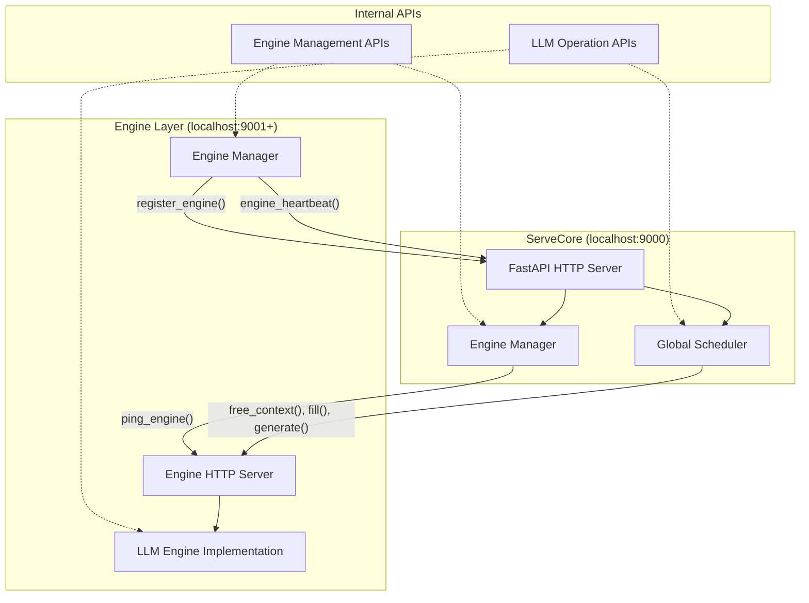
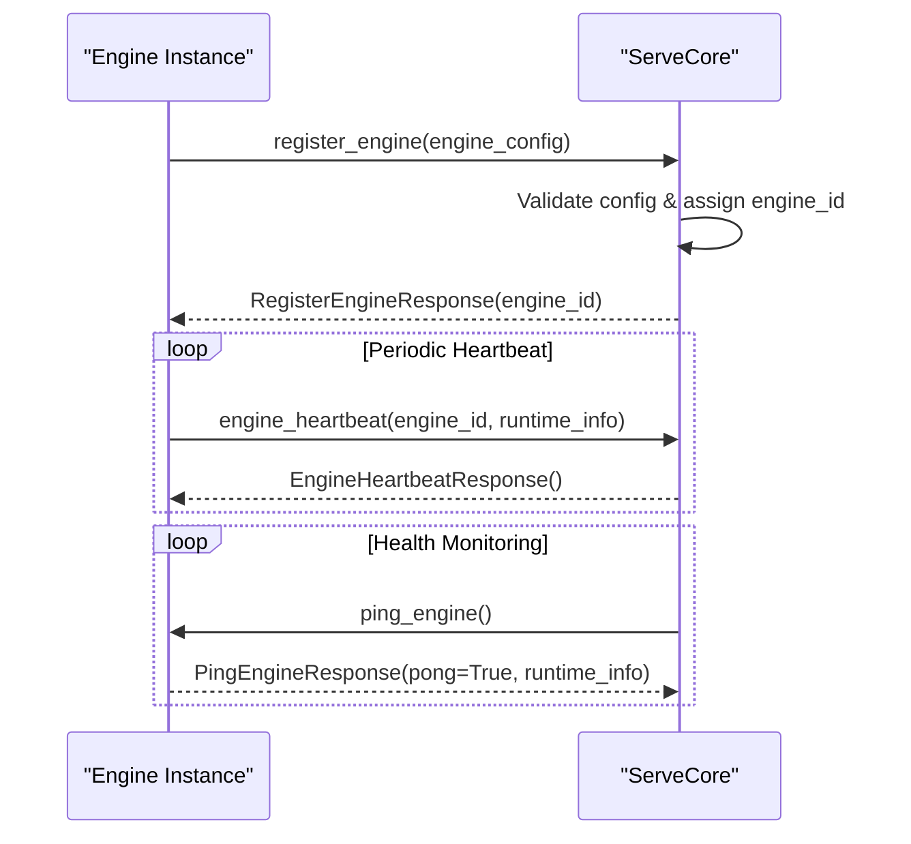
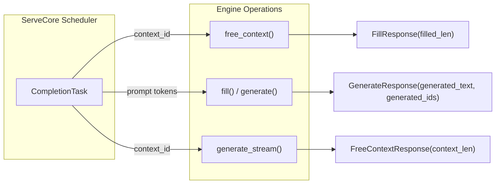
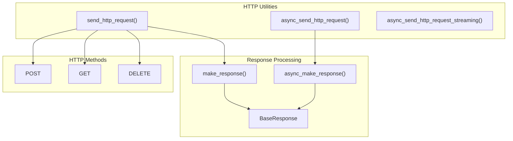
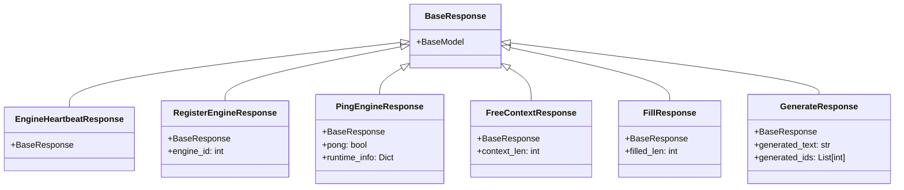

<!-- source: DeepWiki mcp.deepwiki.com · repo microsoft/ParrotServe · page 6.2 Internal APIs · fetched 2026-10-26 -->

# Internal APIs

Relevant source files

The following files were used as context for generating this wiki page:

- [parrot/protocol/base_response.py](parrot/protocol/base_response.py)
- [parrot/protocol/http_utils.py](parrot/protocol/http_utils.py)
- [parrot/protocol/internal/layer_apis.py](parrot/protocol/internal/layer_apis.py)
- [parrot/protocol/public/api_version.py](parrot/protocol/public/api_version.py)

This document covers the internal HTTP APIs used for communication between the ServeCore layer and Engine layer in ParrotServe's distributed architecture. These APIs enable engine registration, health monitoring, and primitive LLM operations. For client-facing APIs that applications use to interact with ParrotServe, see [Public APIs](#6.1).

## Communication Architecture

The internal APIs facilitate bidirectional communication between ServeCore and Engine layers through HTTP requests. The ServeCore acts as both client (when calling engine operations) and server (when receiving engine registrations), while engines act as both server (for LLM operations) and client (for registration and heartbeats).

Sources: [parrot/protocol/internal/layer_apis.py:16-31]()

## Engine Management APIs

### Engine Registration Flow

### Engine Management Functions

| Function | Direction | Purpose | Response Class |
|----------|-----------|---------|----------------|
| `register_engine()` | Engine → ServeCore | Register new engine instance | `RegisterEngineResponse` |
| `engine_heartbeat()` | Engine → ServeCore | Send periodic health updates | `EngineHeartbeatResponse` |
| `ping_engine()` | ServeCore → Engine | Check engine availability | `PingEngineResponse` |

The `register_engine()` function accepts an `EngineConfig` object containing engine configuration and returns a unique `engine_id` for subsequent communications [parrot/protocol/internal/layer_apis.py:99-115](). 

The `engine_heartbeat()` function includes `EngineRuntimeInfo` for capacity and performance monitoring [parrot/protocol/internal/layer_apis.py:118-138]().

The `ping_engine()` function provides health checking with configurable retry logic and returns runtime information [parrot/protocol/internal/layer_apis.py:83-93]().

Sources: [parrot/protocol/internal/layer_apis.py:99-138]()

## LLM Operation APIs

### Primitive Operations

### LLM API Functions

| Function | Purpose | Request Parameters | Response Fields |
|----------|---------|-------------------|-----------------|
| `free_context()` | Release context memory | `context_id` | `context_len` |
| `fill()` | Prefill prompt tokens | `prompt`, `context_id` | `filled_len` |
| `generate()` | Generate tokens | `context_id`, `max_tokens` | `generated_text`, `generated_ids` |
| `generate_stream()` | Stream token generation | `context_id`, `max_tokens` | Streaming response |

The `free_context()` function handles context cleanup and memory management [parrot/protocol/internal/layer_apis.py:69-80](). It accepts a `context_id` parameter and returns the length of the freed context.

These operations map directly to the primitive job types in the engine scheduling system, enabling fine-grained control over LLM inference phases.

Sources: [parrot/protocol/internal/layer_apis.py:69-80](), [parrot/protocol/internal/layer_apis.py:53-64]()

## HTTP Infrastructure

### Request Transport Layer

The HTTP infrastructure provides both synchronous and asynchronous request capabilities through the `send_http_request()` and `async_send_http_request()` functions [parrot/protocol/http_utils.py:17-55]().

### Request Configuration

The `send_http_request()` function supports:
- **Retry Logic**: Configurable `retry_times` parameter for handling transient failures
- **Timeout Handling**: Optional timeout configuration for request duration limits  
- **HTTP Methods**: Support for GET, POST, and DELETE operations
- **Error Handling**: Automatic error forwarding and status code validation

Error responses include structured error information with traceback details for debugging [parrot/protocol/http_utils.py:47-51]().

Sources: [parrot/protocol/http_utils.py:17-81]()

## Response Models

### Response Class Hierarchy

All response models inherit from `BaseResponse`, which extends Pydantic's `BaseModel` for automatic serialization and validation [parrot/protocol/base_response.py:16-17]().

### Response Processing

The response processing system uses:
- **Type-Safe Deserialization**: Pydantic models ensure type safety and validation
- **Field Mapping**: Automatic mapping from JSON response fields to model attributes
- **Async Support**: Both synchronous and asynchronous response processing capabilities

Response construction uses `make_response()` for synchronous requests and `async_make_response()` for asynchronous operations [parrot/protocol/base_response.py:20-30]().

Sources: [parrot/protocol/internal/layer_apis.py:40-64](), [parrot/protocol/base_response.py:16-30]()

---

