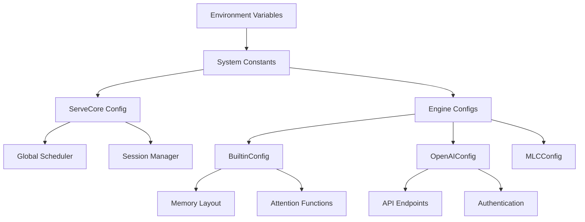
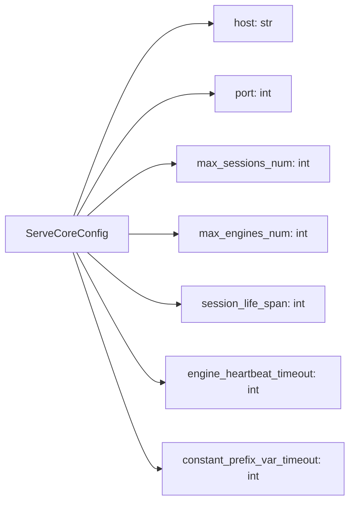
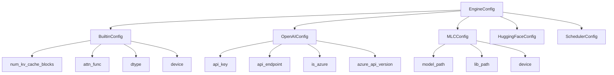
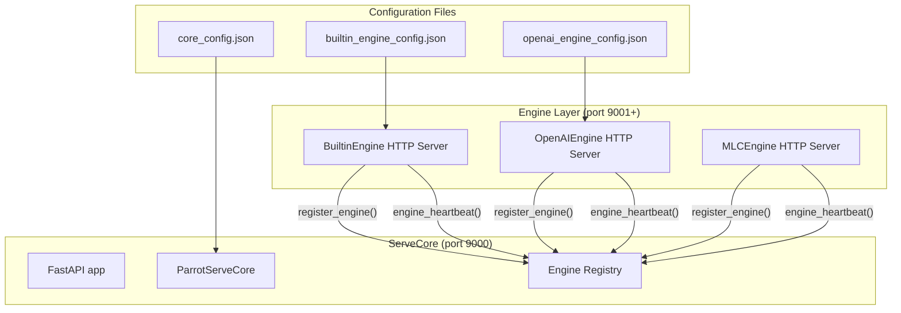
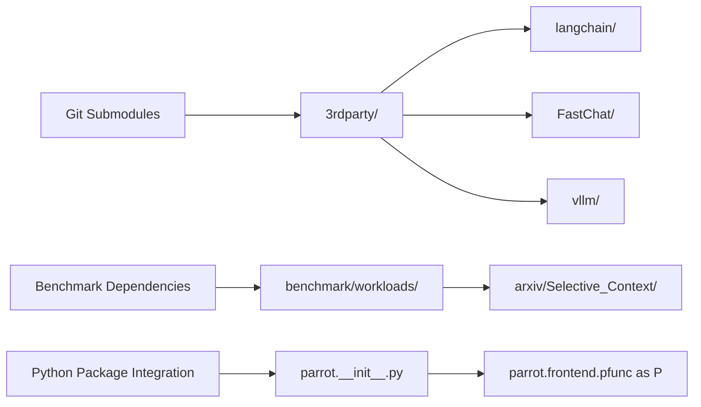
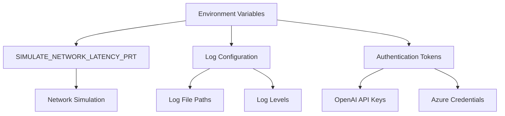
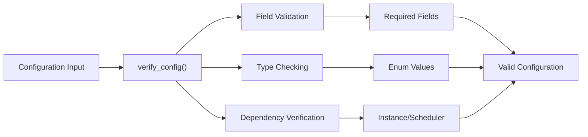

<!-- source: DeepWiki mcp.deepwiki.com · repo microsoft/ParrotServe · page 7 Configuration and Deployment · fetched 2026-10-26 -->

# Configuration and Deployment

<details>
<summary>Relevant source files</summary>

The following files were used as context for generating this wiki page:

- [.gitmodules](.gitmodules)
- [parrot/__init__.py](parrot/__init__.py)
- [parrot/constants.py](parrot/constants.py)
- [parrot/engine/config.py](parrot/engine/config.py)
- [parrot/frontend/pfunc/semantic_variable.py](parrot/frontend/pfunc/semantic_variable.py)
- [parrot/serve/backend_repr/model.py](parrot/serve/backend_repr/model.py)
- [parrot/serve/config.py](parrot/serve/config.py)
- [parrot/serve/http_server.py](parrot/serve/http_server.py)

</details>


This document covers the configuration and deployment procedures for ParrotServe, including engine setup, server configuration, and third-party dependency management. The configuration system enables flexible deployment of distributed LLM serving infrastructure across heterogeneous computing environments.

For detailed engine-specific settings, see [Engine Configuration](#7.1). For installation procedures and dependency management, see [Installation and Dependencies](#7.2).

## Configuration System Overview

ParrotServe uses a hierarchical configuration system with JSON-based configuration files and environment variables. The system supports multiple deployment patterns from single-node development to distributed production environments.

### Configuration Hierarchy



**Sources:** [parrot/constants.py:1-43](), [parrot/engine/config.py:1-171](), [parrot/serve/config.py:1-40]()

## Core Configuration Components

### System Constants

ParrotServe defines system-wide constants in `constants.py` that establish default networking, timing, and engine parameters:

| Configuration Category | Constants | Default Values |
|------------------------|-----------|----------------|
| **HTTP Servers** | `DEFAULT_SERVER_HOST`, `DEFAULT_CORE_SERVER_PORT`, `DEFAULT_ENGINE_SERVER_PORT` | `localhost`, `9000`, `9001` |
| **Loop Intervals** | `CORE_LOOP_INTERVAL`, `ENGINE_LOOP_INTERVAL` | `0.0001s`, `0.000001s` |
| **Engine Types** | `ENGINE_TYPE_BUILTIN`, `ENGINE_TYPE_OPENAI` | `"builtin"`, `"openai"` |
| **Chunking** | `FILL_NO_CHUNK`, `PIPELINE_SEND_CHUNK_NUM` | `-1`, `128` |

**Sources:** [parrot/constants.py:9-43]()

### ServeCore Configuration

The `ServeCoreConfig` class defines parameters for the central orchestration layer:



**Sources:** [parrot/serve/config.py:12-22]()

## Engine Configuration Framework

### Configuration Classes

ParrotServe implements a typed configuration system using dataclasses for different engine types:



**Sources:** [parrot/engine/config.py:28-171]()

### Engine Type Mapping

The configuration system maps engine types to their corresponding model representations:

| Engine Type | Model Type | Configuration Class | Runtime Interface |
|-------------|------------|-------------------|------------------|
| `builtin` | `TOKEN_ID` | `BuiltinConfig` | Local LLM inference |
| `openai` | `TEXT` | `OpenAIConfig` | API-based inference |
| `mlc` | `TOKEN_ID` | `MLCConfig` | MLC framework |

**Sources:** [parrot/serve/backend_repr/model.py:29-32](), [parrot/engine/config.py:29-84]()

## Deployment Architecture

### Server Startup Configuration

The HTTP server initialization demonstrates the deployment pattern:

```mermaid
sequenceDiagram
    participant CLI as "Command Line"
    participant Config as "create_serve_core()"
    participant Server as "ParrotServeCore"
    participant Loop as "asyncio.new_event_loop()"
    participant Uvicorn as "uvicorn.Server"
    
    CLI->>Config: "core_config_path, release_mode"
    Config->>Server: "ServeCoreConfig"
    Server->>Loop: "pcore.serve_loop()"
    Loop->>Uvicorn: "host, port, app"
    Uvicorn->>Server: "HTTP endpoints active"
```

**Sources:** [parrot/serve/http_server.py:164-192]()

### Multi-Engine Deployment

ParrotServe supports heterogeneous engine deployment with automatic registration:



**Sources:** [parrot/serve/http_server.py:150-162](), [parrot/constants.py:10-14]()

## Third-Party Dependencies

### Git Submodules

ParrotServe integrates several third-party components as git submodules:

| Component | Repository | Purpose | Integration Point |
|-----------|------------|---------|------------------|
| **LangChain** | `langchain-ai/langchain` | Application framework | `3rdparty/langchain/` |
| **FastChat** | `lm-sys/FastChat` | Conversation models | `3rdparty/FastChat/` |
| **vLLM** | `vllm-project/vllm` | Optimized inference | `3rdparty/vllm/` |
| **Selective Context** | `liyucheng09/Selective_Context` | Benchmark workload | `benchmark/workloads/arxiv/` |

**Sources:** [.gitmodules:1-13]()

### Dependency Management



**Sources:** [.gitmodules:1-13](), [parrot/__init__.py:9-10]()

## Environment Configuration

### Runtime Environment Variables

The system uses environment variables for runtime behavior control:



**Sources:** [parrot/serve/http_server.py:88-96]()

### Command Line Interface

The HTTP server supports comprehensive command-line configuration:

| Parameter | Type | Purpose | Default |
|-----------|------|---------|---------|
| `--config_path` | `str` | ServeCore config file | Required |
| `--host` | `str` | Server host override | From config |
| `--port` | `int` | Server port override | From config |
| `--log_dir` | `str` | Log directory path | `stdout` |
| `--release_mode` | `flag` | Production deployment | `False` |

**Sources:** [parrot/serve/http_server.py:194-270]()

### Configuration Validation

The system implements configuration validation through class methods:



**Sources:** [parrot/engine/config.py:144-162](), [parrot/serve/config.py:23-39]()

---

