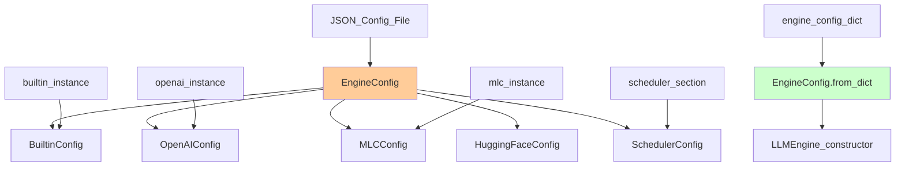
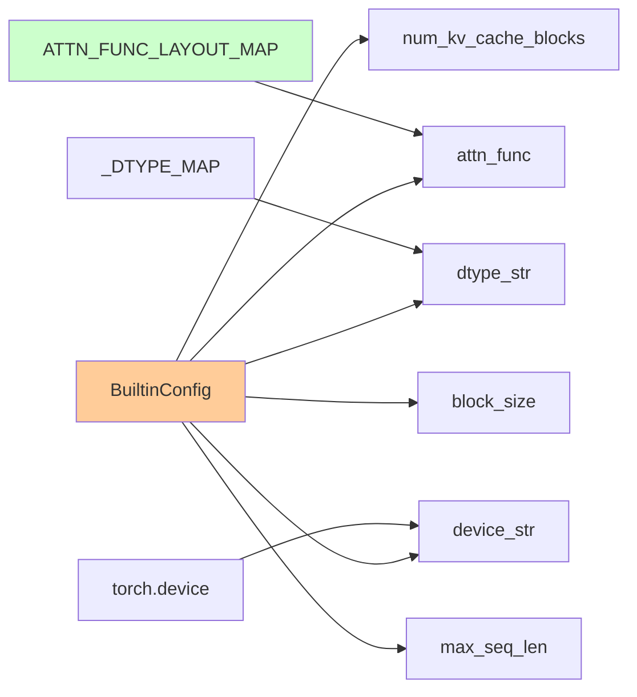
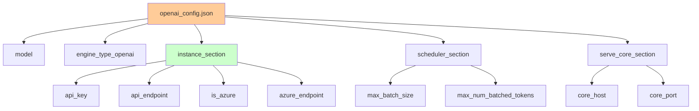
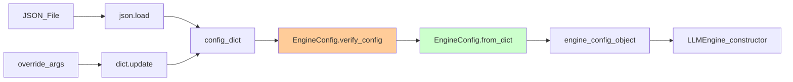
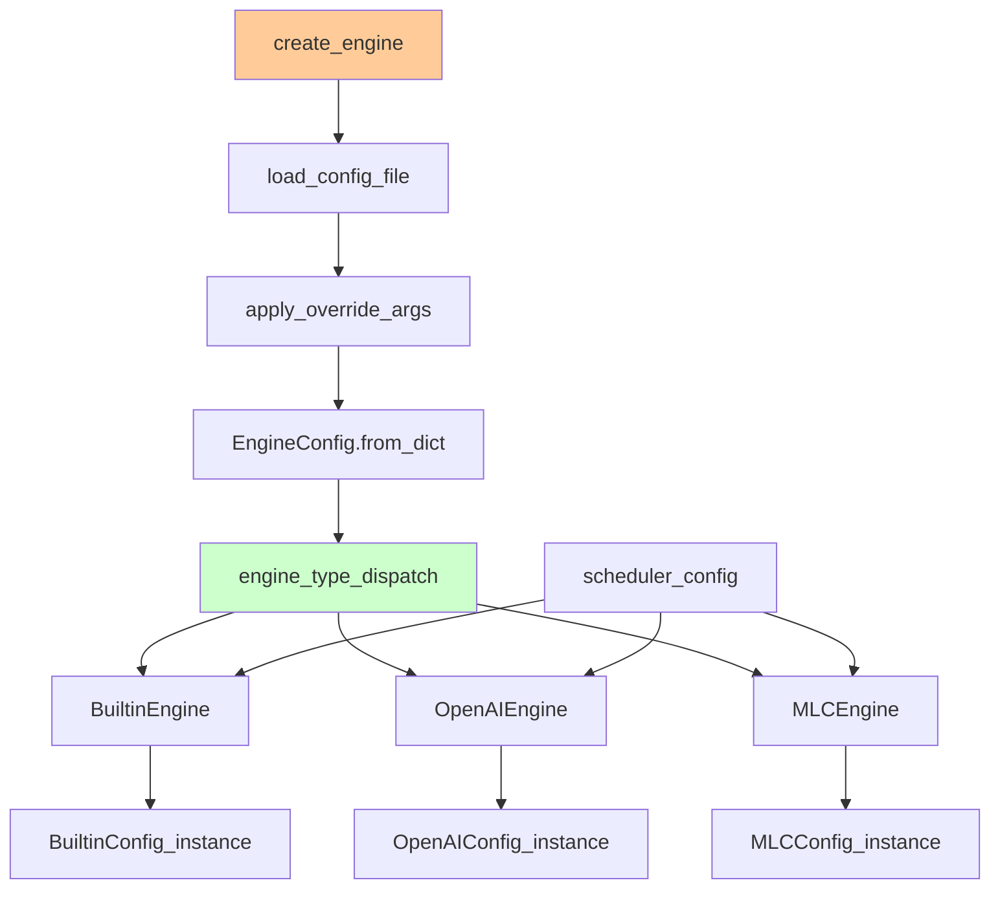

<!-- source: DeepWiki mcp.deepwiki.com · repo microsoft/ParrotServe · page 7.1 Engine Configuration · fetched 2026-10-26 -->

# Engine Configuration

<details>
<summary>Relevant source files</summary>

The following files were used as context for generating this wiki page:

- [examples/hello_world.py](examples/hello_world.py)
- [parrot/__init__.py](parrot/__init__.py)
- [parrot/constants.py](parrot/constants.py)
- [parrot/engine/config.py](parrot/engine/config.py)
- [parrot/engine/http_server.py](parrot/engine/http_server.py)
- [parrot/engine/llm_engine.py](parrot/engine/llm_engine.py)
- [parrot/engine/openai/openai_engine.py](parrot/engine/openai/openai_engine.py)
- [parrot/frontend/pfunc/semantic_variable.py](parrot/frontend/pfunc/semantic_variable.py)
- [parrot/serve/backend_repr/__init__.py](parrot/serve/backend_repr/__init__.py)
- [parrot/serve/backend_repr/model.py](parrot/serve/backend_repr/model.py)
- [parrot/serve/config.py](parrot/serve/config.py)
- [parrot/serve/http_server.py](parrot/serve/http_server.py)
- [sample_configs/engine/openai-example-config.json](sample_configs/engine/openai-example-config.json)

</details>


This document covers the JSON-based configuration system for different engine types in ParrotServe, including authentication settings, model paths, performance parameters, and scheduler configurations. Engine configuration enables flexible deployment of various LLM backends including local models, OpenAI API endpoints, and specialized frameworks.

For information about engine management and lifecycle operations, see [Engine Management](#5.4). For details about primitive operations and scheduling within engines, see [Primitive Operations](#5.2).

## Configuration Architecture

ParrotServe uses a hierarchical configuration system where JSON configuration files are parsed into specialized configuration dataclasses. Each engine type has its own configuration schema while sharing common fields through the base `EngineConfig` class.

### Configuration Class Hierarchy



**Configuration Flow Diagram**

Sources: [parrot/engine/config.py:101-171](), [parrot/engine/llm_engine.py:26-30]()

## Core Configuration Classes

### EngineConfig

The `EngineConfig` class serves as the primary configuration container for all engine types, defining common fields and providing validation methods.

| Field | Type | Default | Description |
|-------|------|---------|-------------|
| `model` | str | "unknown" | Model identifier (HuggingFace format for local, deployment name for OpenAI) |
| `host` | str | "localhost" | Engine server host address |
| `port` | int | 9001 | Engine server port |
| `engine_name` | str | "unknown" | Human-readable engine identifier |
| `engine_type` | str | "builtin" | Engine type: "builtin" or "openai" |
| `tokenizer` | str | "unknown" | Tokenizer name (HuggingFace format) |
| `tasks_capacity` | int | 256 | Maximum concurrent tasks |
| `tokens_capacity` | int | 99999999999999999 | Maximum token capacity |

Sources: [parrot/engine/config.py:101-143](), [parrot/constants.py:10-35]()

### Engine Type Configurations

#### BuiltinConfig

Configuration for local model inference engines using GPU/CPU hardware:



**BuiltinConfig Component Dependencies**

| Field | Type | Description |
|-------|------|-------------|
| `num_kv_cache_blocks` | int | Number of KV cache blocks for attention |
| `attn_func` | str | Attention function: maps to `ATTN_FUNC_LAYOUT_MAP` |
| `dtype` | str | Data type: "float16" or "float32" |
| `device` | str | Compute device: "cpu", "cuda", "cuda:x" |
| `block_size` | int | Memory block size (default: 1) |
| `max_seq_len` | Optional[int] | Override model sequence length |
| `use_dummy_weights` | bool | Use dummy weights for testing |

Sources: [parrot/engine/config.py:29-56](), [parrot/engine/builtin/mem_layout.py:17]()

#### OpenAIConfig

Configuration for OpenAI API and Azure OpenAI endpoints:

| Field | Type | Description |
|-------|------|-------------|
| `api_key` | str | OpenAI or Azure API key |
| `api_endpoint` | str | Endpoint type: maps to `ENDPOINT_MAP` |
| `base_url` | Optional[str] | Custom base URL for API calls |
| `is_azure` | bool | Whether using Azure OpenAI service |
| `azure_api_version` | str | Azure API version (default: "2023-07-01-preview") |
| `azure_endpoint` | str | Azure endpoint URL |

Sources: [parrot/engine/config.py:67-84](), [parrot/engine/openai/api_endpoint.py:19]()

#### SchedulerConfig

Configuration for engine job scheduling and batching:

| Field | Type | Description |
|-------|------|-------------|
| `max_batch_size` | int | Maximum jobs per batch |
| `max_num_batched_tokens` | int | Maximum tokens per batch |
| `max_total_tokens` | int | Total token capacity |
| `policy` | str | Scheduling policy: "fifo" or "tgi" |

Sources: [parrot/engine/config.py:93-98]()

## Configuration File Structure

Engine configurations are defined in JSON files with the following top-level structure:

```json
{
    "model": "model-identifier",
    "engine_name": "human-readable-name", 
    "engine_type": "builtin|openai",
    "host": "localhost",
    "port": 9001,
    "instance": { /* engine-specific config */ },
    "scheduler": { /* scheduler config */ },
    "serve_core": { /* core connection config */ }
}
```

### OpenAI Engine Configuration Example



**OpenAI Configuration Structure**

Sources: [sample_configs/engine/openai-example-config.json:1-25]()

## Configuration Loading and Validation

### Loading Process

The configuration loading follows this pipeline:



**Configuration Loading Pipeline**

The `verify_config` method validates required sections and engine type constraints:

| Validation Check | Requirement |
|------------------|-------------|
| Required sections | `instance`, `scheduler` must be present |
| Engine type | Must be in `ENGINE_TYPES` constant list |
| Field types | Matches dataclass type annotations |

Sources: [parrot/engine/config.py:145-162](), [parrot/engine/http_server.py:78-82]()

### Engine Creation Integration

Configuration objects are consumed during engine instantiation:



**Engine Creation from Configuration**

Sources: [parrot/engine/llm_engine.py:26-42](), [parrot/engine/openai/openai_engine.py:31-42]()

## Runtime Configuration Override

The system supports runtime configuration overrides through command-line arguments:

| CLI Argument | Configuration Field | Description |
|--------------|-------------------|-------------|
| `--host` | `host` | Override engine server host |
| `--port` | `port` | Override engine server port |
| `--engine_name` | `engine_name` | Override engine identifier |
| `--device` | `device` | Override compute device |

These overrides are applied after loading the base configuration file but before engine instantiation.

Sources: [parrot/engine/http_server.py:182-191]()

## Engine Type Constants

Engine types are defined as constants to ensure consistency across the system:

| Constant | Value | Usage |
|----------|-------|-------|
| `ENGINE_TYPE_BUILTIN` | "builtin" | Local model inference engines |
| `ENGINE_TYPE_OPENAI` | "openai" | OpenAI/Azure API engines |
| `ENGINE_TYPES` | List | Validation list for engine types |

Sources: [parrot/constants.py:30-35]()

---

