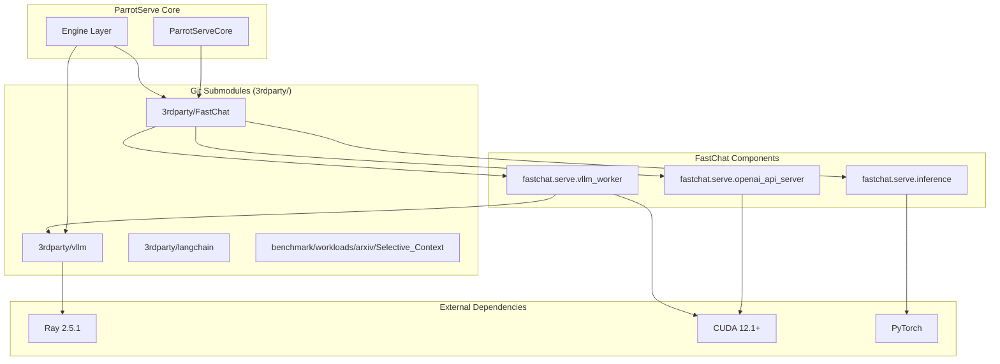
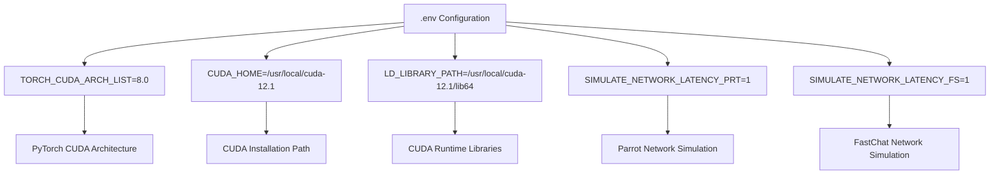
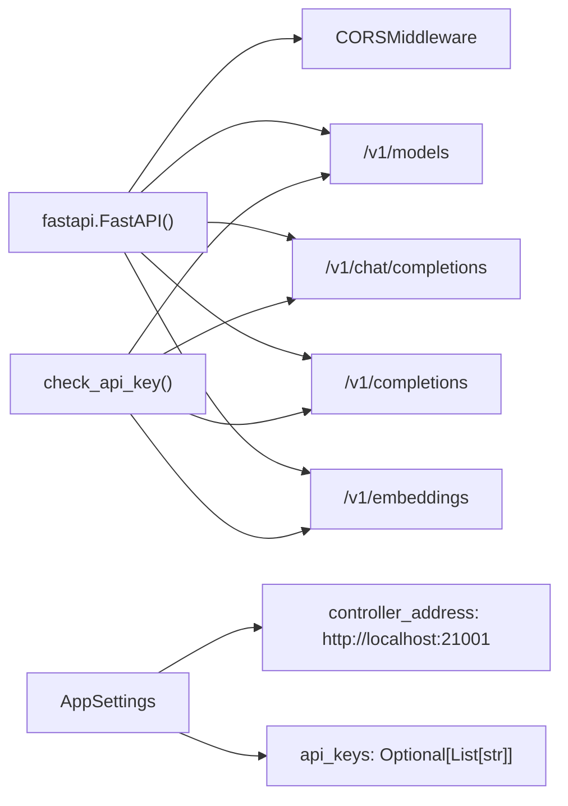
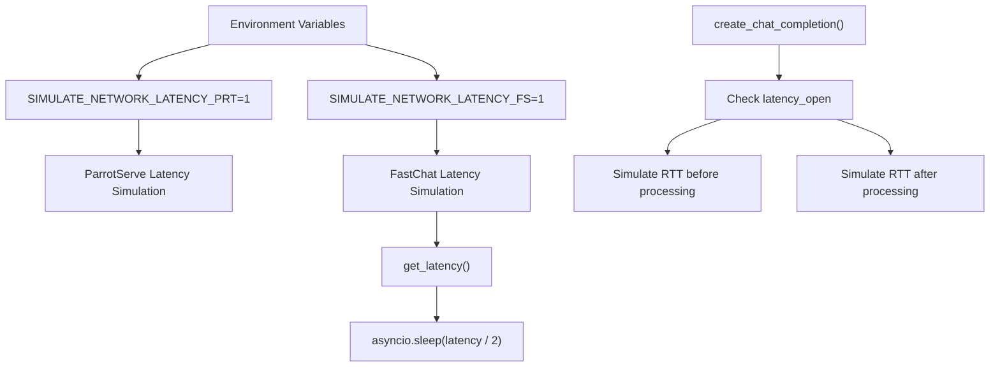

<!-- source: DeepWiki mcp.deepwiki.com · repo microsoft/ParrotServe · page 7.2 Installation and Dependencies · fetched 2026-10-26 -->

# Installation and Dependencies

<details>
<summary>Relevant source files</summary>

The following files were used as context for generating this wiki page:

- [.env](.env)
- [.gitmodules](.gitmodules)
- [3rdparty/FastChat/fastchat/serve/inference.py](3rdparty/FastChat/fastchat/serve/inference.py)
- [3rdparty/FastChat/fastchat/serve/openai_api_server.py](3rdparty/FastChat/fastchat/serve/openai_api_server.py)
- [3rdparty/FastChat/fastchat/serve/vllm_worker.py](3rdparty/FastChat/fastchat/serve/vllm_worker.py)
- [3rdparty/README.md](3rdparty/README.md)

</details>


This document covers the installation procedures, dependency management, and environment configuration required to deploy ParrotServe. It focuses on Git submodule integration, third-party component setup, and CUDA environment configuration. For engine-specific configuration details, see [Engine Configuration](#7.1). For development and testing setup, see [Testing Framework](#8.1).

## Overview

ParrotServe relies on several third-party components integrated through Git submodules and requires specific environment configuration for GPU acceleration and distributed inference. The installation process involves setting up Git submodules, configuring CUDA environment variables, and integrating with external LLM frameworks.

## System Requirements

### Hardware Requirements

| Component | Requirement | Purpose |
|-----------|-------------|---------|
| GPU | CUDA-compatible (Compute Capability 8.0+) | LLM inference acceleration |
| CUDA | Version 12.1+ | GPU computation framework |
| Memory | Varies by model size | Model loading and KV cache |

### Software Dependencies

The system requires specific versions of third-party libraries managed through Git submodules:

| Library | Version/Commit | Purpose |
|---------|----------------|---------|
| FastChat | `e53c73f22efa9a37bf76af8783c96049276a2e98` | OpenAI-compatible API server |
| vLLM | `4b6f069b6fbb4f2ef7d4c6a62140229be61c5dd3` | High-performance inference engine |
| Ray | 2.5.1 | Distributed inference coordination |
| LangChain | Latest | Additional LLM framework support |

Sources: [3rdparty/README.md:6-7](), [.gitmodules:1-12]()

## Third-Party Dependency Architecture



**Third-Party Integration Flow**
This diagram shows how ParrotServe integrates with third-party dependencies through Git submodules and external packages.

Sources: [.gitmodules:1-12](), [3rdparty/README.md:1-11](), [3rdparty/FastChat/fastchat/serve/openai_api_server.py:1-10]()

## Environment Configuration

### CUDA Environment Setup

The system requires specific CUDA environment variables configured in `.env`:



**Environment Variable Configuration Flow**
This diagram shows the required environment variables and their purposes in the ParrotServe system.

Sources: [.env:5-11]()

### Environment Variables

| Variable | Value | Purpose |
|----------|--------|---------|
| `TORCH_CUDA_ARCH_LIST` | `8.0` | PyTorch CUDA architecture targeting |
| `CUDA_HOME` | `/usr/local/cuda-12.1` | CUDA installation directory |
| `LD_LIBRARY_PATH` | `/usr/local/cuda-12.1/lib64:$LD_LIBRARY_PATH` | CUDA runtime library path |
| `SIMULATE_NETWORK_LATENCY_PRT` | `1` | Enable ParrotServe latency simulation |
| `SIMULATE_NETWORK_LATENCY_FS` | `1` | Enable FastChat latency simulation |

Sources: [.env:5-11]()

## Installation Steps

### 1. Clone Repository with Submodules

```bash
git clone --recursive https://github.com/microsoft/ParrotServe
cd ParrotServe
```

If already cloned without submodules:

```bash
git submodule update --init --recursive
```

### 2. Verify Submodule Status

Confirm all submodules are properly initialized:

| Submodule Path | Repository | Status |
|----------------|------------|--------|
| `3rdparty/langchain` | `git@github.com:langchain-ai/langchain.git` | Active |
| `3rdparty/FastChat` | `git@github.com:lm-sys/FastChat.git` | Active |
| `3rdparty/vllm` | `git@github.com:vllm-project/vllm.git` | Active |
| `benchmark/workloads/arxiv/Selective_Context` | `https://github.com/liyucheng09/Selective_Context.git` | Active |

Sources: [.gitmodules:1-12]()

### 3. Environment Configuration

Load the provided environment configuration:

```bash
source .env
```

Verify CUDA environment:

```bash
echo $CUDA_HOME
echo $TORCH_CUDA_ARCH_LIST
nvcc --version
```

Sources: [.env:1-12]()

### 4. Install Python Dependencies

Install core dependencies for each component:

```bash
# Install FastChat dependencies
cd 3rdparty/FastChat
pip install -e .

# Install vLLM dependencies  
cd ../vllm
pip install -e .

# Install Ray for distributed inference
pip install ray==2.5.1
```

Sources: [3rdparty/README.md:9]()

## FastChat Integration Verification

### OpenAI API Server Configuration

The FastChat integration provides OpenAI-compatible endpoints through `openai_api_server.py`:



**FastChat API Server Components**
This diagram shows the FastAPI application structure and endpoint configuration in the FastChat integration.

Sources: [3rdparty/FastChat/fastchat/serve/openai_api_server.py:96-106](), [3rdparty/FastChat/fastchat/serve/openai_api_server.py:364-376]()

### vLLM Worker Integration

The vLLM worker integration provides high-performance inference through `vllm_worker.py`:

| Component | Class/Function | Purpose |
|-----------|----------------|---------|
| Worker | `VLLMWorker` | Main worker class inheriting from `BaseModelWorker` |
| Engine | `AsyncLLMEngine` | vLLM async inference engine |
| Endpoints | `/worker_generate_stream`, `/worker_generate` | Inference API endpoints |
| Semaphore | `worker.semaphore` | Concurrency control |

Sources: [3rdparty/FastChat/fastchat/serve/vllm_worker.py:31-62](), [3rdparty/FastChat/fastchat/serve/vllm_worker.py:170-191]()

## Network Latency Simulation

The system includes network latency simulation capabilities for testing and benchmarking:



**Network Latency Simulation Flow**
This diagram shows how network latency simulation is integrated into the request processing pipeline.

Sources: [.env:9-10](), [3rdparty/FastChat/fastchat/serve/openai_api_server.py:383-398](), [3rdparty/FastChat/fastchat/serve/openai_api_server.py:469-471]()

## Verification and Testing

### 1. Verify CUDA Installation

```bash
python -c "import torch; print(torch.cuda.is_available())"
python -c "import torch; print(torch.cuda.get_device_name(0))"
```

### 2. Test FastChat Integration

```bash
cd 3rdparty/FastChat
python -m fastchat.serve.openai_api_server --help
```

### 3. Test vLLM Integration  

```bash
cd 3rdparty/vllm
python -c "from vllm import AsyncLLMEngine; print('vLLM import successful')"
```

### 4. Verify Ray Installation

```bash
python -c "import ray; print(f'Ray version: {ray.__version__}')"
```

Sources: [3rdparty/README.md:9](), [3rdparty/FastChat/fastchat/serve/openai_api_server.py:918-930]()

## Troubleshooting

### Common Issues

| Issue | Symptom | Solution |
|-------|---------|----------|
| Submodule not initialized | Empty `3rdparty/` directories | Run `git submodule update --init --recursive` |
| CUDA not found | `torch.cuda.is_available()` returns `False` | Verify `CUDA_HOME` and `LD_LIBRARY_PATH` in `.env` |
| Ray version mismatch | Distributed inference failures | Install Ray 2.5.1 specifically |
| FastChat import errors | Module not found errors | Install FastChat from submodule: `pip install -e 3rdparty/FastChat` |

### Environment Variable Issues

If environment variables are not properly set, certain features may not work:

- `SIMULATE_NETWORK_LATENCY_FS` not set: FastChat latency simulation disabled
- `TORCH_CUDA_ARCH_LIST` not set: PyTorch may not utilize optimal CUDA kernels
- `CUDA_HOME` not set: CUDA compilation may fail

Sources: [.env:1-12](), [3rdparty/FastChat/fastchat/serve/openai_api_server.py:383-391]()

---

