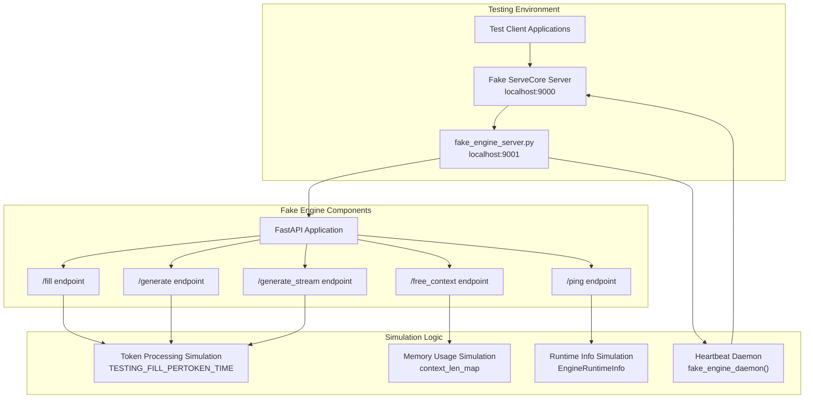
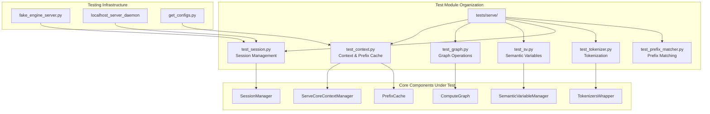
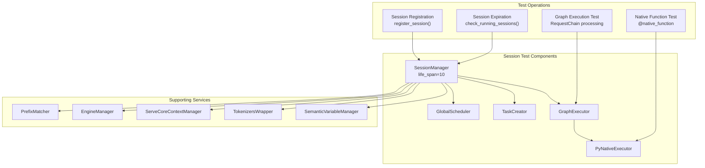

<!-- source: DeepWiki mcp.deepwiki.com · repo microsoft/ParrotServe · page 8 Development and Testing · fetched 2026-10-26 -->

# Development and Testing

<details>
<summary>Relevant source files</summary>

The following files were used as context for generating this wiki page:

- [parrot/testing/fake_engine_server.py](parrot/testing/fake_engine_server.py)
- [tests/serve/test_context.py](tests/serve/test_context.py)
- [tests/serve/test_graph.py](tests/serve/test_graph.py)
- [tests/serve/test_prefix_matcher.py](tests/serve/test_prefix_matcher.py)
- [tests/serve/test_session.py](tests/serve/test_session.py)
- [tests/serve/test_sv.py](tests/serve/test_sv.py)
- [tests/serve/test_tokenizer.py](tests/serve/test_tokenizer.py)

</details>


This document covers the development infrastructure and testing framework for ParrotServe, including testing utilities, fake server implementations, and comprehensive test suites for all major system components. The testing infrastructure enables isolated unit testing, integration testing, and performance validation of the distributed LLM serving system.

For information about system configuration and deployment procedures, see [Configuration and Deployment](#7). For details about the runtime APIs being tested, see [HTTP APIs](#6).

## Testing Infrastructure

ParrotServe provides a comprehensive testing framework built around fake server implementations and isolated component testing. The infrastructure supports both unit testing of individual components and integration testing of the complete system workflow.

### Fake Server Architecture

The testing framework includes sophisticated fake server implementations that simulate the behavior of real LLM engines without requiring actual model inference.



The `fake_engine_server.py` implements a complete engine simulation that tracks context length, simulates token processing time, and provides realistic runtime information reporting. The fake engine registers with the ServeCore using the same protocols as real engines.

**Sources:** [parrot/testing/fake_engine_server.py:1-240]()

### Test Organization and Utilities

ParrotServe organizes tests by system component, with each major subsystem having dedicated test modules that verify both isolated functionality and integration behavior.



**Sources:** [tests/serve/test_context.py:1-79](), [tests/serve/test_graph.py:1-223](), [tests/serve/test_sv.py:1-76](), [tests/serve/test_session.py:1-195]()

## Component Testing

### Context Management Testing

The context management testing validates the `ServeCoreContextManager` and `PrefixCache` implementations, ensuring proper context lifecycle management and prefix sharing optimization.

The `test_context.py` module provides comprehensive testing for:

- **Prefix Cache Operations**: Testing `PrefixCache.cache_prefix_context()` with hash-based prefix identification using `ServeCoreContextManager._hash_var_id()`
- **Context Registration**: Validating `ServeCoreContextManager.register_engine_prefix_cache()` for engine-specific context pools
- **Task Context Assignment**: Testing `ServeCoreContextManager.set_task_contexts()` for proper context allocation to `CompletionTask` instances
- **Reference Counting**: Verifying context reference counting mechanisms in `_context_ref_counter`

**Sources:** [tests/serve/test_context.py:23-74]()

### Graph Operations Testing

Graph testing validates the core computation graph construction, manipulation, and traversal algorithms that enable semantic variable dependencies and request chaining.

Key test scenarios include:

- **Request Chain Construction**: Testing `RequestChain.from_nodes()` with `ConstantFill`, `PlaceholderFill`, and `PlaceholderGen` nodes
- **Graph Insertion and Removal**: Validating `ComputeGraph.insert_and_update_request_chain()` and `ComputeGraph.remove_completion_chain()`
- **Dependency Traversal**: Testing semantic variable activation with `activate_sv()` and `PerformanceCriteria` propagation
- **Chain Parsing**: Validating `ChunkedSemanticCallRequest.parse_from_payload()` for template-based request parsing

The graph testing includes complex dependency scenarios where semantic variables form chains (A → B → C) with proper depth calculation and activation propagation.

**Sources:** [tests/serve/test_graph.py:18-223]()

### Semantic Variable Testing

Semantic variable testing focuses on the core abstraction that enables cross-request dependencies and content-based optimization.

Test coverage includes:

- **Content-Based Hashing**: Testing `SemanticVariableManager._get_local_var_by_content()` for duplicate content detection
- **Variable Creation**: Validating `SemanticVariableManager.create_var()` and `SemanticVariableManager.create_vars_for_semantic_request_chain()`
- **Request Chain Hashing**: Testing consistent hash generation for identical request chains to enable optimization
- **Local Variable Spaces**: Validating session-scoped variable management with `register_local_var_space()`

**Sources:** [tests/serve/test_sv.py:15-75]()

### Session Management Testing

Session testing validates the complete session lifecycle and integration between multiple system components.



Session testing includes integration with the fake engine server using `fake_engine_server()` context manager and validates both semantic function execution and native Python function execution through the `@native_function` decorator.

**Sources:** [tests/serve/test_session.py:36-195]()

## Development Tools

### Tokenizer Testing

The tokenizer testing validates the `TokenizersWrapper` implementation that provides unified tokenization across different model families.

Test scenarios cover:

- **Tokenizer Registration**: Testing `TokenizersWrapper.register_tokenizer()` with different tokenizer types
- **Encoding/Decoding**: Validating `tokenize()` and `detokenize()` operations with known test vectors
- **Request Tokenization**: Testing `CompletionTask.tokenize_chain()` for request chain tokenization across multiple tokenizers
- **Multi-Tokenizer Support**: Ensuring consistent results across different tokenizer implementations like `"hf-internal-testing/llama-tokenizer"` and `"facebook/opt-13b"`

The tests use predefined test vectors to ensure tokenization consistency:

```python
TESTING_PROMPT_TEXT = "He is widely acknowledged as one of the top achievers in his class"
TESTING_TOKEN_IDS = [940, 338, 17644, 24084, 3192, 408, 697, 310, 278, 2246, 3657, 347, 874, 297, 670, 770]
```

**Sources:** [tests/serve/test_tokenizer.py:18-106]()

### Prefix Matching Testing

Prefix matching testing validates the `PrefixMatcher` implementation that optimizes shared prompt prefixes for performance.

The testing covers:

- **Threshold-Based Addition**: Testing prefix addition only after reaching `PrefixMatcher._GP_THRESHOLD + 1` occurrences
- **Prefix Query Operations**: Validating `query_prefix()` for finding longest matching prefixes
- **Counter Management**: Testing `_prefix_counter` tracking for prefix frequency
- **Start Length Configuration**: Testing prefix matching with `PrefixMatcher._START_LEN` constraints

The test creates a scenario where multiple similar strings share a common prefix, validates that the prefix is detected only after sufficient frequency, and verifies correct prefix/suffix splitting.

**Sources:** [tests/serve/test_prefix_matcher.py:4-23]()

---

