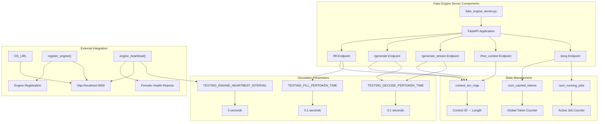
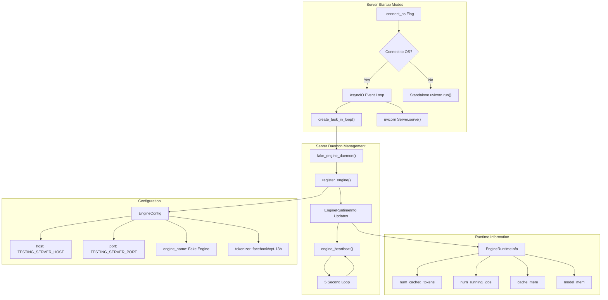
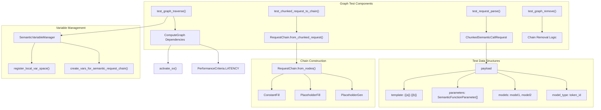
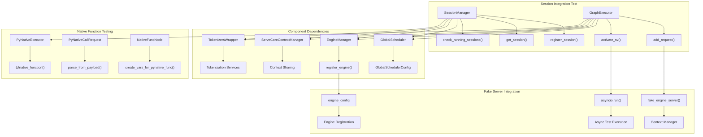
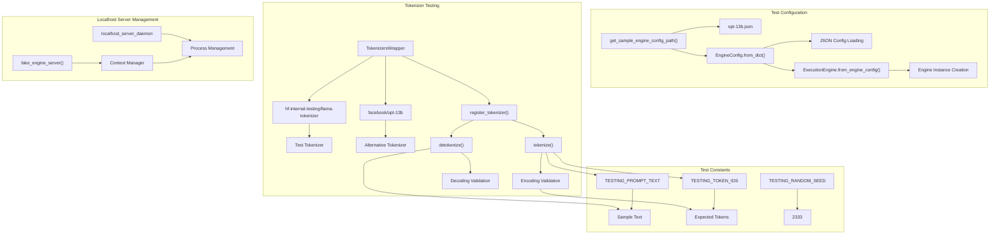

<!-- source: DeepWiki mcp.deepwiki.com · repo microsoft/ParrotServe · page 8.1 Testing Framework · fetched 2026-10-26 -->

# Testing Framework

Relevant source files

The following files were used as context for generating this wiki page:

- [parrot/testing/fake_engine_server.py](parrot/testing/fake_engine_server.py)
- [tests/serve/test_context.py](tests/serve/test_context.py)
- [tests/serve/test_graph.py](tests/serve/test_graph.py)
- [tests/serve/test_prefix_matcher.py](tests/serve/test_prefix_matcher.py)
- [tests/serve/test_session.py](tests/serve/test_session.py)
- [tests/serve/test_sv.py](tests/serve/test_sv.py)
- [tests/serve/test_tokenizer.py](tests/serve/test_tokenizer.py)

## Purpose and Scope

The testing framework provides comprehensive testing infrastructure for ParrotServe's distributed LLM serving system. It includes fake server implementations for simulating engine behavior, unit tests for individual components, and integration tests that validate end-to-end workflows. This framework enables development and validation without requiring actual LLM engines or external services.

For information about benchmarking and performance testing, see [Benchmarking and Performance](#8.2). For details about system configuration used in testing, see [Engine Configuration](#7.1).

## Fake Server Infrastructure

The testing framework provides simulation capabilities through fake server implementations that mimic real engine behavior without requiring actual LLM models or external APIs.

### Fake Engine Server Architecture

The `FakeEngineServer` class simulates real engine behavior by implementing the same HTTP endpoints that actual engines provide. It maintains internal state including context lengths, cached tokens, and running jobs to provide realistic responses to ServeCore requests.

**Sources:** [parrot/testing/fake_engine_server.py:1-240]()

### Testing Server Management

**Sources:** [parrot/testing/fake_engine_server.py:62-87](), [parrot/testing/fake_engine_server.py:211-240]()

## Test Components

The testing framework includes comprehensive unit tests for all major system components, organized by functional area.

### Component Test Coverage

| Test Module | Component Tested | Key Test Functions |
|-------------|------------------|-------------------|
| `test_context.py` | Context Management | `test_prefix_cache()`, `test_context_manager()` |
| `test_graph.py` | Graph Operations | `test_request_parse()`, `test_graph_traverse()` |
| `test_sv.py` | Semantic Variables | `test_content_hash()`, `test_request_chain_hash()` |
| `test_tokenizer.py` | Tokenization | `test_encode()`, `test_decode()`, `test_tokenize_request()` |
| `test_session.py` | Session Management | `test_session_manager()`, `test_graph_executor()` |
| `test_prefix_matcher.py` | Prefix Matching | `test_prefix_matcher()` |

### Graph and Request Processing Tests

**Sources:** [tests/serve/test_graph.py:18-44](), [tests/serve/test_graph.py:90-117](), [tests/serve/test_graph.py:146-214]()

### Context and Variable Testing

```mermaid
graph TD
    subgraph "Context Testing Components"
        A["PrefixCache"] --> B["_prefix_ctx_map"]
        C["ServeCoreContextManager"] --> D["_context_ref_counter"]
        C --> E["prefix_caches[engine_id]"]
        F["SemanticVariableManager"] --> G["constant_prefix_var_timeout"]
    end
    
    subgraph "Test Scenarios"
        H["test_prefix_cache()"] --> I["Cache Prefix Context Mapping"]
        J["test_context_manager()"] --> K["Engine Registration"]
        J --> L["Task Context Setting"]
        M["test_content_hash()"] --> N["Content-based Variable Deduplication"]
    end
    
    subgraph "Variable Lifecycle"
        O["create_var()"] --> P["Variable Creation"]
        Q["set()"] --> R["Content Assignment"]
        S["_get_local_var_by_content()"] --> T["Content-based Retrieval"]
    end
    
    A --> I
    C --> K
    C --> L
    F --> N
    F --> O
    F --> S
    
    subgraph "CompletionTask Integration"
        U["CompletionTask"] --> V["schedule_to()"]
        U --> W["ExecutionEngine"]
        U --> X["EngineConfig"]
    end
    
    J --> U
```

**Sources:** [tests/serve/test_context.py:23-31](), [tests/serve/test_context.py:33-74](), [tests/serve/test_sv.py:15-23]()

## Integration Testing

Integration tests validate end-to-end functionality by combining multiple system components with the fake server infrastructure.

### Session and Execution Integration

**Sources:** [tests/serve/test_session.py:36-73](), [tests/serve/test_session.py:75-131](), [tests/serve/test_session.py:133-189]()

### Testing Utilities and Configuration

The framework provides utilities for test configuration and localhost server management:

**Sources:** [tests/serve/test_context.py:61-64](), [tests/serve/test_tokenizer.py:18-38](), [tests/serve/test_tokenizer.py:41-49](), [tests/serve/test_session.py:20-21]()

The testing framework enables comprehensive validation of ParrotServe's distributed architecture through simulation, unit testing, and integration testing. The fake server infrastructure provides realistic engine behavior without requiring actual LLM models, while the test suite covers all major system components and their interactions.

**Sources:** [parrot/testing/fake_engine_server.py:1-240](), [tests/serve/test_context.py:1-79](), [tests/serve/test_graph.py:1-223](), [tests/serve/test_sv.py:1-76](), [tests/serve/test_tokenizer.py:1-107](), [tests/serve/test_session.py:1-195](), [tests/serve/test_prefix_matcher.py:1-24]()

---

