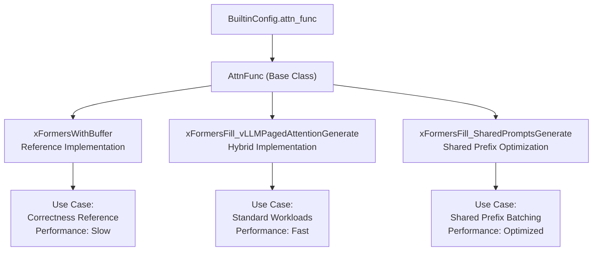
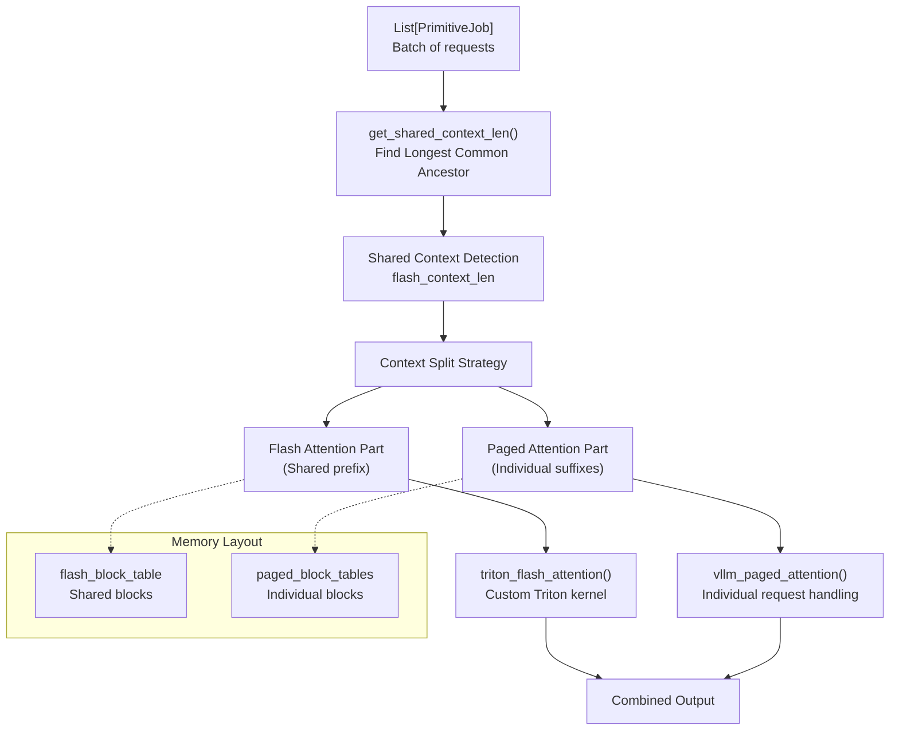
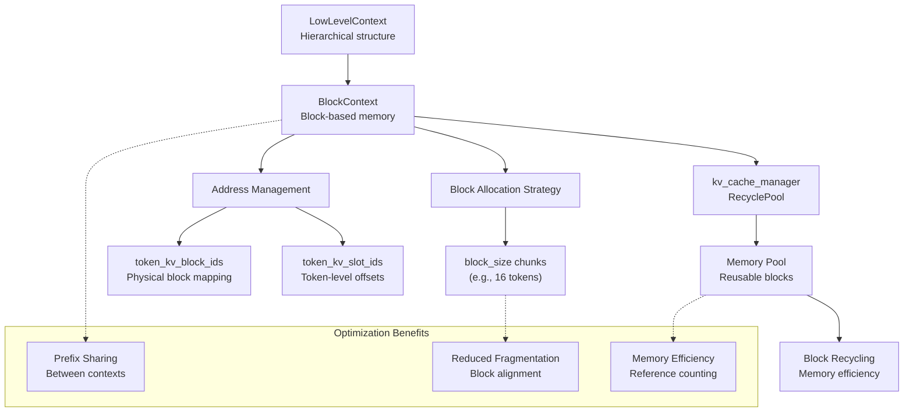
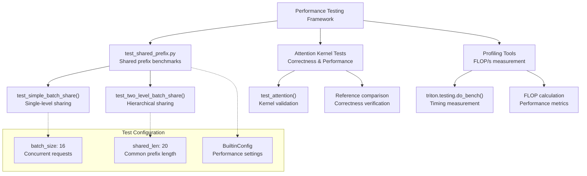
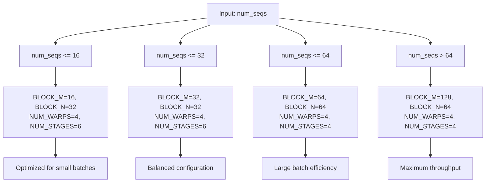

<!-- source: DeepWiki mcp.deepwiki.com · repo microsoft/ParrotServe · page 8.2 Benchmarking and Performance · fetched 2026-10-26 -->

# Benchmarking and Performance

<details>
<summary>Relevant source files</summary>

The following files were used as context for generating this wiki page:

- [parrot/engine/builtin/attn_func.py](parrot/engine/builtin/attn_func.py)
- [parrot/engine/builtin/kernels/shared_flash_decoding.py](parrot/engine/builtin/kernels/shared_flash_decoding.py)
- [parrot/engine/context/block_context.py](parrot/engine/context/block_context.py)
- [parrot/engine/context/low_level_context.py](parrot/engine/context/low_level_context.py)
- [tests/engine/builtin/test_shared_prefix.py](tests/engine/builtin/test_shared_prefix.py)

</details>


This page covers ParrotServe's performance optimization strategies, benchmarking infrastructure, and configuration options for achieving optimal throughput and latency. The system provides multiple attention implementations, shared prefix optimizations, and comprehensive testing tools for measuring and improving performance.

For information about general system configuration, see [Configuration and Deployment](#7). For details about the underlying engine implementations, see [Engine Layer](#5).

## Performance Optimization Strategies

ParrotServe implements several key optimization strategies to achieve high performance for LLM serving workloads.

### Attention Function Selection

The system provides multiple attention function implementations with different performance characteristics, allowing users to select the most appropriate option for their workload:



| Attention Function | Performance | Use Case | Implementation Details |
|-------------------|-------------|----------|----------------------|
| `xformers_with_buffer` | Slow (Reference) | Correctness testing | Loads full KV cache into contiguous buffer |
| `xformers_fill_vllm_paged_attention_generate` | Fast | Standard workloads | xFormers for Fill, vLLM paged attention for Generate |
| `xformers_fill_shared_prompts_generate` | Optimized | Shared prefix batching | Custom kernels with shared prompt optimization |

**Sources:** [parrot/engine/builtin/attn_func.py:704-732]()

### Shared Prefix Optimization

ParrotServe's key performance innovation is automatic detection and optimization of shared prefixes across requests in a batch:



The shared prefix optimization works by:

1. **LCA Detection**: Finding the longest common ancestor context across all jobs in a batch using `_lca()` algorithm
2. **Context Splitting**: Dividing each request into shared and individual parts
3. **Optimized Kernels**: Using custom Triton kernels for the shared portion and standard paged attention for individual parts

**Sources:** [parrot/engine/builtin/attn_func.py:440-460](), [parrot/engine/builtin/attn_func.py:480-490]()

### Memory Management Optimizations

The system uses block-based memory management to enable efficient KV cache sharing and reduce memory fragmentation:



**Sources:** [parrot/engine/context/block_context.py:13-52](), [parrot/engine/context/low_level_context.py:14-30]()

## Benchmarking Infrastructure

ParrotServe provides comprehensive benchmarking tools for measuring and optimizing performance.

### Performance Testing Framework

The system includes specialized testing infrastructure for performance validation:



**Sources:** [tests/engine/builtin/test_shared_prefix.py:7-55](), [parrot/engine/builtin/kernels/shared_flash_decoding.py:407-417]()

### Attention Kernel Benchmarking

The system provides detailed benchmarking for attention kernels with FLOP/s calculations:

```python
def profile_attention(fn, mask_nnz, mode="fwd", warmup=25, rep=100, num_heads=48, head_size=64):
    ms = triton.testing.do_bench(fn, warmup=warmup, rep=rep)
    flops_per_matmul = 2.0 * num_heads * mask_nnz * head_size  
    total_flops = 2 * flops_per_matmul
    gflops = total_flops / ms * 1e-9
```

The benchmarking infrastructure supports:

| Metric | Description | Calculation |
|--------|-------------|-------------|
| **Latency** | Time per operation | `triton.testing.do_bench()` |
| **FLOP/s** | Floating point operations per second | `total_flops / ms * 1e-9` |
| **Throughput** | Tokens processed per second | Function of batch size and latency |
| **Memory Usage** | KV cache utilization | Block allocation tracking |

**Sources:** [parrot/engine/builtin/kernels/shared_flash_decoding.py:407-417](), [parrot/engine/builtin/kernels/shared_flash_decoding.py:419-466]()

## Performance Configuration

### Attention Function Configuration

Configure attention functions through `BuiltinConfig`:

```python
builtin_config = BuiltinConfig(
    attn_func="xformers_fill_shared_prompts_generate",  # Enable shared prefix optimization
    block_size=16,                                      # Memory block size  
    num_kv_cache_blocks=1600,                          # Total cache capacity
)
```

| Parameter | Options | Performance Impact |
|-----------|---------|-------------------|
| `attn_func` | `"xformers_with_buffer"` | Slow, reference implementation |
|  | `"xformers_fill_vllm_paged_attention_generate"` | Fast, standard workloads |
|  | `"xformers_fill_shared_prompts_generate"` | Optimized for shared prefixes |
| `block_size` | 16, 32, 64 | Memory alignment and sharing granularity |
| `num_kv_cache_blocks` | System-dependent | Total memory capacity for KV cache |

**Sources:** [parrot/engine/builtin/attn_func.py:730-738](), [tests/engine/builtin/test_shared_prefix.py:9-13]()

### Triton Kernel Configuration

The Flash Attention implementation automatically configures Triton kernel parameters based on batch size:



**Sources:** [parrot/engine/builtin/kernels/shared_flash_decoding.py:220-240]()

### Performance Testing Workflow

To benchmark a specific configuration:

1. **Configure Engine**: Set `attn_func` and `block_size` in `BuiltinConfig`
2. **Generate Test Data**: Create representative request patterns with shared prefixes
3. **Run Benchmarks**: Use `test_shared_prefix.py` for batching performance
4. **Measure Kernels**: Use `test_attention()` for low-level kernel performance
5. **Analyze Results**: Compare FLOP/s and latency across configurations

Example test case with two-level sharing:

```python
# Test hierarchical prefix sharing performance
shared_len1 = 20  # First level shared context
shared_len2 = 10  # Second level shared context  
batch_size = 16   # Concurrent requests
```

This configuration tests the system's ability to optimize complex sharing patterns where requests share multiple levels of common prefixes.

**Sources:** [tests/engine/builtin/test_shared_prefix.py:57-115]()

---

