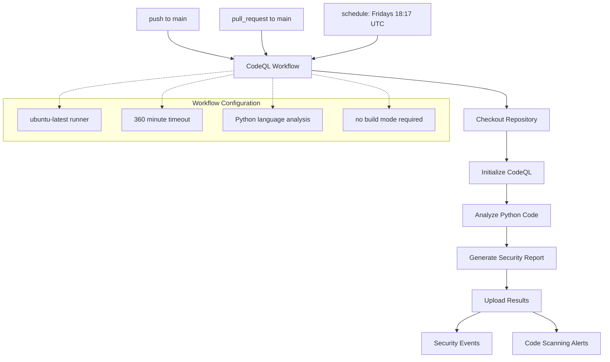
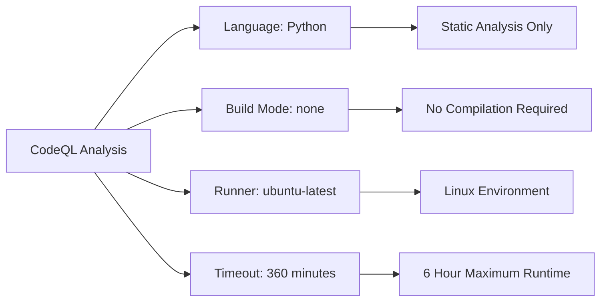
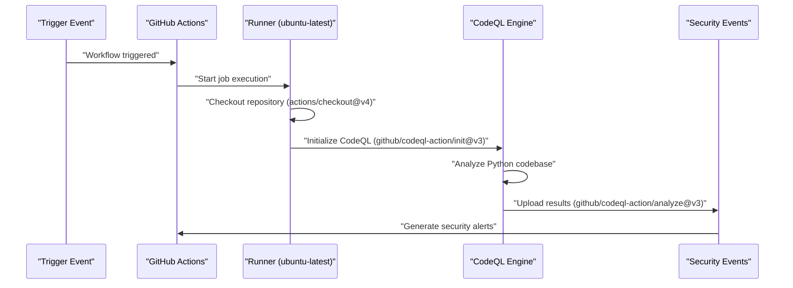

<!-- source: DeepWiki mcp.deepwiki.com · repo microsoft/ParrotServe · page 8.3 CI/CD · fetched 2026-10-26 -->

# CI/CD

Relevant source files

The following files were used as context for generating this wiki page:

- [.github/workflows/codeql.yml](.github/workflows/codeql.yml)

This document covers the continuous integration and continuous deployment (CI/CD) infrastructure for ParrotServe. The current CI/CD setup is minimal and focused primarily on automated security analysis through GitHub Actions workflows.

For information about testing infrastructure and development tools, see [Testing Framework](#8.1). For deployment procedures and configuration management, see [Configuration and Deployment](#7).

## Current CI/CD Infrastructure

ParrotServe currently implements a lightweight CI/CD approach centered around automated security scanning. The system uses GitHub Actions to perform static code analysis but does not include traditional build, test, or deployment automation pipelines.

### CodeQL Security Analysis Pipeline

The primary CI/CD component is a CodeQL workflow that performs automated security analysis on the Python codebase. This workflow is triggered on multiple events to ensure comprehensive coverage of code changes.

**CodeQL Workflow Pipeline**

Sources: [.github/workflows/codeql.yml:1-93]()

### Workflow Triggers and Scheduling

The CodeQL workflow operates on a multi-trigger strategy to ensure continuous security monitoring:

| Trigger Type | Configuration | Purpose |
|--------------|---------------|---------|
| Push Events | `branches: ["main"]` | Analyze changes merged to main branch |
| Pull Requests | `branches: ["main"]` | Scan incoming changes before merge |
| Scheduled | `cron: '17 18 * * 5'` | Weekly analysis every Friday at 18:17 UTC |

This configuration ensures that security analysis occurs both reactively (when code changes) and proactively (on a regular schedule) to catch potential vulnerabilities.

Sources: [.github/workflows/codeql.yml:14-20]()

### Analysis Configuration

The CodeQL analysis is specifically configured for Python codebases with the following parameters:

**CodeQL Configuration Details**

The workflow uses the `none` build mode since Python is an interpreted language that doesn't require compilation. This simplifies the analysis process and reduces execution time.

Sources: [.github/workflows/codeql.yml:46-48](), [.github/workflows/codeql.yml:30-31]()

### Security Permissions and Access

The workflow operates with carefully scoped permissions to ensure security while maintaining functionality:

| Permission | Access Level | Purpose |
|------------|--------------|---------|
| `security-events` | `write` | Upload security analysis results |
| `packages` | `read` | Access internal/private CodeQL packs |
| `actions` | `read` | Required for private repositories |
| `contents` | `read` | Access repository code for analysis |

These permissions follow the principle of least privilege, granting only the access necessary for security analysis operations.

Sources: [.github/workflows/codeql.yml:32-41]()

### Workflow Execution Steps

The CodeQL workflow follows a standard GitHub Actions pattern with specialized security analysis steps:

**CodeQL Execution Sequence**

The workflow uses standard GitHub Actions for repository checkout and official CodeQL actions for analysis, ensuring reliability and security best practices.

Sources: [.github/workflows/codeql.yml:58-93]()

## Limitations and Development Opportunities

The current CI/CD infrastructure represents a security-focused but minimal approach. Notable gaps include:

- No automated testing pipeline integration
- No build artifact generation or validation
- No deployment automation for ServeCore or Engine components
- No integration testing across distributed components
- No performance regression testing

These limitations suggest opportunities for expanding the CI/CD infrastructure to include comprehensive testing and deployment automation as documented in [Testing Framework](#8.1) and [Configuration and Deployment](#7).

Sources: [.github/workflows/codeql.yml:1-93]()

---

