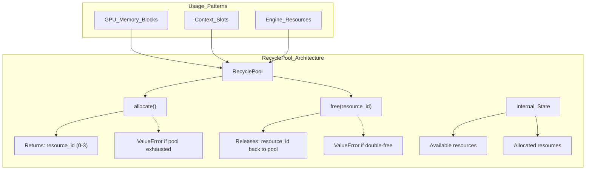
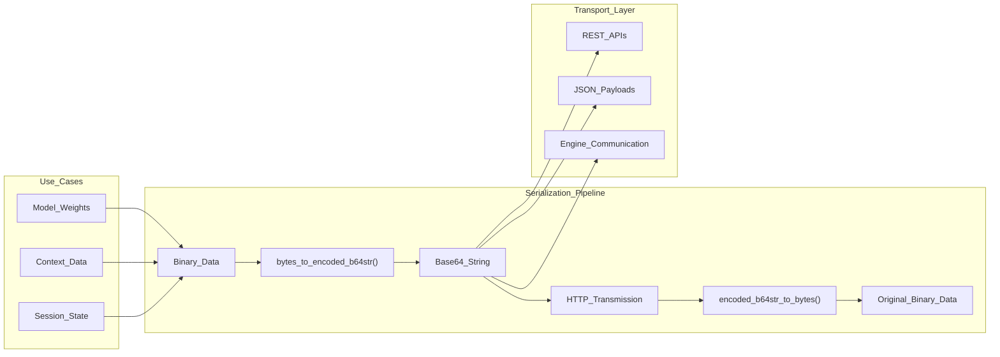
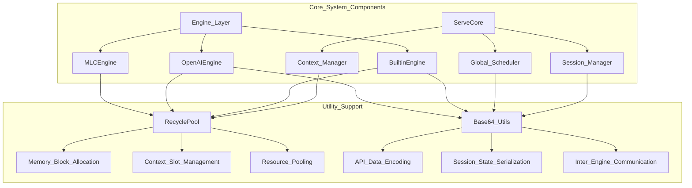

<!-- source: DeepWiki mcp.deepwiki.com · repo microsoft/ParrotServe · page 9 Utilities and Supporting Components · fetched 2026-10-26 -->

# Utilities and Supporting Components

<details>
<summary>Relevant source files</summary>

The following files were used as context for generating this wiki page:

- [tests/test_utils.py](tests/test_utils.py)

</details>


This document covers the core utility classes and helper functions that provide foundational support for ParrotServe's main system functionality. These components handle low-level operations such as memory management, data serialization, and resource pooling that are used throughout the distributed LLM serving system.

For information about the core system architecture, see [Architecture](#2). For engine-specific implementations, see [Engine Layer](#5). For configuration management, see [Configuration and Deployment](#7).

## Memory Management Utilities

ParrotServe includes several utility classes for efficient memory and resource management, particularly important for managing GPU memory and compute resources across distributed engines.

### RecyclePool

The `RecyclePool` class provides a simple resource pooling mechanism for managing reusable resources with fixed capacity. This utility is commonly used for managing GPU memory blocks, context slots, and other limited resources that need to be efficiently allocated and freed.



**RecyclePool Resource Management Flow**

Key characteristics of `RecyclePool`:

| Method | Purpose | Return Value | Error Conditions |
|--------|---------|--------------|------------------|
| `allocate()` | Acquire a resource from the pool | `int` (resource ID 0-3) | `ValueError` if pool is exhausted |
| `free(resource_id)` | Return a resource to the pool | `None` | `ValueError` if resource already free |

The pool maintains a fixed capacity (appears to be 4 resources based on test patterns) and ensures proper resource lifecycle management with error checking for common mistakes like double-free operations.

Sources: [tests/test_utils.py:8-35]()

## Data Serialization Utilities

ParrotServe provides utility functions for data serialization, particularly for encoding binary data for transmission over HTTP APIs and storage in various contexts.

### Base64 Encoding Functions

Two complementary functions handle conversion between binary data and base64-encoded strings:

- `bytes_to_encoded_b64str(data: bytes) -> str`: Converts binary data to base64-encoded string
- `encoded_b64str_to_bytes(encoded: str) -> bytes`: Converts base64-encoded string back to binary data



**Data Serialization and Transport Flow**

These utilities are essential for the distributed nature of ParrotServe, enabling binary data to be safely transmitted through JSON-based HTTP APIs between the ServeCore and Engine layers.

Sources: [tests/test_utils.py:37-42]()

## Integration with Core System Components

The utilities integrate with ParrotServe's main system components to provide essential infrastructure support:



**Utility Integration with System Architecture**

The utility components serve as foundational building blocks that enable:

1. **Memory Efficiency**: `RecyclePool` prevents memory fragmentation and ensures optimal resource utilization across engines
2. **Data Portability**: Base64 utilities enable seamless data transmission across the distributed system
3. **Resource Safety**: Error checking in utilities prevents common resource management bugs
4. **System Reliability**: Proper resource lifecycle management supports system stability under load

Sources: [tests/test_utils.py:1-5]()

## Implementation Details

The utility module is accessed through a common import pattern:

```python
from parrot.utils import (
    RecyclePool,
    bytes_to_encoded_b64str,
    encoded_b64str_to_bytes,
)
```

These utilities follow standard Python conventions and provide comprehensive error handling to ensure system reliability. The test suite demonstrates expected usage patterns and validates both normal operation and error conditions.

Sources: [tests/test_utils.py:1-48]()