# Page: Overview

# Overview

<details>
<summary>Relevant source files</summary>

The following files were used as context for generating this wiki page:

- [.env-dev](.env-dev)
- [.gitignore](.gitignore)
- [CONTRIBUTING.md](CONTRIBUTING.md)
- [README.md](README.md)
- [TRANSPARENCY.md](TRANSPARENCY.md)
- [benchmark/bench_kernel.py](benchmark/bench_kernel.py)
- [docs/README.md](docs/README.md)
- [docs/get_started/launch_server.md](docs/get_started/launch_server.md)
- [docs/sys_design/serve_layer/graph.md](docs/sys_design/serve_layer/graph.md)
- [docs/user_docs/parrot_apis.md](docs/user_docs/parrot_apis.md)
- [docs/user_docs/pfunc.md](docs/user_docs/pfunc.md)
- [docs/version_drafts/v3.md](docs/version_drafts/v3.md)
- [requirements.txt](requirements.txt)
- [setup.py](setup.py)

</details>


This document provides a high-level introduction to ParrotServe, a distributed LLM serving system designed specifically for LLM-based applications. It covers the system's purpose, key innovations, and architectural components.

For detailed API specifications, see [Public APIs](#6.1). For programming interface documentation, see [PFunc API](#3.1). For system architecture details, see [Architecture](#2).

## Purpose and Scope

ParrotServe is a distributed, multi-tenant serving system that optimizes the end-to-end performance of LLM-based applications through a novel **Semantic Variable** abstraction. Unlike traditional LLM serving systems that treat each request independently, ParrotServe exposes application-level information such as computation graphs and prompt structures, enabling sophisticated optimizations including:

- Automatic parallelization and batching of dependent LLM requests
- Performance objective deduction and DAG-aware scheduling  
- Context-aware scheduling with shared prompt prefix optimization
- Asynchronous communication between dependent requests

The system provides a Python-friendly programming interface called **PFunc** that allows developers to define LLM applications using decorators and semantic variables, while the backend automatically discovers dependencies and optimizes execution.

Sources: [README.md:1-37](), [TRANSPARENCY.md:3-11]()

## System Architecture Overview

ParrotServe implements a three-layer distributed architecture that separates concerns between client programming, central orchestration, and LLM inference execution.

### High-Level Architecture

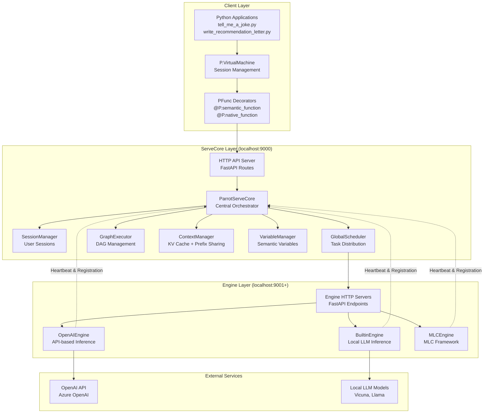

Sources: [README.md:7-11](), [docs/get_started/launch_server.md:6-14]()

## Key Innovation: Semantic Variables

The core innovation of ParrotServe is the **Semantic Variable** abstraction, which exposes application-level dependencies between LLM requests that traditional serving systems cannot capture.

### Semantic Variable System Components

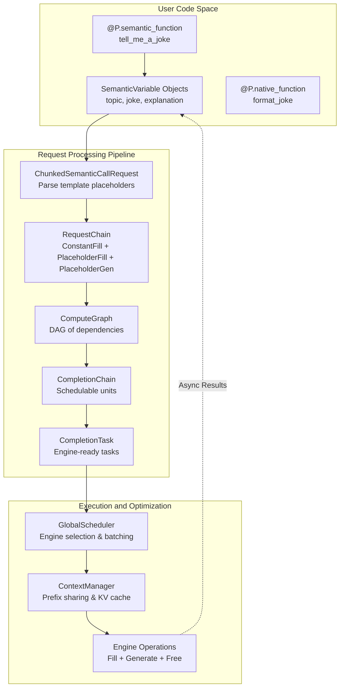

Sources: [docs/user_docs/pfunc.md:8-48](), [docs/sys_design/serve_layer/graph.md:34-80]()

## Core Components and Responsibilities

### ParrotServeCore Layer

| Component | Class/Module | Primary Responsibility |
|-----------|--------------|----------------------|
| HTTP API Server | `parrot.serve.http_server` | FastAPI-based REST endpoints for client requests |
| Session Manager | `SessionManager` | User session lifecycle and isolation |
| Graph Executor | `GraphExecutor` | Compute graph construction and execution |
| Global Scheduler | `GlobalScheduler` | Task distribution and engine selection |
| Context Manager | `ContextManager` | KV cache management and prefix sharing |
| Variable Manager | `VariableManager` | Semantic variable storage and binding |

### Engine Layer  

| Engine Type | Class | Purpose |
|-------------|-------|---------|
| Builtin Engine | `BuiltinEngine` | Local LLM inference with optimized attention |
| OpenAI Engine | `OpenAIEngine` | API-based inference via OpenAI/Azure |
| MLC Engine | `MLCEngine` | MLC framework integration |
| Native Engine | `NativeEngine` | Python function execution |

Sources: [docs/get_started/launch_server.md:64-141](), [docs/version_drafts/v3.md:22-133]()

## Request Processing Flow

ParrotServe transforms user-defined semantic functions into optimized execution plans through a multi-stage pipeline:

### Request Transformation Pipeline

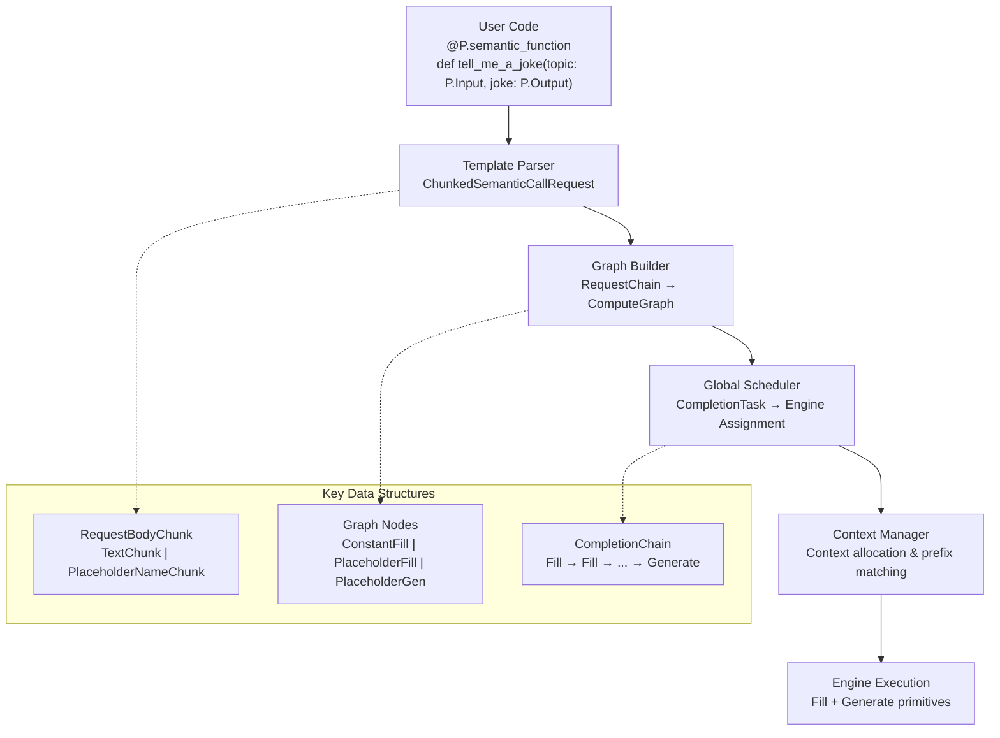

Sources: [docs/sys_design/serve_layer/graph.md:6-19](), [docs/user_docs/parrot_apis.md:50-98]()

## Programming Interface Example

ParrotServe provides a Python-friendly interface that abstracts away the complexity of distributed LLM serving:

```python
from parrot import P

@P.semantic_function()
def tell_me_a_joke(topic: P.Input, joke: P.Output):
    """Tell me a joke about {{topic}}: {{joke}}."""

@P.native_function()
def format_joke(joke: P.Input, formatted_joke: P.Output):
    ret = "Here is the joke for you\n---\n" + joke
    formatted_joke.set(ret)

def main():
    joke = tell_me_a_joke(topic="chicken")
    formatted = format_joke(joke)
    result = formatted.get()
    print(result)
```

The system automatically:
- Discovers dependencies between `tell_me_a_joke` and `format_joke` through the shared `joke` variable
- Optimizes execution by batching compatible requests
- Manages KV cache sharing for common prefixes
- Provides asynchronous result retrieval via `SemanticVariable.get()`

Sources: [README.md:14-31](), [docs/user_docs/pfunc.md:16-48]()

## Deployment and Configuration

ParrotServe operates as a distributed system where `ServeCore` manages multiple `Engine` instances through HTTP-based communication and heartbeat monitoring. Engines register themselves automatically and can be added or removed dynamically without system restart.

The system supports heterogeneous engine types including local LLM inference, cloud API access, and custom Python function execution, providing flexibility for different deployment scenarios and cost optimization strategies.

Sources: [docs/get_started/launch_server.md:9-56](), [requirements.txt:1-27]()

---

# Page: Architecture

# Architecture

<details>
<summary>Relevant source files</summary>

The following files were used as context for generating this wiki page:

- [.env-dev](.env-dev)
- [.gitignore](.gitignore)
- [CONTRIBUTING.md](CONTRIBUTING.md)
- [README.md](README.md)
- [TRANSPARENCY.md](TRANSPARENCY.md)
- [benchmark/bench_kernel.py](benchmark/bench_kernel.py)
- [docs/README.md](docs/README.md)
- [docs/get_started/launch_server.md](docs/get_started/launch_server.md)
- [docs/sys_design/serve_layer/graph.md](docs/sys_design/serve_layer/graph.md)
- [docs/user_docs/parrot_apis.md](docs/user_docs/parrot_apis.md)
- [docs/user_docs/pfunc.md](docs/user_docs/pfunc.md)
- [docs/version_drafts/v3.md](docs/version_drafts/v3.md)
- [parrot/serve/backend_repr/engine.py](parrot/serve/backend_repr/engine.py)
- [parrot/serve/context_manager.py](parrot/serve/context_manager.py)
- [parrot/serve/core.py](parrot/serve/core.py)
- [parrot/serve/engine_manager.py](parrot/serve/engine_manager.py)
- [parrot/serve/scheduler/__init__.py](parrot/serve/scheduler/__init__.py)
- [parrot/serve/scheduler/completion_task.py](parrot/serve/scheduler/completion_task.py)
- [parrot/serve/scheduler/global_scheduler.py](parrot/serve/scheduler/global_scheduler.py)
- [parrot/serve/session/graph_executor.py](parrot/serve/session/graph_executor.py)
- [parrot/serve/session/session.py](parrot/serve/session/session.py)
- [parrot/serve/session_manager.py](parrot/serve/session_manager.py)
- [parrot/serve/variable_manager.py](parrot/serve/variable_manager.py)
- [requirements.txt](requirements.txt)
- [setup.py](setup.py)

</details>


This document provides a high-level overview of ParrotServe's system architecture, explaining the three-layer distributed design and core principles that enable efficient serving of LLM-based applications with semantic variable abstraction.

For detailed information about specific components, see [Core Components](#2.1), [Semantic Variables](#2.2), and [Request Processing Pipeline](#2.3).

## Three-Layer System Design

ParrotServe implements a distributed three-layer architecture that separates concerns between client programming interfaces, central orchestration, and LLM inference execution.

### System Architecture Overview

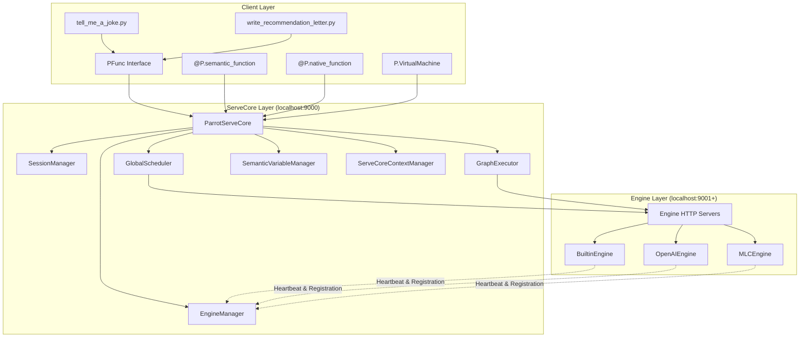

**Sources:** [README.md:7-37](), [parrot/serve/core.py:34-50](), [parrot/serve/session/graph_executor.py:32-36]()

### Layer Responsibilities

| Layer | Primary Responsibility | Key Components |
|-------|----------------------|----------------|
| **Client Layer** | User-facing programming interfaces and application logic | PFunc decorators, VirtualMachine, example applications |
| **ServeCore Layer** | Central orchestration, session management, scheduling | ParrotServeCore, GlobalScheduler, GraphExecutor |
| **Engine Layer** | LLM inference execution with different backends | BuiltinEngine, OpenAIEngine, MLCEngine |

**Sources:** [parrot/serve/core.py:34-50](), [docs/get_started/launch_server.md:7-14]()

## Core Design Principles

### Semantic Variable Abstraction

The central innovation of ParrotServe is the **Semantic Variable** abstraction that provides application-level visibility into LLM computation graphs. This enables automatic optimization without requiring users to manually specify dependencies.

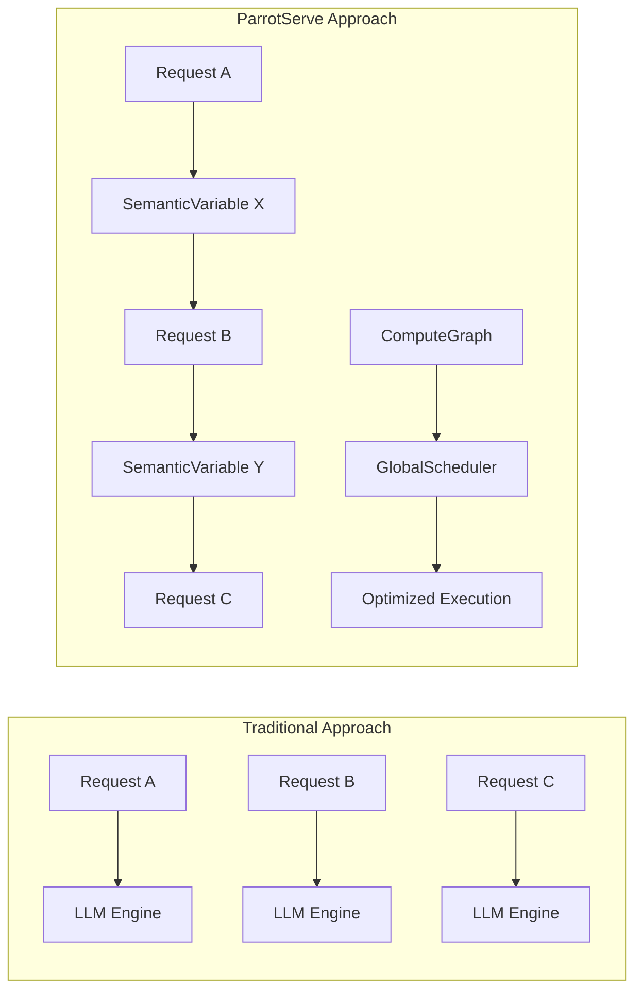

**Sources:** [README.md:7-11](), [parrot/serve/variable_manager.py:121-136]()

### Distributed Engine Management

ParrotServe supports heterogeneous LLM backends through a plugin architecture where engines register themselves with the ServeCore and communicate via HTTP with heartbeat monitoring.

### Context-Aware Resource Sharing

The system implements sophisticated context management with prefix caching and reference counting to enable efficient memory usage across sessions while maintaining isolation.

**Sources:** [parrot/serve/context_manager.py:77-85](), [parrot/serve/engine_manager.py:27-33]()

## Component Interaction Flow

### Core Component Architecture

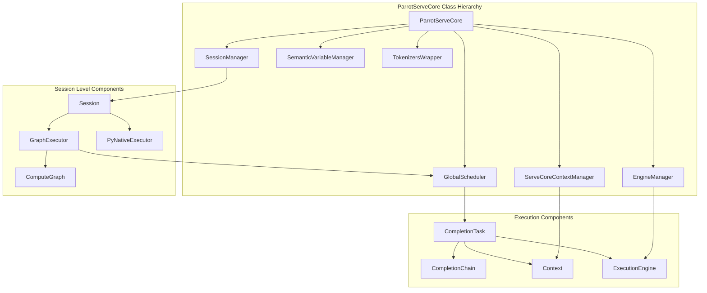

**Sources:** [parrot/serve/core.py:52-88](), [parrot/serve/session/session.py:43-84](), [parrot/serve/scheduler/completion_task.py:27-52]()

### Request Processing Pipeline

The system processes requests through a well-defined pipeline that transforms user input into optimized execution tasks:

1. **Request Submission** - Client submits semantic function calls via HTTP API
2. **Graph Construction** - Parse request into `ChunkedSemanticCallRequest` and convert to `RequestChain`
3. **Variable Assignment** - Create and bind `SemanticVariable` instances to request placeholders
4. **Task Creation** - Generate `CompletionTask` objects for scheduling
5. **Context Assignment** - Allocate `Context` objects with prefix caching optimization
6. **Primitive Execution** - Execute `Fill` and `Generate` operations on target engines

**Sources:** [parrot/serve/session/graph_executor.py:61-98](), [docs/sys_design/serve_layer/graph.md:6-19]()

## Key Implementation Classes

### ServeCore Management

- **`ParrotServeCore`** [parrot/serve/core.py:34]() - Central orchestrator managing all system components
- **`SessionManager`** [parrot/serve/session_manager.py:22]() - Handles session lifecycle and isolation  
- **`EngineManager`** [parrot/serve/engine_manager.py:27]() - Manages engine registration and health monitoring

### Request Processing

- **`GraphExecutor`** [parrot/serve/session/graph_executor.py:32]() - Executes computation graphs within sessions
- **`GlobalScheduler`** [parrot/serve/scheduler/global_scheduler.py:32]() - Schedules tasks across available engines
- **`CompletionTask`** [parrot/serve/scheduler/completion_task.py:27]() - Represents schedulable units of work

### Resource Management

- **`ServeCoreContextManager`** [parrot/serve/context_manager.py:77]() - Manages KV cache contexts with sharing optimization
- **`SemanticVariableManager`** [parrot/serve/variable_manager.py:121]() - Handles semantic variable lifecycle and namespacing
- **`ExecutionEngine`** [parrot/serve/backend_repr/engine.py:44]() - Represents backend LLM inference engines

**Sources:** [parrot/serve/core.py:52-88](), [parrot/serve/scheduler/global_scheduler.py:32-44](), [parrot/serve/context_manager.py:77-111]()

## Communication Protocols

The system uses HTTP-based communication between layers with JSON payloads for requests and responses. Engine registration and heartbeat mechanisms enable dynamic cluster management without requiring static configuration.

**Sources:** [parrot/serve/core.py:99-132](), [docs/user_docs/parrot_apis.md:1-6](), [docs/get_started/launch_server.md:9-14]()

---

# Page: Core Components

# Core Components

<details>
<summary>Relevant source files</summary>

The following files were used as context for generating this wiki page:

- [.env-dev](.env-dev)
- [.gitignore](.gitignore)
- [CONTRIBUTING.md](CONTRIBUTING.md)
- [README.md](README.md)
- [TRANSPARENCY.md](TRANSPARENCY.md)
- [benchmark/bench_kernel.py](benchmark/bench_kernel.py)
- [docs/README.md](docs/README.md)
- [docs/get_started/launch_server.md](docs/get_started/launch_server.md)
- [docs/sys_design/serve_layer/graph.md](docs/sys_design/serve_layer/graph.md)
- [docs/user_docs/parrot_apis.md](docs/user_docs/parrot_apis.md)
- [docs/user_docs/pfunc.md](docs/user_docs/pfunc.md)
- [docs/version_drafts/v3.md](docs/version_drafts/v3.md)
- [parrot/serve/backend_repr/engine.py](parrot/serve/backend_repr/engine.py)
- [parrot/serve/context_manager.py](parrot/serve/context_manager.py)
- [parrot/serve/core.py](parrot/serve/core.py)
- [parrot/serve/engine_manager.py](parrot/serve/engine_manager.py)
- [parrot/serve/scheduler/__init__.py](parrot/serve/scheduler/__init__.py)
- [parrot/serve/scheduler/completion_task.py](parrot/serve/scheduler/completion_task.py)
- [parrot/serve/scheduler/global_scheduler.py](parrot/serve/scheduler/global_scheduler.py)
- [parrot/serve/session/graph_executor.py](parrot/serve/session/graph_executor.py)
- [parrot/serve/session/session.py](parrot/serve/session/session.py)
- [parrot/serve/session_manager.py](parrot/serve/session_manager.py)
- [parrot/serve/variable_manager.py](parrot/serve/variable_manager.py)
- [requirements.txt](requirements.txt)
- [setup.py](setup.py)

</details>


This document provides a detailed explanation of ParrotServe's core components within the ServeCore and Engine layers, and their specific responsibilities in the distributed architecture. This covers the central orchestration layer and the execution backends that handle LLM inference.

For information about the client programming interface, see [Client Programming Interface](#3). For details on request processing flow, see [Request Processing Pipeline](#2.3).

## System Architecture Overview

ParrotServe follows a three-layer distributed architecture where the ServeCore acts as the central orchestrator between client applications and distributed engine instances.

**Core Component Layers**

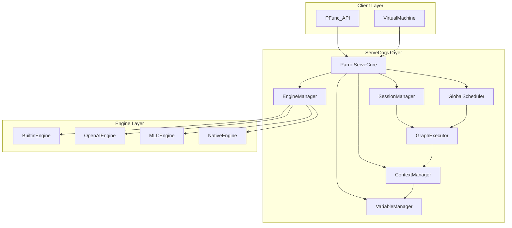

Sources: [parrot/serve/core.py:34-89](), [README.md:7-11]()

## ServeCore Layer Components

The ServeCore layer contains the central orchestration logic and manages all global system state. The main entry point is the `ParrotServeCore` class.

### ParrotServeCore

The `ParrotServeCore` class serves as the central manager that coordinates all system components and handles incoming API requests.

**Key Responsibilities:**
- API endpoint handling for session management, semantic calls, and variable operations
- Component initialization and lifecycle management
- Request routing to appropriate sessions
- Engine registration and heartbeat management

**Core Component Integration**

```mermaid
graph TD
    subgraph "ParrotServeCore_Components"
        A[ParrotServeCore]
        B[SessionManager]
        C[GlobalScheduler]
        D[EngineManager]
        E[ContextManager]
        F[VariableManager]
        G[TokenizersWrapper]
        H[TaskCreator]
    end
    
    A --> B
    A --> C
    A --> D
    A --> E
    A --> F
    A --> G
    A --> H
    
    B --> "session_mgr"
    C --> "global_scheduler"
    D --> "engine_mgr"
    E --> "context_mgr"
    F --> "var_mgr"
    G --> "tokenizers_wrapper"
    H --> "task_creator"
```

Sources: [parrot/serve/core.py:52-89]()

### SessionManager

The `SessionManager` handles user session lifecycle, authentication, and session-scoped resource management.

**Key Components:**
- Session creation and destruction
- Session timeout management
- Session status monitoring (`RUNNING`, `DEAD`, `BAD`)

| Method | Purpose |
|--------|---------|
| `register_session()` | Creates new session with unique ID |
| `remove_session(session_id)` | Cleans up session resources |
| `check_session_status(session_id)` | Validates session availability |
| `session_access_update(session_id)` | Updates last access time |

Sources: [parrot/serve/session_manager.py:22-156]()

### GlobalScheduler

The `GlobalScheduler` implements sophisticated task scheduling algorithms across available engines with support for various optimization strategies.

**Scheduling Features:**
- Application-level FIFO ordering (`app_fifo`)
- Graph-based task grouping (`graph_group`) 
- Context-aware scheduling (`ctx_aware`)
- Engine capacity and constraint checking

**Engine Selection Process**

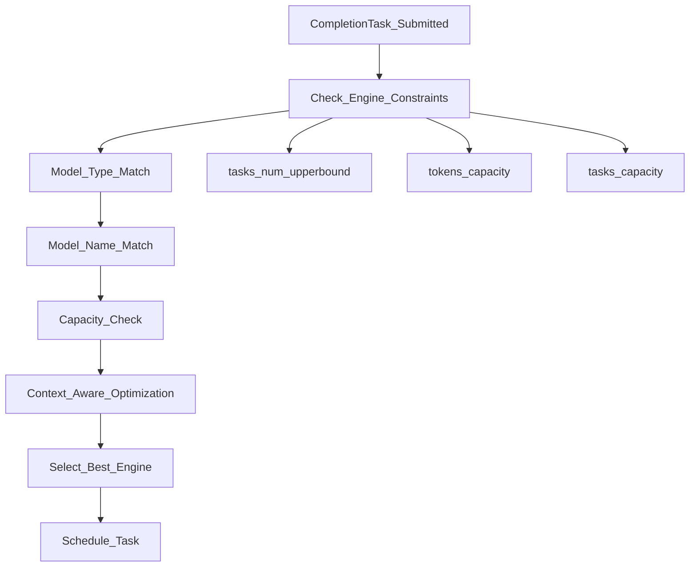

Sources: [parrot/serve/scheduler/global_scheduler.py:32-255]()

### ContextManager (ServeCoreContextManager)

The `ServeCoreContextManager` manages KV cache contexts across sessions and engines, implementing sophisticated caching and sharing strategies.

**Core Features:**
- Context creation, forking, and reference counting
- Prefix caching with content-based hashing
- Cross-session context sharing for constant prefixes
- Engine-specific prefix cache management

**Context Lifecycle Management:**

| Component | Purpose |
|-----------|---------|
| `PrefixCache` | Maps prefix hashes to context IDs |
| `_context_ref_counter` | Tracks context usage across tasks |
| `constant_prefix_contexts` | Manages global constant prefix contexts |
| `session_contexts` | Session-scoped context tracking |

Sources: [parrot/serve/context_manager.py:77-379]()

### SemanticVariableManager

The `SemanticVariableManager` implements the core Semantic Variable abstraction with namespace management and content-based deduplication.

**Variable Namespaces:**
- **Constant Prefix Namespace**: Global variables shared across sessions
- **Session Namespaces**: Session-local variable spaces
- **Content-based Hashing**: Automatic deduplication of identical content

**Variable Creation Strategies:**

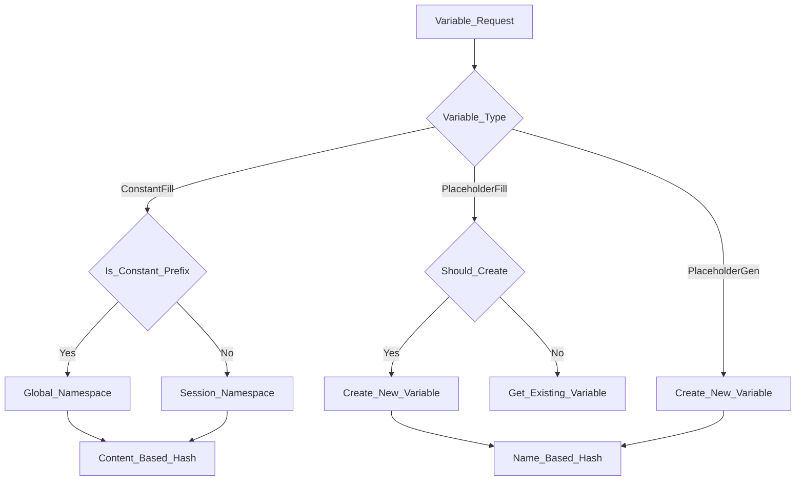

Sources: [parrot/serve/variable_manager.py:121-398]()

## Engine Layer Components

The Engine layer provides pluggable LLM inference backends through a common `ExecutionEngine` interface.

### ExecutionEngine Architecture

All engines implement the same interface for primitive operations while supporting different backend implementations.

**Engine Types and Their Backends**

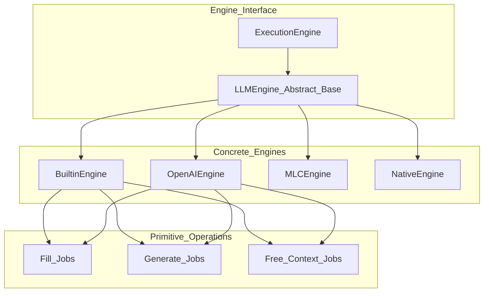

Sources: [parrot/serve/backend_repr/engine.py:44-212]()

### Engine Management

The `EngineManager` handles engine registration, health monitoring, and lifecycle management.

**Engine Lifecycle:**

| State | Description | Trigger |
|-------|-------------|---------|
| `RUNNING` | Engine is operational and accepting tasks | Normal operation |
| `DEAD` | Engine heartbeat expired | Timeout exceed `engine_heartbeat_timeout` |
| `BAD` | Engine encountered exception | Exception raised during execution |

**Engine Registration Process:**

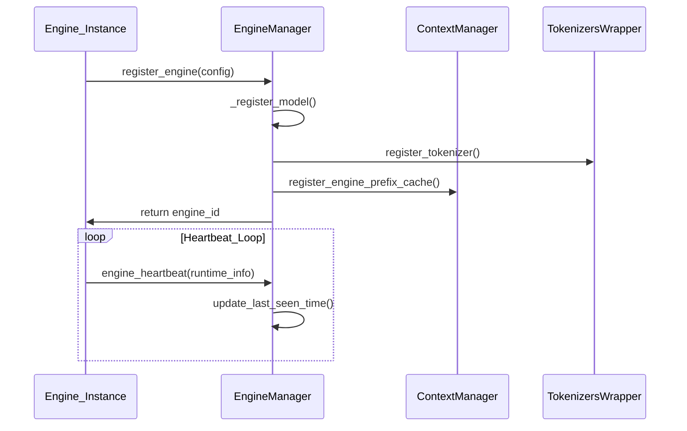

Sources: [parrot/serve/engine_manager.py:27-194]()

### Engine Runtime Information

Each engine maintains both real-time and serve-layer runtime information for scheduling decisions.

**Runtime Information Types:**

| Info Type | Source | Purpose |
|-----------|--------|---------|
| `EngineRuntimeInfo` | Engine heartbeat | Real-time metrics (cache_mem, num_cached_tokens) |
| `ServeLayerRuntimeInfo` | ServeCore tracking | Scheduling state (num_tasks, tokens_num, task_upperbounds) |

Sources: [parrot/serve/backend_repr/engine.py:33-76]()

## Component Interaction Flow

The following diagram shows how core components interact during a typical request processing cycle:

**Request Processing Component Interaction**

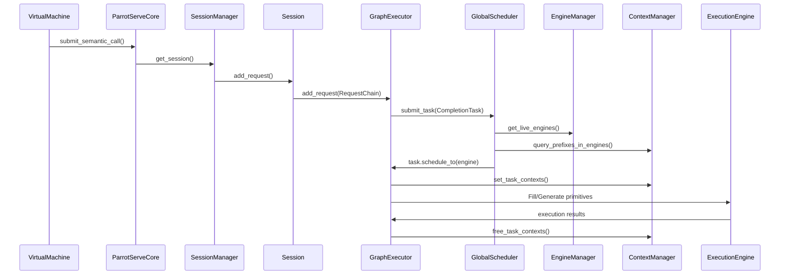

Sources: [parrot/serve/core.py:198-226](), [parrot/serve/session/graph_executor.py:61-116](), [parrot/serve/scheduler/global_scheduler.py:162-180]()

---

# Page: Semantic Variables

# Semantic Variables

<details>
<summary>Relevant source files</summary>

The following files were used as context for generating this wiki page:

- [.env-dev](.env-dev)
- [.gitignore](.gitignore)
- [CONTRIBUTING.md](CONTRIBUTING.md)
- [README.md](README.md)
- [TRANSPARENCY.md](TRANSPARENCY.md)
- [benchmark/bench_kernel.py](benchmark/bench_kernel.py)
- [docs/README.md](docs/README.md)
- [docs/get_started/launch_server.md](docs/get_started/launch_server.md)
- [docs/sys_design/serve_layer/graph.md](docs/sys_design/serve_layer/graph.md)
- [docs/user_docs/parrot_apis.md](docs/user_docs/parrot_apis.md)
- [docs/user_docs/pfunc.md](docs/user_docs/pfunc.md)
- [docs/version_drafts/v3.md](docs/version_drafts/v3.md)
- [parrot/__init__.py](parrot/__init__.py)
- [parrot/constants.py](parrot/constants.py)
- [parrot/engine/config.py](parrot/engine/config.py)
- [parrot/frontend/pfunc/semantic_variable.py](parrot/frontend/pfunc/semantic_variable.py)
- [parrot/protocol/public/apis.py](parrot/protocol/public/apis.py)
- [parrot/serve/backend_repr/model.py](parrot/serve/backend_repr/model.py)
- [parrot/serve/config.py](parrot/serve/config.py)
- [parrot/serve/graph/__init__.py](parrot/serve/graph/__init__.py)
- [parrot/serve/graph/graph.py](parrot/serve/graph/graph.py)
- [parrot/serve/graph/graph_traverse.py](parrot/serve/graph/graph_traverse.py)
- [parrot/serve/graph/semantic_variable.py](parrot/serve/graph/semantic_variable.py)
- [parrot/serve/graph/visualize_utils.py](parrot/serve/graph/visualize_utils.py)
- [parrot/serve/http_server.py](parrot/serve/http_server.py)
- [parrot/serve/scheduler/task_creator.py](parrot/serve/scheduler/task_creator.py)
- [parrot/testing/fake_core_server.py](parrot/testing/fake_core_server.py)
- [requirements.txt](requirements.txt)
- [setup.py](setup.py)
- [tests/serve/test_scheduler.py](tests/serve/test_scheduler.py)
- [tests/test_protocol.py](tests/test_protocol.py)

</details>


This document covers the Semantic Variable abstraction, which is the core innovation in ParrotServe that enables application-level optimization of LLM requests. Semantic Variables provide a programming model for structured prompts and enable automatic dependency analysis, parallelization, and context sharing across LLM requests.

For information about the overall system architecture, see [Architecture](#2). For details about request processing and graph execution, see [Request Processing Pipeline](#2.3).

## Core Concept and Definition

A Semantic Variable represents a semantically meaningful portion of an LLM prompt that can be shared across multiple requests. Unlike traditional LLM serving systems that treat each request independently, ParrotServe uses Semantic Variables to expose the internal structure of prompts and dependencies between requests.

### Semantic Variable Types

Semantic Variables can represent different types of prompt content:

- **System prompts or prefixes** - Reusable instruction text
- **User inputs** - Parameters passed to LLM functions  
- **Output locations** - Where generated content should be stored
- **Communication ports** - Data flow between LLM agents
- **Few-shot examples** - Demonstration content

The core `SemanticVariable` class implements an asynchronous programming model similar to Python's `Future` or JavaScript's `Promise`, allowing requests to depend on outputs from other requests.

**Semantic Variable Core Architecture**
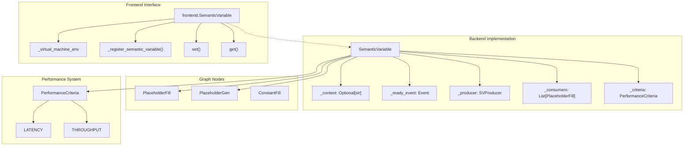

Sources: [parrot/serve/graph/semantic_variable.py:14-142](), [parrot/frontend/pfunc/semantic_variable.py:15-142](), [parrot/serve/graph/node.py](), [parrot/serve/graph/perf_criteria.py]()

## Implementation Architecture

### Backend SemanticVariable Class

The backend `SemanticVariable` class provides the core functionality for content storage, event handling, and graph relationships:

| Property | Type | Purpose |
|----------|------|---------|
| `name` | `str` | Human-readable identifier |
| `id` | `str` | Unique system identifier |
| `_content` | `Optional[str]` | Stored text content |
| `_ready_event` | `Event` | Asynchronous readiness signaling |
| `_producer` | `Optional[SVProducer]` | Node that generates content |
| `_consumers` | `List[PlaceholderFill]` | Nodes that consume content |
| `_criteria` | `PerformanceCriteria` | Optimization objective |

Key methods include:
- `set(content: str)` - Store content and signal readiness
- `get() -> str` - Retrieve content (blocking)
- `wait_ready()` - Asynchronous wait for content
- `activate(criteria, depth)` - Enable optimization with performance criteria

### Frontend SemanticVariable Class

The frontend provides a user-facing API that communicates with the backend through the `VirtualMachine` environment:

```python
# Example usage from frontend
var = P.variable(name="topic", content="AI")
result = semantic_function(topic=var)
content = result.get()  # Blocks until ready
```

Sources: [parrot/serve/graph/semantic_variable.py:36-142](), [parrot/frontend/pfunc/semantic_variable.py:24-142]()

## Variable Lifecycle and State Management

### Registration and Creation

Semantic Variables follow a specific lifecycle managed by the `SemanticVariableManager`:

**Variable Lifecycle Flow**
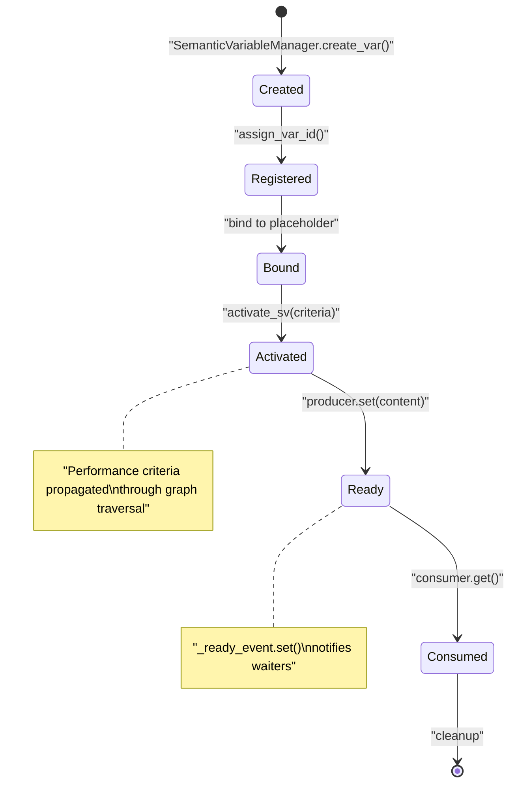

### Variable Scoping

The system supports different variable scopes managed by `SemanticVariableManager`:

- **Session-local variables** - Private to a user session
- **Global constant prefix variables** - Shared across sessions with timeout
- **Inter-session temporary variables** - Short-lived shared results

Sources: [parrot/serve/variable_manager.py](), [parrot/serve/graph/semantic_variable.py:70-92]()

## Graph Integration and Dependencies

### Producer-Consumer Relationships

Semantic Variables create dependencies between graph nodes through producer-consumer relationships:

- **Producers**: `PlaceholderGen` nodes or `NativeFuncNode` instances that generate content
- **Consumers**: `PlaceholderFill` nodes that use the content in prompts

**Graph Node Relationships**
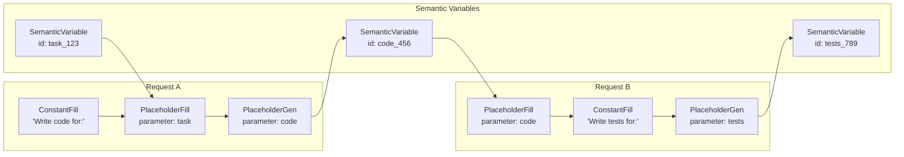

### Graph Traversal and Activation

The `activate_sv()` function performs backward graph traversal to propagate performance criteria and determine execution order:

1. Start from target semantic variable
2. Traverse backward through producers
3. Recursively activate dependencies  
4. Assign performance criteria and depth
5. Group related chains for optimization

Sources: [parrot/serve/graph/graph_traverse.py:90-100](), [parrot/serve/graph/graph.py:321-432](), [parrot/serve/graph/node.py]()

## Performance Criteria and Optimization

### Performance Objectives

Semantic Variables can be activated with different performance criteria that influence scheduling:

- **`LATENCY`** - Optimize for low end-to-end latency
- **`THROUGHPUT`** - Optimize for high request throughput

The `TaskCreator` translates these criteria into concrete scheduling annotations:

```python
# From TaskCreator._lower_criteria()
if criteria == PerformanceCriteria.LATENCY:
    return ScheduleAnnotation(
        tasks_num_upperbound=4,
        tokens_num_upperbound=4096,
    )
elif criteria == PerformanceCriteria.THROUGHPUT:
    return ScheduleAnnotation(
        tasks_num_upperbound=99999,
        tokens_num_upperbound=9999999999999,
    )
```

### Context Sharing and Prefix Optimization

Semantic Variables enable context sharing optimizations:

- **Prefix caching** - Reuse KV cache for common prompt prefixes
- **Content-based deduplication** - Hash identical variable content
- **Reference counting** - Efficient memory management for shared contexts

Sources: [parrot/serve/scheduler/task_creator.py:25-39](), [parrot/serve/graph/perf_criteria.py](), [parrot/serve/context_manager.py]()

## Frontend Programming Interface

### PFunc Integration

The frontend integrates with the PFunc programming model through decorators and type annotations:

```python
@P.semantic_function()
def generate_code(task: P.Input, code: P.Output):
    """Write Python code for: {{task}}
    
    {{code}}"""

# Usage creates semantic variables automatically  
code_var = generate_code(task="sort a list")
result = code_var.get(criteria=P.LATENCY)
```

### API Operations

The frontend provides RESTful APIs for semantic variable operations:

| Endpoint | Method | Purpose |
|----------|--------|---------|
| `/v1/semantic_var` | POST | Register new variable |
| `/v1/semantic_var/{var_id}` | POST | Set variable content |
| `/v1/semantic_var/{var_id}` | GET | Get variable content |
| `/v1/semantic_var` | GET | List session variables |

### Asynchronous Operations

Both synchronous and asynchronous access patterns are supported:

```python
# Synchronous blocking
content = var.get(criteria=P.LATENCY)

# Asynchronous non-blocking  
content = await var.aget(criteria=P.LATENCY)
```

Sources: [parrot/frontend/pfunc/semantic_variable.py:119-142](), [parrot/protocol/public/apis.py:205-310](), [parrot/serve/http_server.py:119-142]()

---

# Page: Request Processing Pipeline

# Request Processing Pipeline

<details>
<summary>Relevant source files</summary>

The following files were used as context for generating this wiki page:

- [parrot/protocol/public/apis.py](parrot/protocol/public/apis.py)
- [parrot/serve/backend_repr/engine.py](parrot/serve/backend_repr/engine.py)
- [parrot/serve/context_manager.py](parrot/serve/context_manager.py)
- [parrot/serve/core.py](parrot/serve/core.py)
- [parrot/serve/engine_manager.py](parrot/serve/engine_manager.py)
- [parrot/serve/graph/__init__.py](parrot/serve/graph/__init__.py)
- [parrot/serve/graph/graph.py](parrot/serve/graph/graph.py)
- [parrot/serve/graph/graph_traverse.py](parrot/serve/graph/graph_traverse.py)
- [parrot/serve/graph/semantic_variable.py](parrot/serve/graph/semantic_variable.py)
- [parrot/serve/graph/visualize_utils.py](parrot/serve/graph/visualize_utils.py)
- [parrot/serve/scheduler/__init__.py](parrot/serve/scheduler/__init__.py)
- [parrot/serve/scheduler/completion_task.py](parrot/serve/scheduler/completion_task.py)
- [parrot/serve/scheduler/global_scheduler.py](parrot/serve/scheduler/global_scheduler.py)
- [parrot/serve/scheduler/task_creator.py](parrot/serve/scheduler/task_creator.py)
- [parrot/serve/session/graph_executor.py](parrot/serve/session/graph_executor.py)
- [parrot/serve/session/session.py](parrot/serve/session/session.py)
- [parrot/serve/session_manager.py](parrot/serve/session_manager.py)
- [parrot/serve/variable_manager.py](parrot/serve/variable_manager.py)
- [parrot/testing/fake_core_server.py](parrot/testing/fake_core_server.py)
- [tests/serve/test_scheduler.py](tests/serve/test_scheduler.py)
- [tests/test_protocol.py](tests/test_protocol.py)

</details>


This document describes how user requests flow through ParrotServe from initial submission to final execution. It covers the transformation of requests into executable tasks, semantic variable management, graph construction, and the scheduling pipeline.

For information about the semantic variable abstraction that enables this pipeline, see [Semantic Variables](#2.2). For details about specific execution engines, see [Engine Layer](#5).

## Overview

The request processing pipeline transforms user-submitted semantic function calls into optimized execution tasks. The pipeline consists of several key stages:

1. **Request Parsing** - HTTP requests are parsed into structured `ChunkedSemanticCallRequest` objects
2. **Graph Construction** - Requests are converted into `RequestChain` objects and inserted into the `ComputeGraph`
3. **Variable Assignment** - Semantic variables are created and assigned to request nodes
4. **Task Creation** - `CompletionChain` objects are converted into schedulable `CompletionTask` objects
5. **Scheduling** - Tasks are assigned to execution engines by the `GlobalScheduler`
6. **Execution** - Tasks are executed through primitive operations (Fill/Generate) on engines

## Request Submission and Parsing

### HTTP Request Processing

The pipeline begins when clients submit requests through the public HTTP API. The `ParrotServeCore` class handles incoming requests:

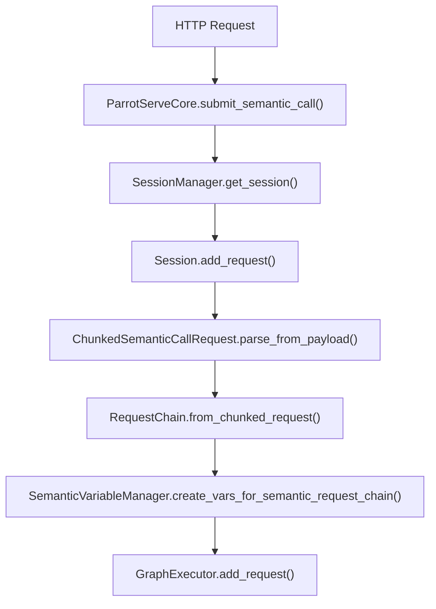

The `submit_semantic_call` method in `ParrotServeCore` validates the session and delegates request processing to the appropriate `Session` object. Each session maintains its own `ComputeGraph` and execution context.

Sources: [parrot/serve/core.py:198-226](), [parrot/serve/session/session.py:170-190]()

### Request Structure Transformation

Incoming requests are parsed into `ChunkedSemanticCallRequest` objects, which represent the template structure with placeholders:

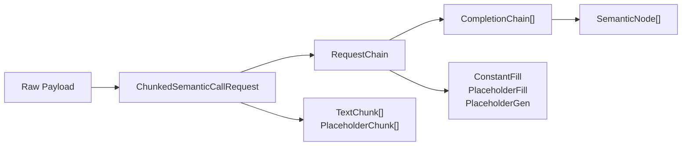

The transformation process converts template strings with placeholders into structured node sequences. Each `{{placeholder}}` becomes either a `PlaceholderFill` (input) or `PlaceholderGen` (output) node based on the parameter configuration.

Sources: [parrot/serve/graph/graph.py:254-305](), [parrot/serve/graph/call_request.py]()

## Semantic Variable Management

### Variable Creation and Assignment

The `SemanticVariableManager` creates and assigns semantic variables to request nodes based on content and scope:

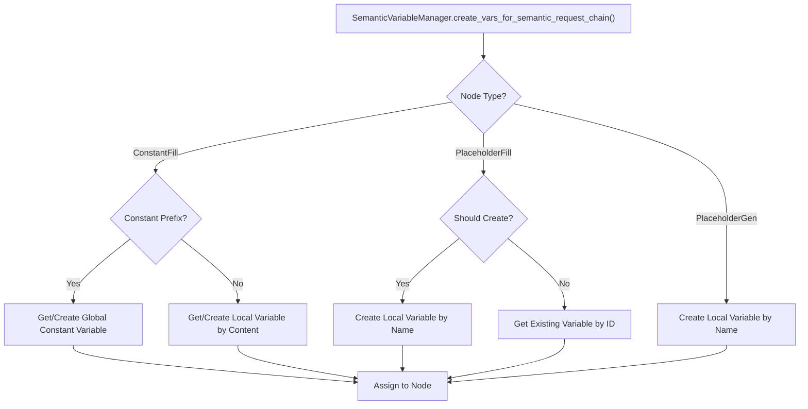

The variable manager implements a two-tier system:
- **Constant Prefix Variables**: Global scope, content-based hashing, timeout-based expiration
- **Local Variables**: Session scope, either content-based or name-based allocation

Sources: [parrot/serve/variable_manager.py:282-356]()

### Variable Namespaces

Variables are organized in hierarchical namespaces to enable sharing and isolation:

| Namespace Type | Scope | Hashing Strategy | Use Case |
|---|---|---|---|
| Constant Prefix | Global | Content-based | Shared system prompts |
| Session Local | Per-session | Content or name-based | User inputs/outputs |

Sources: [parrot/serve/variable_manager.py:121-151]()

## Graph Construction and Execution

### Compute Graph Integration

`RequestChain` objects are inserted into the session's `ComputeGraph`, creating execution dependencies:

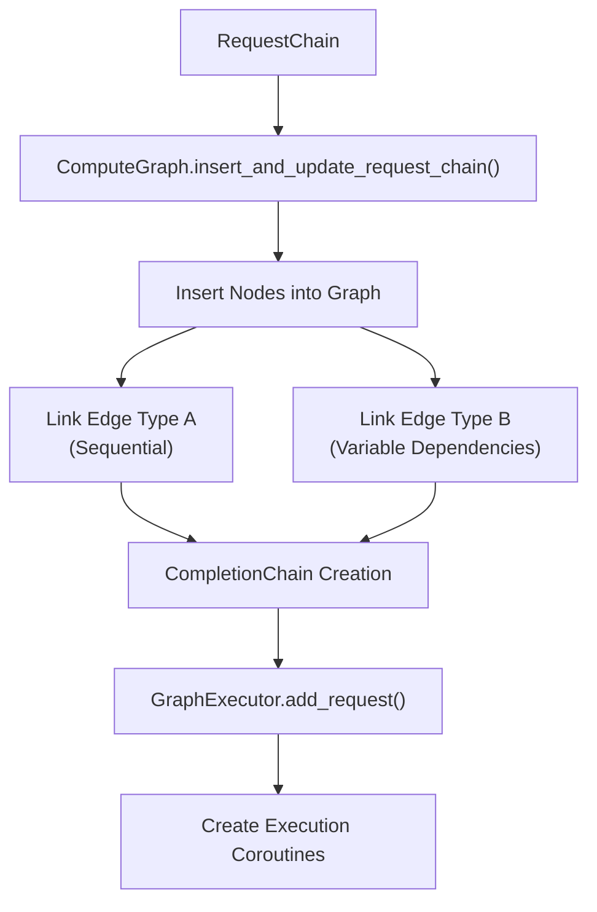

The graph maintains two types of edges:
- **Edge Type A**: Sequential execution within request chains
- **Edge Type B**: Cross-request dependencies through semantic variables

Sources: [parrot/serve/graph/graph.py:360-394](), [parrot/serve/session/graph_executor.py:103-116]()

### Execution Coroutine Creation

For each `CompletionChain`, the `GraphExecutor` creates an asynchronous execution coroutine:

```mermaid
graph TD
    A["CompletionChain"] --> B["GraphExecutor._execute_coroutine()"]
    B --> C["Wait for Activation"]
    C --> D["TaskCreator.create_task()"]
    D --> E["Wait for Input Dependencies"]
    E --> F["TokenizersWrapper.tokenize_chain()"]
    F --> G["GlobalScheduler.submit_task()"]
    G --> H["Wait for Scheduling"]
    H --> I["ContextManager.set_task_contexts()"]
    I --> J["Execute Fill/Generate Operations"]
```

Each coroutine handles the complete lifecycle of a completion chain from dependency resolution to execution.

Sources: [parrot/serve/session/graph_executor.py:61-98]()

## Task Creation and Scheduling

### Task Object Creation

The `TaskCreator` converts `CompletionChain` objects into schedulable `CompletionTask` objects:

```mermaid
graph LR
    A["CompletionChain"] --> B["TaskCreator.create_task()"]
    B --> C["Extract Performance Criteria"]
    C --> D["Create ScheduleAnnotation"]
    D --> E["CompletionTask"]
    
    F["PerformanceCriteria.LATENCY"] --> G["tasks_num_upperbound=4"]
    H["PerformanceCriteria.THROUGHPUT"] --> I["tasks_num_upperbound=99999"]
```

Tasks include scheduling annotations that guide the `GlobalScheduler` in engine selection and resource allocation.

Sources: [parrot/serve/scheduler/task_creator.py:41-72]()

### Global Scheduling

The `GlobalScheduler` implements various scheduling policies to optimize task placement:

```mermaid
graph TD
    A["GlobalScheduler.schedule()"] --> B{"Scheduling Policy"}
    B -->|app_fifo| C["Sort by SV Depth"]
    B -->|graph_group| D["Group by Chain Dependencies"]
    B -->|ctx_group| E["Group by Shared Context"]
    B -->|ctx_aware| F["Prefer Engines with Cached Prefixes"]
    
    C --> G["Engine Selection"]
    D --> G
    E --> G
    F --> G
    
    G --> H["Check Engine Availability"]
    H --> I["Assign Tasks to Engines"]
```

The scheduler considers multiple factors: model compatibility, capacity constraints, task limits, and context cache availability.

Sources: [parrot/serve/scheduler/global_scheduler.py:182-254]()

## Context Management and Execution

### Context Assignment

The `ServeCoreContextManager` assigns execution contexts to scheduled tasks, implementing prefix caching optimization:

```mermaid
graph TD
    A["CompletionTask"] --> B["ContextManager.set_task_contexts()"]
    B --> C{"Prefix Cached?"}
    C -->|Yes| D["Reuse Cached Context"]
    C -->|No| E{"First Node?"}
    E -->|Yes| F["Create New Context"]
    E -->|No| G{"Fuse Fill?"}
    G -->|Yes| H["Reuse Previous Context"]
    G -->|No| I["Fork from Previous Context"]
    
    D --> J["Add Reference Counter"]
    F --> K["Cache Prefix if Fill"]
    I --> K
    H --> K
    K --> J
```

Context management enables efficient memory usage through prefix sharing and reference counting.

Sources: [parrot/serve/context_manager.py:206-266]()

### Primitive Execution

The `GraphExecutor.execute()` method runs the actual computation by sending primitive operations to engines:

```mermaid
graph LR
    A["CompletionTask"] --> B{"Node Type"}
    B -->|Fill| C["Create Fill Primitive"]
    B -->|Generate| D["Create Generate Primitive"]
    
    C --> E["Fill.apost(engine.http_address)"]
    D --> F["Generate.apost(engine.http_address)"]
    
    E --> G["Update Node Content"]
    F --> G
    G --> H["Mark Context Ready"]
```

Fill operations handle prompt prefill, while Generate operations produce new tokens. The executor handles both token-based and text-based model types.

Sources: [parrot/serve/session/graph_executor.py:117-254]()

## Performance Optimization Features

### Prefix Caching

The system implements sophisticated prefix caching through the `PrefixCache` class:

| Cache Type | Scope | Key | Benefit |
|---|---|---|---|
| Intra-session | Single session | Variable ID sequence | Avoid redundant prefill |
| Inter-session | Global | Content hash | Share common prompts |
| Constant prefix | Global with timeout | Content hash | System prompt reuse |

### Request Batching

The scheduler supports multiple grouping strategies:

- **Graph Grouping**: Tasks with shared dependencies
- **Context Grouping**: Tasks with identical prefixes  
- **Application FIFO**: Depth-based priority ordering

### Asynchronous Execution

The pipeline leverages Python's asyncio for concurrent processing:
- Multiple completion chains execute in parallel
- Dependency resolution blocks only affected chains
- Engine communication uses async HTTP clients

Sources: [parrot/serve/context_manager.py:23-76](), [parrot/serve/scheduler/global_scheduler.py:196-229]()

## Error Handling and Recovery

The system implements comprehensive error handling throughout the pipeline:

- **Session-level**: Bad sessions are marked and swept
- **Task-level**: Failed tasks update engine status
- **Engine-level**: Dead engines are removed from scheduling
- **Variable-level**: Exception propagation through dependency chains

Engine failures trigger automatic failover through the `EngineManager`, while session exceptions are isolated to prevent system-wide failures.

Sources: [parrot/serve/session/graph_executor.py:82-87](), [parrot/serve/engine_manager.py:96-106]()

---

# Page: Client Programming Interface

# Client Programming Interface

<details>
<summary>Relevant source files</summary>

The following files were used as context for generating this wiki page:

- [.env-dev](.env-dev)
- [.gitignore](.gitignore)
- [CONTRIBUTING.md](CONTRIBUTING.md)
- [README.md](README.md)
- [TRANSPARENCY.md](TRANSPARENCY.md)
- [benchmark/bench_kernel.py](benchmark/bench_kernel.py)
- [docs/README.md](docs/README.md)
- [docs/get_started/launch_server.md](docs/get_started/launch_server.md)
- [docs/sys_design/serve_layer/graph.md](docs/sys_design/serve_layer/graph.md)
- [docs/user_docs/parrot_apis.md](docs/user_docs/parrot_apis.md)
- [docs/user_docs/pfunc.md](docs/user_docs/pfunc.md)
- [docs/version_drafts/v3.md](docs/version_drafts/v3.md)
- [parrot/engine/engine_creator.py](parrot/engine/engine_creator.py)
- [parrot/frontend/pfunc/function.py](parrot/frontend/pfunc/function.py)
- [parrot/frontend/pfunc/interface.py](parrot/frontend/pfunc/interface.py)
- [parrot/frontend/pfunc/vm.py](parrot/frontend/pfunc/vm.py)
- [parrot/testing/localhost_server_daemon.py](parrot/testing/localhost_server_daemon.py)
- [requirements.txt](requirements.txt)
- [setup.py](setup.py)
- [tests/engine/builtin/test_llama.py](tests/engine/builtin/test_llama.py)
- [tests/engine/builtin/test_sampler.py](tests/engine/builtin/test_sampler.py)
- [tests/engine/test_engine.py](tests/engine/test_engine.py)
- [tests/engine/test_http_server.py](tests/engine/test_http_server.py)

</details>


## Purpose and Scope

The Client Programming Interface provides user-facing programming abstractions for developing LLM-based applications with ParrotServe. This interface enables developers to write semantic programs using Python decorators and semantic variables that automatically leverage ParrotServe's optimization capabilities including request parallelization, batching, and context sharing.

For detailed information about individual API components, see [PFunc API](#3.1). For VirtualMachine session management, see [VirtualMachine](#3.2). For complete application examples, see [Example Applications](#3.3). For server-side request processing, see [Request Processing Pipeline](#2.3).

## Client Interface Architecture

The client programming interface consists of three main layers that abstract the underlying distributed serving system:

```mermaid
graph TB
    subgraph "User Application Layer"
        UserCode["User Application Code<br/>tell_me_a_joke.py"]
        MainFunc["main() function"]
    end
    
    subgraph "PFunc Programming Interface"
        Decorators["Function Decorators<br/>@P.semantic_function<br/>@P.native_function"]
        ParamTypes["Parameter Types<br/>P.Input, P.Output"]
        SemVar["SemanticVariable<br/>Content containers"]
    end
    
    subgraph "VirtualMachine Runtime"
        VM["VirtualMachine<br/>Session management"]
        FuncRegistry["Function Registry<br/>BasicFunction storage"]
        APIClient["HTTP API Client<br/>ServeCore communication"]
    end
    
    subgraph "ServeCore Communication"
        SessionAPI["Session APIs<br/>/session endpoints"]
        CallAPI["Semantic Call APIs<br/>/semantic_call endpoints"] 
        VarAPI["Variable APIs<br/>/semantic_var endpoints"]
    end
    
    UserCode --> Decorators
    MainFunc --> VM
    Decorators --> SemVar
    Decorators --> ParamTypes
    
    VM --> FuncRegistry
    VM --> APIClient
    
    APIClient --> SessionAPI
    APIClient --> CallAPI
    APIClient --> VarAPI
    
    style VM fill:#ffcc99
    style Decorators fill:#ccffcc
    style SemVar fill:#ccccff
```

Sources: [parrot/frontend/pfunc/vm.py:49-481](), [parrot/frontend/pfunc/interface.py:1-165](), [parrot/frontend/pfunc/function.py:34-633]()

## Core Programming Components

### Function Decorators

The programming interface provides two primary decorators for defining LLM functions:

| Decorator | Purpose | Function Type |
|-----------|---------|---------------|
| `@P.semantic_function()` | Define LLM prompt templates with placeholders | `SemanticFunction` |
| `@P.native_function()` | Define Python computation functions | `PyNativeFunction` |

```mermaid
graph LR
    UserFunc["User Function Definition<br/>with decorator"]
    
    SemanticDec["@P.semantic_function()"]
    NativeDec["@P.native_function()"]
    
    SemanticFunc["SemanticFunction<br/>Template parsing"]
    NativeFunc["PyNativeFunction<br/>Code serialization"]
    
    FuncRegistry["Function Registry<br/>_function_registry"]
    
    UserFunc --> SemanticDec
    UserFunc --> NativeDec
    
    SemanticDec --> SemanticFunc
    NativeDec --> NativeFunc
    
    SemanticFunc --> FuncRegistry
    NativeFunc --> FuncRegistry
```

Sources: [parrot/frontend/pfunc/interface.py:38-147](), [parrot/frontend/pfunc/function.py:225-383](), [parrot/frontend/pfunc/function.py:461-633]()

### Parameter Type System

Function parameters are annotated with semantic types that determine their role in the computation graph:

| Parameter Type | Class | Description |
|----------------|-------|-------------|
| `P.Input` | `ParamType.INPUT_LOC` | Input semantic variable locations |
| `P.Output` | `ParamType.OUTPUT_LOC` | Output semantic variable locations |
| Python objects | `ParamType.INPUT_PYOBJ` | Direct Python object parameters |

Sources: [parrot/frontend/pfunc/interface.py:23-36](), [parrot/frontend/pfunc/function_body.py:15-37]()

### SemanticVariable Container

`SemanticVariable` objects serve as content containers that enable data flow dependencies between function calls:

```mermaid
graph TB
    subgraph "SemanticVariable Lifecycle"
        Create["SemanticVariable Creation<br/>P.variable() or function output"]
        Register["Variable Registration<br/>register_semantic_variable_handler()"]
        SetContent["Content Assignment<br/>set_semantic_variable_handler()"]
        GetContent["Content Retrieval<br/>get_semantic_variable_handler()"]
    end
    
    subgraph "VM Integration"
        VMHandler["VirtualMachine<br/>_virtual_machine_env"]
        SessionMgmt["Session Management<br/>session_id + session_auth"]
        HTTPClient["HTTP API Client<br/>core_http_addr"]
    end
    
    Create --> Register
    Register --> SetContent
    SetContent --> GetContent
    
    Register --> VMHandler
    SetContent --> VMHandler  
    GetContent --> VMHandler
    
    VMHandler --> SessionMgmt
    VMHandler --> HTTPClient
    
    style Create fill:#ccffcc
    style VMHandler fill:#ffcc99
```

Sources: [parrot/frontend/pfunc/semantic_variable.py:1-200](), [parrot/frontend/pfunc/vm.py:85-169]()

## VirtualMachine Session Management

The `VirtualMachine` class provides the runtime environment for executing semantic programs by managing sessions and coordinating with ServeCore:

### Session Lifecycle

```mermaid
graph LR
    VMInit["VirtualMachine<br/>__init__()"]
    
    SessionReg["register_session()<br/>POST /session"]
    RunScope["running_scope()<br/>Context manager"]
    ProgramExec["Program Execution<br/>Semantic function calls"]
    SessionCleanup["unregister_session()<br/>DELETE /session"]
    
    VMInit --> SessionReg
    SessionReg --> RunScope
    RunScope --> ProgramExec
    ProgramExec --> SessionCleanup
    
    subgraph "Session State"
        SessionID["session_id<br/>NONE_SESSION_ID -> actual ID"]
        SessionAuth["_session_auth<br/>Authentication token"]
        FuncReg["_function_registry<br/>Function storage"]
    end
    
    SessionReg --> SessionID
    SessionReg --> SessionAuth
    RunScope --> FuncReg
```

Sources: [parrot/frontend/pfunc/vm.py:277-308](), [parrot/frontend/pfunc/vm.py:387-456]()

### Function Call Processing

When a semantic function is called, the VirtualMachine processes the request through multiple stages:

```mermaid
graph TB
    subgraph "Function Call Processing"
        FuncCall["Semantic Function Call<br/>tell_me_a_joke(topic='chicken')"]
        CallObj["SemanticCall Creation<br/>BasicCall.__init__()"]
        ReqPayload["Request Payload Generation<br/>to_request_payload()"]
        Submit["Submit to ServeCore<br/>submit_semantic_call_handler()"]
        Response["Parameter Info Response<br/>var_id assignments"]
        VarReturn["SemanticVariable Return<br/>Output variable creation"]
    end
    
    subgraph "VM Handler Methods"
        SubmitHandler["submit_semantic_call_handler()<br/>HTTP POST /semantic_call"]
        RegisterVar["register_semantic_variable_handler()<br/>Variable registration"]
        GetVar["get_semantic_variable_handler()<br/>Content retrieval"]
    end
    
    FuncCall --> CallObj
    CallObj --> ReqPayload
    ReqPayload --> Submit
    Submit --> SubmitHandler
    SubmitHandler --> Response
    Response --> VarReturn
    
    VarReturn --> RegisterVar
    VarReturn --> GetVar
    
    style Submit fill:#ffcc99
    style SubmitHandler fill:#ccccff
```

Sources: [parrot/frontend/pfunc/function.py:301-383](), [parrot/frontend/pfunc/vm.py:183-274]()

## HTTP API Communication

The client interface communicates with ServeCore through RESTful HTTP APIs using structured request/response patterns:

### API Endpoint Mapping

| Client Operation | HTTP Endpoint | VM Handler Method |
|------------------|---------------|-------------------|
| Session registration | `POST /session` | `register_session()` |
| Session removal | `DELETE /session` | `unregister_session()` |
| Semantic function call | `POST /semantic_call` | `submit_semantic_call_handler()` |
| Native function call | `POST /py_native_call` | `submit_py_native_call_handler()` |
| Variable registration | `POST /semantic_var` | `register_semantic_variable_handler()` |
| Variable content get | `GET /semantic_var/{var_id}` | `get_semantic_variable_handler()` |
| Variable content set | `POST /semantic_var/{var_id}` | `set_semantic_variable_handler()` |

Sources: [parrot/frontend/pfunc/vm.py:183-274](), [parrot/protocol/public/apis.py:1-200](), [docs/user_docs/parrot_apis.md:1-259]()

## Basic Usage Pattern

The typical client programming pattern follows this structure:

```python
from parrot import P

# Define semantic functions using decorators
@P.semantic_function()
def function_name(param1: P.Input, param2: P.Output):
    """Template with {{param1}} placeholder: {{param2}}"""

# Create VirtualMachine and run program
vm = VirtualMachine(core_http_addr="http://localhost:9000")
def main():
    result = function_name(topic="example")
    content = result.get()  # Retrieve generated content

# Execute under VM context
vm.run(main)
```

This pattern automatically handles session management, function registration, variable creation, and request submission to the distributed serving system.

Sources: [README.md:14-31](), [parrot/frontend/pfunc/vm.py:420-456](), [docs/user_docs/pfunc.md:16-38]()

---

# Page: PFunc API

# PFunc API

<details>
<summary>Relevant source files</summary>

The following files were used as context for generating this wiki page:

- [.env-dev](.env-dev)
- [.gitignore](.gitignore)
- [CONTRIBUTING.md](CONTRIBUTING.md)
- [README.md](README.md)
- [TRANSPARENCY.md](TRANSPARENCY.md)
- [benchmark/bench_kernel.py](benchmark/bench_kernel.py)
- [docs/README.md](docs/README.md)
- [docs/get_started/launch_server.md](docs/get_started/launch_server.md)
- [docs/sys_design/serve_layer/graph.md](docs/sys_design/serve_layer/graph.md)
- [docs/user_docs/parrot_apis.md](docs/user_docs/parrot_apis.md)
- [docs/user_docs/pfunc.md](docs/user_docs/pfunc.md)
- [docs/version_drafts/v3.md](docs/version_drafts/v3.md)
- [parrot/__init__.py](parrot/__init__.py)
- [parrot/constants.py](parrot/constants.py)
- [parrot/engine/config.py](parrot/engine/config.py)
- [parrot/engine/engine_creator.py](parrot/engine/engine_creator.py)
- [parrot/frontend/pfunc/function.py](parrot/frontend/pfunc/function.py)
- [parrot/frontend/pfunc/interface.py](parrot/frontend/pfunc/interface.py)
- [parrot/frontend/pfunc/semantic_variable.py](parrot/frontend/pfunc/semantic_variable.py)
- [parrot/frontend/pfunc/vm.py](parrot/frontend/pfunc/vm.py)
- [parrot/serve/backend_repr/model.py](parrot/serve/backend_repr/model.py)
- [parrot/serve/config.py](parrot/serve/config.py)
- [parrot/serve/http_server.py](parrot/serve/http_server.py)
- [parrot/testing/localhost_server_daemon.py](parrot/testing/localhost_server_daemon.py)
- [requirements.txt](requirements.txt)
- [setup.py](setup.py)
- [tests/engine/builtin/test_llama.py](tests/engine/builtin/test_llama.py)
- [tests/engine/builtin/test_sampler.py](tests/engine/builtin/test_sampler.py)
- [tests/engine/test_engine.py](tests/engine/test_engine.py)
- [tests/engine/test_http_server.py](tests/engine/test_http_server.py)

</details>


This document provides detailed documentation of the PFunc (Parrot-Function) API decorators and interfaces for defining LLM applications. PFunc serves as the primary user-facing programming interface that transforms standard Python functions into Parrot semantic and native functions through decorators.

For information about the VirtualMachine session management, see [VirtualMachine](#3.2). For complete application examples, see [Example Applications](#3.3).

## Purpose and Scope

The PFunc API enables developers to define LLM-based applications using familiar Python syntax enhanced with special decorators and parameter annotations. The core functionality includes:

- `@P.semantic_function()` decorator for LLM-powered functions with prompt templates
- `@P.native_function()` decorator for Python functions that operate on semantic variables  
- Parameter annotations (`P.Input`, `P.Output`) for defining function interfaces
- Integration with the `SemanticVariable` abstraction for dependency tracking

## Core Decorators

### @semantic_function Decorator

The `semantic_function` decorator transforms a Python function into a `SemanticFunction` that executes prompts on LLM engines. The function's docstring serves as the prompt template with `{{placeholder}}` syntax for variable substitution.

```mermaid
graph TD
    A["@P.semantic_function()"] --> B["semantic_function()"]
    B --> C["create_func()"]
    C --> D["SemanticFunction"]
    D --> E["SemanticCall"]
    E --> F["VM.submit_semantic_call_handler()"]
    F --> G["HTTP API /semantic_call"]
    
    H["Python Function"] --> I["inspect.signature()"]
    I --> J["Parameter parsing"]
    J --> K["ParamType classification"]
    
    L["Docstring"] --> M["parse_func_body()"]
    M --> N["FuncBodyPiece list"]
```

**Decorator Implementation Flow**

Sources: [parrot/frontend/pfunc/interface.py:38-106](), [parrot/frontend/pfunc/function.py:225-271]()

The decorator accepts several parameters:
- `formatter`: Optional prompt formatting pipeline 
- `conversation_template`: Optional conversation template transformer
- `try_register`: Whether to automatically register with the VirtualMachine
- `**semantic_func_metadata`: Additional metadata like `remove_pure_fill`, `models`, etc.

### @native_function Decorator  

The `native_function` decorator creates a `PyNativeFunction` that executes Python code on the server side, operating on semantic variables as string content.

```mermaid
graph TD
    A["@P.native_function()"] --> B["native_function()"]
    B --> C["create_func()"]
    C --> D["PyNativeFunction"]
    D --> E["PyNativeCall"] 
    E --> F["VM.submit_py_native_call_handler()"]
    F --> G["HTTP API /py_native_call"]
    
    H["Python Function"] --> I["serialize_func_code()"]
    I --> J["Bytecode serialization"]
    J --> K["Base64 encoding"]
```

**Native Function Code Serialization**

Sources: [parrot/frontend/pfunc/interface.py:108-148](), [parrot/frontend/pfunc/function.py:461-486]()

## Parameter Annotations

### P.Input

The `Input` annotation marks function parameters as input semantic variables or Python objects. During function parsing, parameters are classified into:

- `ParamType.INPUT_LOC`: Semantic variable inputs that participate in dependency tracking
- `ParamType.INPUT_PYOBJ`: Regular Python objects converted to strings via `__str__()`

```python
def example_func(topic: P.Input, max_length: int):
    # topic becomes INPUT_LOC, max_length becomes INPUT_PYOBJ  
```

Sources: [parrot/frontend/pfunc/interface.py:23-25](), [parrot/frontend/pfunc/function_body.py:1-50]()

### P.Output

The `Output` annotation marks parameters as output locations where generated content will be stored. Output parameters can specify sampling configuration:

```python 
class Output:
    def __init__(self, sampling_config: Optional[SamplingConfig] = None):
        self.sampling_config = sampling_config
```

Output parameters are automatically assigned `SamplingConfig()` if not specified during semantic function creation.

Sources: [parrot/frontend/pfunc/interface.py:27-36](), [parrot/sampling_config.py:1-50]()

## SemanticVariable Integration

All `P.Input` and `P.Output` parameters are bound to `SemanticVariable` instances that provide:

- Automatic registration with the current VirtualMachine session
- Content storage and retrieval through `.get()` and `.set()` methods  
- Dependency tracking across function calls via variable IDs
- Performance criteria specification (`THROUGHPUT` vs `LATENCY`)

```mermaid
graph LR
    A["Parameter"] --> B["SemanticVariable"]
    B --> C["VM Registration"]
    C --> D["var_id assignment"]
    D --> E["ServeCore tracking"]
    
    F["Function Call"] --> G["Variable binding"] 
    G --> H["Dependency graph"]
    H --> I["Request scheduling"]
```

**SemanticVariable Lifecycle in Function Calls**

Sources: [parrot/frontend/pfunc/semantic_variable.py:15-142](), [parrot/frontend/pfunc/function.py:116-149]()

## Function Calling Patterns

### Synchronous Calls

Functions return `SemanticVariable` instances immediately, but content retrieval blocks until execution completes:

```python
joke = tell_me_a_joke(topic="programming")
content = joke.get()  # Blocks until LLM generates response
```

### Asynchronous Calls  

The `ainvoke()` method and `aget()` provide non-blocking execution:

```python
joke = await tell_me_a_joke.ainvoke(topic="programming") 
content = await joke.aget()  # Non-blocking retrieval
```

Sources: [parrot/frontend/pfunc/function.py:330-382](), [parrot/frontend/pfunc/semantic_variable.py:132-141]()

## Implementation Architecture

```mermaid
graph TB
    subgraph "User Code"
        A["@P.semantic_function()"]
        B["Python Function"]
        C["Function Call"]
    end
    
    subgraph "PFunc Layer"
        D["semantic_function()"]
        E["SemanticFunction"]
        F["SemanticCall"]
        G["SemanticVariable"]
    end
    
    subgraph "VirtualMachine"
        H["submit_semantic_call_handler()"]
        I["register_semantic_variable_handler()"]
        J["HTTP Client"]
    end
    
    subgraph "ServeCore APIs"
        K["/semantic_call"]
        L["/semantic_var"]
    end
    
    A --> D
    B --> E
    C --> F
    F --> G
    F --> H
    G --> I
    H --> J
    I --> J
    J --> K
    J --> L
```

**PFunc API Architecture and Data Flow**

Sources: [parrot/frontend/pfunc/interface.py:1-165](), [parrot/frontend/pfunc/vm.py:183-273](), [parrot/serve/http_server.py:85-137]()

## Core Classes and Methods

| Class | Purpose | Key Methods |
|-------|---------|-------------|
| `SemanticFunction` | LLM-powered function with prompt template | `__call__()`, `ainvoke()`, `to_template_str()` |
| `PyNativeFunction` | Python function operating on semantic variables | `__call__()`, `get_pyfunc()` |
| `SemanticCall` | Represents a call to a semantic function | `to_request_payload()`, `update_var_ids()` |
| `SemanticVariable` | Container for text content with dependency tracking | `get()`, `aget()`, `set()` |
| `Parameter` | Function parameter with type and sampling config | `get_param_str()`, `is_output` |

Sources: [parrot/frontend/pfunc/function.py:34-600](), [parrot/frontend/pfunc/semantic_variable.py:15-142]()

## Examples

### Basic Semantic Function

```python
@P.semantic_function()
def tell_me_a_joke(topic: P.Input, joke: P.Output):
    """Tell me a joke about {{topic}}: {{joke}}."""

# Usage
joke_var = tell_me_a_joke(topic="programming")
joke_content = joke_var.get()
```

### Multi-Output Function

```python  
@P.semantic_function()
def analyze_code(
    code: P.Input, 
    summary: P.Output,
    issues: P.Output(sampling_config=SamplingConfig(max_gen_length=200))
):
    """Analyze this code: {{code}}
    
    Summary: {{summary}}
    Issues found: {{issues}}"""

# Usage returns tuple of SemanticVariables
summary, issues = analyze_code(code="def hello(): print('hi')")
```

### Native Function Usage

```python
@P.native_function()
def format_response(raw_text: P.Input, formatted: P.Output):
    cleaned = raw_text.strip().upper()
    formatted.set(f"RESULT: {cleaned}")

# Chain with semantic function
joke = tell_me_a_joke(topic="cats")
formatted_joke = format_response(joke)
final_result = formatted_joke.get()
```

Sources: [README.md:14-31](), [docs/user_docs/pfunc.md:16-72]()

# PFunc API

The PFunc API serves as the primary client programming interface for Parrot, enabling developers to define LLM applications using Python decorators and semantic variable abstractions. This document covers the `@semantic_function` and `@native_function` decorators that transform regular Python functions into Parrot-compatible functions.

For session management and execution context, see [VirtualMachine](#3.2). For complete application walkthroughs, see [Example Applications](#3.3).

## Purpose and Scope

PFunc (Parrot-Function) provides a Python-native way to define LLM applications through:

- **Semantic Functions**: LLM-powered functions using prompt templates with placeholder syntax
- **Native Functions**: Python functions that operate on semantic variables 
- **Parameter Annotations**: Type system for inputs (`P.Input`) and outputs (`P.Output`)
- **Semantic Variables**: Dependency-tracked containers for text content

The API abstracts away HTTP requests and session management while exposing application-level optimization opportunities to the Parrot system.

## Core Decorators

### @semantic_function Decorator

The `@P.semantic_function()` decorator transforms Python functions into `SemanticFunction` instances that execute LLM requests. The function's docstring becomes the prompt template, with `{{parameter}}` placeholders for variable substitution.

```mermaid
graph TD
    A["User Function"] --> B["@P.semantic_function()"]
    B --> C["semantic_function()"]
    C --> D["inspect.signature()"]
    C --> E["parse_func_body()"]
    D --> F["Parameter classification"]
    E --> G["Template parsing"]
    F --> H["SemanticFunction"]
    G --> H
    H --> I["Function registration"]
```

**Semantic Function Creation Pipeline**

The decorator implementation in [parrot/frontend/pfunc/interface.py:38-106]() performs:

1. **Parameter Analysis**: Uses `inspect.signature()` to extract function parameters
2. **Type Classification**: Maps annotations to `ParamType` enum values:
   - `P.Input` → `ParamType.INPUT_LOC` 
   - `P.Output` → `ParamType.OUTPUT_LOC`
   - No annotation → `ParamType.INPUT_PYOBJ`
3. **Template Parsing**: Converts docstring to `FuncBodyPiece` list via `parse_func_body()`
4. **Function Creation**: Instantiates `SemanticFunction` with parsed components

**Decorator Parameters**:
- `formatter`: Optional `Sequential` transformer for prompt formatting
- `conversation_template`: Optional `FuncMutator` for model-specific templates  
- `try_register`: Boolean to control automatic VM registration
- `**semantic_func_metadata`: Additional metadata (models, remove_pure_fill, etc.)

Sources: [parrot/frontend/pfunc/interface.py:38-106](), [parrot/frontend/pfunc/function.py:225-271]()

### @native_function Decorator

The `@P.native_function()` decorator creates `PyNativeFunction` instances that execute Python code server-side, operating on semantic variables as string content.

```mermaid
graph TD
    A["Python Function"] --> B["@P.native_function()"]
    B --> C["native_function()"]
    C --> D["Function serialization"]
    D --> E["serialize_func_code()"]
    E --> F["marshal.dumps()"]
    F --> G["Base64 encoding"]
    G --> H["PyNativeFunction"]
    H --> I["Function registration"]
```

**Native Function Serialization Pipeline**

The implementation serializes the function's bytecode for server-side execution:

1. **Code Extraction**: Accesses `pyfunc.__code__` attribute
2. **Serialization**: Uses `marshal.dumps()` to convert bytecode to bytes
3. **Encoding**: Base64 encodes for HTTP transport
4. **Storage**: Stores in `PyNativeFunction.pyfunc_code_dumped`

Native functions execute in a sandboxed environment on the ServeCore, accessing semantic variables through their string content.

Sources: [parrot/frontend/pfunc/interface.py:108-148](), [parrot/frontend/pfunc/function.py:461-486](), [parrot/utils/serialize_utils.py:1-50]()

## Parameter Annotations

### P.Input Annotation

The `Input` class marks function parameters as semantic variable inputs. During parameter classification, `P.Input` parameters become `ParamType.INPUT_LOC`, enabling dependency tracking across function calls.

```python
class Input:
    """Annotate the Input semantic variable in the Parrot function signature."""
```

Input parameters can accept:
- **SemanticVariable instances**: Direct variable references for dependency chaining
- **Python objects**: Converted to string via `__str__()` and wrapped in new SemanticVariable

Sources: [parrot/frontend/pfunc/interface.py:23-25](), [parrot/frontend/pfunc/function.py:116-133]()

### P.Output Annotation

The `Output` class marks parameters as output locations where generated content will be stored. Output parameters optionally specify sampling configuration for LLM generation.

```python
class Output:
    def __init__(self, sampling_config: Optional[SamplingConfig] = None):
        self.sampling_config = sampling_config
```

Output parameters are automatically assigned default `SamplingConfig()` during `SemanticFunction` creation if not explicitly provided.

**Usage Patterns**:
```python
# Default sampling config
result: P.Output

# Custom sampling config  
result: P.Output(sampling_config=SamplingConfig(max_gen_length=100))
```

Sources: [parrot/frontend/pfunc/interface.py:27-36](), [parrot/sampling_config.py:1-50]()

## Function Body Parsing

Semantic functions use a template parsing system that converts docstrings into structured `FuncBodyPiece` sequences for execution.

```mermaid
graph LR
    A["Docstring"] --> B["PLACEHOLDER_REGEX"]
    B --> C["{{parameter}} matching"]
    C --> D["Text chunks"]
    C --> E["Parameter chunks"]
    D --> F["Constant pieces"]
    E --> G["ParameterLoc pieces"]
    F --> H["FuncBodyPiece list"]
    G --> H
```

**Template Parsing Process**

The `parse_func_body()` function in [parrot/frontend/pfunc/function.py:176-223]() implements:

1. **Regex Matching**: Uses pattern `{{[a-zA-Z_][a-zA-Z0-9_]*}}` to find placeholders
2. **Chunk Creation**: Alternates between `Constant` (text) and `ParameterLoc` (placeholder) pieces
3. **Validation**: Ensures placeholder names match declared parameters
4. **Output Constraints**: Prevents adjacent output locations and duplicate output usage

Sources: [parrot/frontend/pfunc/function.py:176-223](), [parrot/frontend/pfunc/function_body.py:1-50]()

## Function Calling Mechanics

### Call Creation and Binding

When a decorated function is called, it creates a `SemanticCall` or `PyNativeCall` instance that handles parameter binding and variable management.

```mermaid
graph TB
    subgraph "Function Call"
        A["func(*args, **kwargs)"] --> B["BasicCall.__init__()"]
        B --> C["set_bindings()"]
        C --> D["Parameter classification"]
        D --> E["SemanticVariable creation"]
    end
    
    subgraph "Variable Management"
        E --> F["Auto-generated outputs"]
        F --> G["Variable registration"]
        G --> H["VM.register_semantic_variable_handler()"]
    end
    
    subgraph "Execution"
        H --> I["Call submission"]
        I --> J["VM.submit_semantic_call_handler()"]
        J --> K["HTTP /semantic_call"]
    end
```

**Parameter Binding Process**

The binding logic in [parrot/frontend/pfunc/function.py:77-149]() handles:

1. **Positional Arguments**: Mapped to input parameters in declaration order
2. **Keyword Arguments**: Mapped by parameter name, including pre-allocated outputs
3. **Output Creation**: Auto-generates `SemanticVariable` instances for unspecified outputs
4. **Type Conversion**: Converts Python objects to strings for `INPUT_PYOBJ` parameters

### Variable Registration and ID Assignment

SemanticVariables undergo registration and ID assignment during function execution:

```python
# Variable registration flow
var_id = vm.register_semantic_variable_handler(var_name)
semantic_variable.assign_id(var_id)

# Content retrieval  
content = vm.get_semantic_variable_handler(var_id, criteria)
```

The registration process enables dependency tracking and optimization in the ServeCore layer.

Sources: [parrot/frontend/pfunc/function.py:142-149](), [parrot/frontend/pfunc/semantic_variable.py:54-82]()

## Return Value Patterns

Functions return `SemanticVariable` instances or tuples based on output parameter count:

```python
# Single output - returns SemanticVariable
joke = tell_me_a_joke(topic="cats")

# Multiple outputs - returns tuple  
summary, analysis = analyze_text(content="Hello world")

# No outputs - returns empty tuple (rare)
```

The unpacking logic in [parrot/frontend/pfunc/function.py:360-364]() ensures consistent return patterns.

## Integration with VirtualMachine

PFunc functions require a `VirtualMachine` context for execution. The VM provides:

- **Session Management**: HTTP session with ServeCore
- **Variable Registration**: Semantic variable tracking
- **Request Submission**: HTTP API calls for function execution
- **Error Handling**: Graceful degradation when VM context unavailable

```python
vm = VirtualMachine(core_http_addr="http://localhost:9000")
with vm.running_scope():
    result = my_semantic_function(input_data)
    content = result.get()
```

Sources: [parrot/frontend/pfunc/vm.py:367-456](), [parrot/frontend/pfunc/function.py:55-62]()

## Core API Classes

| Class | File Location | Purpose |
|-------|---------------|---------|
| `SemanticFunction` | [parrot/frontend/pfunc/function.py:226-397]() | LLM-powered function with prompt template |
| `PyNativeFunction` | [parrot/frontend/pfunc/function.py:461-587]() | Python function operating on semantic variables |
| `SemanticCall` | [parrot/frontend/pfunc/function.py:399-456]() | Execution context for semantic function calls |
| `PyNativeCall` | [parrot/frontend/pfunc/function.py:589-620]() | Execution context for native function calls |
| `SemanticVariable` | [parrot/frontend/pfunc/semantic_variable.py:15-142]() | Variable container with dependency tracking |
| `Parameter` | [parrot/frontend/pfunc/function_body.py:15-50]() | Function parameter with type and sampling config |

Sources: [parrot/frontend/pfunc/function.py:1-650](), [parrot/frontend/pfunc/semantic_variable.py:1-142]()

---

# Page: VirtualMachine

# VirtualMachine

<details>
<summary>Relevant source files</summary>

The following files were used as context for generating this wiki page:

- [parrot/__init__.py](parrot/__init__.py)
- [parrot/constants.py](parrot/constants.py)
- [parrot/engine/config.py](parrot/engine/config.py)
- [parrot/engine/engine_creator.py](parrot/engine/engine_creator.py)
- [parrot/frontend/pfunc/function.py](parrot/frontend/pfunc/function.py)
- [parrot/frontend/pfunc/interface.py](parrot/frontend/pfunc/interface.py)
- [parrot/frontend/pfunc/semantic_variable.py](parrot/frontend/pfunc/semantic_variable.py)
- [parrot/frontend/pfunc/vm.py](parrot/frontend/pfunc/vm.py)
- [parrot/serve/backend_repr/model.py](parrot/serve/backend_repr/model.py)
- [parrot/serve/config.py](parrot/serve/config.py)
- [parrot/serve/http_server.py](parrot/serve/http_server.py)
- [parrot/testing/localhost_server_daemon.py](parrot/testing/localhost_server_daemon.py)
- [tests/engine/builtin/test_llama.py](tests/engine/builtin/test_llama.py)
- [tests/engine/builtin/test_sampler.py](tests/engine/builtin/test_sampler.py)
- [tests/engine/test_engine.py](tests/engine/test_engine.py)
- [tests/engine/test_http_server.py](tests/engine/test_http_server.py)

</details>


The `VirtualMachine` class provides the client-side abstraction for session management and function execution in ParrotServe's semantic programming environment. It serves as the primary interface between user applications and the ServeCore layer, managing the lifecycle of sessions, function registrations, semantic variables, and execution contexts.

For information about the underlying PFunc API decorators and function definitions, see [PFunc API](#3.1). For examples of applications built using VirtualMachine, see [Example Applications](#3.3).

## Core Architecture

The VirtualMachine acts as a session proxy that maintains state and coordinates communication between client applications and the ServeCore. It implements the client-side portion of ParrotServe's distributed architecture.

### VirtualMachine Class Structure

```mermaid
graph TD
    subgraph "Client Application Space"
        A[User_Application] --> B["VirtualMachine"]
        B --> C["SemanticVariable._virtual_machine_env"]
        B --> D["BasicFunction._virtual_machine_env"]
    end
    
    subgraph "VirtualMachine Internal State"
        B --> E["session_id"]
        B --> F["_session_auth"]
        B --> G["_function_registry: Dict[str, BasicFunction]"]
        B --> H["core_http_addr"]
    end
    
    subgraph "ServeCore Communication"
        B --> I["register_session()"]
        B --> J["submit_semantic_call()"]
        B --> K["register_semantic_variable()"]
        B --> L["submit_py_native_call()"]
    end
    
    subgraph "Context Management"
        B --> M["running_scope()"]
        B --> N["set_global_env()"]
        B --> O["unset_global_env()"]
    end
```

Sources: [parrot/frontend/pfunc/vm.py:49-481](), [parrot/frontend/pfunc/semantic_variable.py:22](), [parrot/frontend/pfunc/function.py:37]()

## Session Management

The VirtualMachine manages user sessions with the ServeCore, handling registration, authentication, and cleanup. Each VM instance represents exactly one session in the distributed system.

### Session Lifecycle

```mermaid
graph LR
    A["VM.__init__()"] --> B["session_id = NONE_SESSION_ID"]
    B --> C["register_session()"]
    C --> D["session_id + session_auth assigned"]
    D --> E["Session Active"]
    E --> F["unregister_session()"]
    F --> G["Session Terminated"]
    
    subgraph "Session Properties"
        H["session_id: int"]
        I["_session_auth: str"]
        J["core_http_addr: str"]
    end
```

| Method | Purpose | HTTP API Called |
|--------|---------|----------------|
| `register_session()` | Create new session with ServeCore | `POST /{API_VERSION}/session` |
| `unregister_session()` | Clean up session resources | `DELETE /{API_VERSION}/session/{session_id}` |
| `session_registered` | Check if session is active | Property check |

Sources: [parrot/frontend/pfunc/vm.py:281-308](), [parrot/constants.py:39](), [parrot/protocol/public/apis.py:15-27]()

## Function Registry

The VirtualMachine maintains a local registry of functions that can be called within the session context. This registry supports both semantic functions and native Python functions.

### Function Registration Process

```mermaid
graph TD
    A["SemanticFunction/PyNativeFunction"] --> B["func.try_register = True"]
    B --> C["func._register_function()"]
    C --> D["BasicFunction._has_vm_env()"]
    D -->|True| E["vm.register_function_handler()"]
    D -->|False| F["Warning: VM not set"]
    E --> G["_function_registry[func.name] = func"]
    
    subgraph "Registry Structure"
        H["_function_registry: Dict[str, BasicFunction]"]
        I["_anonymous_funcname_counter: int"]
    end
```

The registry stores functions by name and prevents duplicate registrations. Anonymous functions receive auto-generated names using the counter.

Sources: [parrot/frontend/pfunc/vm.py:170-181](), [parrot/frontend/pfunc/function.py:55-62](), [parrot/frontend/pfunc/vm.py:318-337]()

## Semantic Variable Operations

The VirtualMachine provides handlers for semantic variable lifecycle management, acting as the bridge between client-side `SemanticVariable` objects and server-side variable storage.

### Variable Handler Methods

```mermaid
graph TD
    A["SemanticVariable.set()"] --> B["vm.set_semantic_variable_handler()"]
    C["SemanticVariable.get()"] --> D["vm.get_semantic_variable_handler()"]
    E["SemanticVariable.aget()"] --> F["vm.aget_semantic_variable_handler()"]
    G["SemanticVariable.__init__()"] --> H["vm.register_semantic_variable_handler()"]
    
    B --> I["set_semantic_variable API"]
    D --> J["get_semantic_variable API"]
    F --> K["aget_semantic_variable API"]
    H --> L["register_semantic_variable API"]
    
    subgraph "HTTP Endpoints"
        I --> M["POST /v1/semantic_var/{var_id}"]
        J --> N["GET /v1/semantic_var/{var_id}"]
        K --> N
        L --> O["POST /v1/semantic_var"]
    end
```

| Handler Method | Purpose | Returns |
|----------------|---------|---------|
| `register_semantic_variable_handler()` | Register new variable with ServeCore | `var_id: str` |
| `set_semantic_variable_handler()` | Set variable content | `None` |
| `get_semantic_variable_handler()` | Fetch variable content (blocking) | `content: str` |
| `aget_semantic_variable_handler()` | Fetch variable content (async) | `content: str` |

Sources: [parrot/frontend/pfunc/vm.py:85-168](), [parrot/frontend/pfunc/semantic_variable.py:54-93]()

## Call Handling

The VirtualMachine processes function calls by converting them into HTTP requests to the ServeCore and managing the response data for variable ID assignments.

### Call Submission Flow

```mermaid
graph TD
    A["SemanticFunction.__call__()"] --> B["SemanticCall created"]
    B --> C["vm.submit_semantic_call_handler()"]
    C --> D["submit_semantic_call API"]
    D --> E["POST /v1/semantic_call"]
    E --> F["Response: param_info[]"]
    F --> G["call.update_var_ids()"]
    G --> H["Return SemanticVariable(s)"]
    
    I["PyNativeFunction.__call__()"] --> J["PyNativeCall created"]
    J --> K["vm.submit_py_native_call_handler()"]
    K --> L["submit_py_native_call API"]
    L --> M["POST /v1/py_native_call"]
    M --> N["Response: param_info[]"]
    N --> O["call.update_var_ids()"]
    O --> P["Return SemanticVariable(s)"]
```

Both semantic and native calls follow similar patterns:
1. Create call object with function and arguments
2. Submit to ServeCore via VM handler
3. Receive parameter info with variable IDs
4. Update local SemanticVariable objects with server-assigned IDs
5. Return variables to caller

Sources: [parrot/frontend/pfunc/vm.py:183-273](), [parrot/frontend/pfunc/function.py:275-382](), [parrot/frontend/pfunc/function.py:487-575]()

## Execution Context Management

The VirtualMachine provides a context manager that establishes the global environment for semantic programming execution, ensuring proper setup and teardown of system state.

### Global Environment Setup

```mermaid
graph TD
    A["vm.running_scope()"] --> B["vm.set_global_env()"]
    B --> C["BasicFunction._virtual_machine_env = self"]
    B --> D["SemanticVariable._virtual_machine_env = self"]
    B --> E["vm.register_session()"]
    
    F["User Code Execution"] --> G["Functions access VM via static ref"]
    G --> H["Variables access VM via static ref"]
    
    I["Context Exit"] --> J["vm.unset_global_env()"]
    J --> K["Clear static references"]
    J --> L["vm.unregister_session()"]
    
    subgraph "Error Handling"
        M["BaseException caught"] --> N["Print error details"]
        N --> O["Force cleanup"]
    end
```

### VM Execution Methods

| Method | Purpose | Usage |
|--------|---------|-------|
| `set_global_env()` | Establish VM as global context | Called at scope entry |
| `unset_global_env()` | Clear global context | Called at scope exit |
| `running_scope()` | Context manager for execution | `with vm.running_scope():` |
| `run()` | Execute program with context | Both sync/async functions |
| `profile()` | Benchmark program execution | Performance measurement |

The context manager handles both synchronous and asynchronous program execution, automatically managing event loops for coroutine-based programs.

Sources: [parrot/frontend/pfunc/vm.py:367-481](), [parrot/frontend/pfunc/vm.py:420-456]()

## API Integration

The VirtualMachine integrates with ServeCore through a comprehensive set of HTTP APIs, providing seamless communication between client and server components.

### HTTP Communication Architecture

```mermaid
graph TD
    subgraph "VirtualMachine Methods"
        A["register_session()"]
        B["submit_semantic_call_handler()"]
        C["submit_py_native_call_handler()"]
        D["register_semantic_variable_handler()"]
        E["set_semantic_variable_handler()"]
        F["get_semantic_variable_handler()"]
    end
    
    subgraph "Public API Layer"
        G["parrot.protocol.public.apis"]
        H["register_session()"]
        I["submit_semantic_call()"]
        J["submit_py_native_call()"]
        K["register_semantic_variable()"]
        L["set_semantic_variable()"]
        M["get_semantic_variable()"]
    end
    
    subgraph "HTTP Endpoints"
        N["POST /v1/session"]
        O["POST /v1/semantic_call"]
        P["POST /v1/py_native_call"]
        Q["POST /v1/semantic_var"]
        R["POST /v1/semantic_var/{var_id}"]
        S["GET /v1/semantic_var/{var_id}"]
    end
    
    A --> H --> N
    B --> I --> O
    C --> J --> P
    D --> K --> Q
    E --> L --> R
    F --> M --> S
```

All HTTP communication includes session authentication via `session_id` and `session_auth` parameters, ensuring proper isolation between different VM instances.

Sources: [parrot/frontend/pfunc/vm.py:57-61](), [parrot/protocol/public/apis.py](), [parrot/serve/http_server.py:66-143]()

---

# Page: Example Applications

# Example Applications

<details>
<summary>Relevant source files</summary>

The following files were used as context for generating this wiki page:

- [examples/tell_me_a_joke.py](examples/tell_me_a_joke.py)
- [examples/write_recommendation_letter.py](examples/write_recommendation_letter.py)

</details>


This page demonstrates how to build applications using ParrotServe's client programming interface through real-world examples. The examples show how to use the `P.VirtualMachine` abstraction and semantic functions to create LLM-powered applications with automatic optimization and parallelization.

For detailed information about the underlying programming abstractions, see [PFunc API](#3.1) and [VirtualMachine](#3.2). For information about how these applications are executed by the system, see [Request Processing Pipeline](#2.3).

## Overview

ParrotServe includes several example applications that demonstrate key features:

| Application | File | Purpose | Key Features |
|-------------|------|---------|--------------|
| Joke Generator | `examples/tell_me_a_joke.py` | Generate jokes and explanations | Batch processing, semantic variables, async execution |
| Recommendation Letter | `examples/write_recommendation_letter.py` | Generate academic recommendation letters | Performance criteria, single function calls |

## Application Architecture Pattern

All example applications follow a consistent pattern that leverages ParrotServe's semantic programming model:

```mermaid
graph TD
    subgraph "User Application Code"
        A["P.VirtualMachine()"]
        B["vm.import_function()"]
        C["function_call()"]
        D["result.get()"]
    end
    
    subgraph "ParrotServe Infrastructure"
        E["core_http_addr:9000"]
        F["Session Management"]
        G["Function Resolution"]
        H["Semantic Variable Creation"]
        I["Request Processing"]
        J["Engine Execution"]
    end
    
    subgraph "Semantic Function Library"
        K["codelib.app.common"]
        L["tell_me_a_joke"]
        M["write_recommendation_letter"]
    end
    
    A --> E
    B --> G
    C --> H
    D --> I
    
    E --> F
    G --> K
    H --> I
    I --> J
    
    K --> L
    K --> M
    
    style A fill:#f9f9f9
    style H fill:#f9f9f9
    style I fill:#f9f9f9
```

**Sources:** [examples/tell_me_a_joke.py:10-20](), [examples/write_recommendation_letter.py:8-18]()

## Joke Generator Application

The joke generator demonstrates batch processing and asynchronous semantic variable handling. It generates multiple jokes simultaneously and retrieves results efficiently.

### Application Flow

```mermaid
graph TD
    subgraph "Initialization"
        A["P.VirtualMachine(core_http_addr, mode='debug')"]
        B["vm.import_function('tell_me_a_joke', 'codelib.app.common')"]
    end
    
    subgraph "Batch Request Generation"
        C["for i in range(len(topics))"]
        D["joke, explanation = joke_generator(topics[i], topic2s[i])"]
        E["jokes.append(joke)"]
        F["explanations.append(explanation)"]
    end
    
    subgraph "Result Retrieval"
        G["for i in range(len(topics))"]
        H["joke_str = jokes[i].get()"]
        I["explanation_str = explanations[i].get()"]
        J["print(results)"]
    end
    
    A --> B
    B --> C
    C --> D
    D --> E
    D --> F
    E --> G
    F --> G
    G --> H
    G --> I
    H --> J
    I --> J
    
    style D fill:#f9f9f9
    style H fill:#f9f9f9
    style I fill:#f9f9f9
```

**Sources:** [examples/tell_me_a_joke.py:13-57]()

### Key Implementation Details

The joke generator showcases several important patterns:

#### Batch Processing
The application processes multiple topics simultaneously by calling the semantic function in a loop [examples/tell_me_a_joke.py:42-45](). This creates multiple semantic variables that can be executed in parallel by the ParrotServe runtime.

#### Semantic Variable Management
The application demonstrates proper semantic variable lifecycle:
- **Creation Phase**: Semantic variables are created through function calls [examples/tell_me_a_joke.py:43]()
- **Collection Phase**: Variables are stored in lists for batch management [examples/tell_me_a_joke.py:44-45]()
- **Retrieval Phase**: Results are retrieved using `.get()` method [examples/tell_me_a_joke.py:48,54]()

#### Topic Configuration
The application uses predefined topic lists for demonstration:
```python
topics = ["student", "machine learning", "human being", "a programmer", "a mathematician", "a physicist"]
topic2s = ["homework", "monkey", "robot", "bug", "iPhone", "cat"]
```

**Sources:** [examples/tell_me_a_joke.py:23-38]()

## Recommendation Letter Application

The recommendation letter generator demonstrates single function calls and performance criteria specification.

### Application Structure

```mermaid
graph TD
    subgraph "Setup and Configuration"
        A["P.VirtualMachine(core_http_addr='http://localhost:9000', mode='debug')"]
        B["vm.import_function('write_recommendation_letter', 'codelib.app.common')"]
    end
    
    subgraph "Function Execution"
        C["letter_generator(stu_name, prof_name, major, grades, specialty)"]
        D["SemanticVariable[letter]"]
    end
    
    subgraph "Result Processing"
        E["letter.get(P.PerformanceCriteria.LATENCY)"]
        F["print(letter_str)"]
    end
    
    A --> B
    B --> C
    C --> D
    D --> E
    E --> F
    
    style C fill:#f9f9f9
    style E fill:#f9f9f9
```

**Sources:** [examples/write_recommendation_letter.py:10-34]()

### Performance Criteria Usage

The recommendation letter application demonstrates explicit performance optimization by specifying `P.PerformanceCriteria.LATENCY` when retrieving results [examples/write_recommendation_letter.py:29](). This instructs ParrotServe to optimize for response time rather than throughput.

### Parameter Passing

The application shows how to pass structured parameters to semantic functions:

| Parameter | Value | Purpose |
|-----------|-------|---------|
| `stu_name` | "John" | Student name |
| `prof_name` | "Prof. Smith" | Professor name |  
| `major` | "Computer Science" | Academic major |
| `grades` | "3.8" | GPA information |
| `specialty` | Basketball team leadership | Special achievements |

**Sources:** [examples/write_recommendation_letter.py:21-27]()

## VirtualMachine Configuration

Both applications use identical `P.VirtualMachine` configuration patterns:

```mermaid
graph LR
    subgraph "VirtualMachine Configuration"
        A["core_http_addr='http://localhost:9000'"]
        B["mode='debug'"]
        C["P.VirtualMachine()"]
    end
    
    subgraph "Connection Management"
        D["ServeCore HTTP Server"]
        E["Session Registration"]
        F["Function Import Resolution"]
    end
    
    A --> C
    B --> C
    C --> D
    D --> E
    D --> F
    
    style C fill:#f9f9f9
    style D fill:#f9f9f9
```

**Sources:** [examples/tell_me_a_joke.py:13-16](), [examples/write_recommendation_letter.py:10-13]()

### Configuration Parameters

- **`core_http_addr`**: Specifies the ServeCore endpoint URL for client-server communication
- **`mode="debug"`**: Enables debug mode for enhanced logging and error reporting during development

## Function Import Pattern

Both applications use the `vm.import_function()` method to resolve semantic functions from the shared codebase:

```python
# Joke generator
joke_generator = vm.import_function("tell_me_a_joke", "codelib.app.common")

# Recommendation letter
letter_generator = vm.import_function("write_recommendation_letter", "codelib.app.common")
```

This pattern allows applications to reference semantic functions defined in the `codelib.app.common` module without direct imports, enabling dynamic function resolution through the ParrotServe runtime.

**Sources:** [examples/tell_me_a_joke.py:19](), [examples/write_recommendation_letter.py:15-17]()

## Execution Model

Both applications use the `vm.run()` method to execute their main logic within the ParrotServe runtime environment:

```python
vm.run(main)
```

This execution model ensures proper session management and resource cleanup while providing access to the semantic programming environment.

**Sources:** [examples/tell_me_a_joke.py:57](), [examples/write_recommendation_letter.py:34]()

---

# Page: ServeCore Layer

# ServeCore Layer

<details>
<summary>Relevant source files</summary>

The following files were used as context for generating this wiki page:

- [parrot/serve/backend_repr/engine.py](parrot/serve/backend_repr/engine.py)
- [parrot/serve/context_manager.py](parrot/serve/context_manager.py)
- [parrot/serve/core.py](parrot/serve/core.py)
- [parrot/serve/engine_manager.py](parrot/serve/engine_manager.py)
- [parrot/serve/scheduler/__init__.py](parrot/serve/scheduler/__init__.py)
- [parrot/serve/scheduler/completion_task.py](parrot/serve/scheduler/completion_task.py)
- [parrot/serve/scheduler/global_scheduler.py](parrot/serve/scheduler/global_scheduler.py)
- [parrot/serve/session/graph_executor.py](parrot/serve/session/graph_executor.py)
- [parrot/serve/session/session.py](parrot/serve/session/session.py)
- [parrot/serve/session_manager.py](parrot/serve/session_manager.py)
- [parrot/serve/variable_manager.py](parrot/serve/variable_manager.py)
- [tests/serve/test_context.py](tests/serve/test_context.py)
- [tests/serve/test_graph.py](tests/serve/test_graph.py)
- [tests/serve/test_prefix_matcher.py](tests/serve/test_prefix_matcher.py)
- [tests/serve/test_session.py](tests/serve/test_session.py)
- [tests/serve/test_sv.py](tests/serve/test_sv.py)
- [tests/serve/test_tokenizer.py](tests/serve/test_tokenizer.py)

</details>


The ServeCore layer is the central orchestration component of ParrotServe, responsible for coordinating all distributed LLM serving operations. It acts as the intermediary between client applications and the engine layer, managing sessions, scheduling computation graphs, and optimizing resource utilization through sophisticated context management.

For information about the client-facing programming interfaces, see [Client Programming Interface](#3). For details about the backend LLM engines, see [Engine Layer](#5).

## Overview

The ServeCore layer implements a distributed orchestration architecture centered around the `ParrotServeCore` class. It manages multiple concurrent user sessions, each containing computation graphs that represent LLM request dependencies. The core innovation is its ability to automatically parallelize and optimize LLM requests through semantic variable abstraction and shared context management.

**Core Components Architecture**
```mermaid
graph TB
    subgraph "ParrotServeCore"
        A[ParrotServeCore] -->|manages| B[SessionManager]
        A -->|manages| C[EngineManager] 
        A -->|manages| D[GlobalScheduler]
        A -->|manages| E[ServeCoreContextManager]
        A -->|manages| F[SemanticVariableManager]
        A -->|manages| G[TokenizersWrapper]
    end
    
    subgraph "Per-Session Components"
        H[Session] -->|contains| I[GraphExecutor]
        H -->|contains| J[PyNativeExecutor]
        I -->|uses| K[ComputeGraph]
    end
    
    B -->|creates| H
    D -->|schedules| L[CompletionTask]
    I -->|submits| L
    
    L -->|executed by| M[ExecutionEngine]
    E -->|provides contexts to| L
    F -->|manages variables for| K
```

Sources: [parrot/serve/core.py:34-89](), [parrot/serve/session/session.py:43-84](), [parrot/serve/session/graph_executor.py:32-60]()

## Request Processing Pipeline

The ServeCore processes requests through a multi-stage pipeline that transforms client semantic function calls into schedulable engine tasks. This pipeline enables automatic parallelization and optimization of LLM requests.

**Request Flow Through ServeCore**
```mermaid
graph TD
    A["submit_semantic_call()"] --> B[ChunkedSemanticCallRequest]
    B --> C[RequestChain]
    C --> D[CompletionChain]
    D --> E[CompletionTask]
    
    F[SessionManager] --> G["check_session_status()"]
    G --> H["session_access_update()"]
    H --> I["session.add_request()"]
    
    I --> J[SemanticVariableManager]
    J --> K["create_vars_for_semantic_request_chain()"]
    K --> L[GraphExecutor]
    L --> M["add_request()"]
    
    M --> N["_execute_coroutine()"]
    N --> O[TaskCreator]
    O --> P["create_task()"]
    P --> Q[GlobalScheduler]
    Q --> R["submit_task()"]
    
    subgraph "Task Execution"
        S["wait_scheduled()"] --> T["tokenize_chain()"]
        T --> U[ServeCoreContextManager]
        U --> V["set_task_contexts()"]
        V --> W["execute()"]
    end
    
    R --> S
```

Sources: [parrot/serve/core.py:198-225](), [parrot/serve/session/session.py:103-134](), [parrot/serve/session/graph_executor.py:103-116]()

The pipeline handles both semantic function calls and Python native function calls through separate but parallel processing paths. Each request is converted into a computation graph where nodes represent either constant text fills or placeholder generations.

| Stage | Component | Responsibility |
|-------|-----------|----------------|
| Request Parsing | `ChunkedSemanticCallRequest` | Parse template and parameters |
| Graph Construction | `RequestChain` | Convert to node sequence |
| Variable Assignment | `SemanticVariableManager` | Create/assign semantic variables |
| Task Creation | `TaskCreator` | Create schedulable tasks |
| Scheduling | `GlobalScheduler` | Assign tasks to engines |
| Context Assignment | `ServeCoreContextManager` | Optimize memory usage |
| Execution | `GraphExecutor` | Execute Fill/Generate primitives |

## Session Management

The `SessionManager` maintains isolated execution environments for each connected client application. Sessions provide namespace isolation for semantic variables while enabling global optimizations across sessions through shared constant prefixes.

**Session Lifecycle Management**
```mermaid
graph LR
    A["register_session()"] --> B[Session]
    B --> C[SessionStatus.RUNNING]
    
    D["session_access_update()"] --> E["_session_last_access_time"]
    
    F["check_running_sessions()"] --> G{Session Expired?}
    G -->|Yes| H[SessionStatus.DEAD]
    G -->|No| I{Executor Exception?}
    I -->|Yes| J[SessionStatus.BAD]
    
    K["sweep_not_running_sessions()"] --> L["_remove_session()"]
    L --> M["free_session_resources()"]
    
    subgraph "Session Resources"
        N[GraphExecutor]
        O[PyNativeExecutor] 
        P[Session Contexts]
        Q[Local Variable Space]
    end
    
    B --> N
    B --> O
    M --> P
    M --> Q
```

Sources: [parrot/serve/session_manager.py:22-156](), [parrot/serve/session/session.py:192-208]()

Each session contains its own `GraphExecutor` for managing computation graphs and `PyNativeExecutor` for Python function execution. Sessions automatically expire after a configurable timeout period, triggering cleanup of all associated resources including contexts and semantic variables.

## Global Task Scheduling 

The `GlobalScheduler` implements sophisticated algorithms to distribute completion tasks across available engines while considering model compatibility, capacity constraints, and context optimization opportunities.

**Scheduling Algorithm Flow**
```mermaid
graph TD
    A["submit_task()"] --> B[task_queue]
    
    C["schedule()"] --> D{app_fifo enabled?}
    D -->|Yes| E["Sort by SV depth"]
    D -->|No| F[FIFO order]
    
    E --> G[Task Grouping]
    F --> G
    
    G --> H{graph_group enabled?}
    H -->|Yes| I["Group by chain_groups"]
    
    G --> J{ctx_group enabled?} 
    J -->|Yes| K["Group by first_node.sv"]
    
    I --> L["_find_engine()"]
    K --> L
    G -->|No grouping| L
    
    L --> M["_get_engine_list()"]
    M --> N[Engine Compatibility Check]
    
    subgraph "Engine Selection Criteria"
        O[Model Type Match]
        P[Model Name Match] 
        Q[Task Capacity Check]
        R[Token Capacity Check]
        S[Context Awareness]
    end
    
    N --> O
    N --> P  
    N --> Q
    N --> R
    
    S --> T["query_prefixes_in_engines()"]
    T --> U[Best Engine Selection]
    U --> V["task.schedule_to()"]
```

Sources: [parrot/serve/scheduler/global_scheduler.py:32-254](), [parrot/serve/scheduler/completion_task.py:66-76]()

The scheduler supports multiple optimization strategies:

- **Application FIFO**: Prioritizes tasks by semantic variable depth to minimize end-to-end latency
- **Graph Grouping**: Batches tasks sharing common chain groups for improved throughput  
- **Context Grouping**: Batches tasks with shared prefixes to leverage cached contexts
- **Context Awareness**: Prefers engines already containing relevant cached prefixes

## Context Management and Optimization

The `ServeCoreContextManager` implements advanced memory management through prefix caching and reference counting. It enables significant performance improvements by sharing cached KV contexts across requests and sessions.

**Context Sharing and Caching Strategy**
```mermaid
graph TB
    subgraph "Context Types"
        A[Intra-session Context]
        B[Inter-session Context] 
        C[Constant Prefix Context]
    end
    
    subgraph "PrefixCache per Engine"
        D["prefix_hash -> context_id"]
        E["{{sv0}} -> ctx0"]
        F["{{sv0}}{{sv1}} -> ctx1"] 
        G["{{sv0}}{{sv1}}{{sv2}} -> ctx2"]
    end
    
    H["set_task_contexts()"] --> I{Prefix cached?}
    I -->|Yes| J["get_cached_prefix_context()"]
    I -->|No| K["_new_context()"]
    
    J --> L["_add_ref_counter()"]
    K --> M["cache_prefix_context()"]
    M --> L
    
    N["free_task_contexts()"] --> O["_free_context()"]
    O --> P{ref_counter > 0?}
    P -->|Yes| Q[Keep Context]
    P -->|No| R["free_context() API call"]
    
    subgraph "Constant Prefix Optimization"
        S[SemanticVariableManager]
        T["constant_prefix_contexts"]
        U["Extra ref_counter"]
    end
    
    S --> T
    T --> U
    U --> L
```

Sources: [parrot/serve/context_manager.py:77-379](), [parrot/serve/variable_manager.py:154-164]()

The context manager implements several key optimizations:

- **Prefix Hashing**: Maps content-based hashes to cached contexts using format `{{var_id}}{{var_id2}}`
- **Reference Counting**: Tracks context usage across multiple tasks and sessions  
- **Constant Prefix Variables**: Maintains global cache for frequently used text prefixes
- **Hierarchical Context Forking**: Creates parent-child context relationships for efficient memory usage

## Integration Points

The ServeCore coordinates with other system layers through well-defined interfaces:

**Layer Communication Protocols**
```mermaid
graph TB
    subgraph "Client Layer APIs"
        A["POST /session/register"]
        B["POST /semantic_call"] 
        C["GET /semantic_variable/{var_id}"]
        D["PUT /semantic_variable/{var_id}"]
    end
    
    subgraph "ServeCore Processing"  
        E[ParrotServeCore]
        F["register_session()"]
        G["submit_semantic_call()"]
        H["get_semantic_variable()"]
        I["set_semantic_variable()"]
    end
    
    subgraph "Engine Layer APIs"
        J["POST /register"]
        K["POST /heartbeat"]
        L["POST /fill"]
        M["POST /generate"]
    end
    
    A --> F
    B --> G  
    C --> H
    D --> I
    
    E --> F
    E --> G
    E --> H  
    E --> I
    
    N[EngineManager] --> J
    N --> K
    O[GraphExecutor] --> L
    O --> M
```

Sources: [parrot/serve/core.py:99-133](), [parrot/serve/core.py:198-331](), [parrot/serve/session/graph_executor.py:158-241]()

The ServeCore maintains engine connectivity through heartbeat monitoring and automatic failure detection. When engines become unresponsive, the `EngineManager` marks them as dead and removes them from the scheduling pool, ensuring system resilience.

| Interface | Direction | Purpose |
|-----------|-----------|---------|
| HTTP REST APIs | Client → ServeCore | Session and variable management |
| Primitive APIs | ServeCore → Engine | Fill/Generate/Free operations |
| Registration | Engine → ServeCore | Engine discovery and capabilities |
| Heartbeat | Engine → ServeCore | Health monitoring and runtime info |

---

# Page: Session Management

# Session Management

<details>
<summary>Relevant source files</summary>

The following files were used as context for generating this wiki page:

- [parrot/serve/backend_repr/engine.py](parrot/serve/backend_repr/engine.py)
- [parrot/serve/context_manager.py](parrot/serve/context_manager.py)
- [parrot/serve/core.py](parrot/serve/core.py)
- [parrot/serve/engine_manager.py](parrot/serve/engine_manager.py)
- [parrot/serve/scheduler/__init__.py](parrot/serve/scheduler/__init__.py)
- [parrot/serve/scheduler/completion_task.py](parrot/serve/scheduler/completion_task.py)
- [parrot/serve/scheduler/global_scheduler.py](parrot/serve/scheduler/global_scheduler.py)
- [parrot/serve/session/graph_executor.py](parrot/serve/session/graph_executor.py)
- [parrot/serve/session/session.py](parrot/serve/session/session.py)
- [parrot/serve/session_manager.py](parrot/serve/session_manager.py)
- [parrot/serve/variable_manager.py](parrot/serve/variable_manager.py)
- [tests/serve/test_context.py](tests/serve/test_context.py)
- [tests/serve/test_graph.py](tests/serve/test_graph.py)
- [tests/serve/test_prefix_matcher.py](tests/serve/test_prefix_matcher.py)
- [tests/serve/test_session.py](tests/serve/test_session.py)
- [tests/serve/test_sv.py](tests/serve/test_sv.py)
- [tests/serve/test_tokenizer.py](tests/serve/test_tokenizer.py)

</details>


Session Management handles the lifecycle, isolation, and resource management of user sessions within ParrotServe. A session represents a stateful connection from a client application and provides an isolated execution environment for semantic function calls and compute graph operations. For information about the overall ServeCore architecture, see [ServeCore Layer](#4). For details about graph execution algorithms, see [Graph Execution](#4.2).

## Session Lifecycle Overview

Sessions in ParrotServe follow a managed lifecycle from registration through execution to cleanup. The `SessionManager` coordinates session creation and tracks session health, while individual `Session` objects encapsulate execution state and resources.

### Session Lifecycle States

```mermaid
stateDiagram-v2
    [*] --> CREATED: "register_session()"
    CREATED --> RUNNING: "Session.__init__()"
    RUNNING --> DEAD: "timeout exceeded"
    RUNNING --> BAD: "executor exception"
    DEAD --> [*]: "sweep_not_running_sessions()"
    BAD --> [*]: "sweep_not_running_sessions()"
    
    note right of RUNNING
        Active session processing
        semantic_call() requests
        GraphExecutor running
        Resource allocation
    end note
    
    note right of DEAD
        Session timeout exceeded
        No client activity
        Ready for cleanup
    end note
    
    note right of BAD
        Executor exception raised
        Session marked invalid
        Resources need cleanup
    end note
```

Sources: [parrot/serve/session/session.py:37-41](), [parrot/serve/session_manager.py:127-147]()

## Session Management Architecture

The session management system consists of a two-tier architecture with global session coordination and per-session execution environments.

```mermaid
graph TB
    subgraph "ServeCore"
        SM["SessionManager<br/>session_manager.py"]
        VM["SemanticVariableManager<br/>variable_manager.py"] 
        CM["ServeCoreContextManager<br/>context_manager.py"]
        GS["GlobalScheduler<br/>global_scheduler.py"]
    end
    
    subgraph "Session Scope (session_id)"
        S["Session<br/>session/session.py"]
        GE["GraphExecutor<br/>session/graph_executor.py"]
        NE["PyNativeExecutor<br/>session/native_executor.py"]
        CG["ComputeGraph<br/>graph/compute_graph.py"]
    end
    
    subgraph "Resource Management"
        LSV["Local SV Namespace<br/>session_namespaces[session_id]"]
        SC["Session Contexts<br/>session_contexts[session_id]"]
        RQ["Request Queue<br/>_request_id_counter"]
    end
    
    SM -->|"register_session()"| S
    SM -->|"session lifecycle"| S
    S -->|"execution"| GE
    S -->|"native calls"| NE
    GE -->|"compute graph"| CG
    
    VM -->|"create local namespace"| LSV
    CM -->|"session contexts"| SC
    S -->|"request tracking"| RQ
    
    GE -->|"submit tasks"| GS
    
    style S fill:#e1f5fe
    style GE fill:#f3e5f5
    style SM fill:#fff3e0
```

Sources: [parrot/serve/core.py:79-88](), [parrot/serve/session/session.py:51-84](), [parrot/serve/session_manager.py:22-38]()

### Core Session Management Components

| Component | Responsibility | Key Methods |
|-----------|---------------|-------------|
| `SessionManager` | Global session coordination | `register_session()`, `remove_session()`, `check_running_sessions()` |
| `Session` | Per-session execution environment | `add_request()`, `free_session_resources()` |
| `GraphExecutor` | Compute graph execution | `add_request()`, `_execute_coroutine()` |
| `PyNativeExecutor` | Python native function execution | `add_native_func()`, `_execute_native_func()` |

Sources: [parrot/serve/session_manager.py:49-156](), [parrot/serve/session/session.py:43-208]()

## Session Registration and Authentication

Session registration follows a simple token-based authentication model with automatic ID allocation and resource initialization.

```mermaid
sequenceDiagram
    participant Client as "Client Application"
    participant Core as "ParrotServeCore<br/>core.py"
    participant SM as "SessionManager<br/>session_manager.py"
    participant S as "Session<br/>session/session.py"
    participant VM as "SemanticVariableManager"
    participant CM as "ServeCoreContextManager"
    
    Client->>Core: "register_session(payload)"
    Core->>SM: "register_session()"
    SM->>SM: "_session_id_pool.allocate()"
    SM->>S: "Session(session_id, **kwargs)"
    S->>VM: "register_local_var_space(session_id)"
    S->>CM: "register_session_contexts(session_id)"
    S-->>SM: "session created"
    SM-->>Core: "session_id"
    Core-->>Client: '{"session_id": X, "session_auth": "1"}'
    
    Note over Client,CM: Session now ready for semantic_call() requests
```

The session registration process allocates a unique `session_id` from a `RecyclePool` and initializes isolated resource namespaces for variables and contexts.

Sources: [parrot/serve/core.py:138-149](), [parrot/serve/session_manager.py:49-65](), [parrot/serve/session/session.py:192-194]()

## Session Isolation and Resource Management

Each session maintains isolated namespaces for semantic variables and execution contexts to prevent cross-session interference.

### Resource Isolation Model

```mermaid
graph TB
    subgraph "Global Resources"
        CPV["Constant Prefix Variables<br/>constant_prefix_namespace"]
        GPC["Global Prefix Cache<br/>prefix_caches[engine_id]"]
    end
    
    subgraph "Session A (session_id=1)"
        LSV_A["Local Variables<br/>session_namespaces[1]"]
        SC_A["Session Contexts<br/>session_contexts[1]"]
        CG_A["ComputeGraph<br/>session_1.graph"]
    end
    
    subgraph "Session B (session_id=2)" 
        LSV_B["Local Variables<br/>session_namespaces[2]"]
        SC_B["Session Contexts<br/>session_contexts[2]"]
        CG_B["ComputeGraph<br/>session_2.graph"]
    end
    
    CPV -.->|"shared constants"| LSV_A
    CPV -.->|"shared constants"| LSV_B
    GPC -.->|"shared prefixes"| SC_A
    GPC -.->|"shared prefixes"| SC_B
    
    LSV_A -.->|"isolated"| LSV_B
    SC_A -.->|"isolated"| SC_B
    CG_A -.->|"isolated"| CG_B
    
    style LSV_A fill:#e8f5e8
    style LSV_B fill:#e8f5e8
    style SC_A fill:#f0f8ff
    style SC_B fill:#f0f8ff
```

### Session Resource Types

- **Local Variable Namespace**: Session-scoped semantic variables created via `SemanticVariableManager.session_namespaces[session_id]`
- **Session Contexts**: Execution contexts managed through `ServeCoreContextManager.session_contexts[session_id]`
- **Compute Graph**: Per-session DAG tracking request dependencies in `GraphExecutor.graph`
- **Request Counter**: Monotonic request ID generation via `Session._request_id_counter`

Sources: [parrot/serve/variable_manager.py:142-143](), [parrot/serve/context_manager.py:91-92](), [parrot/serve/session/session.py:89-91]()

## Request Processing Within Sessions

Sessions handle two types of requests: semantic function calls processed through `GraphExecutor` and Python native function calls processed through `PyNativeExecutor`.

### Semantic Request Processing Flow

```mermaid
sequenceDiagram
    participant Client as "Client"
    participant Session as "Session<br/>session.py"
    participant VM as "VariableManager"
    participant GE as "GraphExecutor<br/>graph_executor.py"
    participant GS as "GlobalScheduler"
    
    Client->>Session: "add_request(payload, is_native=False)"
    Session->>Session: "_add_semantic_request(request_id, payload)"
    Session->>Session: "ChunkedSemanticCallRequest.parse_from_payload()"
    Session->>Session: "RequestChain.from_chunked_request()"
    Session->>VM: "create_vars_for_semantic_request_chain()"
    Session->>GE: "add_request(request_chain)"
    GE->>GE: "graph.insert_and_update_request_chain()"
    
    loop "for completion_chain in request_chain.comp_chains"
        GE->>GE: "create_task_in_loop(_execute_coroutine())"
        Note over GE: "Async coroutine created per CompletionChain"
    end
    
    GE->>GS: "submit_task(task)"
    Note over GS: "Task queued for scheduling"
```

Sources: [parrot/serve/session/session.py:103-134](), [parrot/serve/session/graph_executor.py:103-115]()

### Session Request Lifecycle

1. **Request Parsing**: Convert HTTP payload to `ChunkedSemanticCallRequest` [parrot/serve/session/session.py:105-109]()
2. **Chain Construction**: Build `RequestChain` with fill/generate nodes [parrot/serve/session/session.py:114]()
3. **Variable Assignment**: Create semantic variables in session namespace [parrot/serve/session/session.py:117-119]()
4. **Graph Insertion**: Add request to session's compute graph [parrot/serve/session/graph_executor.py:111]()
5. **Async Execution**: Create coroutines for each completion chain [parrot/serve/session/graph_executor.py:114-115]()

## Session Expiration and Cleanup

Sessions are automatically cleaned up based on configurable timeouts and health monitoring performed by the `SessionManager`.

### Session Health Monitoring

```mermaid
graph LR
    subgraph "serve_loop() in ParrotServeCore"
        CHK["check_running_sessions()"]
        SWP["sweep_not_running_sessions()"]
    end
    
    CHK -->|"mark expired/bad"| SWP
    
    subgraph "Health Checks"
        TO["Timeout Check<br/>current_time - last_access_time > life_span"]
        EX["Exception Check<br/>executor.bad_exception != None"]
    end
    
    subgraph "Cleanup Actions"
        FC["free_session_contexts()"]
        FV["free_local_var_space()"]
        RP["_session_id_pool.free()"]
    end
    
    CHK --> TO
    CHK --> EX
    SWP --> FC
    SWP --> FV
    SWP --> RP
    
    TO -.->|"SessionStatus.DEAD"| SWP
    EX -.->|"SessionStatus.BAD"| SWP
```

### Session Cleanup Process

When a session is marked for removal, the cleanup process ensures all allocated resources are properly freed:

1. **Context Cleanup**: Free all session contexts via `ServeCoreContextManager.free_session_contexts()` [parrot/serve/session/session.py:200]()
2. **Variable Cleanup**: Remove local variable namespace via `SemanticVariableManager.free_local_var_space()` [parrot/serve/session/session.py:203]()
3. **ID Recycling**: Return session ID to pool via `SessionManager._session_id_pool.free()` [parrot/serve/session_manager.py:43]()

Sources: [parrot/serve/core.py:339-353](), [parrot/serve/session_manager.py:127-156](), [parrot/serve/session/session.py:196-207]()

### Session Configuration Parameters

| Parameter | Purpose | Default/Range |
|-----------|---------|---------------|
| `life_span` | Session timeout in seconds | Configurable per deployment |
| `session_id` | Unique identifier from `RecyclePool` | Auto-allocated integer |
| `session_auth` | Simple authentication token | Currently hardcoded as "1" |

Sources: [parrot/serve/session/session.py:64-65](), [parrot/serve/core.py:149]()

---

# Page: Graph Execution

# Graph Execution

<details>
<summary>Relevant source files</summary>

The following files were used as context for generating this wiki page:

- [parrot/protocol/public/apis.py](parrot/protocol/public/apis.py)
- [parrot/serve/backend_repr/engine.py](parrot/serve/backend_repr/engine.py)
- [parrot/serve/context_manager.py](parrot/serve/context_manager.py)
- [parrot/serve/core.py](parrot/serve/core.py)
- [parrot/serve/engine_manager.py](parrot/serve/engine_manager.py)
- [parrot/serve/graph/__init__.py](parrot/serve/graph/__init__.py)
- [parrot/serve/graph/graph.py](parrot/serve/graph/graph.py)
- [parrot/serve/graph/graph_traverse.py](parrot/serve/graph/graph_traverse.py)
- [parrot/serve/graph/semantic_variable.py](parrot/serve/graph/semantic_variable.py)
- [parrot/serve/graph/visualize_utils.py](parrot/serve/graph/visualize_utils.py)
- [parrot/serve/scheduler/__init__.py](parrot/serve/scheduler/__init__.py)
- [parrot/serve/scheduler/completion_task.py](parrot/serve/scheduler/completion_task.py)
- [parrot/serve/scheduler/global_scheduler.py](parrot/serve/scheduler/global_scheduler.py)
- [parrot/serve/scheduler/task_creator.py](parrot/serve/scheduler/task_creator.py)
- [parrot/serve/session/graph_executor.py](parrot/serve/session/graph_executor.py)
- [parrot/serve/session/session.py](parrot/serve/session/session.py)
- [parrot/serve/session_manager.py](parrot/serve/session_manager.py)
- [parrot/serve/variable_manager.py](parrot/serve/variable_manager.py)
- [parrot/testing/fake_core_server.py](parrot/testing/fake_core_server.py)
- [tests/serve/test_scheduler.py](tests/serve/test_scheduler.py)
- [tests/test_protocol.py](tests/test_protocol.py)

</details>


This document covers the compute graph construction, execution, and dependency management within ParrotServe's session layer. The `GraphExecutor` is responsible for coordinating the execution of LLM computation graphs by converting requests into schedulable tasks and managing their lifecycle through primitive operations.

For information about the overall session management, see [Session Management](#4.1). For details about the global scheduling algorithms, see [Global Scheduling](#4.3). For context management and KV cache optimization, see [Context Management](#4.4).

## Architecture Overview

The graph execution system operates within individual sessions and coordinates with the global scheduler to execute computation graphs efficiently.

```mermaid
graph TB
    subgraph "Session Layer"
        GE["GraphExecutor"]
        CG["ComputeGraph"]
        NE["PyNativeExecutor"]
    end
    
    subgraph "Request Processing"
        RC["RequestChain"]
        CC["CompletionChain"]
        CT["CompletionTask"]
    end
    
    subgraph "Global Components"
        GS["GlobalScheduler"]
        TC["TaskCreator"]
        CM["ServeCoreContextManager"]
        EM["EngineManager"]
    end
    
    subgraph "Engine Communication"
        FP["Fill Primitive"]
        GP["Generate Primitive"]
        ENG["ExecutionEngine"]
    end
    
    RC --> CC
    CC --> CT
    GE --> CG
    GE --> RC
    CT --> GS
    TC --> CT
    GE --> TC
    GE --> GS
    GE --> CM
    GE --> EM
    GE --> FP
    GE --> GP
    FP --> ENG
    GP --> ENG
```

**Graph Execution Architecture**: The `GraphExecutor` manages computation graphs within sessions, converting request chains into tasks and coordinating with global components for execution.

Sources: [parrot/serve/session/graph_executor.py:32-60](), [parrot/serve/core.py:34-89]()

## Core Components

### GraphExecutor Class

The `GraphExecutor` is the central orchestrator for graph execution within a session. It maintains a `ComputeGraph` and coordinates with global components to execute computation chains.

| Component | Type | Purpose |
|-----------|------|---------|
| `session_id` | int | Session identifier for this executor |
| `graph` | `ComputeGraph` | The computation graph for this session |
| `task_creator` | `TaskCreator` | Creates schedulable tasks from completion chains |
| `scheduler` | `GlobalScheduler` | Global task scheduler |
| `engine_mgr` | `EngineManager` | Manages available execution engines |
| `context_mgr` | `ServeCoreContextManager` | Manages KV cache contexts |
| `tokenizers_wrapper` | `TokenizersWrapper` | Handles tokenization for different models |

Sources: [parrot/serve/session/graph_executor.py:38-56]()

### Request Chain Processing

Request chains represent the structured breakdown of LLM requests into semantic components that can be executed as computation graphs.

```mermaid
graph LR
    subgraph "Request Processing Pipeline"
        REQ["ChunkedSemanticCallRequest"]
        RC["RequestChain"]
        CC1["CompletionChain[0]"]
        CC2["CompletionChain[1]"]
        CCN["CompletionChain[n]"]
    end
    
    subgraph "Node Types"
        CF["ConstantFill"]
        PF["PlaceholderFill"] 
        PG["PlaceholderGen"]
    end
    
    REQ --> RC
    RC --> CC1
    RC --> CC2
    RC --> CCN
    
    CF --> CC1
    PF --> CC1
    PG --> CC1
```

**Request Chain Processing**: Requests are parsed into chains containing different node types, which are then grouped into completion chains for scheduling.

Sources: [parrot/serve/graph/graph.py:157-252](), [parrot/serve/session/graph_executor.py:103-116]()

## Execution Flow

The graph execution follows a precise pipeline from request submission to primitive execution on engines.

```mermaid
graph TD
    subgraph "add_request Flow"
        A1["GraphExecutor.add_request()"]
        A2["ComputeGraph.insert_and_update_request_chain()"]
        A3["create_task_in_loop(_execute_coroutine())"]
    end
    
    subgraph "Execution Coroutine"
        B1["CompletionChain.gen_node.sv.wait_activated()"]
        B2["TaskCreator.create_task()"]
        B3["Wait for all Fill nodes ready"]
        B4["CompletionTask.tokenize_chain()"]
        B5["GlobalScheduler.submit_task()"]
        B6["CompletionTask.wait_scheduled()"]
    end
    
    subgraph "Task Execution"
        C1["ServeCoreContextManager.set_task_contexts()"]
        C2["GraphExecutor.execute()"]
        C3["Send Fill/Generate primitives"]
        C4["TaskCreator.free_task()"]
    end
    
    A1 --> A2
    A2 --> A3
    A3 --> B1
    B1 --> B2
    B2 --> B3
    B3 --> B4
    B4 --> B5
    B5 --> B6
    B6 --> C1
    C1 --> C2
    C2 --> C3
    C3 --> C4
```

**Graph Execution Flow**: The complete flow from request addition through task creation, scheduling, and execution.

Sources: [parrot/serve/session/graph_executor.py:103-116](), [parrot/serve/session/graph_executor.py:61-98]()

### Request Addition Process

When a new request is added to the `GraphExecutor`, it follows this sequence:

1. **Graph Insertion**: The `RequestChain` is inserted into the `ComputeGraph` via `insert_and_update_request_chain()`
2. **Coroutine Creation**: For each `CompletionChain` in the request, an execution coroutine is created using `create_task_in_loop()`
3. **Async Execution**: Each coroutine handles the lifecycle of its completion chain independently

Sources: [parrot/serve/session/graph_executor.py:103-116]()

### Execution Coroutine Lifecycle

The `_execute_coroutine()` method manages the complete lifecycle of a completion chain:

```mermaid
graph TD
    A["_execute_coroutine() starts"]
    B["wait_activated() on gen_node.sv"]
    C["TaskCreator.create_task()"]
    D["Wait for Fill node dependencies"]
    E["tokenize_chain()"]
    F["GlobalScheduler.submit_task()"]
    G["wait_scheduled()"]
    H["set_task_contexts()"]
    I["execute() task"]
    J["free_task() and contexts"]
    K["Exception handling"]
    
    A --> B
    B --> C
    C --> D
    D --> E
    E --> F
    F --> G
    G --> H
    H --> I
    I --> J
    
    C -.-> K
    D -.-> K
    E -.-> K
    F -.-> K
    G -.-> K
    I -.-> K
    K --> J
```

**Execution Coroutine Lifecycle**: Each completion chain is handled by an independent coroutine that manages the full execution pipeline.

Sources: [parrot/serve/session/graph_executor.py:61-98]()

## Task Execution Mechanics

### Primitive Operations

The `execute()` method converts computation tasks into primitive operations that engines can process:

| Primitive Type | Purpose | Key Fields |
|----------------|---------|------------|
| `Fill` | Prefill phase for constant text or placeholder content | `token_ids`, `text`, `context_id` |
| `Generate` | Decode phase for generating new content | `sampling_config`, `context_id` |

### Token ID vs Text Processing

The system handles two model types differently:

```mermaid
graph LR
    subgraph "ModelType.TOKEN_ID"
        T1["tokenize_chain()"]
        T2["Fill with token_ids"]
        T3["Generate with stop_token_ids"]
        T4["detokenize generated_ids"]
    end
    
    subgraph "ModelType.TEXT"
        S1["node.get() text content"]
        S2["Fill with text"]
        S3["Generate with text output"]
        S4["Use generated_text directly"]
    end
    
    T1 --> T2
    T2 --> T3
    T3 --> T4
    
    S1 --> S2
    S2 --> S3
    S3 --> S4
```

**Model Type Processing**: Different processing paths for token-based vs text-based models.

Sources: [parrot/serve/session/graph_executor.py:124-133](), [parrot/serve/session/graph_executor.py:150-194]()

### Context Management Integration

The execution process integrates tightly with context management for optimization:

1. **Context Assignment**: `set_task_contexts()` assigns contexts before execution
2. **Fill Fusion**: Multiple fill nodes can share contexts when `fuse_fill` is enabled
3. **Context Lifecycle**: Contexts are freed after task completion

Sources: [parrot/serve/session/graph_executor.py:90-98](), [parrot/serve/context_manager.py:206-266]()

## Error Handling and Recovery

### Exception Propagation

The `GraphExecutor` implements comprehensive error handling:

```mermaid
graph TD
    A["Exception in _execute_coroutine()"]
    B["exception_interrupt()"]
    C["Set bad_exception"]
    D["Session marked as BAD"]
    E["EngineManager.raise_exception()"]
    F["Engine marked as BAD"]
    G["Task status = ERROR"]
    
    A --> B
    B --> C
    C --> D
    
    A --> E
    E --> F
    
    A --> G
```

**Error Handling Flow**: Exceptions are propagated to mark sessions and engines as bad, preventing further task assignment.

Sources: [parrot/serve/session/graph_executor.py:82-87](), [parrot/serve/session/graph_executor.py:247-254]()

### Session State Management

The `SessionManager` monitors `GraphExecutor` health and removes bad sessions:

- **Exception Detection**: `executor.bad_exception` is checked periodically
- **Session Cleanup**: Bad sessions are marked and swept during the core loop
- **Resource Cleanup**: Session resources are freed when sessions are removed

Sources: [parrot/serve/session_manager.py:127-147](), [parrot/serve/core.py:335-354]()

---

# Page: Global Scheduling

# Global Scheduling

<details>
<summary>Relevant source files</summary>

The following files were used as context for generating this wiki page:

- [parrot/serve/backend_repr/engine.py](parrot/serve/backend_repr/engine.py)
- [parrot/serve/context_manager.py](parrot/serve/context_manager.py)
- [parrot/serve/core.py](parrot/serve/core.py)
- [parrot/serve/engine_manager.py](parrot/serve/engine_manager.py)
- [parrot/serve/scheduler/__init__.py](parrot/serve/scheduler/__init__.py)
- [parrot/serve/scheduler/completion_task.py](parrot/serve/scheduler/completion_task.py)
- [parrot/serve/scheduler/global_scheduler.py](parrot/serve/scheduler/global_scheduler.py)
- [parrot/serve/session/graph_executor.py](parrot/serve/session/graph_executor.py)
- [parrot/serve/session/session.py](parrot/serve/session/session.py)
- [parrot/serve/session_manager.py](parrot/serve/session_manager.py)
- [parrot/serve/variable_manager.py](parrot/serve/variable_manager.py)
- [tests/serve/test_context.py](tests/serve/test_context.py)
- [tests/serve/test_graph.py](tests/serve/test_graph.py)
- [tests/serve/test_prefix_matcher.py](tests/serve/test_prefix_matcher.py)
- [tests/serve/test_session.py](tests/serve/test_session.py)
- [tests/serve/test_sv.py](tests/serve/test_sv.py)
- [tests/serve/test_tokenizer.py](tests/serve/test_tokenizer.py)

</details>


This document covers the Global Scheduling system in ParrotServe, which handles task distribution and engine selection across the distributed serving cluster. The `GlobalScheduler` coordinates task execution by matching `CompletionTask` objects with available `ExecutionEngine` instances based on capacity, context awareness, and performance criteria.

For session-level graph execution, see [Graph Execution](#4.2). For engine management and lifecycle, see [Engine Management](#5.4). For context management and prefix sharing, see [Context Management](#4.4).

## Purpose and Architecture

The Global Scheduling system serves as the central orchestrator for distributing computational tasks across heterogeneous LLM engines. It implements sophisticated scheduling algorithms that consider engine capacity, context locality, task grouping, and performance criteria to optimize both throughput and latency.

```mermaid
graph TB
    subgraph "Session Layer"
        SE["Session"]
        GE["GraphExecutor"]
        CC["CompletionChain"]
    end
    
    subgraph "Scheduling Layer"
        TC["TaskCreator"]
        CT["CompletionTask"]
        GS["GlobalScheduler"]
        GSC["GlobalSchedulerConfig"]
    end
    
    subgraph "Engine Layer" 
        EM["EngineManager"]
        EE1["ExecutionEngine"]
        EE2["ExecutionEngine"]
        EE3["ExecutionEngine"]
    end
    
    subgraph "Context Layer"
        CM["ServeCoreContextManager"]
        PC["PrefixCache"]
    end
    
    SE --> GE
    GE --> CC
    CC --> TC
    TC --> CT
    CT --> GS
    GS --> GSC
    GS --> EM
    GS --> CM
    EM --> EE1
    EM --> EE2 
    EM --> EE3
    CM --> PC
    
    GS -->|"schedule_to(engine)"| CT
    CT -->|"contexts"| CM
```

**Sources:** [parrot/serve/scheduler/global_scheduler.py:32-255](), [parrot/serve/session/graph_executor.py:32-116](), [parrot/serve/core.py:73-77]()

## Core Components

### GlobalScheduler Class

The `GlobalScheduler` class implements the main scheduling logic with configurable behavior through `GlobalSchedulerConfig`:

| Configuration | Purpose | Default |
|---------------|---------|---------|
| `app_fifo` | Priority scheduling by task depth | `False` |
| `graph_group` | Group tasks by shared graph groups | `False` |
| `ctx_group` | Group tasks by shared context | `False` |
| `ctx_aware` | Prefer engines with cached prefixes | `False` |
| `max_queue_size` | Maximum tasks in queue | `1024` |

The scheduler maintains a task queue and processes tasks through the main `schedule()` method, which runs periodically in the ServeCore loop.

**Sources:** [parrot/serve/scheduler/global_scheduler.py:23-30](), [parrot/serve/core.py:350-351]()

### Task Submission and Queuing

```mermaid
sequenceDiagram
    participant GE as "GraphExecutor"
    participant TC as "TaskCreator" 
    participant CT as "CompletionTask"
    participant GS as "GlobalScheduler"
    participant TQ as "task_queue"
    
    GE->>TC: "create_task(completion_chain)"
    TC->>CT: "new CompletionTask"
    CT->>GS: "submit_task(task)"
    GS->>TQ: "append(task)"
    GS->>CT: "status = INQUEUE"
    
    Note over GS: Periodic schedule() call
    GS->>TQ: "process tasks"
    GS->>CT: "schedule_to(engine)"
    CT->>CT: "status = EXECUTING"
```

**Sources:** [parrot/serve/session/graph_executor.py:69-81](), [parrot/serve/scheduler/global_scheduler.py:162-180]()

## Engine Selection Algorithm

### Engine Filtering

The scheduler filters available engines through multiple criteria in `_get_engine_list()`:

```mermaid
graph TD
    subgraph "Engine Filtering Pipeline"
        EL["engine_list = get_live_engines()"]
        MT["Model Type Check"]
        MN["Model Name Check"]  
        TU["Tasks Upperbound Check"]
        TC["Tasks Capacity Check"]
        TOK["Token Capacity Check"]
    end
    
    EL --> MT
    MT --> MN
    MN --> TU
    TU --> TC
    TC --> TOK
    TOK --> FE["Filtered Engines"]
    
    MT -->|"model_type != engine.model.model_type"| REJ1["Reject"]
    MN -->|"model not in models list"| REJ2["Reject"]
    TU -->|"tasks > upperbound"| REJ3["Reject"]
    TC -->|"no capacity"| REJ4["Reject"]
    TOK -->|"insufficient tokens"| REJ5["Reject"]
```

**Sources:** [parrot/serve/scheduler/global_scheduler.py:49-96]()

### Context-Aware Engine Selection

When `ctx_aware` is enabled, the scheduler queries the `ServeCoreContextManager` to find engines with cached prefixes:

```python
# Query engines with cached prefixes
engine_ids_with_prefixes = self.context_mgr.query_prefixes_in_engines(tasks[0])

# Prefer engines with cached context
if (engine.engine_id in engine_ids_with_prefixes and 
    best_engine.engine_id not in engine_ids_with_prefixes):
    best_engine = engine
```

**Sources:** [parrot/serve/scheduler/global_scheduler.py:124-140](), [parrot/serve/context_manager.py:297-327]()

## Task Grouping Strategies

### Graph-Based Grouping

Tasks sharing common `chain_groups` can be grouped together for batch processing:

```mermaid
graph LR
    subgraph "Task Grouping Logic"
        T1["Task1: {groupA, groupB}"]
        T2["Task2: {groupB, groupC}"] 
        T3["Task3: {groupA}"]
        T4["Task4: {groupD}"]
    end
    
    subgraph "Grouped Result"
        G1["Group1: {T1, T2, T3}"]
        G2["Group2: {T4}"]
    end
    
    T1 --> G1
    T2 --> G1
    T3 --> G1
    T4 --> G2
    
    G1 -.->|"common_groups = {groupA}"| INT["Intersection"]
```

**Sources:** [parrot/serve/scheduler/global_scheduler.py:214-220]()

### Context-Based Grouping

Tasks sharing the same first semantic variable can be grouped to leverage shared context:

```python
# Context group check
if ctx_group_enabled:
    if task.chain.first_node.sv == task_j.chain.first_node.sv:
        cur_group.append(task_j)
```

**Sources:** [parrot/serve/scheduler/global_scheduler.py:222-226]()

## Scheduling Process Flow

```mermaid
flowchart TD
    SS["schedule() called"]
    AF["app_fifo sorting?"]
    TQ["Process task_queue"]
    TG["Task Grouping"]
    FE["_find_engine(group)"]
    EF["Engine Filtering"]
    CA["Context-Aware Selection"]
    BE["Best Engine Selection"]
    ST["schedule_to(engine)"]
    UQ["Update task_queue"]
    
    SS --> AF
    AF -->|"Yes"| SORT["Sort by -depth"]
    AF -->|"No"| TQ
    SORT --> TQ
    TQ --> TG
    TG --> FE
    FE --> EF
    EF --> CA
    CA --> BE
    BE --> ST
    ST --> UQ
    
    TG -.->|"graph_group enabled"| GG["Graph Grouping"]
    TG -.->|"ctx_group enabled"| CG["Context Grouping"]
```

**Sources:** [parrot/serve/scheduler/global_scheduler.py:182-254]()

## Capacity Management

### Engine Capacity Tracking

Each `ExecutionEngine` maintains runtime information for scheduling decisions:

| Capacity Type | Method | Purpose |
|--------------|--------|----------|
| Tasks | `get_remain_tasks_capacity()` | Available task slots |
| Tokens | `get_remain_tokens_capacity()` | Available token budget |
| Upperbound | `get_tasks_num_upperbound()` | Maximum concurrent tasks |

```python
# Capacity checks in engine filtering
if len(tasks) > engine.get_remain_tasks_capacity():
    return False

if total_tokens_num > engine.get_remain_tokens_capacity():
    return False
```

**Sources:** [parrot/serve/backend_repr/engine.py:126-153](), [parrot/serve/scheduler/global_scheduler.py:81-92]()

### Task Resource Updates

When tasks are scheduled or completed, engine capacity is updated:

```mermaid
sequenceDiagram
    participant CT as "CompletionTask"
    participant EE as "ExecutionEngine" 
    participant SRI as "ServeLayerRuntimeInfo"
    
    Note over CT,EE: Task Scheduling
    CT->>EE: "schedule_to(engine)"
    EE->>SRI: "update_servelayer_runtime_info_add_task()"
    SRI->>SRI: "num_tasks += 1"
    SRI->>SRI: "tokens_num += task_tokens"
    
    Note over CT,EE: Task Completion  
    CT->>EE: "leave_scheduled()"
    EE->>SRI: "update_servelayer_runtime_info_remove_task()"
    SRI->>SRI: "num_tasks -= 1"
    SRI->>SRI: "tokens_num -= task_tokens"
```

**Sources:** [parrot/serve/backend_repr/engine.py:159-203](), [parrot/serve/scheduler/completion_task.py:66-85]()

## Performance Optimization Features

### Priority Scheduling

When `app_fifo` is enabled, tasks are sorted by semantic variable depth to prioritize dependencies:

```python
# Sort tasks by depth (deeper chains have higher priority)
self.task_queue.sort(key=lambda x: -x.chain.gen_node.sv.depth)
```

This ensures that tasks with more downstream dependencies are scheduled first to minimize overall latency.

**Sources:** [parrot/serve/scheduler/global_scheduler.py:185-188]()

### Batching and Grouping

The scheduler supports batching compatible tasks to improve throughput:

- **Graph Grouping**: Tasks from the same computation graph
- **Context Grouping**: Tasks sharing initial context
- **Model Grouping**: Tasks requiring the same model type

**Sources:** [parrot/serve/scheduler/global_scheduler.py:199-227]()

---

# Page: Context Management

# Context Management

<details>
<summary>Relevant source files</summary>

The following files were used as context for generating this wiki page:

- [parrot/engine/builtin/attn_func.py](parrot/engine/builtin/attn_func.py)
- [parrot/engine/builtin/kernels/shared_flash_decoding.py](parrot/engine/builtin/kernels/shared_flash_decoding.py)
- [parrot/engine/context/block_context.py](parrot/engine/context/block_context.py)
- [parrot/engine/context/low_level_context.py](parrot/engine/context/low_level_context.py)
- [tests/engine/builtin/test_shared_prefix.py](tests/engine/builtin/test_shared_prefix.py)
- [tests/serve/test_context.py](tests/serve/test_context.py)
- [tests/serve/test_graph.py](tests/serve/test_graph.py)
- [tests/serve/test_prefix_matcher.py](tests/serve/test_prefix_matcher.py)
- [tests/serve/test_session.py](tests/serve/test_session.py)
- [tests/serve/test_sv.py](tests/serve/test_sv.py)
- [tests/serve/test_tokenizer.py](tests/serve/test_tokenizer.py)

</details>


Context Management is responsible for efficiently managing Key-Value (KV) cache memory, enabling prefix sharing optimizations, and handling context lifecycles across user sessions in ParrotServe. This system allows multiple LLM requests to share common prompt prefixes, significantly reducing memory usage and improving performance through sophisticated caching mechanisms.

For information about session-level resource management, see [Session Management](#4.1). For details about how contexts integrate with task scheduling, see [Global Scheduling](#4.3).

## Context Hierarchy and Architecture

ParrotServe implements a hierarchical context system where contexts can have parent-child relationships, enabling efficient sharing of common prompt prefixes across multiple requests.

### Context Types and Structure

```mermaid
graph TD
    LowLevelContext["LowLevelContext (Abstract)"] --> BlockContext["BlockContext"]
    
    subgraph "Context Hierarchy"
        RootCtx["Root Context<br/>context_id=0<br/>depth=0"]
        SharedCtx1["Shared Context 1<br/>context_id=1<br/>depth=1"]
        SharedCtx2["Shared Context 2<br/>context_id=2<br/>depth=1"]
        LeafCtx1["Leaf Context 3<br/>context_id=3<br/>depth=2"]
        LeafCtx2["Leaf Context 4<br/>context_id=4<br/>depth=2"]
        LeafCtx3["Leaf Context 5<br/>context_id=5<br/>depth=2"]
    end
    
    RootCtx --> SharedCtx1
    RootCtx --> SharedCtx2
    SharedCtx1 --> LeafCtx1
    SharedCtx1 --> LeafCtx2
    SharedCtx2 --> LeafCtx3
    
    subgraph "Context Properties"
        Props["context_id: int<br/>parent_context: Optional[LowLevelContext]<br/>sub_context_ids: List[int]<br/>depth: int"]
    end
    
    BlockContext --> Props
```

**Sources**: [parrot/engine/context/low_level_context.py:14-61](), [parrot/engine/context/block_context.py:13-136]()

The `LowLevelContext` abstract base class defines the core context interface with hierarchical relationships. Each context maintains references to its parent and child contexts, enabling efficient traversal and shared resource management.

### Block-Based Memory Management

```mermaid
graph TB
    subgraph "BlockContext Memory Layout"
        TokenIds["token_ids: List[int]<br/>[tok1, tok2, tok3, tok4, tok5, tok6]"]
        BlockIds["token_kv_block_ids: List[int]<br/>[0, 0, 0, 1, 1, 1]"]
        SlotIds["token_kv_slot_ids: List[int]<br/>[0, 1, 2, 16, 17, 18]"]
    end
    
    subgraph "KV Cache Manager"
        RecyclePool["RecyclePool<br/>kv_cache_manager"]
        Block0["Block 0<br/>Slots 0-15"]
        Block1["Block 1<br/>Slots 16-31"]
        Block2["Block 2<br/>Slots 32-47"]
    end
    
    TokenIds --> BlockIds
    BlockIds --> SlotIds
    RecyclePool --> Block0
    RecyclePool --> Block1
    RecyclePool --> Block2
    
    SlotIds --> Block0
    SlotIds --> Block1
```

**Sources**: [parrot/engine/context/block_context.py:40-69](), [parrot/engine/context/block_context.py:92-125]()

`BlockContext` implements paged attention concepts by organizing KV cache into fixed-size blocks. Each token is assigned to a specific block and slot within that block, enabling efficient memory allocation and sharing.

## Prefix Caching and Sharing

The context management system implements sophisticated prefix caching to share common prompt prefixes across multiple requests, reducing memory usage and computation overhead.

### ServeCoreContextManager Architecture

```mermaid
graph TB
    subgraph "ServeCoreContextManager"
        ContextMgr["ServeCoreContextManager"]
        PrefixCaches["prefix_caches: Dict[engine_id, PrefixCache]"]
        RefCounter["_context_ref_counter"]
    end
    
    subgraph "PrefixCache per Engine"
        PrefixCache["PrefixCache"]
        PrefixCtxMap["_prefix_ctx_map: Dict[hash, context_id]"]
    end
    
    subgraph "Context Operations"
        HashVar["_hash_var_id(var_id) -> str"]
        CachePrefix["cache_prefix_context(prefix_hash, context_id)"]
        SetTaskCtx["set_task_contexts(task)"]
    end
    
    ContextMgr --> PrefixCaches
    ContextMgr --> RefCounter
    PrefixCaches --> PrefixCache
    PrefixCache --> PrefixCtxMap
    
    ContextMgr --> HashVar
    ContextMgr --> CachePrefix
    ContextMgr --> SetTaskCtx
```

**Sources**: [tests/serve/test_context.py:9](), [tests/serve/test_context.py:23-31](), [tests/serve/test_context.py:68-74]()

### Content-Based Hashing and Deduplication

```mermaid
sequenceDiagram
    participant Request as "Semantic Request"
    participant VarMgr as "SemanticVariableManager"
    participant CtxMgr as "ServeCoreContextManager"
    participant PrefixCache as "PrefixCache"
    
    Request->>VarMgr: create_vars_for_semantic_request_chain()
    VarMgr->>VarMgr: _get_local_var_by_content()
    Note over VarMgr: Content-based hashing for deduplication
    
    VarMgr->>CtxMgr: Content hash computed
    CtxMgr->>CtxMgr: _hash_var_id(sv)
    CtxMgr->>PrefixCache: cache_prefix_context(prefix_hash, context_id)
    PrefixCache->>PrefixCache: Update _prefix_ctx_map
    
    Note over CtxMgr,PrefixCache: Prefix sharing enabled across sessions
```

**Sources**: [tests/serve/test_sv.py:15-23](), [tests/serve/test_context.py:28]()

The system uses content-based hashing to identify identical variable contents and prefixes, enabling automatic deduplication and sharing across different sessions and requests.

## Attention Integration and Shared Prompts

Context management is tightly integrated with the attention mechanisms to enable efficient computation on shared prefixes.

### Shared Prefix Attention Architecture

```mermaid
graph TB
    subgraph "Attention Functions"
        xFormersBuffer["xFormersWithBuffer"]
        xFormersVLLM["xFormersFill_vLLMPagedAttentionGenerate"]
        xFormersShared["xFormersFill_SharedPromptsGenerate"]
    end
    
    subgraph "Shared Context Processing"
        LCA["get_shared_context_len()"]
        LCALogic["Find LCA of context tree"]
        FlashContext["flash_context_len"]
        PagedContext["paged_context_lens"]
    end
    
    subgraph "Context Tree Operations"
        Context1["Context 1<br/>depth=3"]
        Context2["Context 2<br/>depth=2"] 
        Context3["Context 3<br/>depth=4"]
        LCANode["LCA Context<br/>depth=1"]
    end
    
    xFormersShared --> LCA
    LCA --> LCALogic
    LCALogic --> FlashContext
    LCALogic --> PagedContext
    
    Context1 --> LCANode
    Context2 --> LCANode  
    Context3 --> LCANode
    
    LCANode --> FlashContext
```

**Sources**: [parrot/engine/builtin/attn_func.py:408-459](), [parrot/engine/builtin/attn_func.py:440-459]()

The `xFormersFill_SharedPromptsGenerate` attention function implements a sophisticated algorithm to find the Lowest Common Ancestor (LCA) of multiple contexts, enabling efficient shared prefix computation.

### Context Block Management in Attention

```mermaid
graph LR
    subgraph "Job Processing"
        FillJob["Fill Job<br/>token_ids: List[int]"]
        GenJob["Generate Job<br/>sampling_config"]
    end
    
    subgraph "Block Tables"
        FlashBlocks["flash_block_table<br/>Shared prefix blocks"]
        PagedBlocks["paged_block_tables<br/>Individual context blocks"]
        SlotMapping["slot_mapping<br/>Token -> Slot mapping"]
    end
    
    subgraph "Cache Operations"
        KCache["k_cache: blocked storage"]
        VCache["v_cache: blocked storage"]
        ReshapeCache["vllm_reshape_and_cache()"]
    end
    
    FillJob --> SlotMapping
    GenJob --> PagedBlocks
    SlotMapping --> ReshapeCache
    PagedBlocks --> FlashBlocks
    
    ReshapeCache --> KCache
    ReshapeCache --> VCache
```

**Sources**: [parrot/engine/builtin/attn_func.py:489-600](), [parrot/engine/builtin/attn_func.py:614-621]()

## Context Lifecycle Management

### Context Creation and Registration

| Operation | Description | Implementation |
|-----------|-------------|----------------|
| `register_engine_prefix_cache()` | Register prefix cache for engine | Creates `PrefixCache` per engine |
| `set_task_contexts()` | Associate contexts with tasks | Updates reference counters |
| `cache_prefix_context()` | Cache computed prefix | Stores hash->context mapping |
| `_hash_var_id()` | Generate content hash | Enables deduplication |

**Sources**: [tests/serve/test_context.py:69-70]()

### Reference Counting and Memory Management

```mermaid
stateDiagram-v2
    [*] --> Created: context_id assigned
    Created --> Cached: cache_prefix_context()
    Cached --> Referenced: set_task_contexts()
    Referenced --> Shared: Multiple tasks reference
    Shared --> Referenced: Tasks complete
    Referenced --> Cached: No active references
    Cached --> Destroyed: destruction()
    Destroyed --> [*]
    
    note right of Shared: _context_ref_counter tracks usage
    note right of Cached: _prefix_ctx_map maintains mapping
```

**Sources**: [tests/serve/test_context.py:72](), [parrot/engine/context/low_level_context.py:32-40]()

The system maintains reference counters to track context usage and automatically manages memory allocation and deallocation based on usage patterns.

### Prefix Matching and Global Optimization

```mermaid
graph TB
    subgraph "PrefixMatcher"
        Matcher["PrefixMatcher"]
        Counter["_prefix_counter"]
        Threshold["_GP_THRESHOLD"]
        StartLen["_START_LEN"]
    end
    
    subgraph "Prefix Operations"
        AddPrefix["add_prefix(text)"]
        QueryPrefix["query_prefix(text) -> position"]
        GlobalPrefix["Global prefix detection"]
    end
    
    Matcher --> Counter
    Matcher --> AddPrefix
    Matcher --> QueryPrefix
    
    AddPrefix --> Counter
    Counter --> Threshold
    Threshold --> GlobalPrefix
    QueryPrefix --> StartLen
```

**Sources**: [tests/serve/test_prefix_matcher.py:4-20](), [parrot/serve/prefix_matcher.py (referenced)]()

The `PrefixMatcher` identifies frequently occurring prefixes that exceed a threshold, promoting them to global shared prefixes for system-wide optimization.

## Integration with Task Execution

Context management integrates closely with the task execution pipeline to provide efficient context allocation and sharing.

### Task-Context Assignment Flow

```mermaid
sequenceDiagram
    participant Task as "CompletionTask"
    participant Engine as "ExecutionEngine" 
    participant CtxMgr as "ServeCoreContextManager"
    participant Context as "BlockContext"
    
    Task->>Engine: schedule_to(engine)
    Task->>CtxMgr: set_task_contexts(task)
    CtxMgr->>Context: Allocate/reuse context
    CtxMgr->>CtxMgr: Update _context_ref_counter
    
    Note over CtxMgr: Hash-based prefix lookup
    CtxMgr->>CtxMgr: cache_prefix_context()
    
    Engine->>Context: Access KV cache blocks
    Context->>Context: get_context_block_ids()
    Context->>Context: get_context_slot_ids()
```

**Sources**: [tests/serve/test_context.py:59-74](), [parrot/engine/context/block_context.py:110-124]()

This system enables ParrotServe to efficiently manage memory resources while providing significant performance improvements through intelligent context sharing and caching mechanisms.

---

# Page: Engine Layer

# Engine Layer

<details>
<summary>Relevant source files</summary>

The following files were used as context for generating this wiki page:

- [examples/hello_world.py](examples/hello_world.py)
- [parrot/engine/builtin/builtin_engine.py](parrot/engine/builtin/builtin_engine.py)
- [parrot/engine/builtin/builtin_runner.py](parrot/engine/builtin/builtin_runner.py)
- [parrot/engine/http_server.py](parrot/engine/http_server.py)
- [parrot/engine/llm_engine.py](parrot/engine/llm_engine.py)
- [parrot/engine/openai/openai_engine.py](parrot/engine/openai/openai_engine.py)
- [parrot/serve/backend_repr/__init__.py](parrot/serve/backend_repr/__init__.py)
- [parrot/utils/__init__.py](parrot/utils/__init__.py)
- [parrot/utils/async_utils.py](parrot/utils/async_utils.py)
- [parrot/utils/misc.py](parrot/utils/misc.py)
- [parrot/utils/recycle_pool.py](parrot/utils/recycle_pool.py)
- [sample_configs/engine/openai-example-config.json](sample_configs/engine/openai-example-config.json)

</details>


The Engine Layer provides LLM inference backends that handle actual model execution and provide different types of language model services. Engines are distributed components that register with ServeCore and execute primitive operations (`Fill`, `Generate`, `FreeContext`) on behalf of user requests.

For information about how engines integrate with the overall system architecture, see [Architecture](#2). For details about client-facing APIs, see [HTTP APIs](#6). For engine configuration and deployment, see [Configuration and Deployment](#7).

## Engine Architecture Overview

The Engine Layer implements a pluggable architecture where different inference backends can be integrated through a common `LLMEngine` interface. Each engine runs as an independent HTTP server that registers with ServeCore and processes primitive jobs.

### Engine Component Architecture

```mermaid
graph TB
    subgraph "Engine HTTP Server"
        A[http_server.py]
        B["/fill endpoint"]
        C["/generate endpoint"]  
        D["/generate_stream endpoint"]
        E["/free_context endpoint"]
        F["/ping endpoint"]
    end
    
    subgraph "LLMEngine Interface"
        G[LLMEngine_ABC]
        H["fill()"]
        I["generate()"]
        J["generate_stream()"]
        K["free_context()"]
        L["get_runtime_info()"]
    end
    
    subgraph "Engine Implementations"
        M[BuiltinEngine]
        N[OpenAIEngine]
        O[MLCEngine]
    end
    
    subgraph "Engine Components"
        P[EngineScheduler]
        Q[EngineContextManager]
        R[PrimitiveJob]
        S[IterationState]
    end
    
    subgraph "ServeCore Communication"
        T["register_engine()"]
        U["engine_heartbeat()"]
        V[EngineRuntimeInfo]
    end
    
    A --> B
    A --> C
    A --> D
    A --> E
    A --> F
    
    B --> H
    C --> I
    D --> J
    E --> K
    F --> L
    
    G --> H
    G --> I
    G --> J
    G --> K
    G --> L
    
    M --> G
    N --> G
    O --> G
    
    M --> P
    M --> Q
    N --> P
    N --> Q
    
    P --> R
    Q --> R
    M --> S
    
    M --> T
    N --> T
    M --> U
    N --> U
    U --> V
    
    style G fill:#ffeeee
    style A fill:#eeeeff
    style P fill:#eeffee
```

**Engine Layer Architecture**

Sources: [parrot/engine/llm_engine.py:22-170](), [parrot/engine/http_server.py:25-97](), [parrot/engine/builtin/builtin_engine.py:24-201](), [parrot/engine/openai/openai_engine.py:28-234]()

## Engine Types and Implementations

### LLMEngine Abstract Base Class

The `LLMEngine` class defines the common interface that all engine implementations must implement:

| Method | Purpose | Returns |
|--------|---------|---------|
| `fill()` | Prefill operation - processes input tokens | Dict with filled length |
| `generate()` | Generation operation - produces output tokens | Dict with generated text/tokens |
| `generate_stream()` | Streaming generation | AsyncGenerator for real-time output |
| `free_context()` | Release context resources | Dict with context length |
| `get_runtime_info()` | Engine status and metrics | EngineRuntimeInfo object |

Sources: [parrot/engine/llm_engine.py:61-114]()

### BuiltinEngine Implementation

`BuiltinEngine` provides local LLM inference with fine-grained optimization capabilities:

```mermaid
graph LR
    subgraph "BuiltinEngine Components"
        A[BuiltinEngine]
        B[BuiltinRunner]
        C[EngineScheduler]
        D[BuiltinConfig]
        E[BlockContext]
        F[RecyclePool]
    end
    
    subgraph "Model Infrastructure"
        G["instantiate_model()"]
        H[HuggingFace_Model]
        I[KVCacheManager]
        J[IterationState]
    end
    
    subgraph "Primitive Jobs"
        K[Fill_Jobs]
        L[Generate_Jobs]
        M[PrimitiveJob_Queue]
    end
    
    A --> B
    A --> C
    A --> D
    B --> G
    B --> I
    B --> J
    G --> H
    C --> M
    M --> K
    M --> L
    B --> E
    E --> F
    F --> I
    
    style A fill:#ffeeee
    style B fill:#eeffee
    style C fill:#eeeeff
```

**BuiltinEngine Architecture**

Key features:
- **Local Model Execution**: Loads and runs models locally using PyTorch
- **Block-based KV Cache**: Efficient memory management with `RecyclePool` 
- **Batch Processing**: Combines Fill and Generate jobs in single forward passes
- **Memory Tracking**: GPU/CPU memory usage monitoring with `MemTracker`

Sources: [parrot/engine/builtin/builtin_engine.py:24-201](), [parrot/engine/builtin/builtin_runner.py:35-200](), [parrot/utils/recycle_pool.py:11-66]()

### OpenAIEngine Implementation  

`OpenAIEngine` provides API-based inference for OpenAI and Azure OpenAI services:

```mermaid
graph LR
    subgraph "OpenAIEngine Components"
        A[OpenAIEngine]
        B[AsyncOpenAI_Client]
        C[AsyncAzureOpenAI_Client]
        D[OpenAIConfig]
        E[TextContext]
    end
    
    subgraph "API Endpoints"
        F[Completion_API]
        G[ChatCompletion_API]
        H[Endpoint_Enum]
    end
    
    subgraph "Job Processing"
        I[Fill_Jobs]
        J[Generate_Jobs]
        K["_execute_job()"]
    end
    
    A --> B
    A --> C
    A --> D
    A --> E
    B --> F
    C --> G
    D --> H
    A --> K
    K --> I
    K --> J
    I --> E
    J --> F
    J --> G
    
    style A fill:#ffeeee
    style B fill:#eeffee
    style K fill:#eeeeff
```

**OpenAIEngine Architecture**

Key features:
- **API Integration**: Supports both OpenAI and Azure OpenAI endpoints
- **Unlimited Batching**: No token or batch size limits (delegated to API)
- **Async Execution**: Non-blocking API calls with background job processing  
- **Text Context**: Maintains conversation history in text format

Sources: [parrot/engine/openai/openai_engine.py:28-234](), [sample_configs/engine/openai-example-config.json:1-25]()

## Primitive Operations

Engines execute three core primitive operations that form the building blocks of LLM inference:

### Fill Operation
**Purpose**: Prefill phase - processes input tokens to build KV cache
- Extends context with new input tokens
- Updates KV cache with computed attention states  
- Returns length of filled content

### Generate Operation  
**Purpose**: Decode phase - generates output tokens one by one
- Samples next token from model logits
- Extends context with generated token
- Continues until stop condition (EOS, max length, etc.)

### Free Context Operation
**Purpose**: Resource cleanup - releases allocated context memory
- Frees KV cache blocks associated with context
- Returns freed context length
- Prevents memory leaks in long-running engines

```mermaid
graph TD
    subgraph "Primitive Operation Flow"
        A[Incoming_Request]
        B{Operation_Type}
        C[Fill_Job]
        D[Generate_Job] 
        E[FreeContext_Job]
        F[EngineScheduler]
        G[Context_Allocation]
        H[Model_Forward_Pass]
        I[Token_Sampling]
        J[Context_Update]
        K[Job_Completion]
    end
    
    A --> B
    B --> |"fill"| C
    B --> |"generate"| D
    B --> |"free_context"| E
    C --> F
    D --> F
    E --> F
    F --> G
    G --> H
    H --> I
    I --> J
    J --> K
    
    style F fill:#eeeeff
    style H fill:#ffeeee
    style I fill:#eeffee
```

**Primitive Operations Execution Flow**

Sources: [parrot/engine/builtin/builtin_runner.py:69-200](), [parrot/engine/openai/openai_engine.py:86-128](), [parrot/engine/llm_engine.py:61-107]()

## Engine Management and Registration

### Engine Registration Process

Engines register with ServeCore during startup and maintain connectivity through heartbeat messages:

```mermaid
sequenceDiagram
    participant E as Engine_Instance
    participant HS as HTTP_Server
    participant SC as ServeCore
    participant EM as Engine_Manager
    
    Note over E,EM: Engine Startup and Registration
    
    E->>E: "load engine_config"
    E->>E: "instantiate LLMEngine"
    E->>SC: "register_engine(engine_config)"
    SC->>EM: "add engine to registry"
    SC->>E: "return engine_id"
    
    Note over E,EM: Runtime Operation
    
    E->>HS: "start HTTP server"
    HS->>HS: "bind /fill, /generate endpoints"
    
    loop "Heartbeat Loop"
        E->>E: "get_runtime_info()"
        E->>SC: "engine_heartbeat(engine_id, runtime_info)"
        SC->>EM: "update engine status"
    end
    
    Note over E,EM: Task Execution
    
    SC->>HS: "POST /fill {payload}"
    HS->>E: "fill(payload)"
    E->>E: "execute primitive job"
    E->>HS: "return response"
    HS->>SC: "HTTP response"
```

**Engine Registration and Lifecycle**

### Runtime Information Reporting

Engines report detailed runtime metrics through `EngineRuntimeInfo`:

| Metric | BuiltinEngine | OpenAIEngine | Purpose |
|--------|---------------|--------------|---------|
| `num_cached_tokens` | Block count × block size | UNKNOWN | KV cache utilization |
| `num_running_jobs` | Active job count | Active job count | Current load |
| `cache_mem` | Calculated from blocks | UNKNOWN | Memory usage (MiB) |
| `model_mem` | PyTorch model size | UNKNOWN | Model memory (MiB) |
| `recent_average_latency` | Tracked per iteration | 0 | Performance monitoring |

Sources: [parrot/engine/llm_engine.py:43-170](), [parrot/engine/builtin/builtin_engine.py:145-186](), [parrot/engine/openai/openai_engine.py:181-199]()

## HTTP Server Interface

Each engine runs an independent FastAPI HTTP server that exposes the primitive operations as REST endpoints:

### Engine HTTP Endpoints

```mermaid
graph TB
    subgraph "Engine HTTP Server"
        A[FastAPI_App]
        B["/fill"]
        C["/generate"] 
        D["/generate_stream"]
        E["/free_context"]
        F["/ping"]
    end
    
    subgraph "Request Processing"
        G["request.json()"]
        H["payload validation"]
        I["LLMEngine method call"]
        J["response formatting"]
    end
    
    subgraph "LLMEngine Interface"
        K["fill(payload)"]
        L["generate(payload)"]
        M["generate_stream(payload)"]
        N["free_context(payload)"]
        O["get_runtime_info()"]
    end
    
    B --> G
    C --> G
    D --> G
    E --> G
    F --> G
    
    G --> H
    H --> I
    I --> J
    
    I --> K
    I --> L
    I --> M
    I --> N
    I --> O
    
    style A fill:#eeeeff
    style I fill:#ffeeee
```

**Engine HTTP API Architecture**

### Payload Structure

Engine endpoints accept JSON payloads with the following structure:

**Fill Payload:**
```json
{
  "session_id": "string",
  "task_id": "string", 
  "context_id": "string",
  "parent_context_id": "string",
  "text": "string",           // OpenAIEngine
  "token_ids": [int],     // BuiltinEngine
  "end_flag": boolean
}
```

**Generate Payload:**
```json
{
  "session_id": "string",
  "task_id": "string",
  "context_id": "string", 
  "parent_context_id": "string",
  "sampling_config": {
    "temperature": 0.7,
    "max_tokens": 100
  },
  "end_flag": boolean
}
```

### Engine Server Startup

The engine server startup process is managed by `start_server()` in [parrot/engine/http_server.py:70-97]():

1. **Engine Creation**: Load configuration and instantiate appropriate `LLMEngine`
2. **Event Loop Setup**: Create asyncio event loop for concurrent request handling  
3. **Engine Loop**: Start background `engine_loop()` for job processing
4. **HTTP Server**: Start uvicorn server to handle incoming requests

Sources: [parrot/engine/http_server.py:32-68](), [parrot/engine/http_server.py:70-97](), [examples/hello_world.py:13-16]()

---

# Page: Engine Types

# Engine Types

<details>
<summary>Relevant source files</summary>

The following files were used as context for generating this wiki page:

- [examples/hello_world.py](examples/hello_world.py)
- [parrot/engine/builtin/builtin_engine.py](parrot/engine/builtin/builtin_engine.py)
- [parrot/engine/builtin/builtin_runner.py](parrot/engine/builtin/builtin_runner.py)
- [parrot/engine/engine_creator.py](parrot/engine/engine_creator.py)
- [parrot/engine/http_server.py](parrot/engine/http_server.py)
- [parrot/engine/llm_engine.py](parrot/engine/llm_engine.py)
- [parrot/engine/openai/openai_engine.py](parrot/engine/openai/openai_engine.py)
- [parrot/frontend/pfunc/function.py](parrot/frontend/pfunc/function.py)
- [parrot/frontend/pfunc/interface.py](parrot/frontend/pfunc/interface.py)
- [parrot/frontend/pfunc/vm.py](parrot/frontend/pfunc/vm.py)
- [parrot/serve/backend_repr/__init__.py](parrot/serve/backend_repr/__init__.py)
- [parrot/testing/localhost_server_daemon.py](parrot/testing/localhost_server_daemon.py)
- [parrot/utils/__init__.py](parrot/utils/__init__.py)
- [parrot/utils/async_utils.py](parrot/utils/async_utils.py)
- [parrot/utils/misc.py](parrot/utils/misc.py)
- [parrot/utils/recycle_pool.py](parrot/utils/recycle_pool.py)
- [sample_configs/engine/openai-example-config.json](sample_configs/engine/openai-example-config.json)
- [tests/engine/builtin/test_llama.py](tests/engine/builtin/test_llama.py)
- [tests/engine/builtin/test_sampler.py](tests/engine/builtin/test_sampler.py)
- [tests/engine/test_engine.py](tests/engine/test_engine.py)
- [tests/engine/test_http_server.py](tests/engine/test_http_server.py)

</details>


This page documents the different types of LLM engines available in ParrotServe and their specific implementations. Engine types define how ParrotServe executes LLM inference - whether locally on GPU hardware, through external APIs, or via specialized frameworks.

For information about engine primitive operations (Fill, Generate, Free Context), see [5.2](#5.2). For details on attention mechanisms and optimization techniques, see [5.3](#5.3). For engine lifecycle management and registration, see [5.4](#5.4).

## Engine Architecture Overview

ParrotServe implements a pluggable engine architecture where different LLM backends integrate through a common `LLMEngine` abstract interface. Each engine type handles model execution differently while providing the same primitive operations to the ServeCore layer.

**Engine Type Hierarchy**
```mermaid
classDiagram
    class LLMEngine {
        <<abstract>>
        +fill(payload) Dict
        +generate(payload) Dict  
        +generate_stream(payload) AsyncGenerator
        +free_context(payload) Dict
        +get_runtime_info(profile) EngineRuntimeInfo
        +engine_iter()
        +heartbeat()
        +engine_loop()
    }
    
    class BuiltinEngine {
        -BuiltinRunner runner
        -EngineScheduler scheduler
        -MemTracker gpu_mem_tracker
        +fill(payload) Dict
        +generate(payload) Dict
        +free_context(payload) Dict
    }
    
    class OpenAIEngine {
        -AsyncOpenAI client
        -OpenAIConfig openai_config
        -EngineScheduler scheduler
        +fill(payload) Dict
        +generate(payload) Dict
        +free_context(payload) Dict
    }
    
    class MLCEngine {
        <<placeholder>>
        +fill(payload) Dict
        +generate(payload) Dict
        +free_context(payload) Dict
    }
    
    LLMEngine <|-- BuiltinEngine
    LLMEngine <|-- OpenAIEngine  
    LLMEngine <|-- MLCEngine
```

Sources: [parrot/engine/llm_engine.py:22-170](), [parrot/engine/builtin/builtin_engine.py:24-201](), [parrot/engine/openai/openai_engine.py:28-234]()

## Engine Type Implementations

### BuiltinEngine

The `BuiltinEngine` provides local LLM inference with fine-grained optimization capabilities. It directly loads and executes language models on local GPU hardware using optimized attention mechanisms and memory management.

**BuiltinEngine Architecture**
```mermaid
graph TB
    subgraph "BuiltinEngine"
        BE["BuiltinEngine"]
        BR["BuiltinRunner"]
        ES["EngineScheduler"]
        ECM["EngineContextManager"] 
        MT["MemTracker"]
    end
    
    subgraph "Model Components"
        MI["Model Instance<br/>(OPT, Llama, etc)"]
        KVC["KVCacheManager<br/>(RecyclePool)"]
        SAM["Sampler"]
    end
    
    subgraph "Attention Mechanisms"
        XF["xformers_with_buffer"]
        VP["vllm_paged_attention"]
        SP["shared_prompt_attn"]
    end
    
    subgraph "Memory Management"
        BC["BlockContext"]
        RP["RecyclePool"]
        BS["block_size"]
    end
    
    BE --> BR
    BE --> ES
    BE --> ECM
    BE --> MT
    
    BR --> MI
    BR --> KVC
    BR --> SAM
    
    MI --> XF
    MI --> VP  
    MI --> SP
    
    ECM --> BC
    BC --> RP
    KVC --> RP
    RP --> BS
```

Key characteristics:
- **Local Execution**: Runs models directly on GPU hardware with CUDA support
- **Block-based Memory**: Uses `RecyclePool` for efficient KV cache block allocation  
- **Multiple Attention Backends**: Supports `xformers_with_buffer`, `vllm_paged_attention`, and shared prompt optimizations
- **Detailed Metrics**: Provides GPU memory usage, cache statistics, and latency profiling
- **Batch Processing**: Optimized scheduler for batching Fill and Generate operations

Sources: [parrot/engine/builtin/builtin_engine.py:24-201](), [parrot/engine/builtin/builtin_runner.py:35-200](), [parrot/engine/config.py]()

### OpenAIEngine

The `OpenAIEngine` provides LLM inference through external API calls to OpenAI or Azure OpenAI services. It handles authentication, request formatting, and response parsing for cloud-based inference.

**OpenAIEngine Architecture**
```mermaid
graph TB
    subgraph "OpenAIEngine"
        OE["OpenAIEngine"]
        OC["OpenAIConfig"]
        ES["EngineScheduler"]
        ECM["EngineContextManager"]
    end
    
    subgraph "OpenAI Client"
        AOA["AsyncOpenAI"]
        AZOA["AsyncAzureOpenAI"] 
        EP["Endpoint<br/>(completion/chat)"]
    end
    
    subgraph "Context Management"
        TC["TextContext"]
        CM["Chat Messages"]
        PT["Prompt Text"]
    end
    
    subgraph "External Services"
        OAPI["OpenAI API"]
        AZAPI["Azure OpenAI API"]
    end
    
    OE --> OC
    OE --> ES
    OE --> ECM
    
    OE --> AOA
    OE --> AZOA
    OE --> EP
    
    ECM --> TC
    TC --> CM
    TC --> PT
    
    AOA --> OAPI
    AZOA --> AZAPI
```

Key characteristics:
- **API Integration**: Supports both OpenAI and Azure OpenAI endpoints
- **Async Processing**: Uses `AsyncOpenAI` client for non-blocking API calls
- **Text Context**: Manages conversation history as text rather than token sequences
- **Unlimited Capacity**: No local memory constraints, limited only by API quotas
- **Multiple Endpoints**: Supports both completion and chat completion API formats

Sources: [parrot/engine/openai/openai_engine.py:28-234](), [parrot/engine/openai/api_endpoint.py]()

### MLCEngine

The `MLCEngine` is designed to integrate with the MLC (Machine Learning Compilation) framework for optimized model execution. This engine type is referenced in system diagrams but may not be fully implemented.

```mermaid
graph TB
    subgraph "MLCEngine (Planned)"
        ME["MLCEngine"]
        MC["MLCConfig"]
        MR["MLCRuntime"]
    end
    
    subgraph "MLC Framework"
        TVM["TVM Runtime"]
        OPT["MLC Optimizations"]
        COMP["Compiled Models"]
    end
    
    ME --> MC
    ME --> MR
    MR --> TVM
    MR --> OPT
    MR --> COMP
```

Sources: Referenced in system architecture diagrams

## Engine Creation and Factory Pattern

The `create_engine` function implements a factory pattern for instantiating the appropriate engine type based on configuration.

**Engine Creation Flow**
```mermaid
graph TD
    CC["create_engine()"]
    CONFIG["engine_config.json"]
    TYPE["engine_type"]
    
    BE["BuiltinEngine"]
    OE["OpenAIEngine"]  
    ERROR["ParrotEngineInternalError"]
    
    CC --> CONFIG
    CONFIG --> TYPE
    
    TYPE -->|"builtin"| BE
    TYPE -->|"openai"| OE
    TYPE -->|"unsupported"| ERROR
    
    BE --> REG["register_engine()"]
    OE --> REG
    REG --> CORE["ServeCore"]
```

The factory function validates configuration and creates the appropriate engine instance:

| Engine Type | Constant | Implementation Class | Use Case |
|-------------|----------|---------------------|----------|
| `builtin` | `ENGINE_TYPE_BUILTIN` | `BuiltinEngine` | Local GPU inference |
| `openai` | `ENGINE_TYPE_OPENAI` | `OpenAIEngine` | API-based inference |

Sources: [parrot/engine/engine_creator.py:22-59](), [parrot/constants.py]()

## Engine Configuration

Each engine type uses specific configuration schemas defined in JSON files:

**BuiltinEngine Configuration**
- `model`: HuggingFace model path
- `instance.device`: CUDA device specification  
- `instance.attn_func`: Attention mechanism selection
- `instance.block_size`: KV cache block size
- `scheduler.max_batch_size`: Maximum batch size

**OpenAIEngine Configuration**  
- `model`: OpenAI model name or Azure deployment name
- `instance.api_key`: Authentication key
- `instance.is_azure`: Azure OpenAI flag
- `instance.azure_endpoint`: Azure endpoint URL
- `instance.api_endpoint`: completion vs chat endpoint

Sources: [sample_configs/engine/openai-example-config.json:1-25](), [parrot/engine/config.py]()

## Engine HTTP Interface

All engines expose a consistent HTTP API through FastAPI servers for communication with ServeCore:

**Engine HTTP Endpoints**
```mermaid
graph LR
    CORE["ServeCore"] 
    
    subgraph "Engine HTTP Server"
        FILL["/fill"]
        GEN["/generate"] 
        STREAM["/generate_stream"]
        FREE["/free_context"]
        PING["/ping"]
    end
    
    ENGINE["LLMEngine Instance"]
    
    CORE -->|"POST"| FILL
    CORE -->|"POST"| GEN
    CORE -->|"POST"| STREAM  
    CORE -->|"POST"| FREE
    CORE -->|"POST"| PING
    
    FILL --> ENGINE
    GEN --> ENGINE
    STREAM --> ENGINE
    FREE --> ENGINE
    PING --> ENGINE
```

Sources: [parrot/engine/http_server.py:32-68]()

---

# Page: Primitive Operations

# Primitive Operations

<details>
<summary>Relevant source files</summary>

The following files were used as context for generating this wiki page:

- [parrot/engine/builtin/builtin_engine.py](parrot/engine/builtin/builtin_engine.py)
- [parrot/engine/builtin/builtin_runner.py](parrot/engine/builtin/builtin_runner.py)
- [parrot/engine/primitive_job.py](parrot/engine/primitive_job.py)
- [parrot/utils/__init__.py](parrot/utils/__init__.py)
- [parrot/utils/async_utils.py](parrot/utils/async_utils.py)
- [parrot/utils/misc.py](parrot/utils/misc.py)
- [parrot/utils/recycle_pool.py](parrot/utils/recycle_pool.py)

</details>


## Purpose and Scope

This document describes the three core primitive operations that form the foundation of all LLM engines in ParrotServe: **Fill**, **Generate**, and **Free Context**. These operations correspond to the fundamental phases of LLM inference - prefill, decode, and resource cleanup. All engine implementations must support these primitives to participate in the distributed serving system.

For information about specific engine implementations that execute these primitives, see [Engine Types](#5.1). For attention mechanism optimizations that enhance primitive performance, see [Attention Mechanisms](#5.3). For engine lifecycle and registration processes, see [Engine Management](#5.4).

## Primitive Operations Overview

ParrotServe abstracts all LLM inference into three fundamental operations that engines must implement. These primitives enable the system to orchestrate complex multi-step LLM computations while maintaining engine-agnostic scheduling and optimization.

```mermaid
graph TD
    subgraph "LLM Inference Pipeline"
        A["Input Tokens"] --> B["Fill Operation"]
        B --> C["KV Cache State"]
        C --> D["Generate Operation"] 
        D --> E["Output Tokens"]
        D --> D
        C --> F["Free Context Operation"]
        F --> G["Released Resources"]
    end
    
    subgraph "Primitive Job Classes"
        H["PrimitiveJob"] --> I["Fill"]
        H --> J["Generate"] 
        K["Free Context Call"]
    end
    
    subgraph "Engine Interface"
        L["LLMEngine.fill()"] 
        M["LLMEngine.generate()"]
        N["LLMEngine.free_context()"]
    end
    
    I --> L
    J --> M
    K --> N
    
    B -.-> L
    D -.-> M
    F -.-> N
```

**Primitive Operations Flow Diagram**

Sources: [parrot/engine/primitive_job.py:13-35](), [parrot/engine/llm_engine.py]()

## Fill Operation

The **Fill** primitive corresponds to the prefill phase in LLM inference, where input token sequences are processed to populate the KV cache. This operation extends the context state with new input tokens and prepares the model for generation.

### Fill Job Structure

| Field | Type | Purpose |
|-------|------|---------|
| `session_id` | int | Session identifier for isolation |
| `task_id` | int | Unique task identifier |
| `context_id` | int | Context instance identifier |
| `parent_context_id` | int | Parent context for sharing |
| `token_ids` | List[int] | Input tokens to process |
| `text` | str | Alternative text input |
| `end_flag` | bool | Completion marker |

### Fill Execution Flow

```mermaid
sequenceDiagram
    participant SC as "ServeCore"
    participant E as "Engine"
    participant R as "BuiltinRunner"
    participant C as "BlockContext"
    
    SC->>E: "fill(payload)"
    E->>E: "Create Fill job"
    E->>E: "_add_job(fill_job)"
    E->>C: "bind_job_context()"
    E->>R: "Schedule in EngineScheduler"
    R->>R: "Allocate KV cache blocks"
    R->>R: "Execute model forward pass"
    R->>C: "Update context state"
    R->>E: "Set finish_event"
    E->>SC: "Return filled_len"
```

**Fill Operation Sequence Diagram**

The `Fill` class encapsulates prefill operations with token sequences that extend the context:

```python
# From parrot/engine/primitive_job.py:36-64
class Fill(PrimitiveJob):
    """Fill primitive is corresponding to the `prefill` stage in LLM.

    Its mission is to fill the KV cache in the execution engine, extending the context
    using the input tokens.
    """
```

### Fill Implementation in BuiltinEngine

The `BuiltinEngine.fill()` method processes fill requests by creating job instances and coordinating execution:

- Creates `Fill` job with payload parameters [parrot/engine/builtin/builtin_engine.py:72-85]()
- Binds job to `BlockContext` for KV cache management [parrot/engine/builtin/builtin_engine.py:61-66]()
- Schedules job through `EngineScheduler` [parrot/engine/builtin/builtin_engine.py:58-60]()
- Returns filled token count upon completion [parrot/engine/builtin/builtin_engine.py:83-85]()

Sources: [parrot/engine/primitive_job.py:36-64](), [parrot/engine/builtin/builtin_engine.py:71-85](), [parrot/engine/builtin/builtin_runner.py:97-100]()

## Generate Operation

The **Generate** primitive corresponds to the decode phase in LLM inference, where the model produces output tokens autoregressively based on the current context state. This operation supports both synchronous and streaming generation modes.

### Generate Job Structure

| Field | Type | Purpose |
|-------|------|---------|
| `session_id` | int | Session identifier |
| `task_id` | int | Task identifier |
| `context_id` | int | Context identifier |
| `sampling_config` | SamplingConfig | Generation parameters |
| `output_queue` | AsyncQueue[int] | Streaming token output |
| `gen_text` | str | Generated text accumulator |
| `gen_length` | int | Generated token count |

### Generation Modes

```mermaid
graph TD
    subgraph "Generate Operation Modes"
        A["generate() payload"] --> B["Synchronous Mode"]
        A --> C["Streaming Mode"]
        
        B --> D["Generate job creation"]
        C --> E["Generate job creation"]
        
        D --> F["await finish_event.wait()"]
        E --> G["return job.generator()"]
        
        F --> H["Return all tokens"]
        G --> I["Yield tokens incrementally"]
    end
    
    subgraph "Token Processing"
        J["put_token(token_id)"] --> K["output_queue.put_nowait()"]
        K --> L["context.push_token_id()"]
        L --> M["check_stop()"]
        M --> N["Stop condition check"]
    end
    
    D --> J
    E --> J
```

**Generate Operation Modes Diagram**

### Generation Control Flow

The `Generate` class manages autoregressive token production with configurable stopping conditions:

```python
# From parrot/engine/primitive_job.py:105-112
def check_stop(self) -> bool:
    token_id = self.context.get_last_token_id()
    return (
        token_id in self.sampling_config.stop_token_ids
        or self.gen_length >= self.sampling_config.max_gen_length
    )
```

### Streaming Generation

The `generate_stream()` method provides real-time token streaming through async generators:

- Creates `Generate` job with streaming configuration [parrot/engine/builtin/builtin_engine.py:119-127]()
- Returns async generator for incremental token access [parrot/engine/builtin/builtin_engine.py:129]()
- Supports real-time response streaming via `AsyncQueue` [parrot/engine/primitive_job.py:114-123]()

Sources: [parrot/engine/primitive_job.py:66-123](), [parrot/engine/builtin/builtin_engine.py:88-129](), [parrot/engine/builtin/builtin_runner.py:100-107]()

## Free Context Operation

The **Free Context** primitive handles resource cleanup by releasing KV cache blocks and context state when they are no longer needed. This operation is critical for memory management in long-running services.

### Context Lifecycle Management

```mermaid
graph TD
    subgraph "Context Lifecycle"
        A["Context Creation"] --> B["Fill Operations"]
        B --> C["Generate Operations"]
        C --> D["Context Active"]
        D --> E["free_context() call"]
        E --> F["Check running jobs"]
        F --> G["Release KV cache blocks"]
        G --> H["Context Destroyed"]
    end
    
    subgraph "Safety Checks"
        I["Running Jobs Check"] --> J["RuntimeError if active"]
        I --> K["Safe to free"]
        K --> L["context_manager.free_context()"]
    end
    
    F --> I
    J --> M["Exception thrown"]
    L --> G
```

**Context Lifecycle and Free Operation Diagram**

### Free Context Implementation

The `free_context()` method ensures safe resource deallocation:

```python
# From parrot/engine/builtin/builtin_engine.py:132-142
async def free_context(self, payload: Dict) -> Dict:
    context_id = payload["context_id"]
    for job in self.scheduler.running_jobs:
        if job.context_id == context_id:
            raise RuntimeError(f"Context {context_id} is still running.")
    
    context_len = self.runner.context_manager.free_context(context_id)
    return {"context_len": context_len}
```

### Memory Management Integration

- Validates no active jobs use the context [parrot/engine/builtin/builtin_engine.py:134-137]()
- Delegates to `EngineContextManager` for actual cleanup [parrot/engine/builtin/builtin_engine.py:139]()
- Returns released context length for accounting [parrot/engine/builtin/builtin_engine.py:140-142]()
- Integrates with `RecyclePool` for KV cache block reuse [parrot/utils/recycle_pool.py:47-55]()

Sources: [parrot/engine/builtin/builtin_engine.py:132-142](), [parrot/utils/recycle_pool.py:47-55]()

## Job Scheduling and Execution

The primitive operations are executed through a sophisticated scheduling system that batches jobs, manages resources, and coordinates execution across multiple contexts.

### Job Execution Pipeline

```mermaid
graph TD
    subgraph "Job Submission"
        A["Primitive API Call"] --> B["Create PrimitiveJob"]
        B --> C["_add_job()"]
        C --> D["EngineScheduler.add_job()"]
        C --> E["bind_job_context()"]
    end
    
    subgraph "Scheduling Loop"
        F["engine_iter()"] --> G["scheduler.schedule()"]
        G --> H["runner.run_iter(jobs)"]
        H --> I["Job batching and sorting"]
        I --> J["Model execution"]
        J --> K["scheduler.finish()"]
    end
    
    subgraph "Context Management"
        L["BlockContext allocation"] --> M["KV cache blocks"]
        M --> N["Block reuse via RecyclePool"]
        E --> L
    end
    
    D --> F
    K --> F
```

**Job Scheduling and Execution Pipeline Diagram**

### Batch Execution Strategy

The `BuiltinRunner.run_iter()` method implements efficient batch processing:

1. **Job Sorting**: Fill jobs are prioritized before Generate jobs [parrot/engine/builtin/builtin_runner.py:76]()
2. **Context Allocation**: KV cache blocks are allocated per job [parrot/engine/builtin/builtin_runner.py:94-109]()
3. **First Sampling**: Pre-computed hidden states enable immediate token generation [parrot/engine/builtin/builtin_runner.py:112-124]()
4. **Batch Execution**: Combined forward pass for all jobs [parrot/engine/builtin/builtin_runner.py:162-164]()
5. **Result Distribution**: Outputs are distributed to respective jobs [parrot/engine/builtin/builtin_runner.py:178-188]()

### Resource Management

The scheduling system integrates with several resource management components:

| Component | Purpose | Integration Point |
|-----------|---------|------------------|
| `RecyclePool` | KV cache block allocation | [parrot/utils/recycle_pool.py:30-45]() |
| `BlockContext` | Context state management | [parrot/engine/builtin/builtin_runner.py:87-92]() |
| `EngineScheduler` | Job queue and batching | [parrot/engine/builtin/builtin_engine.py:42]() |
| `LatencyAnalyzer` | Performance tracking | [parrot/engine/builtin/builtin_engine.py:199]() |

Sources: [parrot/engine/builtin/builtin_runner.py:69-200](), [parrot/engine/builtin/builtin_engine.py:58-66](), [parrot/utils/recycle_pool.py:30-45]()

## Cross-Engine Primitive Implementation

While the specific implementation details vary across engine types, all engines must implement the same primitive operation interface defined in the `LLMEngine` abstract base class.

### Engine-Specific Adaptations

```mermaid
graph TD
    subgraph "LLMEngine Interface"
        A["fill(payload)"] 
        B["generate(payload)"]
        C["generate_stream(payload)"]
        D["free_context(payload)"]
    end
    
    subgraph "BuiltinEngine"
        E["PrimitiveJob creation"]
        F["EngineScheduler"]
        G["BuiltinRunner execution"]
    end
    
    subgraph "OpenAIEngine"
        H["API request translation"]
        I["HTTP client calls"]
        J["Response parsing"]
    end
    
    subgraph "MLCEngine"
        K["MLC framework calls"]
        L["Native execution"]
        M["Performance optimization"]
    end
    
    A --> E
    A --> H  
    A --> K
    
    B --> E
    B --> H
    B --> K
    
    E --> F
    F --> G
    
    H --> I
    I --> J
    
    K --> L
    L --> M
```

**Cross-Engine Primitive Implementation Diagram**

Each engine type adapts the primitive operations to its execution model:

- **BuiltinEngine**: Direct model execution with fine-grained optimization [parrot/engine/builtin/builtin_engine.py:24-25]()
- **OpenAIEngine**: API translation and HTTP request management
- **MLCEngine**: MLC framework integration with native performance
- **NativeEngine**: Python function execution for non-LLM operations

The uniform primitive interface enables the ServeCore to schedule tasks across heterogeneous engines while maintaining consistent semantics and resource management.

Sources: [parrot/engine/builtin/builtin_engine.py:24-201](), [parrot/engine/llm_engine.py]()

---

# Page: Attention Mechanisms

# Attention Mechanisms

<details>
<summary>Relevant source files</summary>

The following files were used as context for generating this wiki page:

- [parrot/engine/builtin/attn_func.py](parrot/engine/builtin/attn_func.py)
- [parrot/engine/builtin/kernels/shared_flash_decoding.py](parrot/engine/builtin/kernels/shared_flash_decoding.py)
- [parrot/engine/context/block_context.py](parrot/engine/context/block_context.py)
- [parrot/engine/context/low_level_context.py](parrot/engine/context/low_level_context.py)
- [tests/engine/builtin/test_shared_prefix.py](tests/engine/builtin/test_shared_prefix.py)

</details>


## Purpose and Scope

This document covers the optimized attention mechanism implementations in ParrotServe's Engine Layer. These mechanisms handle the core attention computation for LLM inference, providing different optimization strategies for memory efficiency and computational performance. For general engine architecture and primitive operations, see [Engine Types](#5.1) and [Primitive Operations](#5.2). For KV cache management and context sharing, see [Context Management](#4.4).

The attention mechanisms in ParrotServe are designed to work with the system's paged KV cache architecture and support advanced optimizations like shared prefix caching and batched inference across multiple concurrent requests.

## Attention Function Architecture

ParrotServe implements multiple attention function strategies through a common `AttnFunc` interface, allowing the system to choose the most appropriate implementation based on workload characteristics and hardware capabilities.

### AttnFunc Base Class Design

```mermaid
classDiagram
    class AttnFunc {
        +int layer_idx
        +float scaling
        +int num_heads
        +int head_dim
        +__init__(layer_idx, scaling, num_heads, head_dim)
        +init_iteration_state()* 
        +forward(q, k, v, iteration_state)*
    }
    
    class xFormersWithBuffer {
        +init_iteration_state()
        +forward()
    }
    
    class xFormersFill_vLLMPagedAttentionGenerate {
        +init_iteration_state()
        +forward()
    }
    
    class xFormersFill_SharedPromptsGenerate {
        +_lca()
        +get_shared_context_len()
        +init_iteration_state()
        +forward()
    }
    
    AttnFunc <|-- xFormersWithBuffer
    AttnFunc <|-- xFormersFill_vLLMPagedAttentionGenerate
    AttnFunc <|-- xFormersFill_SharedPromptsGenerate
```

**Sources:** [parrot/engine/builtin/attn_func.py:31-56]()

### Attention Function Selection

The system provides three main attention implementations, each optimized for different scenarios:

| Implementation | Use Case | Performance Trade-off |
|---|---|---|
| `xFormersWithBuffer` | Reference implementation | Slow but correct, uses contiguous buffers |
| `xFormersFill_vLLMPagedAttentionGenerate` | vLLM-style optimization | Fast generation, no Fill/Generate fusion |
| `xFormersFill_SharedPromptsGenerate` | Shared prefix optimization | Optimized for shared prompts across requests |

**Sources:** [parrot/engine/builtin/attn_func.py:704-737]()

## xFormers with Buffer Implementation

The `xFormersWithBuffer` class provides a reference implementation that loads paged KV cache into contiguous buffers before performing attention computation using xFormers operators.

### Buffer-Based Attention Flow

```mermaid
flowchart TD
    A["PrimitiveJob[]"] --> B["init_iteration_state()"]
    B --> C["Allocate k_buffer, v_buffer"]
    C --> D["Create q_kv_attn_bias"]
    D --> E["forward()"]
    E --> F["discontinuous_move_tokens()"]
    F --> G["Load KV from paged cache"]
    G --> H["xops.memory_efficient_attention_forward()"]
    H --> I["Return attention output"]
    
    J["get_k_cache(layer_idx)"] --> F
    K["get_v_cache(layer_idx)"] --> F
```

**Sources:** [parrot/engine/builtin/attn_func.py:58-189]()

### Buffer Allocation Strategy

The buffer allocation handles both Fill and Generate jobs by:

1. Computing total buffer size based on KV sequence lengths
2. Creating block diagonal causal masks for attention
3. Managing index tensors for discontinuous memory access

**Sources:** [parrot/engine/builtin/attn_func.py:98-130]()

## vLLM Paged Attention Integration

The `xFormersFill_vLLMPagedAttentionGenerate` class integrates vLLM's paged attention mechanism, separating Fill operations (using xFormers) from Generate operations (using paged attention).

### Hybrid Attention Architecture

```mermaid
flowchart TD
    A["Mixed Fill/Generate Jobs"] --> B["Separate Fill and Generate Paths"]
    B --> C["Fill Jobs: xFormers + Buffer"]
    B --> D["Generate Jobs: vLLM Paged Attention"]
    
    C --> E["xops.memory_efficient_attention_forward()"]
    D --> F["vllm_paged_attention()"]
    
    E --> G["Concatenate Outputs"]
    F --> G
    G --> H["Final Attention Output"]
    
    I["Block Tables"] --> F
    J["Context Lengths"] --> F
    K["Head Mapping"] --> F
```

**Sources:** [parrot/engine/builtin/attn_func.py:195-406]()

### Block Table Management

The implementation maintains separate data structures for paged attention:

- `block_tables`: Logical to physical block ID mapping for generation sequences
- `slot_mapping`: Token position to slot ID mapping for all tokens
- `context_lens`: Sequence lengths for generation jobs

**Sources:** [parrot/engine/builtin/attn_func.py:214-315]()

## Shared Prompts Optimization

The `xFormersFill_SharedPromptsGenerate` class implements advanced shared prefix optimization by detecting common prompt prefixes across multiple requests and using specialized kernels for efficient computation.

### Shared Context Detection Algorithm

```mermaid
flowchart TD
    A["List[PrimitiveJob]"] --> B["Find LCA of first two contexts"]
    B --> C["Iterate through remaining jobs"]
    C --> D["Update LCA with each job context"]
    D --> E["LCA = null?"]
    E -->|Yes| F["shared_context_len = 0"]
    E -->|No| G["shared_context_len = LCA.get_context_len()"]
    
    H["_lca(context1, context2)"] --> B
    H --> D
    
    I["Context Tree Structure"] --> H
```

**Sources:** [parrot/engine/builtin/attn_func.py:440-459]()

### Shared Prefix Memory Layout

The shared prompts implementation splits the attention computation into two phases:

1. **Flash Attention Phase**: Compute attention for shared prefix using flash attention kernels
2. **Paged Attention Phase**: Handle individual sequence continuations using paged attention

**Sources:** [parrot/engine/builtin/attn_func.py:684-696]()

## Triton Flash Attention Kernels

ParrotServe includes custom Triton kernels for flash attention that support paged KV caches and shared prefix optimization.

### Flash Attention Kernel Architecture

```mermaid
flowchart TD
    A["triton_flash_attention()"] --> B["split_kv_num == 1?"]
    B -->|Yes| C["_fwd_kernel_v2()"]
    B -->|No| D["Multi-split execution"]
    
    D --> E["Allocate temp buffers"]
    E --> F["_fwd_kernel_v2() for each split"]
    F --> G["_reduce_kernel()"]
    G --> H["Final output"]
    
    C --> H
    
    I["Block Tables"] --> C
    J["Head Mapping"] --> C
    K["Context Length"] --> C
```

**Sources:** [parrot/engine/builtin/kernels/shared_flash_decoding.py:202-283]()

### Kernel Optimization Parameters

The Triton kernels use adaptive block sizes based on sequence length:

| Sequence Range | BLOCK_M | BLOCK_N | NUM_WARPS | NUM_STAGES |
|---|---|---|---|---|
| ≤ 16 | 16 | 32 | 4 | 6 |
| ≤ 32 | 32 | 32 | 4 | 6 |
| ≤ 64 | 64 | 64 | 4 | 4 |
| > 64 | 128 | 64 | 4 | 4 |

**Sources:** [parrot/engine/builtin/kernels/shared_flash_decoding.py:220-239]()

## Integration with Context Management

The attention mechanisms work closely with ParrotServe's hierarchical context system, leveraging the block-based memory management for efficient KV cache access.

### Context-Attention Integration

```mermaid
flowchart TD
    A["BlockContext"] --> B["get_context_block_ids()"]
    A --> C["get_context_slot_ids()"]
    A --> D["get_context_len()"]
    
    B --> E["AttnFunc.init_iteration_state()"]
    C --> E
    D --> E
    
    E --> F["Block Tables Setup"]
    E --> G["Slot Mapping Setup"]
    E --> H["Context Length Arrays"]
    
    F --> I["Attention Computation"]
    G --> I
    H --> I
    
    J["LowLevelContext.parent_context"] --> K["Hierarchical Context Traversal"]
    K --> B
    K --> C
```

**Sources:** [parrot/engine/context/block_context.py:110-125](), [parrot/engine/context/low_level_context.py:42-46]()

### Memory Management Integration

The attention functions coordinate with the RecyclePool-based KV cache manager to:

1. Access cached KV states through block IDs
2. Handle memory allocation for new tokens
3. Support context sharing across multiple requests

**Sources:** [parrot/engine/context/block_context.py:50-91]()

## Performance Testing and Validation

The system includes comprehensive testing for shared prefix optimizations and attention kernel correctness.

### Shared Prefix Test Scenarios

```mermaid
flowchart TD
    A["test_simple_batch_share()"] --> B["Shared prefix: 20 tokens"]
    B --> C["16 diverged sequences"]
    C --> D["Validate shared context detection"]
    
    E["test_two_level_batch_share()"] --> F["Level 1: 20 tokens"]
    F --> G["Level 2: 10 tokens"]
    G --> H["16 diverged sequences"]
    H --> I["Validate hierarchical sharing"]
    
    J["xformers_fill_shared_prompts_generate"] --> A
    J --> E
```

**Sources:** [tests/engine/builtin/test_shared_prefix.py:7-119]()

The testing framework validates that the shared prompt optimization correctly identifies common prefixes and maintains computational correctness across different batching scenarios.

---

# Page: Engine Management

# Engine Management

<details>
<summary>Relevant source files</summary>

The following files were used as context for generating this wiki page:

- [examples/hello_world.py](examples/hello_world.py)
- [parrot/__init__.py](parrot/__init__.py)
- [parrot/constants.py](parrot/constants.py)
- [parrot/engine/config.py](parrot/engine/config.py)
- [parrot/engine/http_server.py](parrot/engine/http_server.py)
- [parrot/engine/llm_engine.py](parrot/engine/llm_engine.py)
- [parrot/engine/openai/openai_engine.py](parrot/engine/openai/openai_engine.py)
- [parrot/frontend/pfunc/semantic_variable.py](parrot/frontend/pfunc/semantic_variable.py)
- [parrot/serve/backend_repr/__init__.py](parrot/serve/backend_repr/__init__.py)
- [parrot/serve/backend_repr/model.py](parrot/serve/backend_repr/model.py)
- [parrot/serve/config.py](parrot/serve/config.py)
- [parrot/serve/http_server.py](parrot/serve/http_server.py)
- [sample_configs/engine/openai-example-config.json](sample_configs/engine/openai-example-config.json)

</details>


Engine Management handles the lifecycle of LLM inference engines within the ParrotServe distributed system. This includes engine registration with ServeCore, continuous heartbeat monitoring to track engine health, runtime information reporting for scheduling decisions, and configuration management for different engine types.

For information about the different types of engines and their implementations, see [Engine Types](#5.1). For details about the primitive operations engines execute, see [Primitive Operations](#5.2).

## Engine Registration Process

When an engine starts, it must register itself with the ServeCore to become available for task scheduling. The registration process establishes the engine's identity and capabilities within the distributed system.

```mermaid
sequenceDiagram
    participant Engine as "LLMEngine Instance"
    participant HTTP as "Engine HTTP Server"
    participant Core as "ServeCore"
    
    Engine->>Engine: "Initialize with engine_config"
    Engine->>Engine: "_register_engine()"
    Engine->>Core: "POST /register_engine"
    Note over Engine,Core: "Sends EngineConfig metadata"
    Core->>Core: "Assign unique engine_id"
    Core->>Engine: "Return engine_id"
    Engine->>Engine: "Store engine_id"
    Engine->>HTTP: "Start HTTP server on configured port"
    Engine->>Engine: "Start heartbeat_thread"
```

The registration occurs in the `LLMEngine.__init__()` method, where engines call `_register_engine()` to establish their connection to ServeCore. The registration payload includes engine configuration details such as model name, capacity, and server endpoints.

Sources: [parrot/engine/llm_engine.py:47-58](), [parrot/serve/http_server.py:157-162]()

## Heartbeat System

Engines maintain continuous communication with ServeCore through a heartbeat mechanism that ensures engine availability and provides real-time status updates for scheduling decisions.

```mermaid
graph TD
    subgraph "Engine Process"
        A["LLMEngine instance"]
        B["heartbeat_thread"]
        C["_heartbeat_daemon()"]
        D["heartbeat()"]
        E["get_runtime_info()"]
    end
    
    subgraph "ServeCore Process"
        F["POST /engine_heartbeat"]
        G["engine_heartbeat handler"]
        H["Engine Registry"]
    end
    
    A --> B
    B --> C
    C --> D
    D --> E
    E --> D
    D -->|"HTTP Request"| F
    F --> G
    G --> H
    
    C -->|"Sleep heartbeat_interval"| C
```

The heartbeat system operates through several key components:

- **Heartbeat Thread**: A daemon thread started in `engine_loop()` that runs the heartbeat cycle
- **Heartbeat Interval**: Configurable interval (default 3 seconds) defined in `EngineConfig.heartbeat_interval`
- **Runtime Information**: Each heartbeat includes current engine status via `get_runtime_info()`

Sources: [parrot/engine/llm_engine.py:151-156](), [parrot/engine/llm_engine.py:123-149](), [parrot/engine/config.py:114]()

## Runtime Information Reporting

Engines report detailed runtime statistics to enable intelligent scheduling and resource management decisions by ServeCore.

| Field | Description | Source |
|-------|-------------|---------|
| `num_cached_tokens` | Number of tokens currently in KV cache | Engine-specific implementation |
| `num_running_jobs` | Active jobs being processed | `EngineScheduler.num_running_jobs` |
| `num_total_jobs` | Total jobs processed since startup | `EngineScheduler.num_total_jobs` |
| `cache_mem` | Memory used by KV cache (bytes) | Engine-specific implementation |
| `model_mem` | Memory used by model weights (bytes) | Engine-specific implementation |
| `recent_average_latency` | Moving average of recent job latencies | `LatencyAnalyzer.get_average_latency()` |

```mermaid
graph LR
    subgraph "Runtime Info Collection"
        A["EngineScheduler"] --> D["EngineRuntimeInfo"]
        B["ContextManager"] --> D
        C["LatencyAnalyzer"] --> D
    end
    
    subgraph "Transmission"
        D --> E["engine_heartbeat()"]
        E --> F["POST /engine_heartbeat"]
    end
    
    subgraph "ServeCore Usage"
        F --> G["Global Scheduler"]
        G --> H["Engine Selection"]
        G --> I["Load Balancing"]
    end
```

Different engine types report different levels of detail. For example, `OpenAIEngine` sets memory-related fields to `UNKNOWN_DATA_FIELD` since it cannot access OpenAI API infrastructure details, while `BuiltinEngine` provides detailed memory usage statistics.

Sources: [parrot/engine/llm_engine.py:110-114](), [parrot/engine/openai/openai_engine.py:181-199](), [parrot/constants.py:42]()

## Configuration Management

Engine configuration is managed through a hierarchical JSON-based system that supports different engine types and deployment scenarios.

```mermaid
graph TD
    subgraph "Configuration Structure"
        A["engine-config.json"] --> B["EngineConfig"]
        A --> C["Instance Config"]
        A --> D["SchedulerConfig"]
        A --> E["ServeCoreConfig"]
    end
    
    subgraph "Engine-Specific Configs"
        C --> F["BuiltinConfig"]
        C --> G["OpenAIConfig"]
        C --> H["MLCConfig"]
    end
    
    subgraph "Runtime Override"
        I["Command Line Args"] --> J["override_args"]
        J --> B
    end
```

Configuration examples for different engine types:

**Core Engine Configuration** (`EngineConfig`):
- `model`: Model identifier (e.g., "gpt-3.5-turbo", "facebook/opt-13b")
- `engine_name`: Human-readable engine identifier
- `engine_type`: Engine type ("builtin", "openai")
- `host`/`port`: HTTP server binding configuration
- `heartbeat_interval`: Heartbeat frequency in seconds
- `tasks_capacity`: Maximum concurrent tasks

**Engine-Specific Configuration**:
- `OpenAIConfig`: API keys, endpoints, Azure configuration
- `BuiltinConfig`: Memory allocation, attention mechanisms, device settings
- `SchedulerConfig`: Batch sizes, token limits, scheduling policies

Sources: [parrot/engine/config.py:101-143](), [sample_configs/engine/openai-example-config.json:1-25](), [parrot/engine/config.py:28-57]()

## HTTP Server Lifecycle

Each engine runs its own HTTP server to handle requests from ServeCore, providing endpoints for primitive operations and status monitoring.

```mermaid
graph TD
    subgraph "Server Startup"
        A["start_server()"] --> B["create_engine()"]
        B --> C["LLMEngine instance"]
        C --> D["FastAPI app setup"]
        D --> E["Uvicorn Server config"]
    end
    
    subgraph "Endpoint Registration"
        F["POST /fill"] --> G["llm_engine.fill()"]
        H["POST /generate"] --> I["llm_engine.generate()"]
        J["POST /free_context"] --> K["llm_engine.free_context()"]
        L["POST /ping"] --> M["llm_engine.get_runtime_info()"]
    end
    
    subgraph "Background Tasks"
        N["engine_loop()"] --> O["engine_iter()"]
        O --> P["Job Execution"]
    end
    
    E --> F
    E --> H
    E --> J
    E --> L
    C --> N
```

The HTTP server lifecycle involves several key phases:

1. **Initialization**: `start_server()` creates the engine instance and FastAPI application
2. **Endpoint Setup**: Standard endpoints for primitive operations are registered
3. **Background Loop**: `engine_loop()` runs concurrently to process jobs and send heartbeats
4. **Request Handling**: Incoming requests are dispatched to the appropriate engine methods

The server supports command-line overrides for deployment flexibility, allowing operators to override configuration file settings for host, port, engine name, and device allocation.

Sources: [parrot/engine/http_server.py:70-97](), [parrot/engine/http_server.py:32-68](), [parrot/engine/llm_engine.py:158-169]()

## Engine Status Monitoring

ServeCore maintains a registry of all engines and their current status for scheduling and fault tolerance purposes.

```mermaid
graph LR
    subgraph "Engine States"
        A["STARTING"] --> B["REGISTERED"]
        B --> C["HEALTHY"]
        C --> D["UNHEALTHY"]
        D --> C
        D --> E["TIMEOUT"]
        C --> E
        E --> F["REMOVED"]
    end
    
    subgraph "State Transitions"
        G["Engine Registration"] --> B
        H["Successful Heartbeat"] --> C
        I["Missed Heartbeat"] --> D
        J["Heartbeat Timeout"] --> E
        K["Manual Removal"] --> F
    end
```

Engine monitoring involves several timeout mechanisms:

- **Heartbeat Timeout**: Engines that fail to send heartbeats within `engine_heartbeat_timeout` (default 600 seconds) are marked as unavailable
- **Connection Timeout**: Failed registration attempts or network issues trigger retry logic
- **Health Assessment**: ServeCore evaluates engine health based on heartbeat frequency and reported runtime information

The monitoring system enables ServeCore to make informed scheduling decisions, automatically excluding unhealthy engines from task assignment and providing operators with visibility into system health.

Sources: [parrot/serve/config.py:20](), [parrot/serve/http_server.py:150-155](), [parrot/constants.py:16-19]()

---

# Page: HTTP APIs

# HTTP APIs

<details>
<summary>Relevant source files</summary>

The following files were used as context for generating this wiki page:

- [parrot/__init__.py](parrot/__init__.py)
- [parrot/constants.py](parrot/constants.py)
- [parrot/engine/config.py](parrot/engine/config.py)
- [parrot/frontend/pfunc/semantic_variable.py](parrot/frontend/pfunc/semantic_variable.py)
- [parrot/protocol/public/apis.py](parrot/protocol/public/apis.py)
- [parrot/serve/backend_repr/model.py](parrot/serve/backend_repr/model.py)
- [parrot/serve/config.py](parrot/serve/config.py)
- [parrot/serve/graph/__init__.py](parrot/serve/graph/__init__.py)
- [parrot/serve/graph/graph.py](parrot/serve/graph/graph.py)
- [parrot/serve/graph/graph_traverse.py](parrot/serve/graph/graph_traverse.py)
- [parrot/serve/graph/semantic_variable.py](parrot/serve/graph/semantic_variable.py)
- [parrot/serve/graph/visualize_utils.py](parrot/serve/graph/visualize_utils.py)
- [parrot/serve/http_server.py](parrot/serve/http_server.py)
- [parrot/serve/scheduler/task_creator.py](parrot/serve/scheduler/task_creator.py)
- [parrot/testing/fake_core_server.py](parrot/testing/fake_core_server.py)
- [tests/serve/test_scheduler.py](tests/serve/test_scheduler.py)
- [tests/test_protocol.py](tests/test_protocol.py)

</details>


This document describes the HTTP API interfaces in ParrotServe, covering both public client-facing APIs and internal layer-to-layer communication protocols. These REST endpoints enable distributed communication between the client applications, ServeCore orchestrator, and Engine instances.

For information about the client programming interfaces that use these APIs, see [Client Programming Interface](#3). For details about internal engine management, see [Engine Management](#5.4).

## API Architecture Overview

ParrotServe implements a two-tier HTTP API architecture with distinct endpoint categories for different communication layers:

```mermaid
graph TB
    subgraph "Client Applications"
        ClientApp["Python Applications<br/>tell_me_a_joke.py"]
        VirtualMachine["P.VirtualMachine<br/>Session Management"]
    end
    
    subgraph "Public API Layer (Port 9000)"
        PublicAPI["FastAPI Server<br/>parrot.serve.http_server"]
        SessionAPI["/v1/session<br/>register_session()"]
        SemanticAPI["/v1/semantic_call<br/>submit_semantic_call()"]
        VariableAPI["/v1/semantic_var<br/>register_semantic_variable()"]
    end
    
    subgraph "ServeCore"
        ParrotServeCore["ParrotServeCore<br/>Request Processing"]
    end
    
    subgraph "Internal API Layer"
        EngineHeartbeat["/engine_heartbeat<br/>engine_heartbeat()"]
        RegisterEngine["/register_engine<br/>register_engine()"]
    end
    
    subgraph "Engine Instances (Port 9001+)"
        EngineHTTP["Engine HTTP Servers<br/>FastAPI Endpoints"]
        FillAPI["/fill<br/>Fill.post()"]
        GenerateAPI["/generate<br/>Generate.post()"]
        FreeContextAPI["/free_context<br/>free_context()"]
    end
    
    ClientApp --> VirtualMachine
    VirtualMachine -->|"HTTP Requests"| PublicAPI
    PublicAPI --> SessionAPI
    PublicAPI --> SemanticAPI
    PublicAPI --> VariableAPI
    
    SessionAPI --> ParrotServeCore
    SemanticAPI --> ParrotServeCore
    VariableAPI --> ParrotServeCore
    
    ParrotServeCore --> EngineHeartbeat
    ParrotServeCore --> RegisterEngine
    
    ParrotServeCore -->|"Task Distribution"| EngineHTTP
    EngineHTTP --> FillAPI
    EngineHTTP --> GenerateAPI
    EngineHTTP --> FreeContextAPI
    
    EngineHTTP -->|"Registration & Heartbeat"| ParrotServeCore
```

**Sources:** [parrot/serve/http_server.py:1-271](), [parrot/constants.py:9-14](), [parrot/protocol/public/apis.py:1-310]()

## Public APIs

The public APIs are exposed by ServeCore on the default port 9000 and follow RESTful conventions with versioned endpoints under `/v1/`.

### Session Management APIs

| Endpoint | Method | Function | Purpose |
|----------|--------|----------|---------|
| `/v1/session` | POST | `register_session()` | Create new user session |
| `/v1/session/{session_id}` | DELETE | `remove_session()` | Remove existing session |
| `/v1/session/{session_id}` | GET | `get_session_info()` | Get session information |

**Session Registration Flow:**
```mermaid
sequenceDiagram
    participant Client as "P.VirtualMachine"
    participant API as "FastAPI Server"
    participant Core as "ParrotServeCore"
    
    Client->>API: POST /v1/session {"api_key": "xxx"}
    API->>Core: register_session(payload)
    Core->>Core: Allocate session_id
    Core->>API: RegisterSessionResponse
    API->>Client: {"session_id": 123, "session_auth": "token"}
```

The `RegisterSessionResponse` class defines the response structure with `session_id` and `session_auth` fields for subsequent authenticated requests.

**Sources:** [parrot/serve/http_server.py:66-82](), [parrot/protocol/public/apis.py:41-90]()

### Function Call APIs

| Endpoint | Method | Function | Purpose |
|----------|--------|----------|---------|
| `/v1/semantic_call` | POST | `submit_semantic_call()` | Submit LLM function call |
| `/v1/py_native_call` | POST | `submit_py_native_call()` | Submit Python function call |

**Semantic Call Request Structure:**
The semantic call payload includes:
- `template`: Prompt template with placeholders like `"Hello {{name}}"`
- `placeholders`: Array of parameter definitions with `is_output` flags
- `models`: List of target model names
- `model_type`: Either `"token_id"` or `"text"`

**Sources:** [parrot/serve/http_server.py:85-116](), [tests/test_protocol.py:51-83]()

### Semantic Variable APIs

| Endpoint | Method | Function | Purpose |
|----------|--------|----------|---------|
| `/v1/semantic_var` | POST | `register_semantic_variable()` | Create new semantic variable |
| `/v1/semantic_var/{var_id}` | POST | `set_semantic_variable()` | Set variable content |
| `/v1/semantic_var/{var_id}` | GET | `get_semantic_variable()` | Get variable content |
| `/v1/semantic_var` | GET | `get_semantic_variable_list()` | List session variables |

**Variable Lifecycle Diagram:**
```mermaid
graph LR
    Register["register_semantic_variable()<br/>POST /v1/semantic_var"] --> VarCreated["SemanticVariable Created<br/>var_id assigned"]
    VarCreated --> SetContent["set_semantic_variable()<br/>POST /v1/semantic_var/{var_id}"]
    VarCreated --> GetContent["get_semantic_variable()<br/>GET /v1/semantic_var/{var_id}"]
    SetContent --> Ready["Variable Ready"]
    GetContent --> WaitOrReturn["Wait or Return Content"]
```

**Sources:** [parrot/serve/http_server.py:119-142](), [parrot/protocol/public/apis.py:205-309]()

## Internal APIs

Internal APIs facilitate communication between ServeCore and Engine instances without versioning prefixes.

### Engine Management APIs

| Endpoint | Method | Function | Purpose |
|----------|--------|----------|---------|
| `/register_engine` | POST | `register_engine()` | Register new engine instance |
| `/engine_heartbeat` | POST | `engine_heartbeat()` | Send engine health status |

**Engine Registration Process:**
```mermaid
sequenceDiagram
    participant Engine as "Engine Instance"
    participant Core as "ServeCore"
    participant Manager as "EngineManager"
    
    Engine->>Core: POST /register_engine<br/>{"engine_config": {...}}
    Core->>Manager: register_engine(config)
    Manager->>Manager: Allocate engine_id
    Manager->>Core: RegisterEngineResponse
    Core->>Engine: {"engine_id": 123}
    
    loop Heartbeat Loop
        Engine->>Core: POST /engine_heartbeat<br/>{"engine_id": 123, "runtime_info": {...}}
        Core->>Manager: Update engine status
        Core->>Engine: HTTP 200 OK
    end
```

The `EngineRuntimeInfo` class contains metrics like task counts, memory usage, and performance statistics that engines report during heartbeat.

**Sources:** [parrot/serve/http_server.py:150-161](), [tests/test_protocol.py:164-197]()

### Primitive Operation APIs

Engines expose endpoints for the three primitive LLM operations:

| Endpoint | Method | Class | Purpose |
|----------|--------|-------|---------|
| `/fill` | POST | `Fill` | Prefill context with tokens |
| `/generate` | POST | `Generate` | Generate new tokens |
| `/free_context` | POST | N/A | Free allocated context memory |
| `/ping` | GET | N/A | Health check endpoint |

**Primitive Request Structure:**
Both `Fill` and `Generate` classes inherit common fields:
- `session_id`: User session identifier
- `task_id`: Unique task identifier  
- `context_id`: Context memory identifier
- `parent_context_id`: Parent context for sharing
- `end_flag`: Indicates final chunk in sequence

**Sources:** [tests/test_protocol.py:200-271](), [parrot/protocol/internal/primitive_request.py]()

## HTTP Request/Response Flow

The following diagram shows the complete request processing pipeline from client to engine:

```mermaid
graph TD
    subgraph "Client Layer"
        ClientCode["@P.semantic_function<br/>def tell_me_a_joke()"]
        SemanticVar["SemanticVariable.get()<br/>criteria=LATENCY"]
    end
    
    subgraph "HTTP Protocol Layer"
        HTTPRequest["HTTP POST /v1/semantic_call<br/>ChunkedSemanticCallRequest"]
        HTTPResponse["SubmitSemanticCallResponse<br/>request_id + param_info"]
    end
    
    subgraph "ServeCore Processing"
        RequestChain["RequestChain.from_chunked_request()<br/>Parse template chunks"]
        ComputeGraph["ComputeGraph.insert_and_update_request_chain()<br/>Build dependency graph"]
        GlobalScheduler["GlobalScheduler.schedule()<br/>Task distribution"]
    end
    
    subgraph "Engine Communication"
        PrimitiveHTTP["HTTP POST /fill, /generate<br/>Fill/Generate.post()"]
        EngineResponse["FillResponse/GenerateResponse<br/>filled_len/generated_ids"]
    end
    
    ClientCode --> SemanticVar
    SemanticVar --> HTTPRequest
    HTTPRequest --> RequestChain
    RequestChain --> ComputeGraph
    ComputeGraph --> GlobalScheduler
    GlobalScheduler --> PrimitiveHTTP
    PrimitiveHTTP --> EngineResponse
    EngineResponse --> HTTPResponse
    HTTPResponse --> SemanticVar
```

**Error Handling:**
The FastAPI server implements exception handlers for `ParrotCoreUserError` and `ParrotCoreInternalError` classes, returning structured JSON responses with error details and optional traceback information in debug mode.

**Sources:** [parrot/serve/http_server.py:40-58](), [parrot/serve/graph/graph.py:254-305](), [parrot/serve/scheduler/task_creator.py:41-72]()

## API Versioning and Constants

ParrotServe uses semantic versioning with the current API version defined in `API_VERSION`. All public endpoints are prefixed with this version string for backwards compatibility.

**Default Configuration:**
- ServeCore HTTP Server: `localhost:9000`
- Engine HTTP Servers: `localhost:9001+`
- API Version: `/v1/`

The system supports configurable host and port settings through `ServeCoreConfig` and `EngineConfig` classes, enabling distributed deployment across multiple machines.

**Sources:** [parrot/constants.py:9-14](), [parrot/protocol/public/api_version.py](), [parrot/serve/config.py:11-22]()

---

# Page: Public APIs

# Public APIs

<details>
<summary>Relevant source files</summary>

The following files were used as context for generating this wiki page:

- [parrot/__init__.py](parrot/__init__.py)
- [parrot/constants.py](parrot/constants.py)
- [parrot/engine/config.py](parrot/engine/config.py)
- [parrot/frontend/pfunc/semantic_variable.py](parrot/frontend/pfunc/semantic_variable.py)
- [parrot/protocol/public/apis.py](parrot/protocol/public/apis.py)
- [parrot/serve/backend_repr/model.py](parrot/serve/backend_repr/model.py)
- [parrot/serve/config.py](parrot/serve/config.py)
- [parrot/serve/graph/__init__.py](parrot/serve/graph/__init__.py)
- [parrot/serve/graph/graph.py](parrot/serve/graph/graph.py)
- [parrot/serve/graph/graph_traverse.py](parrot/serve/graph/graph_traverse.py)
- [parrot/serve/graph/semantic_variable.py](parrot/serve/graph/semantic_variable.py)
- [parrot/serve/graph/visualize_utils.py](parrot/serve/graph/visualize_utils.py)
- [parrot/serve/http_server.py](parrot/serve/http_server.py)
- [parrot/serve/scheduler/task_creator.py](parrot/serve/scheduler/task_creator.py)
- [parrot/testing/fake_core_server.py](parrot/testing/fake_core_server.py)
- [tests/serve/test_scheduler.py](tests/serve/test_scheduler.py)
- [tests/test_protocol.py](tests/test_protocol.py)

</details>


This document describes the client-facing REST APIs provided by ParrotServe's ServeCore layer. These APIs enable external applications to create sessions, submit semantic function calls, and manage semantic variables through HTTP endpoints.

For information about internal layer-to-layer communication protocols, see [Internal APIs](#6.2). For details about the client programming interface that wraps these APIs, see [Client Programming Interface](#3).

## API Overview

ParrotServe exposes public APIs through a FastAPI-based HTTP server running on the ServeCore. All public endpoints are versioned and follow RESTful design patterns for resource management.

**API Endpoint Structure**
```mermaid
graph TB
    subgraph "ServeCore HTTP Server (localhost:9000)"
        FastAPI["FastAPI Application"]
        
        subgraph "Session Management"
            POST_session["/v1/session POST"]
            DELETE_session["/v1/session/{session_id} DELETE"]
            GET_session["/v1/session/{session_id} GET"]
        end
        
        subgraph "Function Calls"
            POST_semantic["/v1/semantic_call POST"]
            POST_native["/v1/py_native_call POST"]
        end
        
        subgraph "Semantic Variables"
            POST_var["/v1/semantic_var POST"]
            POST_var_set["/v1/semantic_var/{var_id} POST"]
            GET_var["/v1/semantic_var/{var_id} GET"]
            GET_var_list["/v1/semantic_var GET"]
        end
    end
    
    subgraph "Client Applications"
        PythonClient["Python Client Applications"]
        HTTPClient["Generic HTTP Clients"]
    end
    
    PythonClient --> FastAPI
    HTTPClient --> FastAPI
    
    FastAPI --> POST_session
    FastAPI --> DELETE_session
    FastAPI --> GET_session
    FastAPI --> POST_semantic
    FastAPI --> POST_native
    FastAPI --> POST_var
    FastAPI --> POST_var_set
    FastAPI --> GET_var
    FastAPI --> GET_var_list
```

**API Endpoint Summary**

| Category | Method | Endpoint | Function | Purpose |
|----------|--------|----------|----------|---------|
| Session | POST | `/v1/session` | `register_session` | Create new user session |
| Session | DELETE | `/v1/session/{session_id}` | `remove_session` | Terminate user session |
| Session | GET | `/v1/session/{session_id}` | `get_session_info` | Get session details |
| Function Call | POST | `/v1/semantic_call` | `submit_semantic_call` | Submit LLM function call |
| Function Call | POST | `/v1/py_native_call` | `submit_py_native_call` | Submit Python function call |
| Variables | POST | `/v1/semantic_var` | `register_semantic_variable` | Create semantic variable |
| Variables | POST | `/v1/semantic_var/{var_id}` | `set_semantic_variable` | Set variable content |
| Variables | GET | `/v1/semantic_var/{var_id}` | `get_semantic_variable` | Get variable content |
| Variables | GET | `/v1/semantic_var` | `get_semantic_variable_list` | List session variables |

Sources: [parrot/serve/http_server.py:66-143](), [parrot/protocol/public/apis.py:18-32]()

## Session Management APIs

Sessions provide isolated execution contexts for user applications. Each session maintains its own semantic variable namespace and compute graph state.

**Session Registration**
```http
POST /v1/session
Content-Type: application/json

{
    "api_key": "user_api_key"
}
```

Returns `RegisterSessionResponse` containing:
- `session_id`: Integer identifier for the new session
- `session_auth`: Authentication token for subsequent requests

**Session Removal**
```http
DELETE /v1/session/{session_id}
Content-Type: application/json

{
    "session_auth": "session_token"
}
```

Returns `RemoveSessionResponse` (empty response body on success).

**Client Library Usage:**
```python
from parrot.protocol.public.apis import register_session, remove_session

# Register session
response = register_session(http_addr="http://localhost:9000", api_key="my_key")
session_id = response.session_id
session_auth = response.session_auth

# Remove session
remove_session(http_addr="http://localhost:9000", 
               session_id=session_id, 
               session_auth=session_auth)
```

Sources: [parrot/serve/http_server.py:66-77](), [parrot/protocol/public/apis.py:79-123](), [parrot/protocol/public/apis.py:41-47]()

## Function Call APIs

Function call APIs enable submission of both semantic functions (LLM-based) and native Python functions to the ServeCore for execution.

**Semantic Function Call Request Flow**
```mermaid
sequenceDiagram
    participant Client
    participant FastAPI as "FastAPI Server"
    participant Core as "ParrotServeCore"
    participant Graph as "ComputeGraph"
    participant Scheduler as "GlobalScheduler"
    
    Client->>FastAPI: "POST /v1/semantic_call"
    FastAPI->>Core: "submit_semantic_call(payload)"
    Core->>Graph: "Parse template into RequestChain"
    Core->>Graph: "Insert RequestChain into ComputeGraph" 
    Core->>Scheduler: "Schedule completion tasks"
    Core->>FastAPI: "SubmitSemanticCallResponse"
    FastAPI->>Client: "{ request_id, param_info }"
```

**Semantic Function Call**
```http
POST /v1/semantic_call
Content-Type: application/json

{
    "session_id": 123,
    "template": "Tell me a joke about {{topic}}. {{joke}}",
    "placeholders": [
        {
            "name": "topic",
            "is_output": false,
            "var_id": "var_001"
        },
        {
            "name": "joke", 
            "is_output": true,
            "sampling_config": {
                "temperature": 0.9,
                "top_p": 0.9
            }
        }
    ],
    "models": ["gpt-3.5-turbo"],
    "model_type": "text"
}
```

Returns `SubmitSemanticCallResponse` containing:
- `request_id`: Unique identifier for the submitted request
- `param_info`: List of parameter information including variable IDs

**Python Native Function Call**
```http
POST /v1/py_native_call
Content-Type: application/json

{
    "session_id": 123,
    "function_name": "process_data",
    "parameters": {
        "input_var": "var_001",
        "output_var": "var_002"
    }
}
```

Sources: [parrot/serve/http_server.py:85-116](), [parrot/protocol/public/apis.py:125-202](), [tests/test_protocol.py:51-83]()

## Semantic Variable APIs

Semantic variables are the core abstraction for managing intermediate results and dependencies in LLM computation graphs.

**Variable Lifecycle Management**
```mermaid
stateDiagram-v2
    [*] --> Registered: "register_semantic_variable"
    Registered --> Ready: "set_semantic_variable"  
    Ready --> Retrieved: "get_semantic_variable"
    Retrieved --> [*]: "Session cleanup"
    
    note right of Registered: "Variable exists but no content"
    note right of Ready: "Content available for consumption"
    note right of Retrieved: "Content accessed by consumers"
```

**Variable Registration**
```http
POST /v1/semantic_var
Content-Type: application/json

{
    "session_id": 123,
    "session_auth": "token",
    "var_name": "user_input"
}
```

Returns `RegisterSemanticVariableResponse` with:
- `var_id`: Unique string identifier for the variable

**Variable Content Setting**
```http
POST /v1/semantic_var/{var_id}
Content-Type: application/json

{
    "session_id": 123,
    "session_auth": "token", 
    "content": "variable content string"
}
```

**Variable Content Retrieval**
```http
GET /v1/semantic_var/{var_id}
Content-Type: application/json

{
    "session_id": 123,
    "session_auth": "token",
    "criteria": "latency"
}
```

Returns `GetSemanticVariableResponse` with:
- `content`: String content of the variable

The `criteria` parameter accepts:
- `"latency"`: Optimize for low-latency retrieval
- `"throughput"`: Optimize for high-throughput batching

Sources: [parrot/serve/http_server.py:119-143](), [parrot/protocol/public/apis.py:205-309](), [parrot/serve/graph/perf_criteria.py]()

## Authentication and Versioning

**API Versioning**
All public APIs use versioned paths with the pattern `/{API_VERSION}/endpoint` where `API_VERSION` is currently `"v1"`. This enables backward compatibility as the system evolves.

**Authentication Model**
ParrotServe uses a two-tier authentication system:
1. **API Key**: Required for session registration
2. **Session Auth Token**: Required for all subsequent operations within a session

**Error Handling**
The FastAPI server includes exception handlers for:
- `ParrotCoreUserError`: Returns HTTP 500 with error details and optional traceback
- `ParrotCoreInternalError`: Re-raises the exception for system-level handling

In release mode, detailed traceback information is suppressed from error responses.

Sources: [parrot/serve/http_server.py:40-59](), [parrot/protocol/public/api_version.py](), [parrot/constants.py:10-14]()

## Client Library Integration

ParrotServe provides both synchronous and asynchronous client functions in the `parrot.protocol.public.apis` module that wrap the HTTP endpoints.

**Synchronous Client Usage:**
```python
from parrot.protocol.public.apis import (
    register_session, submit_semantic_call, 
    register_semantic_variable, set_semantic_variable, get_semantic_variable
)

# Session setup
response = register_session("http://localhost:9000", "api_key")
session_id = response.session_id

# Variable operations  
var_response = register_semantic_variable(
    "http://localhost:9000", session_id, "auth_token", "my_var"
)
var_id = var_response.var_id

set_semantic_variable(
    "http://localhost:9000", session_id, "auth_token", var_id, "content"
)

content_response = get_semantic_variable(
    "http://localhost:9000", session_id, "auth_token", var_id, "latency"
)
```

**Asynchronous Client Usage:**
```python
from parrot.protocol.public.apis import asubmit_semantic_call, aget_semantic_variable

# Async function submission
response = await asubmit_semantic_call(
    "http://localhost:9000", session_id, "auth_token", payload
)

# Async variable retrieval
content_response = await aget_semantic_variable(
    "http://localhost:9000", session_id, "auth_token", var_id, "criteria"
)
```

Sources: [parrot/protocol/public/apis.py:79-309](), [tests/test_protocol.py:37-146]()

---

# Page: Internal APIs

# Internal APIs

<details>
<summary>Relevant source files</summary>

The following files were used as context for generating this wiki page:

- [parrot/protocol/base_response.py](parrot/protocol/base_response.py)
- [parrot/protocol/http_utils.py](parrot/protocol/http_utils.py)
- [parrot/protocol/internal/layer_apis.py](parrot/protocol/internal/layer_apis.py)
- [parrot/protocol/public/api_version.py](parrot/protocol/public/api_version.py)

</details>


This document covers the internal HTTP APIs used for communication between the ServeCore layer and Engine layer in ParrotServe's distributed architecture. These APIs enable engine registration, health monitoring, and primitive LLM operations. For client-facing APIs that applications use to interact with ParrotServe, see [Public APIs](#6.1).

## Communication Architecture

```mermaid
graph TB
    subgraph ServeCore["ServeCore (localhost:9000)"]
        SC_HTTP["FastAPI HTTP Server"]
        SC_Engine_Mgr["Engine Manager"]
        SC_Scheduler["Global Scheduler"]
    end
    
    subgraph Engine_Layer["Engine Layer (localhost:9001+)"]
        Eng_HTTP["Engine HTTP Server"]
        Eng_Manager["Engine Manager"]
        Eng_LLM["LLM Engine Implementation"]
    end
    
    subgraph Internal_APIs["Internal APIs"]
        EM_APIs["Engine Management APIs"]
        LLM_APIs["LLM Operation APIs"]
    end
    
    SC_Engine_Mgr -->|"ping_engine()"| Eng_HTTP
    SC_Scheduler -->|"free_context(), fill(), generate()"| Eng_HTTP
    
    Eng_Manager -->|"register_engine()"| SC_HTTP
    Eng_Manager -->|"engine_heartbeat()"| SC_HTTP
    
    EM_APIs -.-> SC_Engine_Mgr
    EM_APIs -.-> Eng_Manager
    LLM_APIs -.-> SC_Scheduler
    LLM_APIs -.-> Eng_LLM
    
    Eng_HTTP --> Eng_LLM
    SC_HTTP --> SC_Engine_Mgr
    SC_HTTP --> SC_Scheduler
```

The internal APIs facilitate bidirectional communication between ServeCore and Engine layers through HTTP requests. The ServeCore acts as both client (when calling engine operations) and server (when receiving engine registrations), while engines act as both server (for LLM operations) and client (for registration and heartbeats).

Sources: [parrot/protocol/internal/layer_apis.py:16-31]()

## Engine Management APIs

### Engine Registration Flow

```mermaid
sequenceDiagram
    participant Engine as "Engine Instance"
    participant ServeCore as "ServeCore"
    
    Engine->>ServeCore: register_engine(engine_config)
    ServeCore->>ServeCore: Validate config & assign engine_id
    ServeCore-->>Engine: RegisterEngineResponse(engine_id)
    
    loop Periodic Heartbeat
        Engine->>ServeCore: engine_heartbeat(engine_id, runtime_info)
        ServeCore-->>Engine: EngineHeartbeatResponse()
    end
    
    loop Health Monitoring
        ServeCore->>Engine: ping_engine()
        Engine-->>ServeCore: PingEngineResponse(pong=True, runtime_info)
    end
```

### Engine Management Functions

| Function | Direction | Purpose | Response Class |
|----------|-----------|---------|----------------|
| `register_engine()` | Engine → ServeCore | Register new engine instance | `RegisterEngineResponse` |
| `engine_heartbeat()` | Engine → ServeCore | Send periodic health updates | `EngineHeartbeatResponse` |
| `ping_engine()` | ServeCore → Engine | Check engine availability | `PingEngineResponse` |

The `register_engine()` function accepts an `EngineConfig` object containing engine configuration and returns a unique `engine_id` for subsequent communications [parrot/protocol/internal/layer_apis.py:99-115](). 

The `engine_heartbeat()` function includes `EngineRuntimeInfo` for capacity and performance monitoring [parrot/protocol/internal/layer_apis.py:118-138]().

The `ping_engine()` function provides health checking with configurable retry logic and returns runtime information [parrot/protocol/internal/layer_apis.py:83-93]().

Sources: [parrot/protocol/internal/layer_apis.py:99-138]()

## LLM Operation APIs

### Primitive Operations

```mermaid
graph LR
    subgraph ServeCore_Scheduler["ServeCore Scheduler"]
        Completion_Task["CompletionTask"]
    end
    
    subgraph Engine_Operations["Engine Operations"]
        Fill_Op["free_context()"]
        Generate_Op["fill() / generate()"]
        Free_Op["generate_stream()"]
    end
    
    Completion_Task -->|"context_id"| Fill_Op
    Completion_Task -->|"prompt tokens"| Generate_Op  
    Completion_Task -->|"context_id"| Free_Op
    
    Fill_Op --> Fill_Response["FillResponse(filled_len)"]
    Generate_Op --> Gen_Response["GenerateResponse(generated_text, generated_ids)"]
    Free_Op --> Free_Response["FreeContextResponse(context_len)"]
```

### LLM API Functions

| Function | Purpose | Request Parameters | Response Fields |
|----------|---------|-------------------|-----------------|
| `free_context()` | Release context memory | `context_id` | `context_len` |
| `fill()` | Prefill prompt tokens | `prompt`, `context_id` | `filled_len` |
| `generate()` | Generate tokens | `context_id`, `max_tokens` | `generated_text`, `generated_ids` |
| `generate_stream()` | Stream token generation | `context_id`, `max_tokens` | Streaming response |

The `free_context()` function handles context cleanup and memory management [parrot/protocol/internal/layer_apis.py:69-80](). It accepts a `context_id` parameter and returns the length of the freed context.

These operations map directly to the primitive job types in the engine scheduling system, enabling fine-grained control over LLM inference phases.

Sources: [parrot/protocol/internal/layer_apis.py:69-80](), [parrot/protocol/internal/layer_apis.py:53-64]()

## HTTP Infrastructure

### Request Transport Layer

```mermaid
graph TB
    subgraph HTTP_Utils["HTTP Utilities"]
        Send_Request["send_http_request()"]
        Async_Send["async_send_http_request()"]
        Stream_Send["async_send_http_request_streaming()"]
    end
    
    subgraph HTTP_Methods["HTTP Methods"]
        GET_Method["GET"]
        POST_Method["POST"] 
        DELETE_Method["DELETE"]
    end
    
    subgraph Response_Processing["Response Processing"]
        Make_Response["make_response()"]
        Async_Make["async_make_response()"]
        BaseResponse_Class["BaseResponse"]
    end
    
    Send_Request --> POST_Method
    Send_Request --> GET_Method
    Send_Request --> DELETE_Method
    
    Send_Request --> Make_Response
    Async_Send --> Async_Make
    
    Make_Response --> BaseResponse_Class
    Async_Make --> BaseResponse_Class
```

The HTTP infrastructure provides both synchronous and asynchronous request capabilities through the `send_http_request()` and `async_send_http_request()` functions [parrot/protocol/http_utils.py:17-55]().

### Request Configuration

The `send_http_request()` function supports:
- **Retry Logic**: Configurable `retry_times` parameter for handling transient failures
- **Timeout Handling**: Optional timeout configuration for request duration limits  
- **HTTP Methods**: Support for GET, POST, and DELETE operations
- **Error Handling**: Automatic error forwarding and status code validation

Error responses include structured error information with traceback details for debugging [parrot/protocol/http_utils.py:47-51]().

Sources: [parrot/protocol/http_utils.py:17-81]()

## Response Models

### Response Class Hierarchy

```mermaid
classDiagram
    class BaseResponse {
        +BaseModel
    }
    
    class EngineHeartbeatResponse {
        +BaseResponse
    }
    
    class RegisterEngineResponse {
        +BaseResponse
        +engine_id: int
    }
    
    class PingEngineResponse {
        +BaseResponse
        +pong: bool
        +runtime_info: Dict
    }
    
    class FreeContextResponse {
        +BaseResponse
        +context_len: int
    }
    
    class FillResponse {
        +BaseResponse
        +filled_len: int
    }
    
    class GenerateResponse {
        +BaseResponse
        +generated_text: str
        +generated_ids: List[int]
    }
    
    BaseResponse <|-- EngineHeartbeatResponse
    BaseResponse <|-- RegisterEngineResponse
    BaseResponse <|-- PingEngineResponse
    BaseResponse <|-- FreeContextResponse
    BaseResponse <|-- FillResponse
    BaseResponse <|-- GenerateResponse
```

All response models inherit from `BaseResponse`, which extends Pydantic's `BaseModel` for automatic serialization and validation [parrot/protocol/base_response.py:16-17]().

### Response Processing

The response processing system uses:
- **Type-Safe Deserialization**: Pydantic models ensure type safety and validation
- **Field Mapping**: Automatic mapping from JSON response fields to model attributes
- **Async Support**: Both synchronous and asynchronous response processing capabilities

Response construction uses `make_response()` for synchronous requests and `async_make_response()` for asynchronous operations [parrot/protocol/base_response.py:20-30]().

Sources: [parrot/protocol/internal/layer_apis.py:40-64](), [parrot/protocol/base_response.py:16-30]()

---

# Page: Configuration and Deployment

# Configuration and Deployment

<details>
<summary>Relevant source files</summary>

The following files were used as context for generating this wiki page:

- [.gitmodules](.gitmodules)
- [parrot/__init__.py](parrot/__init__.py)
- [parrot/constants.py](parrot/constants.py)
- [parrot/engine/config.py](parrot/engine/config.py)
- [parrot/frontend/pfunc/semantic_variable.py](parrot/frontend/pfunc/semantic_variable.py)
- [parrot/serve/backend_repr/model.py](parrot/serve/backend_repr/model.py)
- [parrot/serve/config.py](parrot/serve/config.py)
- [parrot/serve/http_server.py](parrot/serve/http_server.py)

</details>


This document covers the configuration and deployment procedures for ParrotServe, including engine setup, server configuration, and third-party dependency management. The configuration system enables flexible deployment of distributed LLM serving infrastructure across heterogeneous computing environments.

For detailed engine-specific settings, see [Engine Configuration](#7.1). For installation procedures and dependency management, see [Installation and Dependencies](#7.2).

## Configuration System Overview

ParrotServe uses a hierarchical configuration system with JSON-based configuration files and environment variables. The system supports multiple deployment patterns from single-node development to distributed production environments.

### Configuration Hierarchy

```mermaid
graph TD
    A["Environment Variables"] --> B["System Constants"]
    B --> C["ServeCore Config"]
    B --> D["Engine Configs"]
    C --> E["Global Scheduler"]
    C --> F["Session Manager"]
    D --> G["BuiltinConfig"]
    D --> H["OpenAIConfig"]
    D --> I["MLCConfig"]
    G --> J["Memory Layout"]
    G --> K["Attention Functions"]
    H --> L["API Endpoints"]
    H --> M["Authentication"]
```

**Sources:** [parrot/constants.py:1-43](), [parrot/engine/config.py:1-171](), [parrot/serve/config.py:1-40]()

## Core Configuration Components

### System Constants

ParrotServe defines system-wide constants in `constants.py` that establish default networking, timing, and engine parameters:

| Configuration Category | Constants | Default Values |
|------------------------|-----------|----------------|
| **HTTP Servers** | `DEFAULT_SERVER_HOST`, `DEFAULT_CORE_SERVER_PORT`, `DEFAULT_ENGINE_SERVER_PORT` | `localhost`, `9000`, `9001` |
| **Loop Intervals** | `CORE_LOOP_INTERVAL`, `ENGINE_LOOP_INTERVAL` | `0.0001s`, `0.000001s` |
| **Engine Types** | `ENGINE_TYPE_BUILTIN`, `ENGINE_TYPE_OPENAI` | `"builtin"`, `"openai"` |
| **Chunking** | `FILL_NO_CHUNK`, `PIPELINE_SEND_CHUNK_NUM` | `-1`, `128` |

**Sources:** [parrot/constants.py:9-43]()

### ServeCore Configuration

The `ServeCoreConfig` class defines parameters for the central orchestration layer:

```mermaid
graph LR
    A["ServeCoreConfig"] --> B["host: str"]
    A --> C["port: int"]
    A --> D["max_sessions_num: int"]
    A --> E["max_engines_num: int"]
    A --> F["session_life_span: int"]
    A --> G["engine_heartbeat_timeout: int"]
    A --> H["constant_prefix_var_timeout: int"]
```

**Sources:** [parrot/serve/config.py:12-22]()

## Engine Configuration Framework

### Configuration Classes

ParrotServe implements a typed configuration system using dataclasses for different engine types:

```mermaid
graph TD
    A["EngineConfig"] --> B["BuiltinConfig"]
    A --> C["OpenAIConfig"]
    A --> D["MLCConfig"]
    A --> E["HuggingFaceConfig"]
    A --> F["SchedulerConfig"]
    
    B --> G["num_kv_cache_blocks"]
    B --> H["attn_func"]
    B --> I["dtype"]
    B --> J["device"]
    
    C --> K["api_key"]
    C --> L["api_endpoint"]
    C --> M["is_azure"]
    C --> N["azure_api_version"]
    
    D --> O["model_path"]
    D --> P["lib_path"]
    D --> Q["device"]
```

**Sources:** [parrot/engine/config.py:28-171]()

### Engine Type Mapping

The configuration system maps engine types to their corresponding model representations:

| Engine Type | Model Type | Configuration Class | Runtime Interface |
|-------------|------------|-------------------|------------------|
| `builtin` | `TOKEN_ID` | `BuiltinConfig` | Local LLM inference |
| `openai` | `TEXT` | `OpenAIConfig` | API-based inference |
| `mlc` | `TOKEN_ID` | `MLCConfig` | MLC framework |

**Sources:** [parrot/serve/backend_repr/model.py:29-32](), [parrot/engine/config.py:29-84]()

## Deployment Architecture

### Server Startup Configuration

The HTTP server initialization demonstrates the deployment pattern:

```mermaid
sequenceDiagram
    participant CLI as "Command Line"
    participant Config as "create_serve_core()"
    participant Server as "ParrotServeCore"
    participant Loop as "asyncio.new_event_loop()"
    participant Uvicorn as "uvicorn.Server"
    
    CLI->>Config: "core_config_path, release_mode"
    Config->>Server: "ServeCoreConfig"
    Server->>Loop: "pcore.serve_loop()"
    Loop->>Uvicorn: "host, port, app"
    Uvicorn->>Server: "HTTP endpoints active"
```

**Sources:** [parrot/serve/http_server.py:164-192]()

### Multi-Engine Deployment

ParrotServe supports heterogeneous engine deployment with automatic registration:

```mermaid
graph TB
    subgraph "ServeCore (port 9000)"
        A["FastAPI app"]
        B["ParrotServeCore"]
        C["Engine Registry"]
    end
    
    subgraph "Engine Layer (port 9001+)"
        D["BuiltinEngine HTTP Server"]
        E["OpenAIEngine HTTP Server"]
        F["MLCEngine HTTP Server"]
    end
    
    subgraph "Configuration Files"
        G["core_config.json"]
        H["builtin_engine_config.json"]
        I["openai_engine_config.json"]
    end
    
    G --> B
    H --> D
    I --> E
    
    D -->|"register_engine()"| C
    E -->|"register_engine()"| C
    F -->|"register_engine()"| C
    
    D -->|"engine_heartbeat()"| C
    E -->|"engine_heartbeat()"| C
    F -->|"engine_heartbeat()"| C
```

**Sources:** [parrot/serve/http_server.py:150-162](), [parrot/constants.py:10-14]()

## Third-Party Dependencies

### Git Submodules

ParrotServe integrates several third-party components as git submodules:

| Component | Repository | Purpose | Integration Point |
|-----------|------------|---------|------------------|
| **LangChain** | `langchain-ai/langchain` | Application framework | `3rdparty/langchain/` |
| **FastChat** | `lm-sys/FastChat` | Conversation models | `3rdparty/FastChat/` |
| **vLLM** | `vllm-project/vllm` | Optimized inference | `3rdparty/vllm/` |
| **Selective Context** | `liyucheng09/Selective_Context` | Benchmark workload | `benchmark/workloads/arxiv/` |

**Sources:** [.gitmodules:1-13]()

### Dependency Management

```mermaid
graph LR
    A["Git Submodules"] --> B["3rdparty/"]
    B --> C["langchain/"]
    B --> D["FastChat/"]
    B --> E["vllm/"]
    
    F["Benchmark Dependencies"] --> G["benchmark/workloads/"]
    G --> H["arxiv/Selective_Context/"]
    
    I["Python Package Integration"] --> J["parrot.__init__.py"]
    J --> K["parrot.frontend.pfunc as P"]
```

**Sources:** [.gitmodules:1-13](), [parrot/__init__.py:9-10]()

## Environment Configuration

### Runtime Environment Variables

The system uses environment variables for runtime behavior control:

```mermaid
graph TD
    A["Environment Variables"] --> B["SIMULATE_NETWORK_LATENCY_PRT"]
    A --> C["Log Configuration"]
    A --> D["Authentication Tokens"]
    
    B --> E["Network Simulation"]
    C --> F["Log File Paths"]
    C --> G["Log Levels"]
    D --> H["OpenAI API Keys"]
    D --> I["Azure Credentials"]
```

**Sources:** [parrot/serve/http_server.py:88-96]()

### Command Line Interface

The HTTP server supports comprehensive command-line configuration:

| Parameter | Type | Purpose | Default |
|-----------|------|---------|---------|
| `--config_path` | `str` | ServeCore config file | Required |
| `--host` | `str` | Server host override | From config |
| `--port` | `int` | Server port override | From config |
| `--log_dir` | `str` | Log directory path | `stdout` |
| `--release_mode` | `flag` | Production deployment | `False` |

**Sources:** [parrot/serve/http_server.py:194-270]()

### Configuration Validation

The system implements configuration validation through class methods:

```mermaid
graph LR
    A["Configuration Input"] --> B["verify_config()"]
    B --> C["Field Validation"]
    B --> D["Type Checking"]
    B --> E["Dependency Verification"]
    
    C --> F["Required Fields"]
    D --> G["Enum Values"]
    E --> H["Instance/Scheduler"]
    
    F --> I["Valid Configuration"]
    G --> I
    H --> I
```

**Sources:** [parrot/engine/config.py:144-162](), [parrot/serve/config.py:23-39]()

---

# Page: Engine Configuration

# Engine Configuration

<details>
<summary>Relevant source files</summary>

The following files were used as context for generating this wiki page:

- [examples/hello_world.py](examples/hello_world.py)
- [parrot/__init__.py](parrot/__init__.py)
- [parrot/constants.py](parrot/constants.py)
- [parrot/engine/config.py](parrot/engine/config.py)
- [parrot/engine/http_server.py](parrot/engine/http_server.py)
- [parrot/engine/llm_engine.py](parrot/engine/llm_engine.py)
- [parrot/engine/openai/openai_engine.py](parrot/engine/openai/openai_engine.py)
- [parrot/frontend/pfunc/semantic_variable.py](parrot/frontend/pfunc/semantic_variable.py)
- [parrot/serve/backend_repr/__init__.py](parrot/serve/backend_repr/__init__.py)
- [parrot/serve/backend_repr/model.py](parrot/serve/backend_repr/model.py)
- [parrot/serve/config.py](parrot/serve/config.py)
- [parrot/serve/http_server.py](parrot/serve/http_server.py)
- [sample_configs/engine/openai-example-config.json](sample_configs/engine/openai-example-config.json)

</details>


This document covers the JSON-based configuration system for different engine types in ParrotServe, including authentication settings, model paths, performance parameters, and scheduler configurations. Engine configuration enables flexible deployment of various LLM backends including local models, OpenAI API endpoints, and specialized frameworks.

For information about engine management and lifecycle operations, see [Engine Management](#5.4). For details about primitive operations and scheduling within engines, see [Primitive Operations](#5.2).

## Configuration Architecture

ParrotServe uses a hierarchical configuration system where JSON configuration files are parsed into specialized configuration dataclasses. Each engine type has its own configuration schema while sharing common fields through the base `EngineConfig` class.

### Configuration Class Hierarchy

```mermaid
graph TD
    A[JSON_Config_File] --> B[EngineConfig]
    B --> C[BuiltinConfig]
    B --> D[OpenAIConfig] 
    B --> E[MLCConfig]
    B --> F[HuggingFaceConfig]
    B --> G[SchedulerConfig]
    
    H[engine_config_dict] --> I[EngineConfig.from_dict]
    I --> J[LLMEngine_constructor]
    
    K[builtin_instance] --> C
    L[openai_instance] --> D
    M[mlc_instance] --> E
    N[scheduler_section] --> G
    
    style B fill:#ffcc99
    style I fill:#ccffcc
```

**Configuration Flow Diagram**

Sources: [parrot/engine/config.py:101-171](), [parrot/engine/llm_engine.py:26-30]()

## Core Configuration Classes

### EngineConfig

The `EngineConfig` class serves as the primary configuration container for all engine types, defining common fields and providing validation methods.

| Field | Type | Default | Description |
|-------|------|---------|-------------|
| `model` | str | "unknown" | Model identifier (HuggingFace format for local, deployment name for OpenAI) |
| `host` | str | "localhost" | Engine server host address |
| `port` | int | 9001 | Engine server port |
| `engine_name` | str | "unknown" | Human-readable engine identifier |
| `engine_type` | str | "builtin" | Engine type: "builtin" or "openai" |
| `tokenizer` | str | "unknown" | Tokenizer name (HuggingFace format) |
| `tasks_capacity` | int | 256 | Maximum concurrent tasks |
| `tokens_capacity` | int | 99999999999999999 | Maximum token capacity |

Sources: [parrot/engine/config.py:101-143](), [parrot/constants.py:10-35]()

### Engine Type Configurations

#### BuiltinConfig

Configuration for local model inference engines using GPU/CPU hardware:

```mermaid
graph LR
    A[BuiltinConfig] --> B[num_kv_cache_blocks]
    A --> C[attn_func]
    A --> D[dtype_str]
    A --> E[device_str] 
    A --> F[block_size]
    A --> G[max_seq_len]
    
    H[ATTN_FUNC_LAYOUT_MAP] --> C
    I[_DTYPE_MAP] --> D
    J[torch.device] --> E
    
    style A fill:#ffcc99
    style H fill:#ccffcc
```

**BuiltinConfig Component Dependencies**

| Field | Type | Description |
|-------|------|-------------|
| `num_kv_cache_blocks` | int | Number of KV cache blocks for attention |
| `attn_func` | str | Attention function: maps to `ATTN_FUNC_LAYOUT_MAP` |
| `dtype` | str | Data type: "float16" or "float32" |
| `device` | str | Compute device: "cpu", "cuda", "cuda:x" |
| `block_size` | int | Memory block size (default: 1) |
| `max_seq_len` | Optional[int] | Override model sequence length |
| `use_dummy_weights` | bool | Use dummy weights for testing |

Sources: [parrot/engine/config.py:29-56](), [parrot/engine/builtin/mem_layout.py:17]()

#### OpenAIConfig

Configuration for OpenAI API and Azure OpenAI endpoints:

| Field | Type | Description |
|-------|------|-------------|
| `api_key` | str | OpenAI or Azure API key |
| `api_endpoint` | str | Endpoint type: maps to `ENDPOINT_MAP` |
| `base_url` | Optional[str] | Custom base URL for API calls |
| `is_azure` | bool | Whether using Azure OpenAI service |
| `azure_api_version` | str | Azure API version (default: "2023-07-01-preview") |
| `azure_endpoint` | str | Azure endpoint URL |

Sources: [parrot/engine/config.py:67-84](), [parrot/engine/openai/api_endpoint.py:19]()

#### SchedulerConfig

Configuration for engine job scheduling and batching:

| Field | Type | Description |
|-------|------|-------------|
| `max_batch_size` | int | Maximum jobs per batch |
| `max_num_batched_tokens` | int | Maximum tokens per batch |
| `max_total_tokens` | int | Total token capacity |
| `policy` | str | Scheduling policy: "fifo" or "tgi" |

Sources: [parrot/engine/config.py:93-98]()

## Configuration File Structure

Engine configurations are defined in JSON files with the following top-level structure:

```json
{
    "model": "model-identifier",
    "engine_name": "human-readable-name", 
    "engine_type": "builtin|openai",
    "host": "localhost",
    "port": 9001,
    "instance": { /* engine-specific config */ },
    "scheduler": { /* scheduler config */ },
    "serve_core": { /* core connection config */ }
}
```

### OpenAI Engine Configuration Example

```mermaid
graph TD
    A[openai_config.json] --> B[model]
    A --> C[engine_type_openai]
    A --> D[instance_section]
    A --> E[scheduler_section] 
    A --> F[serve_core_section]
    
    D --> G[api_key]
    D --> H[api_endpoint] 
    D --> I[is_azure]
    D --> J[azure_endpoint]
    
    E --> K[max_batch_size]
    E --> L[max_num_batched_tokens]
    
    F --> M[core_host]
    F --> N[core_port]
    
    style A fill:#ffcc99
    style D fill:#ccffcc
```

**OpenAI Configuration Structure**

Sources: [sample_configs/engine/openai-example-config.json:1-25]()

## Configuration Loading and Validation

### Loading Process

The configuration loading follows this pipeline:

```mermaid
graph LR
    A[JSON_File] --> B[json.load]
    B --> C[config_dict]
    C --> D[EngineConfig.verify_config]
    D --> E[EngineConfig.from_dict]
    E --> F[engine_config_object]
    F --> G[LLMEngine_constructor]
    
    H[override_args] --> I[dict.update]
    I --> C
    
    style D fill:#ffcc99
    style E fill:#ccffcc
```

**Configuration Loading Pipeline**

The `verify_config` method validates required sections and engine type constraints:

| Validation Check | Requirement |
|------------------|-------------|
| Required sections | `instance`, `scheduler` must be present |
| Engine type | Must be in `ENGINE_TYPES` constant list |
| Field types | Matches dataclass type annotations |

Sources: [parrot/engine/config.py:145-162](), [parrot/engine/http_server.py:78-82]()

### Engine Creation Integration

Configuration objects are consumed during engine instantiation:

```mermaid
graph TD
    A[create_engine] --> B[load_config_file]
    B --> C[apply_override_args]
    C --> D[EngineConfig.from_dict] 
    D --> E[engine_type_dispatch]
    
    E --> F[BuiltinEngine]
    E --> G[OpenAIEngine]
    E --> H[MLCEngine]
    
    F --> I[BuiltinConfig_instance]
    G --> J[OpenAIConfig_instance] 
    H --> K[MLCConfig_instance]
    
    L[scheduler_config] --> F
    L --> G
    L --> H
    
    style A fill:#ffcc99
    style E fill:#ccffcc
```

**Engine Creation from Configuration**

Sources: [parrot/engine/llm_engine.py:26-42](), [parrot/engine/openai/openai_engine.py:31-42]()

## Runtime Configuration Override

The system supports runtime configuration overrides through command-line arguments:

| CLI Argument | Configuration Field | Description |
|--------------|-------------------|-------------|
| `--host` | `host` | Override engine server host |
| `--port` | `port` | Override engine server port |
| `--engine_name` | `engine_name` | Override engine identifier |
| `--device` | `device` | Override compute device |

These overrides are applied after loading the base configuration file but before engine instantiation.

Sources: [parrot/engine/http_server.py:182-191]()

## Engine Type Constants

Engine types are defined as constants to ensure consistency across the system:

| Constant | Value | Usage |
|----------|-------|-------|
| `ENGINE_TYPE_BUILTIN` | "builtin" | Local model inference engines |
| `ENGINE_TYPE_OPENAI` | "openai" | OpenAI/Azure API engines |
| `ENGINE_TYPES` | List | Validation list for engine types |

Sources: [parrot/constants.py:30-35]()

---

# Page: Installation and Dependencies

# Installation and Dependencies

<details>
<summary>Relevant source files</summary>

The following files were used as context for generating this wiki page:

- [.env](.env)
- [.gitmodules](.gitmodules)
- [3rdparty/FastChat/fastchat/serve/inference.py](3rdparty/FastChat/fastchat/serve/inference.py)
- [3rdparty/FastChat/fastchat/serve/openai_api_server.py](3rdparty/FastChat/fastchat/serve/openai_api_server.py)
- [3rdparty/FastChat/fastchat/serve/vllm_worker.py](3rdparty/FastChat/fastchat/serve/vllm_worker.py)
- [3rdparty/README.md](3rdparty/README.md)

</details>


This document covers the installation procedures, dependency management, and environment configuration required to deploy ParrotServe. It focuses on Git submodule integration, third-party component setup, and CUDA environment configuration. For engine-specific configuration details, see [Engine Configuration](#7.1). For development and testing setup, see [Testing Framework](#8.1).

## Overview

ParrotServe relies on several third-party components integrated through Git submodules and requires specific environment configuration for GPU acceleration and distributed inference. The installation process involves setting up Git submodules, configuring CUDA environment variables, and integrating with external LLM frameworks.

## System Requirements

### Hardware Requirements

| Component | Requirement | Purpose |
|-----------|-------------|---------|
| GPU | CUDA-compatible (Compute Capability 8.0+) | LLM inference acceleration |
| CUDA | Version 12.1+ | GPU computation framework |
| Memory | Varies by model size | Model loading and KV cache |

### Software Dependencies

The system requires specific versions of third-party libraries managed through Git submodules:

| Library | Version/Commit | Purpose |
|---------|----------------|---------|
| FastChat | `e53c73f22efa9a37bf76af8783c96049276a2e98` | OpenAI-compatible API server |
| vLLM | `4b6f069b6fbb4f2ef7d4c6a62140229be61c5dd3` | High-performance inference engine |
| Ray | 2.5.1 | Distributed inference coordination |
| LangChain | Latest | Additional LLM framework support |

Sources: [3rdparty/README.md:6-7](), [.gitmodules:1-12]()

## Third-Party Dependency Architecture

```mermaid
graph TB
    subgraph "ParrotServe Core"
        A[ParrotServeCore]
        B[Engine Layer]
    end
    
    subgraph "Git Submodules (3rdparty/)"
        C["3rdparty/FastChat"]
        D["3rdparty/vllm"] 
        E["3rdparty/langchain"]
        F["benchmark/workloads/arxiv/Selective_Context"]
    end
    
    subgraph "FastChat Components"
        G["fastchat.serve.openai_api_server"]
        H["fastchat.serve.vllm_worker"]
        I["fastchat.serve.inference"]
    end
    
    subgraph "External Dependencies"
        J["Ray 2.5.1"]
        K["CUDA 12.1+"]
        L["PyTorch"]
    end
    
    A --> C
    B --> C
    B --> D
    
    C --> G
    C --> H
    C --> I
    
    D --> J
    H --> D
    
    G --> K
    H --> K
    I --> L
```

**Third-Party Integration Flow**
This diagram shows how ParrotServe integrates with third-party dependencies through Git submodules and external packages.

Sources: [.gitmodules:1-12](), [3rdparty/README.md:1-11](), [3rdparty/FastChat/fastchat/serve/openai_api_server.py:1-10]()

## Environment Configuration

### CUDA Environment Setup

The system requires specific CUDA environment variables configured in `.env`:

```mermaid
flowchart TD
    A[".env Configuration"] --> B["TORCH_CUDA_ARCH_LIST=8.0"]
    A --> C["CUDA_HOME=/usr/local/cuda-12.1"]
    A --> D["LD_LIBRARY_PATH=/usr/local/cuda-12.1/lib64"]
    
    B --> E["PyTorch CUDA Architecture"]
    C --> F["CUDA Installation Path"]
    D --> G["CUDA Runtime Libraries"]
    
    H["SIMULATE_NETWORK_LATENCY_PRT=1"] --> I["Parrot Network Simulation"]
    J["SIMULATE_NETWORK_LATENCY_FS=1"] --> K["FastChat Network Simulation"]
    
    A --> H
    A --> J
```

**Environment Variable Configuration Flow**
This diagram shows the required environment variables and their purposes in the ParrotServe system.

Sources: [.env:5-11]()

### Environment Variables

| Variable | Value | Purpose |
|----------|--------|---------|
| `TORCH_CUDA_ARCH_LIST` | `8.0` | PyTorch CUDA architecture targeting |
| `CUDA_HOME` | `/usr/local/cuda-12.1` | CUDA installation directory |
| `LD_LIBRARY_PATH` | `/usr/local/cuda-12.1/lib64:$LD_LIBRARY_PATH` | CUDA runtime library path |
| `SIMULATE_NETWORK_LATENCY_PRT` | `1` | Enable ParrotServe latency simulation |
| `SIMULATE_NETWORK_LATENCY_FS` | `1` | Enable FastChat latency simulation |

Sources: [.env:5-11]()

## Installation Steps

### 1. Clone Repository with Submodules

```bash
git clone --recursive https://github.com/microsoft/ParrotServe
cd ParrotServe
```

If already cloned without submodules:

```bash
git submodule update --init --recursive
```

### 2. Verify Submodule Status

Confirm all submodules are properly initialized:

| Submodule Path | Repository | Status |
|----------------|------------|--------|
| `3rdparty/langchain` | `git@github.com:langchain-ai/langchain.git` | Active |
| `3rdparty/FastChat` | `git@github.com:lm-sys/FastChat.git` | Active |
| `3rdparty/vllm` | `git@github.com:vllm-project/vllm.git` | Active |
| `benchmark/workloads/arxiv/Selective_Context` | `https://github.com/liyucheng09/Selective_Context.git` | Active |

Sources: [.gitmodules:1-12]()

### 3. Environment Configuration

Load the provided environment configuration:

```bash
source .env
```

Verify CUDA environment:

```bash
echo $CUDA_HOME
echo $TORCH_CUDA_ARCH_LIST
nvcc --version
```

Sources: [.env:1-12]()

### 4. Install Python Dependencies

Install core dependencies for each component:

```bash
# Install FastChat dependencies
cd 3rdparty/FastChat
pip install -e .

# Install vLLM dependencies  
cd ../vllm
pip install -e .

# Install Ray for distributed inference
pip install ray==2.5.1
```

Sources: [3rdparty/README.md:9]()

## FastChat Integration Verification

### OpenAI API Server Configuration

The FastChat integration provides OpenAI-compatible endpoints through `openai_api_server.py`:

```mermaid
graph LR
    A["fastapi.FastAPI()"] --> B["CORSMiddleware"]
    A --> C["/v1/models"]
    A --> D["/v1/chat/completions"] 
    A --> E["/v1/completions"]
    A --> F["/v1/embeddings"]
    
    G["AppSettings"] --> H["controller_address: http://localhost:21001"]
    G --> I["api_keys: Optional[List[str]]"]
    
    J["check_api_key()"] --> C
    J --> D
    J --> E
    J --> F
```

**FastChat API Server Components**
This diagram shows the FastAPI application structure and endpoint configuration in the FastChat integration.

Sources: [3rdparty/FastChat/fastchat/serve/openai_api_server.py:96-106](), [3rdparty/FastChat/fastchat/serve/openai_api_server.py:364-376]()

### vLLM Worker Integration

The vLLM worker integration provides high-performance inference through `vllm_worker.py`:

| Component | Class/Function | Purpose |
|-----------|----------------|---------|
| Worker | `VLLMWorker` | Main worker class inheriting from `BaseModelWorker` |
| Engine | `AsyncLLMEngine` | vLLM async inference engine |
| Endpoints | `/worker_generate_stream`, `/worker_generate` | Inference API endpoints |
| Semaphore | `worker.semaphore` | Concurrency control |

Sources: [3rdparty/FastChat/fastchat/serve/vllm_worker.py:31-62](), [3rdparty/FastChat/fastchat/serve/vllm_worker.py:170-191]()

## Network Latency Simulation

The system includes network latency simulation capabilities for testing and benchmarking:

```mermaid
graph TD
    A["Environment Variables"] --> B["SIMULATE_NETWORK_LATENCY_PRT=1"]
    A --> C["SIMULATE_NETWORK_LATENCY_FS=1"]
    
    B --> D["ParrotServe Latency Simulation"]
    C --> E["FastChat Latency Simulation"]
    
    E --> F["get_latency()"]
    F --> G["asyncio.sleep(latency / 2)"]
    
    H["create_chat_completion()"] --> I["Check latency_open"]
    I --> J["Simulate RTT before processing"]
    I --> K["Simulate RTT after processing"]
```

**Network Latency Simulation Flow**
This diagram shows how network latency simulation is integrated into the request processing pipeline.

Sources: [.env:9-10](), [3rdparty/FastChat/fastchat/serve/openai_api_server.py:383-398](), [3rdparty/FastChat/fastchat/serve/openai_api_server.py:469-471]()

## Verification and Testing

### 1. Verify CUDA Installation

```bash
python -c "import torch; print(torch.cuda.is_available())"
python -c "import torch; print(torch.cuda.get_device_name(0))"
```

### 2. Test FastChat Integration

```bash
cd 3rdparty/FastChat
python -m fastchat.serve.openai_api_server --help
```

### 3. Test vLLM Integration  

```bash
cd 3rdparty/vllm
python -c "from vllm import AsyncLLMEngine; print('vLLM import successful')"
```

### 4. Verify Ray Installation

```bash
python -c "import ray; print(f'Ray version: {ray.__version__}')"
```

Sources: [3rdparty/README.md:9](), [3rdparty/FastChat/fastchat/serve/openai_api_server.py:918-930]()

## Troubleshooting

### Common Issues

| Issue | Symptom | Solution |
|-------|---------|----------|
| Submodule not initialized | Empty `3rdparty/` directories | Run `git submodule update --init --recursive` |
| CUDA not found | `torch.cuda.is_available()` returns `False` | Verify `CUDA_HOME` and `LD_LIBRARY_PATH` in `.env` |
| Ray version mismatch | Distributed inference failures | Install Ray 2.5.1 specifically |
| FastChat import errors | Module not found errors | Install FastChat from submodule: `pip install -e 3rdparty/FastChat` |

### Environment Variable Issues

If environment variables are not properly set, certain features may not work:

- `SIMULATE_NETWORK_LATENCY_FS` not set: FastChat latency simulation disabled
- `TORCH_CUDA_ARCH_LIST` not set: PyTorch may not utilize optimal CUDA kernels
- `CUDA_HOME` not set: CUDA compilation may fail

Sources: [.env:1-12](), [3rdparty/FastChat/fastchat/serve/openai_api_server.py:383-391]()

---

# Page: Development and Testing

# Development and Testing

<details>
<summary>Relevant source files</summary>

The following files were used as context for generating this wiki page:

- [parrot/testing/fake_engine_server.py](parrot/testing/fake_engine_server.py)
- [tests/serve/test_context.py](tests/serve/test_context.py)
- [tests/serve/test_graph.py](tests/serve/test_graph.py)
- [tests/serve/test_prefix_matcher.py](tests/serve/test_prefix_matcher.py)
- [tests/serve/test_session.py](tests/serve/test_session.py)
- [tests/serve/test_sv.py](tests/serve/test_sv.py)
- [tests/serve/test_tokenizer.py](tests/serve/test_tokenizer.py)

</details>


This document covers the development infrastructure and testing framework for ParrotServe, including testing utilities, fake server implementations, and comprehensive test suites for all major system components. The testing infrastructure enables isolated unit testing, integration testing, and performance validation of the distributed LLM serving system.

For information about system configuration and deployment procedures, see [Configuration and Deployment](#7). For details about the runtime APIs being tested, see [HTTP APIs](#6).

## Testing Infrastructure

ParrotServe provides a comprehensive testing framework built around fake server implementations and isolated component testing. The infrastructure supports both unit testing of individual components and integration testing of the complete system workflow.

### Fake Server Architecture

The testing framework includes sophisticated fake server implementations that simulate the behavior of real LLM engines without requiring actual model inference.

```mermaid
graph TB
    subgraph "Testing Environment"
        TestClient["Test Client Applications"]
        FakeCore["Fake ServeCore Server<br/>localhost:9000"]
        FakeEngine["fake_engine_server.py<br/>localhost:9001"]
    end
    
    subgraph "Fake Engine Components"
        EngineApp["FastAPI Application"]
        FillEndpoint["/fill endpoint"]
        GenerateEndpoint["/generate endpoint"]
        StreamEndpoint["/generate_stream endpoint"]
        FreeEndpoint["/free_context endpoint"]
        PingEndpoint["/ping endpoint"]
    end
    
    subgraph "Simulation Logic"
        TokenSim["Token Processing Simulation<br/>TESTING_FILL_PERTOKEN_TIME"]
        MemSim["Memory Usage Simulation<br/>context_len_map"]
        RuntimeSim["Runtime Info Simulation<br/>EngineRuntimeInfo"]
        HeartbeatSim["Heartbeat Daemon<br/>fake_engine_daemon()"]
    end
    
    TestClient --> FakeCore
    FakeCore --> FakeEngine
    FakeEngine --> EngineApp
    
    EngineApp --> FillEndpoint
    EngineApp --> GenerateEndpoint
    EngineApp --> StreamEndpoint
    EngineApp --> FreeEndpoint
    EngineApp --> PingEndpoint
    
    FillEndpoint --> TokenSim
    GenerateEndpoint --> TokenSim
    StreamEndpoint --> TokenSim
    FreeEndpoint --> MemSim
    PingEndpoint --> RuntimeSim
    
    FakeEngine --> HeartbeatSim
    HeartbeatSim --> FakeCore
```

The `fake_engine_server.py` implements a complete engine simulation that tracks context length, simulates token processing time, and provides realistic runtime information reporting. The fake engine registers with the ServeCore using the same protocols as real engines.

**Sources:** [parrot/testing/fake_engine_server.py:1-240]()

### Test Organization and Utilities

ParrotServe organizes tests by system component, with each major subsystem having dedicated test modules that verify both isolated functionality and integration behavior.

```mermaid
graph TB
    subgraph "Test Module Organization"
        TestServe["tests/serve/"]
        TestContext["test_context.py<br/>Context & Prefix Cache"]
        TestGraph["test_graph.py<br/>Graph Operations"]
        TestSV["test_sv.py<br/>Semantic Variables"]
        TestSession["test_session.py<br/>Session Management"]
        TestTokenizer["test_tokenizer.py<br/>Tokenization"]
        TestPrefix["test_prefix_matcher.py<br/>Prefix Matching"]
    end
    
    subgraph "Testing Infrastructure"
        FakeEngineServer["fake_engine_server.py"]
        LocalhostDaemon["localhost_server_daemon"]
        GetConfigs["get_configs.py"]
    end
    
    subgraph "Core Components Under Test"
        ContextManager["ServeCoreContextManager"]
        PrefixCache["PrefixCache"]
        ComputeGraph["ComputeGraph"]
        SemanticVarMgr["SemanticVariableManager"]
        SessionManager["SessionManager"]
        TokenizerWrapper["TokenizersWrapper"]
    end
    
    TestServe --> TestContext
    TestServe --> TestGraph
    TestServe --> TestSV
    TestServe --> TestSession
    TestServe --> TestTokenizer
    TestServe --> TestPrefix
    
    TestContext --> ContextManager
    TestContext --> PrefixCache
    TestGraph --> ComputeGraph
    TestSV --> SemanticVarMgr
    TestSession --> SessionManager
    TestTokenizer --> TokenizerWrapper
    
    FakeEngineServer --> TestSession
    LocalhostDaemon --> TestSession
    GetConfigs --> TestContext
```

**Sources:** [tests/serve/test_context.py:1-79](), [tests/serve/test_graph.py:1-223](), [tests/serve/test_sv.py:1-76](), [tests/serve/test_session.py:1-195]()

## Component Testing

### Context Management Testing

The context management testing validates the `ServeCoreContextManager` and `PrefixCache` implementations, ensuring proper context lifecycle management and prefix sharing optimization.

The `test_context.py` module provides comprehensive testing for:

- **Prefix Cache Operations**: Testing `PrefixCache.cache_prefix_context()` with hash-based prefix identification using `ServeCoreContextManager._hash_var_id()`
- **Context Registration**: Validating `ServeCoreContextManager.register_engine_prefix_cache()` for engine-specific context pools
- **Task Context Assignment**: Testing `ServeCoreContextManager.set_task_contexts()` for proper context allocation to `CompletionTask` instances
- **Reference Counting**: Verifying context reference counting mechanisms in `_context_ref_counter`

**Sources:** [tests/serve/test_context.py:23-74]()

### Graph Operations Testing

Graph testing validates the core computation graph construction, manipulation, and traversal algorithms that enable semantic variable dependencies and request chaining.

Key test scenarios include:

- **Request Chain Construction**: Testing `RequestChain.from_nodes()` with `ConstantFill`, `PlaceholderFill`, and `PlaceholderGen` nodes
- **Graph Insertion and Removal**: Validating `ComputeGraph.insert_and_update_request_chain()` and `ComputeGraph.remove_completion_chain()`
- **Dependency Traversal**: Testing semantic variable activation with `activate_sv()` and `PerformanceCriteria` propagation
- **Chain Parsing**: Validating `ChunkedSemanticCallRequest.parse_from_payload()` for template-based request parsing

The graph testing includes complex dependency scenarios where semantic variables form chains (A → B → C) with proper depth calculation and activation propagation.

**Sources:** [tests/serve/test_graph.py:18-223]()

### Semantic Variable Testing

Semantic variable testing focuses on the core abstraction that enables cross-request dependencies and content-based optimization.

Test coverage includes:

- **Content-Based Hashing**: Testing `SemanticVariableManager._get_local_var_by_content()` for duplicate content detection
- **Variable Creation**: Validating `SemanticVariableManager.create_var()` and `SemanticVariableManager.create_vars_for_semantic_request_chain()`
- **Request Chain Hashing**: Testing consistent hash generation for identical request chains to enable optimization
- **Local Variable Spaces**: Validating session-scoped variable management with `register_local_var_space()`

**Sources:** [tests/serve/test_sv.py:15-75]()

### Session Management Testing

Session testing validates the complete session lifecycle and integration between multiple system components.

```mermaid
graph TB
    subgraph "Session Test Components"
        SessionMgr["SessionManager<br/>life_span=10"]
        GraphExec["GraphExecutor"]
        NativeExec["PyNativeExecutor"]
        GlobalSched["GlobalScheduler"]
        TaskCreator["TaskCreator"]
    end
    
    subgraph "Supporting Services"
        VarMgr["SemanticVariableManager"]
        TokenWrapper["TokenizersWrapper"]
        ContextMgr["ServeCoreContextManager"]
        EngineMgr["EngineManager"]
        PrefixMatch["PrefixMatcher"]
    end
    
    subgraph "Test Operations"
        SessionReg["Session Registration<br/>register_session()"]
        SessionExp["Session Expiration<br/>check_running_sessions()"]
        GraphTest["Graph Execution Test<br/>RequestChain processing"]
        NativeTest["Native Function Test<br/>@native_function"]
    end
    
    SessionMgr --> GraphExec
    SessionMgr --> TaskCreator
    SessionMgr --> GlobalSched
    GraphExec --> NativeExec
    
    SessionMgr --> VarMgr
    SessionMgr --> TokenWrapper
    SessionMgr --> ContextMgr
    SessionMgr --> EngineMgr
    SessionMgr --> PrefixMatch
    
    SessionReg --> SessionMgr
    SessionExp --> SessionMgr
    GraphTest --> GraphExec
    NativeTest --> NativeExec
```

Session testing includes integration with the fake engine server using `fake_engine_server()` context manager and validates both semantic function execution and native Python function execution through the `@native_function` decorator.

**Sources:** [tests/serve/test_session.py:36-195]()

## Development Tools

### Tokenizer Testing

The tokenizer testing validates the `TokenizersWrapper` implementation that provides unified tokenization across different model families.

Test scenarios cover:

- **Tokenizer Registration**: Testing `TokenizersWrapper.register_tokenizer()` with different tokenizer types
- **Encoding/Decoding**: Validating `tokenize()` and `detokenize()` operations with known test vectors
- **Request Tokenization**: Testing `CompletionTask.tokenize_chain()` for request chain tokenization across multiple tokenizers
- **Multi-Tokenizer Support**: Ensuring consistent results across different tokenizer implementations like `"hf-internal-testing/llama-tokenizer"` and `"facebook/opt-13b"`

The tests use predefined test vectors to ensure tokenization consistency:

```python
TESTING_PROMPT_TEXT = "He is widely acknowledged as one of the top achievers in his class"
TESTING_TOKEN_IDS = [940, 338, 17644, 24084, 3192, 408, 697, 310, 278, 2246, 3657, 347, 874, 297, 670, 770]
```

**Sources:** [tests/serve/test_tokenizer.py:18-106]()

### Prefix Matching Testing

Prefix matching testing validates the `PrefixMatcher` implementation that optimizes shared prompt prefixes for performance.

The testing covers:

- **Threshold-Based Addition**: Testing prefix addition only after reaching `PrefixMatcher._GP_THRESHOLD + 1` occurrences
- **Prefix Query Operations**: Validating `query_prefix()` for finding longest matching prefixes
- **Counter Management**: Testing `_prefix_counter` tracking for prefix frequency
- **Start Length Configuration**: Testing prefix matching with `PrefixMatcher._START_LEN` constraints

The test creates a scenario where multiple similar strings share a common prefix, validates that the prefix is detected only after sufficient frequency, and verifies correct prefix/suffix splitting.

**Sources:** [tests/serve/test_prefix_matcher.py:4-23]()

---

# Page: Testing Framework

# Testing Framework

<details>
<summary>Relevant source files</summary>

The following files were used as context for generating this wiki page:

- [parrot/testing/fake_engine_server.py](parrot/testing/fake_engine_server.py)
- [tests/serve/test_context.py](tests/serve/test_context.py)
- [tests/serve/test_graph.py](tests/serve/test_graph.py)
- [tests/serve/test_prefix_matcher.py](tests/serve/test_prefix_matcher.py)
- [tests/serve/test_session.py](tests/serve/test_session.py)
- [tests/serve/test_sv.py](tests/serve/test_sv.py)
- [tests/serve/test_tokenizer.py](tests/serve/test_tokenizer.py)

</details>


## Purpose and Scope

The testing framework provides comprehensive testing infrastructure for ParrotServe's distributed LLM serving system. It includes fake server implementations for simulating engine behavior, unit tests for individual components, and integration tests that validate end-to-end workflows. This framework enables development and validation without requiring actual LLM engines or external services.

For information about benchmarking and performance testing, see [Benchmarking and Performance](#8.2). For details about system configuration used in testing, see [Engine Configuration](#7.1).

## Fake Server Infrastructure

The testing framework provides simulation capabilities through fake server implementations that mimic real engine behavior without requiring actual LLM models or external APIs.

### Fake Engine Server Architecture

```mermaid
graph TD
    subgraph "Fake Engine Server Components"
        A["fake_engine_server.py"] --> B["FastAPI Application"]
        B --> C["/fill Endpoint"]
        B --> D["/generate Endpoint"] 
        B --> E["/generate_stream Endpoint"]
        B --> F["/free_context Endpoint"]
        B --> G["/ping Endpoint"]
    end
    
    subgraph "State Management"
        H["context_len_map"] --> I["Context ID → Length"]
        J["num_cached_tokens"] --> K["Global Token Counter"]
        L["num_running_jobs"] --> M["Active Job Counter"]
    end
    
    subgraph "External Integration"
        N["OS_URL"] --> O["http://localhost:9000"]
        P["register_engine()"] --> Q["Engine Registration"]
        R["engine_heartbeat()"] --> S["Periodic Health Reports"]
    end
    
    C --> H
    D --> H
    E --> H
    F --> H
    G --> J
    G --> L
    
    P --> O
    R --> O
    
    subgraph "Simulation Parameters"
        T["TESTING_FILL_PERTOKEN_TIME"] --> U["0.1 seconds"]
        V["TESTING_DECODE_PERTOKEN_TIME"] --> W["0.1 seconds"]
        X["TESTING_ENGINE_HEARTBEAT_INTERVAL"] --> Y["5 seconds"]
    end
    
    C --> T
    D --> V
    E --> V
    R --> X
```

The `FakeEngineServer` class simulates real engine behavior by implementing the same HTTP endpoints that actual engines provide. It maintains internal state including context lengths, cached tokens, and running jobs to provide realistic responses to ServeCore requests.

**Sources:** [parrot/testing/fake_engine_server.py:1-240]()

### Testing Server Management

```mermaid
graph TD
    subgraph "Server Daemon Management"
        A["fake_engine_daemon()"] --> B["register_engine()"]
        B --> C["EngineRuntimeInfo Updates"]
        C --> D["engine_heartbeat()"]
        D --> E["5 Second Loop"]
        E --> D
    end
    
    subgraph "Server Startup Modes"
        F["--connect_os Flag"] --> G{"Connect to OS?"}
        G -->|Yes| H["AsyncIO Event Loop"]
        G -->|No| I["Standalone uvicorn.run()"]
        H --> J["create_task_in_loop()"]
        J --> A
        H --> K["uvicorn Server.serve()"]
    end
    
    subgraph "Runtime Information"
        L["EngineRuntimeInfo"] --> M["num_cached_tokens"]
        L --> N["num_running_jobs"]
        L --> O["cache_mem"]
        L --> P["model_mem"]
    end
    
    C --> L
    
    subgraph "Configuration"
        Q["EngineConfig"] --> R["host: TESTING_SERVER_HOST"]
        Q --> S["port: TESTING_SERVER_PORT"]
        Q --> T["engine_name: Fake Engine"]
        Q --> U["tokenizer: facebook/opt-13b"]
    end
    
    B --> Q
```

**Sources:** [parrot/testing/fake_engine_server.py:62-87](), [parrot/testing/fake_engine_server.py:211-240]()

## Test Components

The testing framework includes comprehensive unit tests for all major system components, organized by functional area.

### Component Test Coverage

| Test Module | Component Tested | Key Test Functions |
|-------------|------------------|-------------------|
| `test_context.py` | Context Management | `test_prefix_cache()`, `test_context_manager()` |
| `test_graph.py` | Graph Operations | `test_request_parse()`, `test_graph_traverse()` |
| `test_sv.py` | Semantic Variables | `test_content_hash()`, `test_request_chain_hash()` |
| `test_tokenizer.py` | Tokenization | `test_encode()`, `test_decode()`, `test_tokenize_request()` |
| `test_session.py` | Session Management | `test_session_manager()`, `test_graph_executor()` |
| `test_prefix_matcher.py` | Prefix Matching | `test_prefix_matcher()` |

### Graph and Request Processing Tests

```mermaid
graph TD
    subgraph "Graph Test Components"
        A["test_request_parse()"] --> B["ChunkedSemanticCallRequest"]
        C["test_chunked_request_to_chain()"] --> D["RequestChain.from_chunked_request()"]
        E["test_graph_traverse()"] --> F["ComputeGraph Dependencies"]
        G["test_graph_remove()"] --> H["Chain Removal Logic"]
    end
    
    subgraph "Test Data Structures"
        I["payload"] --> J["template: {{a}} {{b}}"]
        I --> K["parameters: SemanticFunctionParameter[]"]
        I --> L["models: model1, model2"]
        I --> M["model_type: token_id"]
    end
    
    subgraph "Chain Construction"
        N["RequestChain.from_nodes()"] --> O["ConstantFill"]
        N --> P["PlaceholderFill"]
        N --> Q["PlaceholderGen"]
    end
    
    B --> I
    D --> N
    F --> R["activate_sv()"]
    F --> S["PerformanceCriteria.LATENCY"]
    
    subgraph "Variable Management"
        T["SemanticVariableManager"] --> U["register_local_var_space()"]
        T --> V["create_vars_for_semantic_request_chain()"]
    end
    
    E --> T
```

**Sources:** [tests/serve/test_graph.py:18-44](), [tests/serve/test_graph.py:90-117](), [tests/serve/test_graph.py:146-214]()

### Context and Variable Testing

```mermaid
graph TD
    subgraph "Context Testing Components"
        A["PrefixCache"] --> B["_prefix_ctx_map"]
        C["ServeCoreContextManager"] --> D["_context_ref_counter"]
        C --> E["prefix_caches[engine_id]"]
        F["SemanticVariableManager"] --> G["constant_prefix_var_timeout"]
    end
    
    subgraph "Test Scenarios"
        H["test_prefix_cache()"] --> I["Cache Prefix Context Mapping"]
        J["test_context_manager()"] --> K["Engine Registration"]
        J --> L["Task Context Setting"]
        M["test_content_hash()"] --> N["Content-based Variable Deduplication"]
    end
    
    subgraph "Variable Lifecycle"
        O["create_var()"] --> P["Variable Creation"]
        Q["set()"] --> R["Content Assignment"]
        S["_get_local_var_by_content()"] --> T["Content-based Retrieval"]
    end
    
    A --> I
    C --> K
    C --> L
    F --> N
    F --> O
    F --> S
    
    subgraph "CompletionTask Integration"
        U["CompletionTask"] --> V["schedule_to()"]
        U --> W["ExecutionEngine"]
        U --> X["EngineConfig"]
    end
    
    J --> U
```

**Sources:** [tests/serve/test_context.py:23-31](), [tests/serve/test_context.py:33-74](), [tests/serve/test_sv.py:15-23]()

## Integration Testing

Integration tests validate end-to-end functionality by combining multiple system components with the fake server infrastructure.

### Session and Execution Integration

```mermaid
graph TD
    subgraph "Session Integration Test"
        A["SessionManager"] --> B["register_session()"]
        A --> C["get_session()"]
        A --> D["check_running_sessions()"]
        E["GraphExecutor"] --> F["add_request()"]
        E --> G["activate_sv()"]
    end
    
    subgraph "Component Dependencies"
        H["GlobalScheduler"] --> I["GlobalSchedulerConfig"]
        J["EngineManager"] --> K["register_engine()"]
        L["ServeCoreContextManager"] --> M["Context Sharing"]
        N["TokenizersWrapper"] --> O["Tokenization Services"]
    end
    
    subgraph "Fake Server Integration"
        P["fake_engine_server()"] --> Q["Context Manager"]
        R["engine_config"] --> S["Engine Registration"]
        T["asyncio.run()"] --> U["Async Test Execution"]
    end
    
    A --> H
    A --> J
    A --> L
    A --> N
    E --> H
    E --> J
    E --> L
    E --> N
    
    F --> P
    K --> R
    G --> T
    
    subgraph "Native Function Testing"
        V["PyNativeExecutor"] --> W["@native_function()"]
        X["PyNativeCallRequest"] --> Y["parse_from_payload()"]
        Z["NativeFuncNode"] --> AA["create_vars_for_pynative_func()"]
    end
    
    E --> V
```

**Sources:** [tests/serve/test_session.py:36-73](), [tests/serve/test_session.py:75-131](), [tests/serve/test_session.py:133-189]()

### Testing Utilities and Configuration

The framework provides utilities for test configuration and localhost server management:

```mermaid
graph TD
    subgraph "Test Configuration"
        A["get_sample_engine_config_path()"] --> B["opt-13b.json"]
        C["EngineConfig.from_dict()"] --> D["JSON Config Loading"]
        E["ExecutionEngine.from_engine_config()"] --> F["Engine Instance Creation"]
    end
    
    subgraph "Tokenizer Testing"
        G["TokenizersWrapper"] --> H["register_tokenizer()"]
        I["hf-internal-testing/llama-tokenizer"] --> J["Test Tokenizer"]
        K["facebook/opt-13b"] --> L["Alternative Tokenizer"]
        M["tokenize()"] --> N["Encoding Validation"]
        O["detokenize()"] --> P["Decoding Validation"]
    end
    
    subgraph "Test Constants"
        Q["TESTING_PROMPT_TEXT"] --> R["Sample Text"]
        S["TESTING_TOKEN_IDS"] --> T["Expected Tokens"]
        U["TESTING_RANDOM_SEED"] --> V["2333"]
    end
    
    A --> C
    C --> E
    G --> I
    G --> K
    H --> M
    H --> O
    M --> Q
    M --> S
    N --> T
    O --> R
    
    subgraph "Localhost Server Management"
        W["localhost_server_daemon"] --> X["Process Management"]
        Y["fake_engine_server()"] --> Z["Context Manager"]
    end
    
    Z --> X
```

**Sources:** [tests/serve/test_context.py:61-64](), [tests/serve/test_tokenizer.py:18-38](), [tests/serve/test_tokenizer.py:41-49](), [tests/serve/test_session.py:20-21]()

The testing framework enables comprehensive validation of ParrotServe's distributed architecture through simulation, unit testing, and integration testing. The fake server infrastructure provides realistic engine behavior without requiring actual LLM models, while the test suite covers all major system components and their interactions.

**Sources:** [parrot/testing/fake_engine_server.py:1-240](), [tests/serve/test_context.py:1-79](), [tests/serve/test_graph.py:1-223](), [tests/serve/test_sv.py:1-76](), [tests/serve/test_tokenizer.py:1-107](), [tests/serve/test_session.py:1-195](), [tests/serve/test_prefix_matcher.py:1-24]()

---

# Page: Benchmarking and Performance

# Benchmarking and Performance

<details>
<summary>Relevant source files</summary>

The following files were used as context for generating this wiki page:

- [parrot/engine/builtin/attn_func.py](parrot/engine/builtin/attn_func.py)
- [parrot/engine/builtin/kernels/shared_flash_decoding.py](parrot/engine/builtin/kernels/shared_flash_decoding.py)
- [parrot/engine/context/block_context.py](parrot/engine/context/block_context.py)
- [parrot/engine/context/low_level_context.py](parrot/engine/context/low_level_context.py)
- [tests/engine/builtin/test_shared_prefix.py](tests/engine/builtin/test_shared_prefix.py)

</details>


This page covers ParrotServe's performance optimization strategies, benchmarking infrastructure, and configuration options for achieving optimal throughput and latency. The system provides multiple attention implementations, shared prefix optimizations, and comprehensive testing tools for measuring and improving performance.

For information about general system configuration, see [Configuration and Deployment](#7). For details about the underlying engine implementations, see [Engine Layer](#5).

## Performance Optimization Strategies

ParrotServe implements several key optimization strategies to achieve high performance for LLM serving workloads.

### Attention Function Selection

The system provides multiple attention function implementations with different performance characteristics, allowing users to select the most appropriate option for their workload:

```mermaid
graph TD
    AttnFunc["AttnFunc (Base Class)"]
    
    AttnFunc --> xFormersWithBuffer["xFormersWithBuffer<br/>Reference Implementation"]
    AttnFunc --> xFormersFill_vLLM["xFormersFill_vLLMPagedAttentionGenerate<br/>Hybrid Implementation"]
    AttnFunc --> xFormersFill_Shared["xFormersFill_SharedPromptsGenerate<br/>Shared Prefix Optimization"]
    
    xFormersWithBuffer --> UseCase1["Use Case:<br/>Correctness Reference<br/>Performance: Slow"]
    xFormersFill_vLLM --> UseCase2["Use Case:<br/>Standard Workloads<br/>Performance: Fast"]
    xFormersFill_Shared --> UseCase3["Use Case:<br/>Shared Prefix Batching<br/>Performance: Optimized"]
    
    Config["BuiltinConfig.attn_func"] --> AttnFunc
```

| Attention Function | Performance | Use Case | Implementation Details |
|-------------------|-------------|----------|----------------------|
| `xformers_with_buffer` | Slow (Reference) | Correctness testing | Loads full KV cache into contiguous buffer |
| `xformers_fill_vllm_paged_attention_generate` | Fast | Standard workloads | xFormers for Fill, vLLM paged attention for Generate |
| `xformers_fill_shared_prompts_generate` | Optimized | Shared prefix batching | Custom kernels with shared prompt optimization |

**Sources:** [parrot/engine/builtin/attn_func.py:704-732]()

### Shared Prefix Optimization

ParrotServe's key performance innovation is automatic detection and optimization of shared prefixes across requests in a batch:

```mermaid
graph TD
    Jobs["List[PrimitiveJob]<br/>Batch of requests"]
    
    Jobs --> LCA["get_shared_context_len()<br/>Find Longest Common Ancestor"]
    LCA --> Detection["Shared Context Detection<br/>flash_context_len"]
    
    Detection --> Split["Context Split Strategy"]
    Split --> FlashPart["Flash Attention Part<br/>(Shared prefix)"]
    Split --> PagedPart["Paged Attention Part<br/>(Individual suffixes)"]
    
    FlashPart --> FlashKernel["triton_flash_attention()<br/>Custom Triton kernel"]
    PagedPart --> PagedKernel["vllm_paged_attention()<br/>Individual request handling"]
    
    FlashKernel --> Output["Combined Output"]
    PagedKernel --> Output
    
    subgraph "Memory Layout"
        FlashBlocks["flash_block_table<br/>Shared blocks"]
        PagedBlocks["paged_block_tables<br/>Individual blocks"]
    end
    
    FlashPart -.-> FlashBlocks
    PagedPart -.-> PagedBlocks
```

The shared prefix optimization works by:

1. **LCA Detection**: Finding the longest common ancestor context across all jobs in a batch using `_lca()` algorithm
2. **Context Splitting**: Dividing each request into shared and individual parts
3. **Optimized Kernels**: Using custom Triton kernels for the shared portion and standard paged attention for individual parts

**Sources:** [parrot/engine/builtin/attn_func.py:440-460](), [parrot/engine/builtin/attn_func.py:480-490]()

### Memory Management Optimizations

The system uses block-based memory management to enable efficient KV cache sharing and reduce memory fragmentation:

```mermaid
graph TB
    Context["LowLevelContext<br/>Hierarchical structure"]
    
    Context --> BlockContext["BlockContext<br/>Block-based memory"]
    BlockContext --> KVManager["kv_cache_manager<br/>RecyclePool"]
    
    BlockContext --> Allocation["Block Allocation Strategy"]
    Allocation --> BlockSize["block_size chunks<br/>(e.g., 16 tokens)"]
    
    BlockContext --> Addressing["Address Management"]
    Addressing --> BlockIds["token_kv_block_ids<br/>Physical block mapping"]
    Addressing --> SlotIds["token_kv_slot_ids<br/>Token-level offsets"]
    
    KVManager --> Pool["Memory Pool<br/>Reusable blocks"]
    Pool --> Reuse["Block Recycling<br/>Memory efficiency"]
    
    subgraph "Optimization Benefits"
        Sharing["Prefix Sharing<br/>Between contexts"]
        Fragmentation["Reduced Fragmentation<br/>Block alignment"]
        Efficiency["Memory Efficiency<br/>Reference counting"]
    end
    
    BlockContext -.-> Sharing
    BlockSize -.-> Fragmentation  
    Pool -.-> Efficiency
```

**Sources:** [parrot/engine/context/block_context.py:13-52](), [parrot/engine/context/low_level_context.py:14-30]()

## Benchmarking Infrastructure

ParrotServe provides comprehensive benchmarking tools for measuring and optimizing performance.

### Performance Testing Framework

The system includes specialized testing infrastructure for performance validation:

```mermaid
graph TD
    TestFramework["Performance Testing Framework"]
    
    TestFramework --> SharedPrefixTests["test_shared_prefix.py<br/>Shared prefix benchmarks"]
    TestFramework --> AttentionTests["Attention Kernel Tests<br/>Correctness & Performance"]
    TestFramework --> ProfileTools["Profiling Tools<br/>FLOP/s measurement"]
    
    SharedPrefixTests --> SimpleBatch["test_simple_batch_share()<br/>Single-level sharing"]
    SharedPrefixTests --> TwoLevel["test_two_level_batch_share()<br/>Hierarchical sharing"]
    
    AttentionTests --> KernelTest["test_attention()<br/>Kernel validation"]
    AttentionTests --> Reference["Reference comparison<br/>Correctness verification"]
    
    ProfileTools --> DoTheBench["triton.testing.do_bench()<br/>Timing measurement"]
    ProfileTools --> FLOPCalc["FLOP calculation<br/>Performance metrics"]
    
    subgraph "Test Configuration"
        BatchSize["batch_size: 16<br/>Concurrent requests"]
        ContextLen["shared_len: 20<br/>Common prefix length"]
        ModelConfig["BuiltinConfig<br/>Performance settings"]
    end
    
    SimpleBatch -.-> BatchSize
    TwoLevel -.-> ContextLen
    SharedPrefixTests -.-> ModelConfig
```

**Sources:** [tests/engine/builtin/test_shared_prefix.py:7-55](), [parrot/engine/builtin/kernels/shared_flash_decoding.py:407-417]()

### Attention Kernel Benchmarking

The system provides detailed benchmarking for attention kernels with FLOP/s calculations:

```python
def profile_attention(fn, mask_nnz, mode="fwd", warmup=25, rep=100, num_heads=48, head_size=64):
    ms = triton.testing.do_bench(fn, warmup=warmup, rep=rep)
    flops_per_matmul = 2.0 * num_heads * mask_nnz * head_size  
    total_flops = 2 * flops_per_matmul
    gflops = total_flops / ms * 1e-9
```

The benchmarking infrastructure supports:

| Metric | Description | Calculation |
|--------|-------------|-------------|
| **Latency** | Time per operation | `triton.testing.do_bench()` |
| **FLOP/s** | Floating point operations per second | `total_flops / ms * 1e-9` |
| **Throughput** | Tokens processed per second | Function of batch size and latency |
| **Memory Usage** | KV cache utilization | Block allocation tracking |

**Sources:** [parrot/engine/builtin/kernels/shared_flash_decoding.py:407-417](), [parrot/engine/builtin/kernels/shared_flash_decoding.py:419-466]()

## Performance Configuration

### Attention Function Configuration

Configure attention functions through `BuiltinConfig`:

```python
builtin_config = BuiltinConfig(
    attn_func="xformers_fill_shared_prompts_generate",  # Enable shared prefix optimization
    block_size=16,                                      # Memory block size  
    num_kv_cache_blocks=1600,                          # Total cache capacity
)
```

| Parameter | Options | Performance Impact |
|-----------|---------|-------------------|
| `attn_func` | `"xformers_with_buffer"` | Slow, reference implementation |
|  | `"xformers_fill_vllm_paged_attention_generate"` | Fast, standard workloads |
|  | `"xformers_fill_shared_prompts_generate"` | Optimized for shared prefixes |
| `block_size` | 16, 32, 64 | Memory alignment and sharing granularity |
| `num_kv_cache_blocks` | System-dependent | Total memory capacity for KV cache |

**Sources:** [parrot/engine/builtin/attn_func.py:730-738](), [tests/engine/builtin/test_shared_prefix.py:9-13]()

### Triton Kernel Configuration

The Flash Attention implementation automatically configures Triton kernel parameters based on batch size:

```mermaid
graph TD
    BatchSize["Input: num_seqs"]
    
    BatchSize --> Small["num_seqs <= 16"]
    BatchSize --> Medium["num_seqs <= 32"] 
    BatchSize --> Large["num_seqs <= 64"]
    BatchSize --> XLarge["num_seqs > 64"]
    
    Small --> Config1["BLOCK_M=16, BLOCK_N=32<br/>NUM_WARPS=4, NUM_STAGES=6"]
    Medium --> Config2["BLOCK_M=32, BLOCK_N=32<br/>NUM_WARPS=4, NUM_STAGES=6"]
    Large --> Config3["BLOCK_M=64, BLOCK_N=64<br/>NUM_WARPS=4, NUM_STAGES=4"]
    XLarge --> Config4["BLOCK_M=128, BLOCK_N=64<br/>NUM_WARPS=4, NUM_STAGES=4"]
    
    Config1 --> Performance1["Optimized for small batches"]
    Config2 --> Performance2["Balanced configuration"]
    Config3 --> Performance3["Large batch efficiency"]
    Config4 --> Performance4["Maximum throughput"]
```

**Sources:** [parrot/engine/builtin/kernels/shared_flash_decoding.py:220-240]()

### Performance Testing Workflow

To benchmark a specific configuration:

1. **Configure Engine**: Set `attn_func` and `block_size` in `BuiltinConfig`
2. **Generate Test Data**: Create representative request patterns with shared prefixes
3. **Run Benchmarks**: Use `test_shared_prefix.py` for batching performance
4. **Measure Kernels**: Use `test_attention()` for low-level kernel performance
5. **Analyze Results**: Compare FLOP/s and latency across configurations

Example test case with two-level sharing:

```python
# Test hierarchical prefix sharing performance
shared_len1 = 20  # First level shared context
shared_len2 = 10  # Second level shared context  
batch_size = 16   # Concurrent requests
```

This configuration tests the system's ability to optimize complex sharing patterns where requests share multiple levels of common prefixes.

**Sources:** [tests/engine/builtin/test_shared_prefix.py:57-115]()

---

# Page: CI/CD

# CI/CD

<details>
<summary>Relevant source files</summary>

The following files were used as context for generating this wiki page:

- [.github/workflows/codeql.yml](.github/workflows/codeql.yml)

</details>


This document covers the continuous integration and continuous deployment (CI/CD) infrastructure for ParrotServe. The current CI/CD setup is minimal and focused primarily on automated security analysis through GitHub Actions workflows.

For information about testing infrastructure and development tools, see [Testing Framework](#8.1). For deployment procedures and configuration management, see [Configuration and Deployment](#7).

## Current CI/CD Infrastructure

ParrotServe currently implements a lightweight CI/CD approach centered around automated security scanning. The system uses GitHub Actions to perform static code analysis but does not include traditional build, test, or deployment automation pipelines.

### CodeQL Security Analysis Pipeline

The primary CI/CD component is a CodeQL workflow that performs automated security analysis on the Python codebase. This workflow is triggered on multiple events to ensure comprehensive coverage of code changes.

```mermaid
flowchart TD
    A["push to main"] --> D["CodeQL Workflow"]
    B["pull_request to main"] --> D
    C["schedule: Fridays 18:17 UTC"] --> D
    
    D --> E["Checkout Repository"]
    E --> F["Initialize CodeQL"]
    F --> G["Analyze Python Code"]
    G --> H["Generate Security Report"]
    H --> I["Upload Results"]
    
    I --> J["Security Events"]
    I --> K["Code Scanning Alerts"]
    
    subgraph "Workflow Configuration"
        L["ubuntu-latest runner"]
        M["360 minute timeout"]
        N["Python language analysis"]
        O["no build mode required"]
    end
    
    D -.-> L
    D -.-> M
    D -.-> N
    D -.-> O
```

**CodeQL Workflow Pipeline**

Sources: [.github/workflows/codeql.yml:1-93]()

### Workflow Triggers and Scheduling

The CodeQL workflow operates on a multi-trigger strategy to ensure continuous security monitoring:

| Trigger Type | Configuration | Purpose |
|--------------|---------------|---------|
| Push Events | `branches: ["main"]` | Analyze changes merged to main branch |
| Pull Requests | `branches: ["main"]` | Scan incoming changes before merge |
| Scheduled | `cron: '17 18 * * 5'` | Weekly analysis every Friday at 18:17 UTC |

This configuration ensures that security analysis occurs both reactively (when code changes) and proactively (on a regular schedule) to catch potential vulnerabilities.

Sources: [.github/workflows/codeql.yml:14-20]()

### Analysis Configuration

The CodeQL analysis is specifically configured for Python codebases with the following parameters:

```mermaid
graph LR
    A["CodeQL Analysis"] --> B["Language: Python"]
    A --> C["Build Mode: none"]
    A --> D["Runner: ubuntu-latest"]
    A --> E["Timeout: 360 minutes"]
    
    B --> F["Static Analysis Only"]
    C --> G["No Compilation Required"]
    D --> H["Linux Environment"]
    E --> I["6 Hour Maximum Runtime"]
```

**CodeQL Configuration Details**

The workflow uses the `none` build mode since Python is an interpreted language that doesn't require compilation. This simplifies the analysis process and reduces execution time.

Sources: [.github/workflows/codeql.yml:46-48](), [.github/workflows/codeql.yml:30-31]()

### Security Permissions and Access

The workflow operates with carefully scoped permissions to ensure security while maintaining functionality:

| Permission | Access Level | Purpose |
|------------|--------------|---------|
| `security-events` | `write` | Upload security analysis results |
| `packages` | `read` | Access internal/private CodeQL packs |
| `actions` | `read` | Required for private repositories |
| `contents` | `read` | Access repository code for analysis |

These permissions follow the principle of least privilege, granting only the access necessary for security analysis operations.

Sources: [.github/workflows/codeql.yml:32-41]()

### Workflow Execution Steps

The CodeQL workflow follows a standard GitHub Actions pattern with specialized security analysis steps:

```mermaid
sequenceDiagram
    participant T as "Trigger Event"
    participant GH as "GitHub Actions"
    participant R as "Runner (ubuntu-latest)"
    participant CQL as "CodeQL Engine"
    participant SEC as "Security Events"
    
    T->>GH: "Workflow triggered"
    GH->>R: "Start job execution"
    R->>R: "Checkout repository (actions/checkout@v4)"
    R->>CQL: "Initialize CodeQL (github/codeql-action/init@v3)"
    CQL->>CQL: "Analyze Python codebase"
    CQL->>SEC: "Upload results (github/codeql-action/analyze@v3)"
    SEC->>GH: "Generate security alerts"
```

**CodeQL Execution Sequence**

The workflow uses standard GitHub Actions for repository checkout and official CodeQL actions for analysis, ensuring reliability and security best practices.

Sources: [.github/workflows/codeql.yml:58-93]()

## Limitations and Development Opportunities

The current CI/CD infrastructure represents a security-focused but minimal approach. Notable gaps include:

- No automated testing pipeline integration
- No build artifact generation or validation
- No deployment automation for ServeCore or Engine components
- No integration testing across distributed components
- No performance regression testing

These limitations suggest opportunities for expanding the CI/CD infrastructure to include comprehensive testing and deployment automation as documented in [Testing Framework](#8.1) and [Configuration and Deployment](#7).

Sources: [.github/workflows/codeql.yml:1-93]()

---

# Page: Utilities and Supporting Components

# Utilities and Supporting Components

<details>
<summary>Relevant source files</summary>

The following files were used as context for generating this wiki page:

- [tests/test_utils.py](tests/test_utils.py)

</details>


This document covers the core utility classes and helper functions that provide foundational support for ParrotServe's main system functionality. These components handle low-level operations such as memory management, data serialization, and resource pooling that are used throughout the distributed LLM serving system.

For information about the core system architecture, see [Architecture](#2). For engine-specific implementations, see [Engine Layer](#5). For configuration management, see [Configuration and Deployment](#7).

## Memory Management Utilities

ParrotServe includes several utility classes for efficient memory and resource management, particularly important for managing GPU memory and compute resources across distributed engines.

### RecyclePool

The `RecyclePool` class provides a simple resource pooling mechanism for managing reusable resources with fixed capacity. This utility is commonly used for managing GPU memory blocks, context slots, and other limited resources that need to be efficiently allocated and freed.

```mermaid
graph TD
    subgraph "RecyclePool_Architecture"
        A["RecyclePool"] --> B["allocate()"]
        A --> C["free(resource_id)"]
        B --> D["Returns: resource_id (0-3)"]
        C --> E["Releases: resource_id back to pool"]
        
        F["Internal_State"] --> G["Available resources"]
        F --> H["Allocated resources"]
        
        B -.-> I["ValueError if pool exhausted"]
        C -.-> J["ValueError if double-free"]
    end
    
    subgraph "Usage_Patterns"
        K["GPU_Memory_Blocks"] --> A
        L["Context_Slots"] --> A
        M["Engine_Resources"] --> A
    end
```

**RecyclePool Resource Management Flow**

Key characteristics of `RecyclePool`:

| Method | Purpose | Return Value | Error Conditions |
|--------|---------|--------------|------------------|
| `allocate()` | Acquire a resource from the pool | `int` (resource ID 0-3) | `ValueError` if pool is exhausted |
| `free(resource_id)` | Return a resource to the pool | `None` | `ValueError` if resource already free |

The pool maintains a fixed capacity (appears to be 4 resources based on test patterns) and ensures proper resource lifecycle management with error checking for common mistakes like double-free operations.

Sources: [tests/test_utils.py:8-35]()

## Data Serialization Utilities

ParrotServe provides utility functions for data serialization, particularly for encoding binary data for transmission over HTTP APIs and storage in various contexts.

### Base64 Encoding Functions

Two complementary functions handle conversion between binary data and base64-encoded strings:

- `bytes_to_encoded_b64str(data: bytes) -> str`: Converts binary data to base64-encoded string
- `encoded_b64str_to_bytes(encoded: str) -> bytes`: Converts base64-encoded string back to binary data

```mermaid
graph LR
    subgraph "Serialization_Pipeline"
        A["Binary_Data"] --> B["bytes_to_encoded_b64str()"]
        B --> C["Base64_String"]
        C --> D["HTTP_Transmission"]
        D --> E["encoded_b64str_to_bytes()"]
        E --> F["Original_Binary_Data"]
    end
    
    subgraph "Use_Cases"
        G["Model_Weights"] --> A
        H["Context_Data"] --> A
        I["Session_State"] --> A
    end
    
    subgraph "Transport_Layer"
        C --> J["REST_APIs"]
        C --> K["JSON_Payloads"]
        C --> L["Engine_Communication"]
    end
```

**Data Serialization and Transport Flow**

These utilities are essential for the distributed nature of ParrotServe, enabling binary data to be safely transmitted through JSON-based HTTP APIs between the ServeCore and Engine layers.

Sources: [tests/test_utils.py:37-42]()

## Integration with Core System Components

The utilities integrate with ParrotServe's main system components to provide essential infrastructure support:

```mermaid
graph TD
    subgraph "Core_System_Components"
        A["ServeCore"] --> B["Session_Manager"]
        A --> C["Context_Manager"]
        A --> D["Global_Scheduler"]
        
        E["Engine_Layer"] --> F["BuiltinEngine"]
        E --> G["OpenAIEngine"]
        E --> H["MLCEngine"]
    end
    
    subgraph "Utility_Support"
        I["RecyclePool"] --> J["Memory_Block_Allocation"]
        I --> K["Context_Slot_Management"]
        I --> L["Resource_Pooling"]
        
        M["Base64_Utils"] --> N["API_Data_Encoding"]
        M --> O["Session_State_Serialization"]
        M --> P["Inter_Engine_Communication"]
    end
    
    C --> I
    F --> I
    G --> I
    H --> I
    
    B --> M
    D --> M
    F --> M
    G --> M
```

**Utility Integration with System Architecture**

The utility components serve as foundational building blocks that enable:

1. **Memory Efficiency**: `RecyclePool` prevents memory fragmentation and ensures optimal resource utilization across engines
2. **Data Portability**: Base64 utilities enable seamless data transmission across the distributed system
3. **Resource Safety**: Error checking in utilities prevents common resource management bugs
4. **System Reliability**: Proper resource lifecycle management supports system stability under load

Sources: [tests/test_utils.py:1-5]()

## Implementation Details

The utility module is accessed through a common import pattern:

```python
from parrot.utils import (
    RecyclePool,
    bytes_to_encoded_b64str,
    encoded_b64str_to_bytes,
)
```

These utilities follow standard Python conventions and provide comprehensive error handling to ensure system reliability. The test suite demonstrates expected usage patterns and validates both normal operation and error conditions.

Sources: [tests/test_utils.py:1-48]()