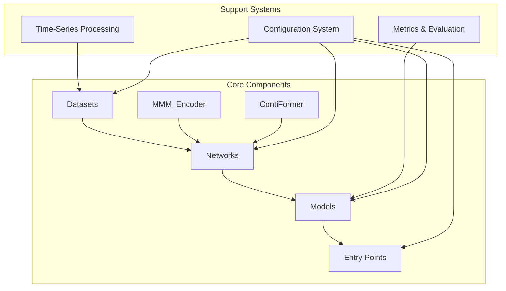
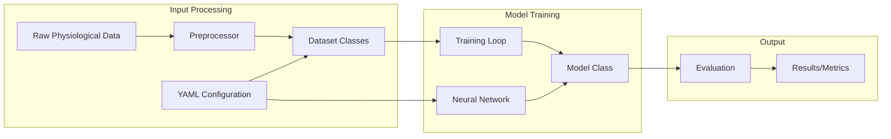
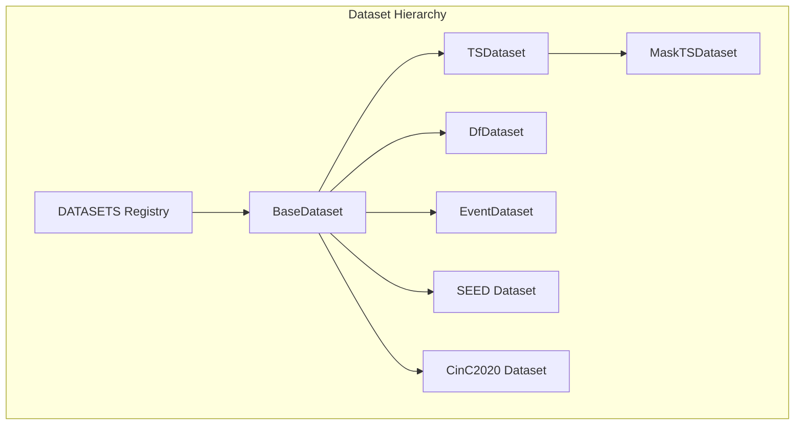
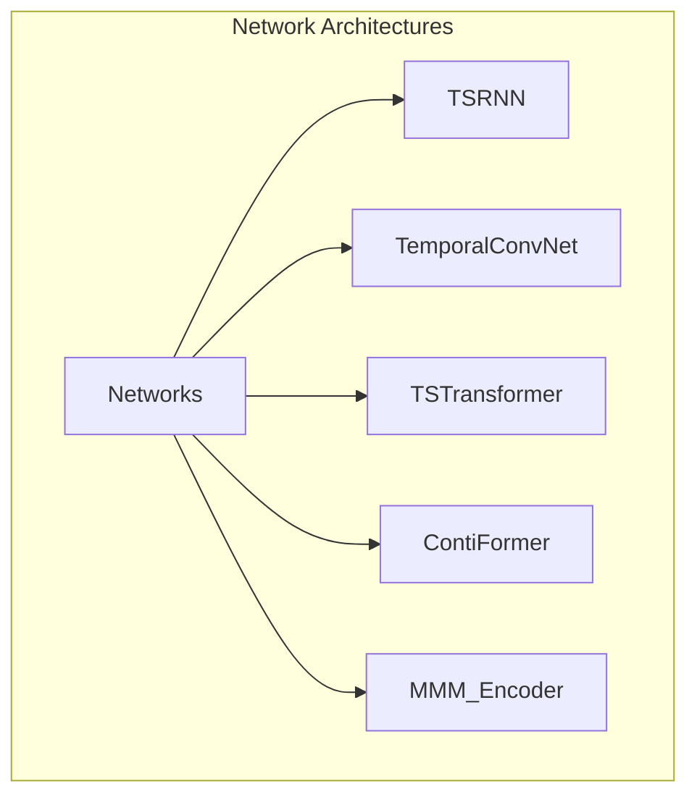
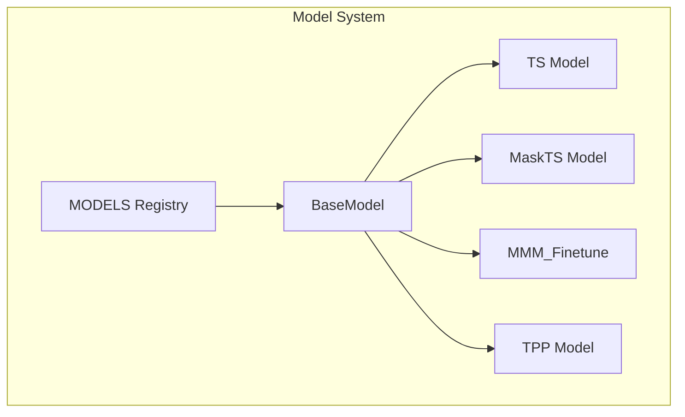

<!-- source: DeepWiki mcp.deepwiki.com · repo microsoft/PhysioPro · page 1 Overview · fetched 2026-10-26 -->

# Overview

<details>
<summary>Relevant source files</summary>

The following files were used as context for generating this wiki page:

- [README.md](README.md)
- [docs/configs/mmm_emotion_from_ckpt.yml](docs/configs/mmm_emotion_from_ckpt.yml)

</details>


PhysioPro is a deep learning framework designed for processing and analyzing physiological data, with a particular focus on EEG (electroencephalogram) data. This framework provides modular components for time series analysis tasks, supporting both regular and irregular time series data.

For installation instructions, see [Installation and Setup](#1.1). For a detailed breakdown of system architecture, see [System Architecture](#1.2).

## Purpose and Core Capabilities

PhysioPro provides researchers and developers with tools to:

- Process raw physiological signals, especially EEG data
- Train deep learning models on time series data
- Handle irregular sampling in time series through specialized architectures
- Perform EEG-based emotion recognition
- Model temporal point processes for event prediction

The framework's key innovations include:

1. **MMM (Topology-Agnostic EEG Representations)**: Specialized architecture for EEG data that incorporates geometry-aware processing
2. **ContiFormer (Continuous-Time Transformer)**: Advanced architecture for handling irregularly sampled time series data

Sources: [README.md:1-7]()

## High-Level System Architecture

The following diagram illustrates the main components of PhysioPro and their relationships:



The system follows a modular design pattern where:
- **Datasets** handle data loading and preprocessing
- **Networks** implement neural network architectures
- **Models** manage training, evaluation, and inference
- **Entry Points** provide interfaces for running experiments
- **Configuration System** coordinates component selection and parameterization

Sources: [README.md:21-24]()

## Data and Processing Flow

The following diagram shows how data flows through the PhysioPro system:



This pipeline is configured through YAML configuration files that specify dataset parameters, network architecture, and training settings.

Sources: [docs/configs/mmm_emotion_from_ckpt.yml:1-47]()

## Key Components

### Dataset System

PhysioPro includes specialized dataset classes for different types of physiological data:



For detailed information about specific datasets, see [Dataset System](#2.1).

### Network Architectures

PhysioPro offers several neural network architectures optimized for time series data:



The two flagship architectures are:

1. **MMM_Encoder**: Specialized for EEG data processing with geometry-aware modeling
2. **ContiFormer**: Designed for continuous-time modeling of irregular time series

For more information on network architectures, see [Network Architectures](#2.2).

Sources: [README.md:5-7]()

### Model System

Models in PhysioPro orchestrate the training and evaluation process:



Models implement training loops, checkpointing, metric calculation, and other standard functionality. The specific model classes are tailored to different tasks such as emotion recognition, time series prediction, and temporal point process modeling.

For more details on models, see [Model System](#2.3).

Sources: [docs/configs/mmm_emotion_from_ckpt.yml:25-43]()

## Configuration System

PhysioPro uses YAML configuration files to specify all aspects of an experiment:

| Configuration Section | Purpose |
|----------------------|---------|
| `data` | Dataset type and parameters |
| `network` | Neural network architecture and parameters |
| `model` | Training parameters, optimizer, loss function, etc. |
| `runtime` | Execution settings like device selection and output directory |

Example configuration snippet for emotion recognition with MMM:

```yaml
data:
  type: SEED
  window_size: 1
  subject_index: 3

network:
  type: MMM_Encoder
  depth: 6
  num_heads: 8

model:
  type: MMM_Finetune
  task: multiclassification
  optimizer: Adam
  lr: 0.00005
```

Sources: [docs/configs/mmm_emotion_from_ckpt.yml:1-47]()

## Main Use Cases

PhysioPro supports several key use cases:

1. **EEG-Based Emotion Recognition**
   - Uses the MMM_Encoder with the SEED dataset
   - Provides tools for fine-tuning pre-trained models
   
2. **Time Series Classification**
   - Supports both regular and irregular time series
   - Uses various network architectures including ContiFormer
   
3. **Temporal Point Process Modeling**
   - Specialized for event prediction tasks
   - Leverages continuous-time modeling capabilities

For practical tutorials on these use cases, see [Use Cases and Tutorials](#3).

Sources: [README.md:5-7](), [docs/configs/mmm_emotion_from_ckpt.yml:1-47]()

## Responsible AI Considerations

PhysioPro is intended for research purposes in physiological data analysis. The framework is not designed for clinical applications and should not be used to influence treatment decisions. Users should:

- Train models with their own data
- Perform Responsible AI testing before any production use
- Validate fair outcomes across different groups of people

Sources: [README.md:26-44]()

---

