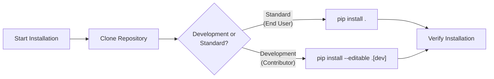
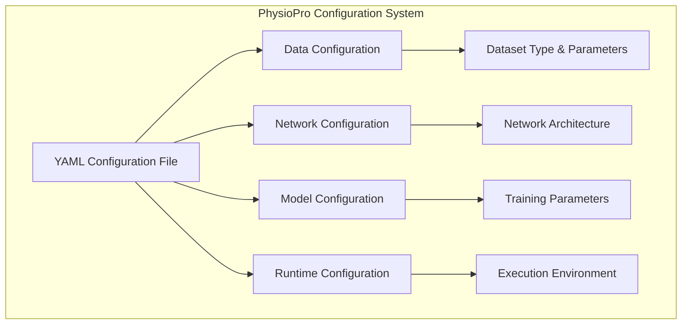
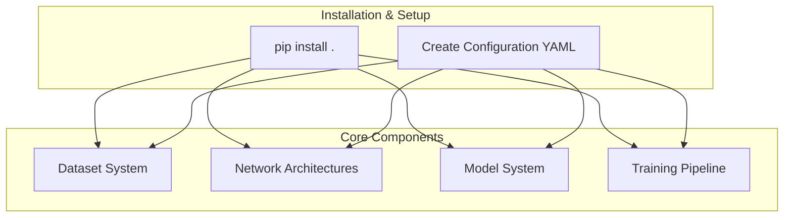

<!-- source: DeepWiki mcp.deepwiki.com · repo microsoft/PhysioPro · page 1.1 Installation and Setup · fetched 2026-10-26 -->

# Installation and Setup

<details>
<summary>Relevant source files</summary>

The following files were used as context for generating this wiki page:

- [README.md](README.md)
- [docs/configs/mmm_emotion_from_ckpt.yml](docs/configs/mmm_emotion_from_ckpt.yml)
- [setup.py](setup.py)

</details>


This document provides detailed instructions for installing and configuring PhysioPro, a deep learning framework for physiological data processing and analysis. For information about the overall system architecture, see [System Architecture](#1.2).

## Prerequisites

Before installing PhysioPro, ensure your system meets the following requirements:

- Python 3.8 or higher
- pip package manager
- Git (for cloning the repository)
- Sufficient disk space (approximately 200MB for the framework and dependencies)
- Optional: CUDA-compatible GPU for accelerated training

Sources: [setup.py:67-68]()

## Installation Options

There are two main approaches to installing PhysioPro, depending on your intended use.



### Standard Installation

For end users who want to use PhysioPro without modifying its source code:

```bash
# 1. Clone the repository
git clone https://github.com/microsoft/PhysioPro.git

# 2. Navigate to the repository root
cd PhysioPro

# 3. Install the package
pip install .
```

Sources: [README.md:11-14]()

### Development Installation

For developers who want to modify the source code or contribute to the project:

```bash
# 1. Clone the repository
git clone https://github.com/microsoft/PhysioPro.git

# 2. Navigate to the repository root
cd PhysioPro

# 3. Install in development mode with additional dependencies
pip install --editable .[dev]
```

The development installation includes additional tools for testing and code quality:
- flake8 (code linting)
- pytest (testing framework)
- pytest-azurepipelines (CI/CD integration)
- pytest-cov (code coverage)
- pylint (code analysis)

Sources: [README.md:16-19](), [setup.py:81]()

## Dependencies

PhysioPro has the following core dependencies that will be automatically installed:

| Package | Version | Purpose |
|---------|---------|---------|
| torch | 2.0.1 | Deep learning framework |
| torchvision | 0.15.2 | Computer vision utilities |
| torchcde | 0.2.5 | Neural controlled differential equations |
| utilsd | 0.0.18.post0 | Utility functions |
| pandas | >=2.0.3 | Data manipulation and analysis |
| scipy | >=1.10.1 | Scientific computing |
| sktime | 0.21.0 | Time series analysis |
| tqdm | >=4.42.1 | Progress bars |
| tensorboard | >=2.14.0 | Experiment visualization |
| numba | >=0.57.1 | JIT compilation for Python |
| biosppy | >=1.0.0 | Biosignal processing |

Sources: [setup.py:68-80]()

## Verifying Installation

After installation, you can verify that PhysioPro is correctly installed by importing it in Python:

```python
import physiopro
print(physiopro.__version__)
```

If the installation was successful, this will print the current version of PhysioPro without any errors.

## Configuration System

PhysioPro uses YAML configuration files to define experiments. These files specify dataset parameters, network architecture, and training settings.



### Configuration File Structure

A typical configuration file includes these main sections:

1. **data**: Specifies the dataset type and parameters
2. **network**: Defines the neural network architecture
3. **model**: Sets up training parameters, loss functions, and metrics
4. **runtime**: Configures execution details like seed, device, and output directories

Sources: [docs/configs/mmm_emotion_from_ckpt.yml:1-47]()

### Example Configuration

Here's a simplified example of a configuration file for emotion recognition using the MMM model:

```yaml
data:
  type: SEED
  window_size: 1
  subject_index: 3
  prefix: /path/to/data/

network:
  type: MMM_Encoder
  depth: 6
  num_heads: 8
  encoder_dim: 64
  channel_num: 79
  in_chans: 5

model:
  type: MMM_Finetune
  task: multiclassification
  model_path: /path/to/pretrained_model.pt
  optimizer: Adam
  lr: 0.00005
  weight_decay: 0.005
  loss_fn: cross_entropy
  metrics: [accuracy]
  batch_size: 32
  out_size: 3

runtime:
  seed: 51
  use_cuda: true
  output_dir: outputs/MMM_SEED/3/
```

Sources: [docs/configs/mmm_emotion_from_ckpt.yml:1-47]()

## Integration with System Components

After installation, PhysioPro's components become available for your experiments. The following diagram shows how the installation process connects to the main system components:



## Next Steps

After completing the installation and setup:

1. Explore the [Quick Start](https://github.com/microsoft/PhysioPro/blob/main/docs/quick-start.md) guide for basic usage examples
2. Learn about the [Dataset System](#2.1) to understand how to prepare your data
3. Explore the [Network Architectures](#2.2) to choose appropriate models for your tasks
4. Review the [Use Cases and Tutorials](#3) for practical examples

Sources: [README.md:21-23]()

## Troubleshooting

If you encounter issues during installation, try the following:

1. Ensure you have the correct Python version (3.8+)
2. Update pip to the latest version: `pip install --upgrade pip`
3. Check for conflicting dependencies in your environment
4. Consider creating a new virtual environment for PhysioPro

For GPU support, ensure you have:
- Compatible NVIDIA GPU
- Appropriate CUDA drivers installed
- Compatible CUDA toolkit version for PyTorch 2.0.1

---

