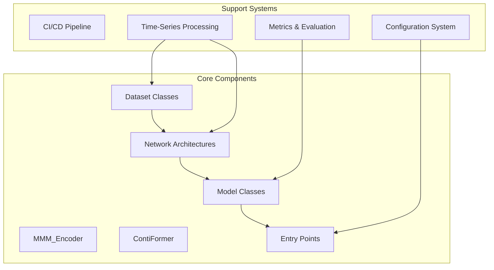
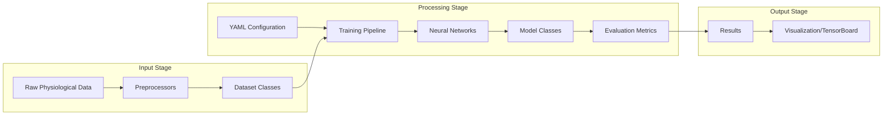
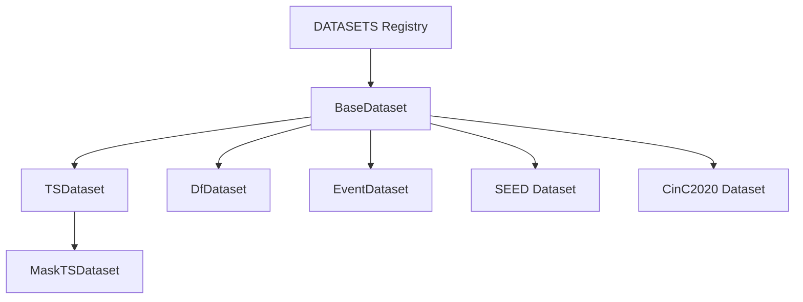
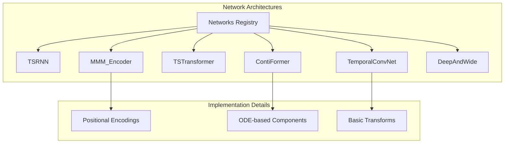
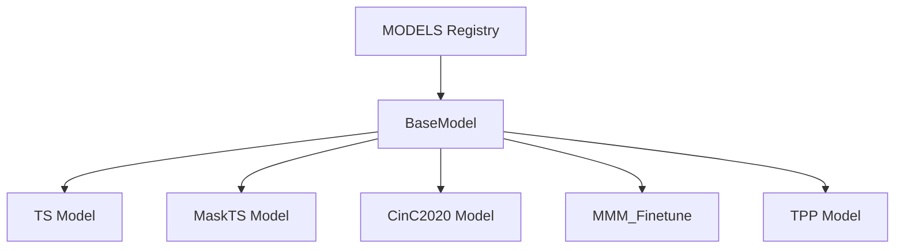
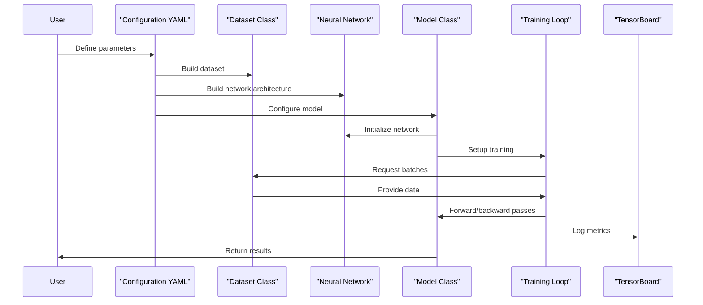

<!-- source: DeepWiki mcp.deepwiki.com · repo microsoft/PhysioPro · page 1.2 System Architecture · fetched 2026-10-26 -->

# System Architecture

<details>
<summary>Relevant source files</summary>

The following files were used as context for generating this wiki page:

- [README.md](README.md)
- [docs/configs/mmm_emotion_from_ckpt.yml](docs/configs/mmm_emotion_from_ckpt.yml)
- [physiopro/__init__.py](physiopro/__init__.py)
- [physiopro/module/basic_transform.py](physiopro/module/basic_transform.py)

</details>


This document provides a high-level overview of PhysioPro's system architecture, explaining the major components and how they interact. For details on installation, see [Installation and Setup](#1.1). For in-depth information about specific components, refer to the [Core Components](#2) section.

## Purpose and Scope

PhysioPro is a deep learning framework specifically designed for processing and analyzing physiological data, with a particular focus on EEG data. The architecture is designed to be modular, allowing components to be combined in various ways for different time series analysis tasks including:

- EEG-based emotion recognition
- Time series classification and prediction
- Temporal point process modeling
- Irregular time series analysis

This document outlines the overall structure of the system, its main components, their roles, and their interactions.

## High-Level System Overview

### System Component Diagram



Sources: README.md

The architecture consists of two main parts:

1. **Core Components**:
   - **Dataset Classes**: Data loading and preprocessing components
   - **Network Architectures**: Neural network implementations specialized for time series
   - **Model Classes**: Higher-level abstractions combining networks with training logic
   - **MMM_Encoder**: Specialized architecture for EEG data with geometry-aware processing
   - **ContiFormer**: Advanced architecture for handling irregular time series
   - **Entry Points**: Scripts and interfaces for running experiments

2. **Support Systems**:
   - **Configuration System**: YAML-based experiment configuration
   - **Metrics & Evaluation**: Performance measurement tools
   - **Time-Series Processing**: Utilities for processing time series data
   - **CI/CD Pipeline**: Code quality and testing infrastructure

## Data Flow Architecture

### Data and Processing Pipeline



Sources: docs/configs/mmm_emotion_from_ckpt.yml

The data processing pipeline consists of:

1. **Input Stage**: Raw physiological data (e.g., EEG signals) is preprocessed and loaded into dataset classes
2. **Processing Stage**: Neural networks process the data through models that implement training and evaluation logic
3. **Output Stage**: Results are analyzed and visualized
4. **Configuration**: YAML files specify dataset parameters, network architecture, and training configuration

The following table shows the key components involved in the data flow:

| Stage | Component | Purpose |
|-------|-----------|---------|
| Input | Dataset Classes | Load and preprocess data |
| Processing | Neural Networks | Implement architectures like ContiFormer, MMM_Encoder |
| Processing | Model Classes | Define training procedures and evaluation metrics |
| Output | TensorBoard | Visualize results and metrics |
| Configuration | YAML Files | Configure all components and experiments |

## Component Hierarchies

### Dataset Class Hierarchy



Sources: docs/configs/mmm_emotion_from_ckpt.yml

The dataset system provides a unified interface for handling different types of physiological data:

- **BaseDataset**: Abstract base class implementing common functionality
- **TSDataset**: For time series data
- **DfDataset**: For tabular data in DataFrame format
- **EventDataset**: For event sequence data (temporal point processes)
- **MaskTSDataset**: For time series with missing values
- **SEED**: For the SEED EEG-based emotion recognition dataset
- **CinC2020**: For the CinC2020 cardiac signal dataset

For detailed information about each dataset type, see [Dataset System](#2.1).

### Network Architecture Hierarchy



Sources: physiopro/module/basic_transform.py, docs/configs/mmm_emotion_from_ckpt.yml

PhysioPro implements several neural network architectures:

- **Time Series Networks**:
  - **TSRNN**: Recurrent networks for time series
  - **TemporalConvNet**: Temporal convolutional networks with components like `Chomp1d` [physiopro/module/basic_transform.py:7-13]()
  - **TSTransformer**: Transformer architecture for time series

- **Advanced Networks**:
  - **ContiFormer**: Continuous-time transformer for irregular time series
  - **MMM_Encoder**: Specialized for EEG data with geometry-aware processing

- **Specialized Networks**:
  - **DeepAndWide**: Combining deep learning with linear models

For detailed information about each network architecture, see [Network Architectures](#2.2).

### Model Class Hierarchy



Sources: docs/configs/mmm_emotion_from_ckpt.yml

The model system provides abstractions for training and inference:

- **BaseModel**: Abstract base class with common functionality
- **TS**: For general time series tasks
- **MaskTS**: For time series with missing values
- **CinC2020**: For cardiac signal analysis
- **MMM_Finetune**: For fine-tuning pre-trained MMM models
- **TPP**: For temporal point process modeling

For detailed information about each model type, see [Model System](#2.3).

## Training Pipeline and Component Integration

### Training Pipeline Sequence



Sources: docs/configs/mmm_emotion_from_ckpt.yml

The training pipeline is orchestrated through several steps:

1. The user defines experiment parameters in a YAML configuration file
2. The configuration is used to instantiate the dataset, network, and model
3. The model initializes the network and sets up the training loop
4. Training proceeds with data batches from the dataset class
5. The model computes forward and backward passes
6. Metrics are logged to TensorBoard
7. Results are returned to the user

## Configuration System

The configuration system uses YAML files to define experiment parameters. Below is an example for emotion recognition with MMM:

```yaml
data:
  type: SEED
  window_size: 1
  subject_index: 3
  prefix: /path/to/data/

network:
  type: MMM_Encoder
  depth: 6
  num_heads: 8
  encoder_dim: 64
  channel_num: 79
  in_chans: 5
  pe_type: 2d

model:
  type: MMM_Finetune
  task: multiclassification
  model_path: /path/to/pretrained_model.pt
  optimizer: Adam
  lr: 0.00005
  weight_decay: 0.005
  loss_fn: cross_entropy
  metrics: [accuracy]
  observe: accuracy
  lower_is_better: False
  max_epochs: 100
  early_stop: 70
  batch_size: 32
  out_size: 3

runtime:
  seed: 51
  use_cuda: true
  output_dir: outputs/MMM_SEED/3/
```

Sources: docs/configs/mmm_emotion_from_ckpt.yml

The configuration file is divided into sections:

- **data**: Dataset parameters (type, window size, subject index)
- **network**: Neural network architecture parameters
- **model**: Training parameters (optimizer, learning rate, loss function, metrics)
- **runtime**: Execution parameters (random seed, device, output directory)

## Key Components

### MMM (Topology-Agnostic EEG Representations)

MMM is specialized for EEG data processing with geometry-aware modeling. It provides:

- Topology-agnostic EEG representations
- Geometry-aware processing
- Fine-tuning capabilities for specific tasks like emotion recognition

For detailed information about MMM, see [MMM_Encoder](#2.2.1).

Sources: README.md

### ContiFormer (Continuous-Time Transformer)

ContiFormer is designed for irregular time series modeling with continuous-time capabilities:

- Handles irregularly sampled time series data
- Uses ODE-based components for continuous-time modeling
- Supports various time series tasks

For detailed information about ContiFormer, see [ContiFormer](#2.2.2).

Sources: README.md

## Summary

PhysioPro's architecture is modular and flexible, supporting various physiological data processing tasks:

- **Modularity**: Components can be mixed and matched for different applications
- **Configurability**: YAML-based configuration for easy experiment setup
- **Specialized Architectures**: Advanced networks like MMM and ContiFormer
- **Comprehensive Pipeline**: From data loading to results visualization

The system is particularly strong for EEG data analysis and irregular time series processing, with state-of-the-art architectures implemented in a cohesive framework.

Sources: README.md, docs/configs/mmm_emotion_from_ckpt.yml

---

