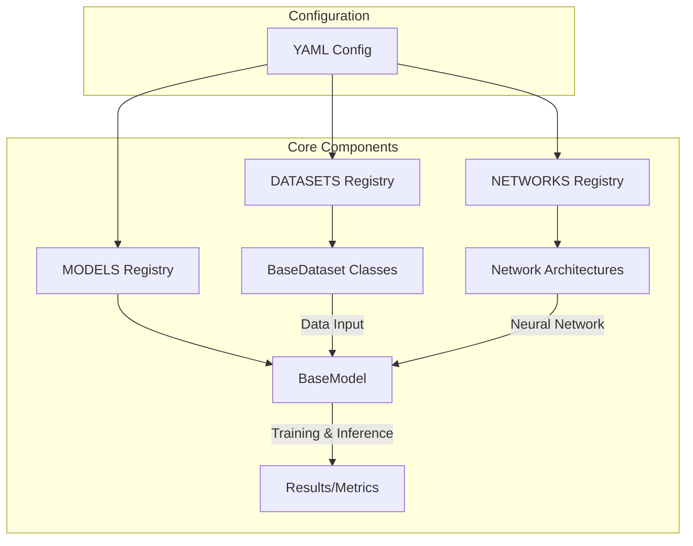
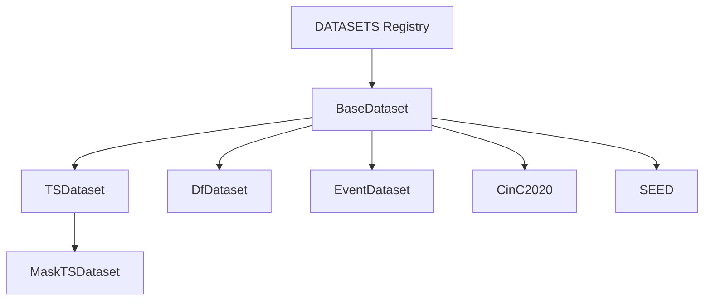
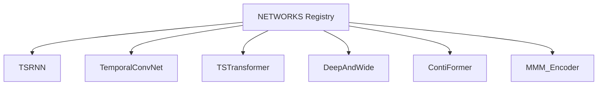
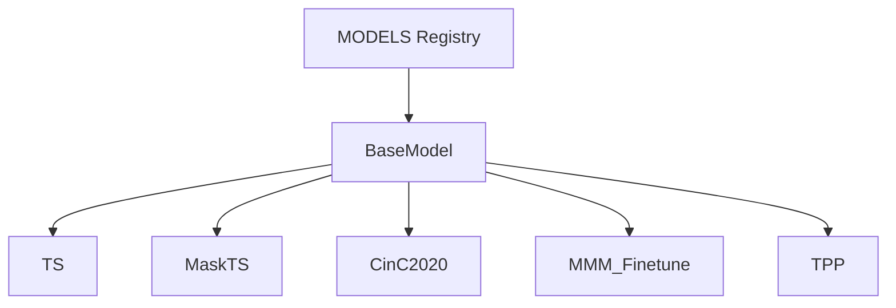
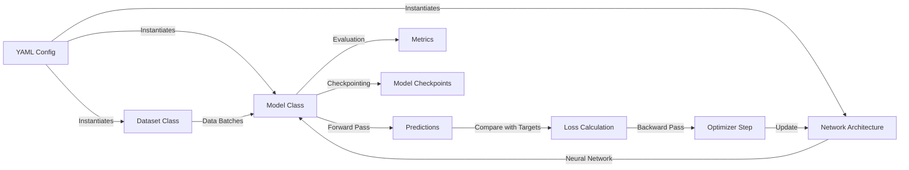
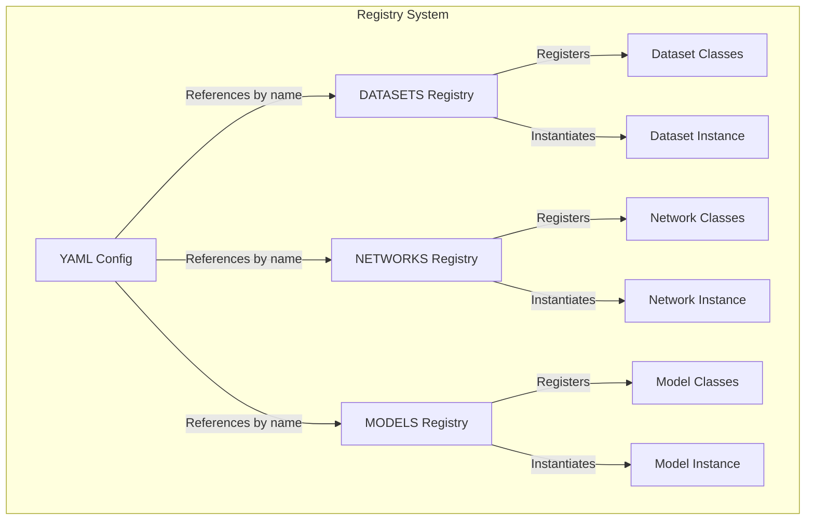

<!-- source: DeepWiki mcp.deepwiki.com · repo microsoft/PhysioPro · page 2 Core Components · fetched 2026-10-26 -->

# Core Components

Relevant source files

The following files were used as context for generating this wiki page:

- [physiopro/dataset/__init__.py](physiopro/dataset/__init__.py)
- [physiopro/model/__init__.py](physiopro/model/__init__.py)
- [physiopro/network/__init__.py](physiopro/network/__init__.py)

PhysioPro is built around a modular architecture with several core components that work together to process and analyze physiological data. This page provides an overview of these key subsystems and how they interrelate. For detailed information about individual components, please refer to their dedicated documentation pages.

The core components of PhysioPro consist of:
- Dataset System: For loading and processing physiological data [Dataset System](#2.1)
- Network Architectures: Deep learning models specialized for time series [Network Architectures](#2.2)
- Model System: Classes that manage training and evaluation [Model System](#2.3)

## Component Architecture

The following diagram illustrates the high-level architecture and interactions between PhysioPro's core components:

Sources: [physiopro/dataset/__init__.py](physiopro/dataset/__init__.py), [physiopro/model/__init__.py](physiopro/model/__init__.py), [physiopro/network/__init__.py](physiopro/network/__init__.py)

## Dataset System

The Dataset System handles data loading, preprocessing, and batching for physiological data. PhysioPro implements various dataset classes to support different data types and processing needs.

### Dataset Class Hierarchy

Sources: [physiopro/dataset/__init__.py:4-10](physiopro/dataset/__init__.py:4-10)

### Available Dataset Classes

| Dataset Class | Purpose |
|---------------|---------|
| `TSDataset` | Base class for time series data |
| `MaskTSDataset` | For time series with missing values |
| `DfDataset` | For pandas DataFrame-based data |
| `EventDataset` | For temporal point process/event data |
| `CinC2020` | For cardiac signal analysis |
| `SEED` | For EEG-based emotion recognition |

Sources: [physiopro/dataset/__init__.py:4-10](physiopro/dataset/__init__.py:4-10)

## Network Architectures

PhysioPro provides multiple neural network architectures specialized for physiological and time series data. These networks serve as the computational backbone for models.

### Network Architecture Hierarchy

Sources: [physiopro/network/__init__.py:1-6](physiopro/network/__init__.py:1-6)

### Available Network Architectures

| Network Architecture | Purpose |
|---------------------|---------|
| `TSRNN` | Recurrent Neural Networks for time series |
| `TemporalConvNet` | Temporal convolutional networks |
| `TSTransformer` | Transformer architecture for time series |
| `DeepAndWide` | Network for CinC2020 cardiac data |
| `ContiFormer` | Continuous-time transformer for irregular time series |
| `MMM_Encoder` | Specialized encoder for EEG data |

Sources: [physiopro/network/__init__.py:1-6](physiopro/network/__init__.py:1-6)

## Model System

The Model System combines datasets and networks with training logic to create end-to-end solutions for physiological data analysis tasks. Models handle training loops, evaluation metrics, and checkpointing.

### Model Class Hierarchy

Sources: [physiopro/model/__init__.py:1-6](physiopro/model/__init__.py:1-6)

### Available Model Classes

| Model Class | Purpose |
|-------------|---------|
| `BaseModel` | Base class with common functionality |
| `TS` | For general time series prediction |
| `MaskTS` | For time series with missing values |
| `CinC2020` | For cardiac signal analysis |
| `MMM_Finetune` | For EEG-based emotion recognition |
| `TPP` | For temporal point process modeling |

Sources: [physiopro/model/__init__.py:1-6](physiopro/model/__init__.py:1-6)

## Component Integration and Data Flow

The following diagram illustrates how data flows through PhysioPro's core components during a typical training or inference process:

Sources: [physiopro/dataset/__init__.py](physiopro/dataset/__init__.py), [physiopro/model/__init__.py](physiopro/model/__init__.py), [physiopro/network/__init__.py](physiopro/network/__init__.py)

## Registry Pattern

PhysioPro uses a registry pattern for component management. Each core component type (Dataset, Network, Model) has an associated registry that enables dynamic component selection via configuration.

Sources: [physiopro/dataset/__init__.py:4](physiopro/dataset/__init__.py:4), [physiopro/model/__init__.py:1](physiopro/model/__init__.py:1), [physiopro/network/__init__.py:1](physiopro/network/__init__.py:1)

## Specialized Components

Two key specialized components in PhysioPro deserve special attention:

1. **MMM_Encoder**: A specialized architecture for processing EEG data that preserves topological relationships between channels.

2. **ContiFormer**: A continuous-time transformer that handles irregularly sampled time series through ODE-based components.

For detailed information about these specialized components, see [MMM_Encoder](#2.2.1) and [ContiFormer](#2.2.2).

## Summary

PhysioPro's core components provide a flexible, modular framework for physiological data analysis:

- **Dataset System**: Handles data loading and preprocessing
- **Network Architectures**: Provide specialized neural networks for time series
- **Model System**: Manages the training and evaluation process

Each component type follows a consistent organization with:
- A registry for dynamic component selection
- A base class defining common functionality
- Specialized implementations for specific data types and tasks

For more detailed information about specific components, refer to their dedicated documentation pages:
- [Dataset System](#2.1)
- [Network Architectures](#2.2)
- [Model System](#2.3)

---

