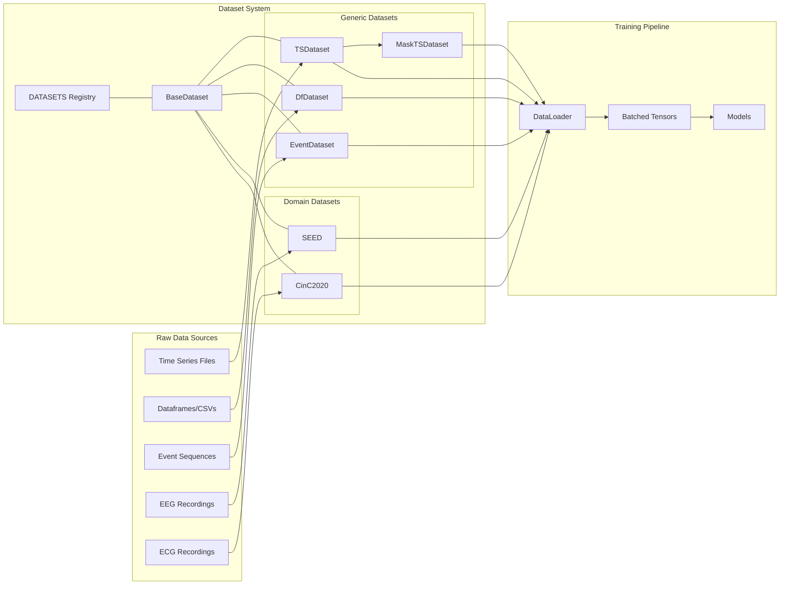
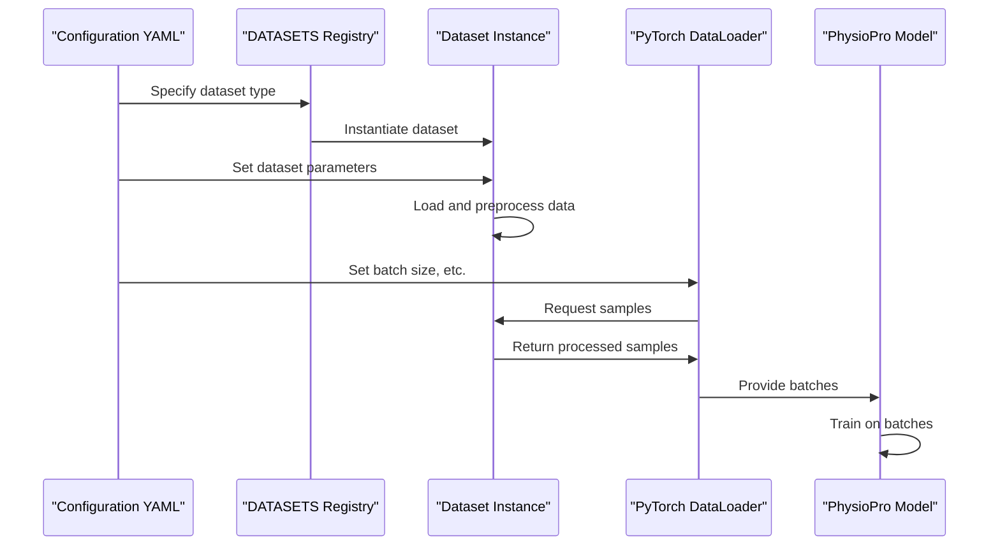

<!-- source: DeepWiki mcp.deepwiki.com · repo microsoft/PhysioPro · page 2.1 Dataset System · fetched 2026-10-26 -->

# Dataset System

<details>
<summary>Relevant source files</summary>

The following files were used as context for generating this wiki page:

- [physiopro/dataset/__init__.py](physiopro/dataset/__init__.py)

</details>


## Purpose and Scope

The Dataset System in PhysioPro is responsible for loading, preprocessing, and providing structured access to various types of physiological time series data. This component serves as the foundation for all data operations within the framework, bridging raw data sources with the neural network and model components.

This document covers the dataset class hierarchy, available dataset implementations, and how to use them in the training pipeline. For information about the network architectures that consume this data, see [Network Architectures](#2.2). For details on how models use these datasets, see [Model System](#2.3).

Sources: [physiopro/dataset/__init__.py:1-11]()

## Dataset Registry and Hierarchy

PhysioPro implements a registry pattern for datasets through the `DATASETS` registry. This allows for dynamic registration and instantiation of dataset classes based on configuration parameters.

```mermaid
classDiagram
    class "DATASETS" {
        <<Registry>>
        +register(name, cls)
        +get(name)
    }
    
    class "BaseDataset" {
        <<Abstract>>
        +__init__(args, kwargs)
        +__getitem__(idx)
        +__len__()
        +prepare_data()
        +setup()
    }
    
    class "TSDataset" {
        +__init__(args, kwargs)
        +__getitem__(idx)
        +preprocess()
    }
    
    class "DfDataset" {
        +__init__(args, kwargs)
        +__getitem__(idx)
        +load_dataframe()
    }
    
    class "EventDataset" {
        +__init__(args, kwargs)
        +__getitem__(idx)
        +process_events()
    }
    
    class "MaskTSDataset" {
        +__init__(args, kwargs)
        +__getitem__(idx)
        +apply_masking()
    }
    
    class "CinC2020" {
        +__init__(args, kwargs)
        +__getitem__(idx)
        +load_ecg_data()
    }
    
    class "SEED" {
        +__init__(args, kwargs)
        +__getitem__(idx) 
        +load_eeg_data()
    }
    
    DATASETS ..> BaseDataset : registers
    BaseDataset <|-- TSDataset
    BaseDataset <|-- DfDataset
    BaseDataset <|-- EventDataset
    TSDataset <|-- MaskTSDataset
    BaseDataset <|-- CinC2020
    BaseDataset <|-- SEED
```

The dataset system follows a hierarchical structure with a base class that defines common functionality, and specialized subclasses for different data types and sources. All dataset classes implement the PyTorch `Dataset` interface, making them compatible with PyTorch's `DataLoader`.

Sources: [physiopro/dataset/__init__.py:4-10]()

## Dataset Types

### Base Dataset

The `BaseDataset` serves as the abstract base class for all dataset implementations in PhysioPro. It defines the common interface and functionality that all datasets must implement.

### Time Series Datasets

#### TSDataset

The `TSDataset` class is designed for handling general time series data. It provides functionality for loading, preprocessing, and accessing time series data with consistent sampling.

#### MaskTSDataset

The `MaskTSDataset` extends `TSDataset` with capabilities for handling missing values in time series data. This is particularly useful for real-world physiological data where sensor readings may be incomplete or contain artifacts.

For more details on masked time series handling, see [Masked Time Series Dataset](#2.1.4).

### Specialized Datasets

#### DfDataset

The `DfDataset` class is optimized for loading and processing data from pandas DataFrames. It provides utilities for preprocessing tabular data and converting it to tensors for model consumption.

#### EventDataset

The `EventDataset` class is specifically designed for temporal point process modeling. It handles sequences of discrete events with timestamps, making it suitable for applications such as predicting medical events or sensor activations.

For more details on event sequence modeling, see [EventDataset for Temporal Point Processes](#2.1.2).

#### Domain-Specific Datasets

- **SEED**: Specialized for EEG-based emotion recognition using the SEED dataset. For more details, see [SEED Dataset](#2.1.1).
- **CinC2020**: Specialized for cardiac signal analysis using the CinC2020 dataset. For more details, see [CinC2020 Dataset](#2.1.3).

Sources: [physiopro/dataset/__init__.py:5-10]()

## Data Flow in PhysioPro

The diagram below shows how data flows through the Dataset System and interfaces with other components of PhysioPro:



Sources: [physiopro/dataset/__init__.py:4-10]()

## Common Usage Patterns

### Dataset Instantiation

Datasets in PhysioPro are typically instantiated through the `DATASETS` registry using configuration parameters. The general pattern is:

```python
# Example usage (not actual code)
dataset = DATASETS.get(dataset_type)(
    data_path=path_to_data,
    **dataset_params
)
```

### Data Loading

Once a dataset is instantiated, it can be used with PyTorch's `DataLoader` for efficient batch processing:

```python
# Example usage (not actual code)
from torch.utils.data import DataLoader

dataloader = DataLoader(
    dataset,
    batch_size=32,
    shuffle=True,
    num_workers=4
)

for batch in dataloader:
    # Process batch
```

## Integration with Training Pipeline

The Dataset System integrates with the Model System through PyTorch's DataLoader. The typical workflow is:

1. Dataset configuration in YAML files
2. Dataset instantiation through the registry
3. DataLoader creation
4. Batch iteration during model training



During training, models access the data through a consistent interface regardless of the underlying dataset implementation. This design enables seamless switching between different dataset types and sources.

## Dataset Configuration Parameters

Common configuration parameters for datasets include:

| Parameter | Description | Applicable Datasets |
|-----------|-------------|---------------------|
| `data_path` | Path to the raw data files | All |
| `split` | Data split (train/val/test) | All |
| `transform` | Data transformations to apply | All |
| `target_transform` | Target transformations to apply | All |
| `window_size` | Size of the time window for processing | TSDataset, MaskTSDataset |
| `stride` | Stride for windowing | TSDataset, MaskTSDataset |
| `mask_ratio` | Ratio of values to mask | MaskTSDataset |
| `event_types` | Types of events to include | EventDataset |
| `channels` | EEG/ECG channels to include | SEED, CinC2020 |

The specific parameters vary by dataset type and are documented in the respective dataset class implementations.

## Summary

The Dataset System in PhysioPro provides a flexible and extensible framework for handling various types of physiological data. The hierarchical design with a common base class and specialized implementations allows for consistent interfaces while accommodating the unique requirements of different data types and sources.

For domain-specific dataset implementations, refer to the dedicated documentation pages:
- [SEED Dataset](#2.1.1) for EEG-based emotion recognition
- [EventDataset for Temporal Point Processes](#2.1.2) for event sequence data
- [CinC2020 Dataset](#2.1.3) for cardiac signal analysis
- [Masked Time Series Dataset](#2.1.4) for time series with missing values

Sources: [physiopro/dataset/__init__.py:4-10]()

---

