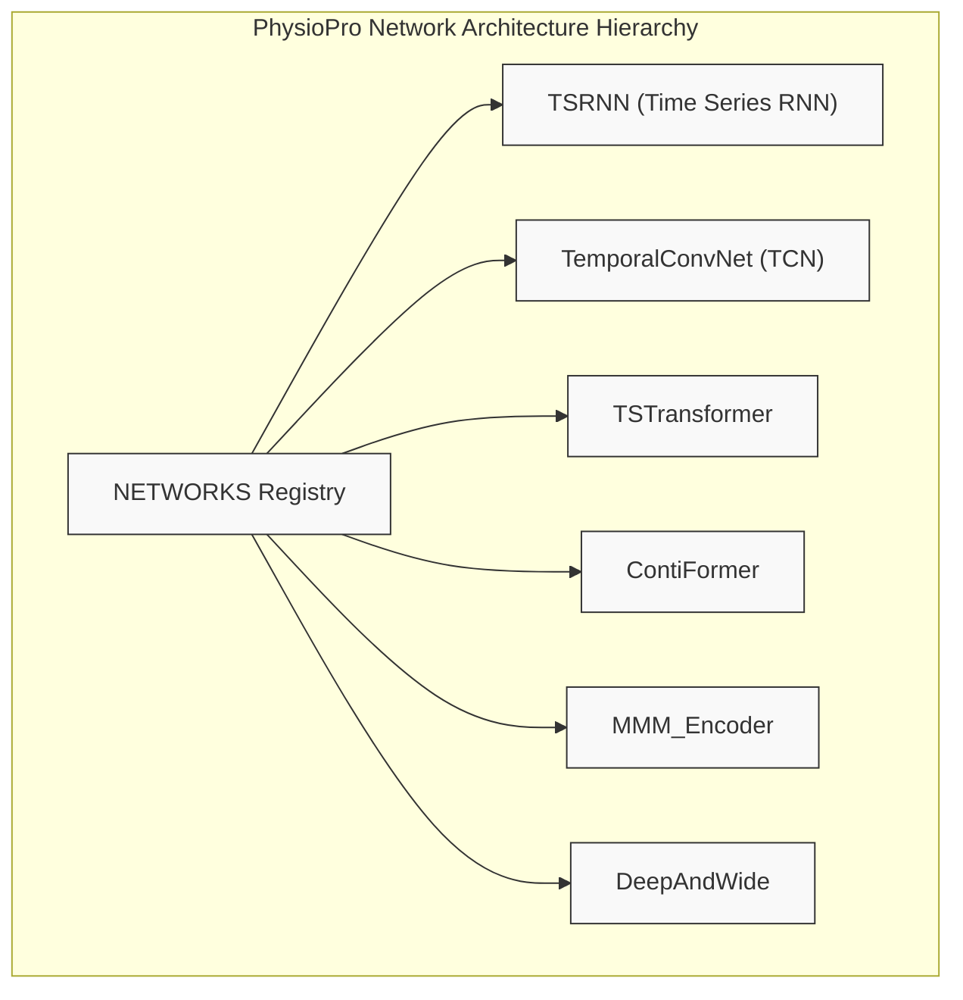
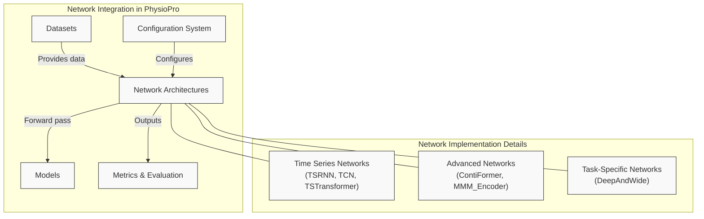
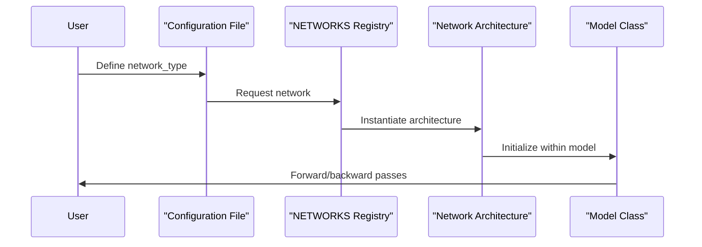
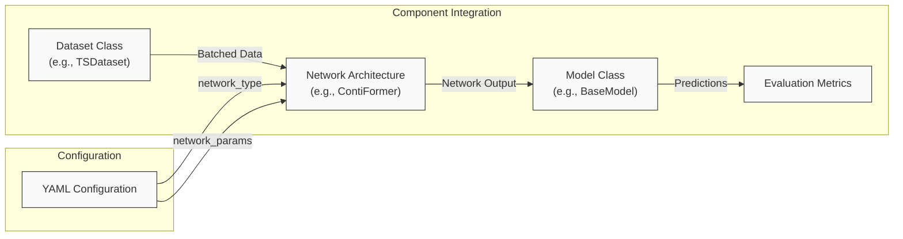

<!-- source: DeepWiki mcp.deepwiki.com · repo microsoft/PhysioPro · page 2.2 Network Architectures · fetched 2026-10-26 -->

# Network Architectures

Relevant source files

The following files were used as context for generating this wiki page:

- [physiopro/network/__init__.py](physiopro/network/__init__.py)

This page provides an overview of neural network architectures in PhysioPro. These architectures form the core of the deep learning processing pipeline for physiological data analysis, particularly focusing on time series and EEG data. For detailed information about specific architectures, see [MMM_Encoder](#2.2.1), [ContiFormer](#2.2.2), and [Time Series Networks](#2.2.3).

## Network Architecture Overview

PhysioPro implements a variety of neural network architectures specialized for processing time series data, with a particular focus on physiological signals. The codebase organizes these architectures in a modular fashion, allowing easy selection and configuration of the appropriate network for different use cases.

Sources: [physiopro/network/__init__.py:1-6]()

## Network Categories

The network architectures in PhysioPro can be categorized into three main groups:

### 1. Basic Time Series Networks

These networks form the foundation for time series processing tasks:

- **TSRNN (Time Series RNN)**: Recurrent neural network variants (LSTM, GRU) optimized for time series data
- **TemporalConvNet (TCN)**: Convolutional architecture with causal convolutions for time series
- **TSTransformer**: Transformer-based architecture adapted for time series data

### 2. Advanced Architectures

Specialized architectures that represent the state-of-the-art in physiological signal processing:

- **ContiFormer**: Continuous-time transformer for handling irregularly sampled time series
- **MMM_Encoder**: Specialized encoder for EEG data that incorporates topology information

### 3. Task-Specific Networks

Networks designed for specific physiological data analysis tasks:

- **DeepAndWide**: Hybrid architecture used for the CinC2020 cardiac signal classification task

Sources: [physiopro/network/__init__.py:1-6]()

## Network Registration and Usage

All network architectures in PhysioPro are registered through a unified registry pattern, making them easily accessible throughout the codebase. The `NETWORKS` registry allows for dynamic network selection based on configuration parameters.

### Network Selection Flow

Sources: [physiopro/network/__init__.py:1-6]()

## Key Network Architectures

### TSRNN (Time Series RNN)

TSRNN provides RNN-based architectures (LSTM, GRU) optimized for processing time series data. This serves as a fundamental building block for many physiological signal processing tasks.

Key features:
- Support for various RNN cell types (LSTM, GRU)
- Configurable for different sequence lengths and input dimensions
- Bidirectional processing options

### TemporalConvNet (TCN)

The TCN architecture uses dilated causal convolutions to process time series data. This approach allows for efficient parallel processing while maintaining the ability to capture long-range dependencies.

Key features:
- Dilated causal convolutions
- Residual connections
- Configurable kernel sizes and dilation factors

### TSTransformer

TSTransformer adapts the transformer architecture for time series data, using self-attention mechanisms to capture dependencies across different time points.

Key features:
- Self-attention for temporal dependencies
- Positional encoding for sequence ordering
- Multi-head attention mechanism

### ContiFormer

ContiFormer is a continuous-time transformer designed to handle irregularly sampled time series data, which is common in physiological monitoring.

Key features:
- ODE-based continuous-time modeling
- Handles irregular sampling intervals
- Attention mechanisms across continuous time

### MMM_Encoder

MMM_Encoder is specialized for EEG data processing, incorporating spatial information about electrode placement and brain topology.

Key features:
- Topology-aware processing for EEG data
- Specialized positional encodings
- Designed for emotion recognition and related tasks

### DeepAndWide

DeepAndWide is a hybrid architecture combining "deep" neural network components with "wide" linear models, used specifically for the CinC2020 cardiac signal classification task.

Key features:
- Combines deep learning with linear models
- Specialized for cardiac signal processing
- Optimized for classification tasks

## Network Architecture Selection

The following table provides guidance on selecting the appropriate network architecture based on the task and data characteristics:

| Network Architecture | Ideal Use Case | Data Type | Key Strengths |
|----------------------|----------------|-----------|---------------|
| TSRNN | Sequential prediction with clear temporal dependencies | Regular time series | Effective for data with strong sequential patterns |
| TemporalConvNet | Parallelizable processing of time series | Regular time series | Efficient training, good for long sequences |
| TSTransformer | Complex pattern recognition in time series | Regular time series | Captures long-range dependencies well |
| ContiFormer | Analysis of irregularly sampled data | Irregular time series | Handles missing data and varying sampling rates |
| MMM_Encoder | EEG-based emotion recognition, brain state analysis | EEG data | Incorporates spatial electrode information |
| DeepAndWide | Cardiac signal classification | ECG data | Combines feature engineering with deep learning |

Sources: [physiopro/network/__init__.py:1-6]()

## Integration with Other Components

Network architectures in PhysioPro are designed to work seamlessly with the dataset and model systems. The typical flow involves:

1. A dataset providing preprocessed data
2. A network processing this data through its architecture
3. A model class orchestrating training, evaluation, and inference

Sources: [physiopro/network/__init__.py:1-6]()

## Summary

PhysioPro provides a comprehensive suite of network architectures optimized for physiological data processing. The architecture design emphasizes:

1. **Modularity**: Networks can be easily swapped based on task requirements
2. **Specialization**: Architectures tailored for specific types of physiological data
3. **Integration**: Seamless connection with dataset and model components

For specific implementation details of each architecture, refer to the dedicated pages:
- [MMM_Encoder](#2.2.1)
- [ContiFormer](#2.2.2)
- [Time Series Networks](#2.2.3)

---

