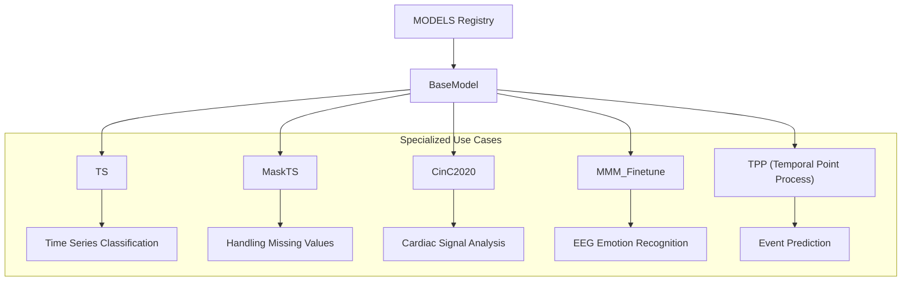
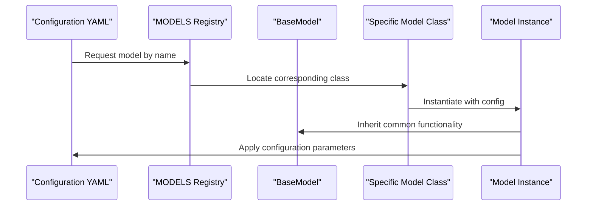
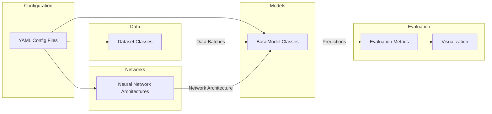
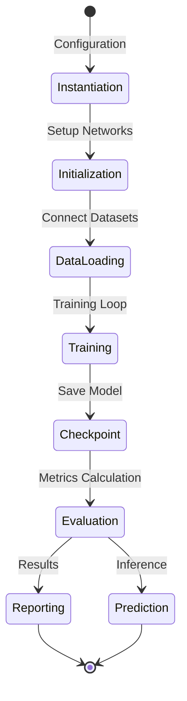

<!-- source: DeepWiki mcp.deepwiki.com · repo microsoft/PhysioPro · page 2.3 Model System · fetched 2026-10-26 -->

# Model System

<details>
<summary>Relevant source files</summary>

The following files were used as context for generating this wiki page:

- [physiopro/model/__init__.py](physiopro/model/__init__.py)

</details>


The Model System in PhysioPro provides the implementation framework for defining, training, and evaluating deep learning models for physiological data analysis. This page covers the organization and functionality of the model classes, their integration with the rest of the framework, and the common patterns used across different model types.

For information about specific neural network architectures, see [Network Architectures](#2.2). For details about how datasets are structured and loaded, see [Dataset System](#2.1).

## Model System Architecture

The Model System is designed around a hierarchical class structure with a common base class that implements shared functionality. The system uses a registry pattern for dynamic model instantiation based on configuration files.



Sources: [physiopro/model/__init__.py:1-6]()

## Model Registry System

PhysioPro implements a registry pattern for model classes, allowing dynamic instantiation of models based on configuration. The `MODELS` registry maps model names to their respective classes, enabling users to reference models by name in configuration files.



Sources: [physiopro/model/__init__.py:1]()

## Model Types Overview

PhysioPro includes several model types, each specialized for different types of physiological data analysis:

| Model Class | Purpose | Primary Use Case |
|-------------|---------|------------------|
| `BaseModel` | Base class with common functionality | Not used directly |
| `TS` | Time series classification and regression | General time series analysis |
| `MaskTS` | Handling time series with missing values | Incomplete physiological data |
| `CinC2020` | Cardiac signal analysis | ECG/cardiac data classification |
| `MMM_Finetune` | Fine-tuning pre-trained EEG models | Emotion recognition from EEG |
| `TPP` | Temporal point process modeling | Event prediction |

For detailed information about the BaseModel functionality, see [BaseModel](#2.3.1).
For more about the MMM_Finetune model, see [MMM_Finetune](#2.3.2).
For details on time series models, see [Time Series Models](#2.3.3).

Sources: [physiopro/model/__init__.py:1-6]()

## Model Integration with PhysioPro Components

The model system integrates with other PhysioPro components to form a complete training and inference pipeline.



Sources: [physiopro/model/__init__.py:1-6]()

## Model Lifecycle

Each model in PhysioPro follows a common lifecycle from instantiation to training to evaluation:



Sources: [physiopro/model/__init__.py:1-6]()

## Common Model Functionality

All model classes in PhysioPro inherit from `BaseModel`, which provides common functionality:

- Training loop implementation
- Checkpoint management (saving/loading)
- Evaluation metrics calculation
- Loss function computation
- Device management (CPU/GPU)
- Logging and TensorBoard integration
- Hyperparameter management

For detailed documentation on these features, see the [BaseModel](#2.3.1) page.

Sources: [physiopro/model/__init__.py:1]()

## Creating Custom Models

To create custom models in PhysioPro, developers should:

1. Inherit from `BaseModel`
2. Implement required methods (forward, training_step, etc.)
3. Register the model with the `MODELS` registry
4. Create configuration templates

Example structure (conceptual, not actual code):

```
class CustomModel(BaseModel):
    def __init__(self, config):
        super().__init__(config)
        # Initialize network architectures
        
    def forward(self, batch):
        # Implement forward pass
        
    def training_step(self, batch):
        # Implement training step
        
    def validation_step(self, batch):
        # Implement validation step
        
# Register the model
MODELS.register("custom_model", CustomModel)
```

Sources: [physiopro/model/__init__.py:1]()

## Summary

The Model System in PhysioPro provides a flexible framework for implementing various physiological data analysis models. It uses a hierarchical class structure with a registry pattern for dynamic model instantiation. The system integrates with other PhysioPro components to create a complete training and inference pipeline, with common functionality implemented in the `BaseModel` class.

For specific details about each model type, refer to the dedicated pages:
- [BaseModel](#2.3.1) for core functionality
- [MMM_Finetune](#2.3.2) for EEG emotion recognition
- [Time Series Models](#2.3.3) for time series analysis

---

