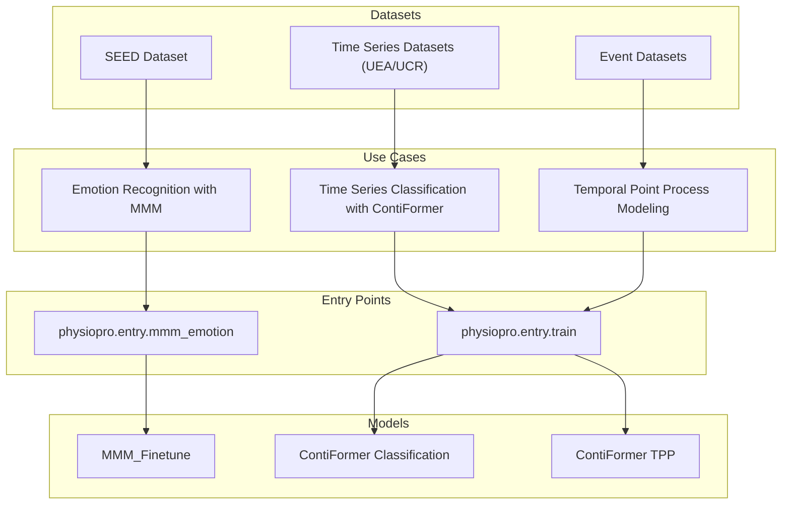
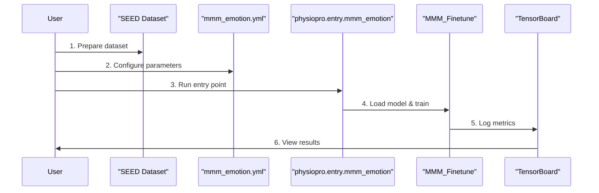
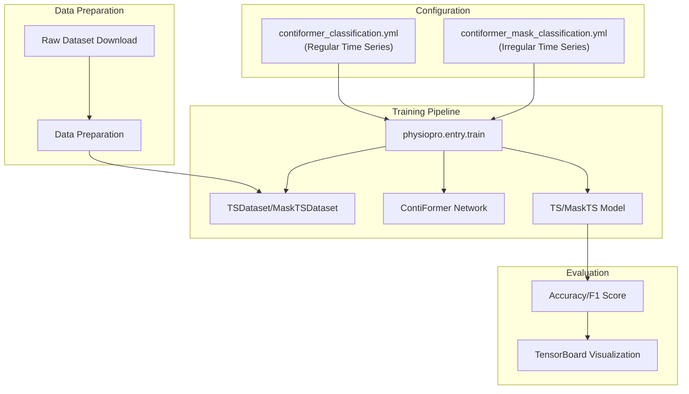
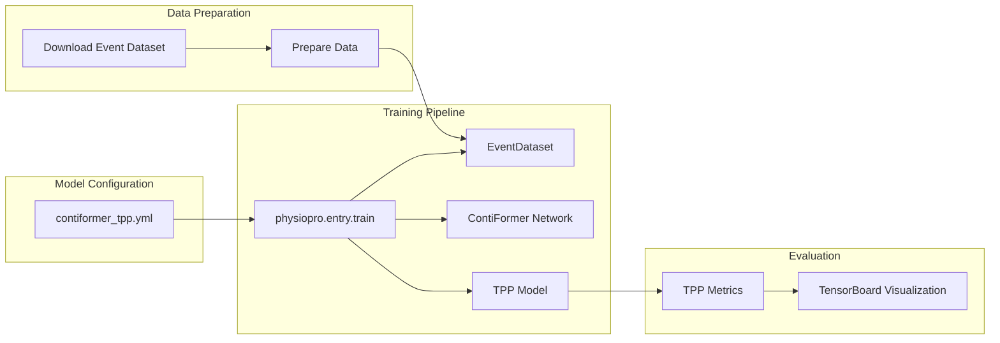
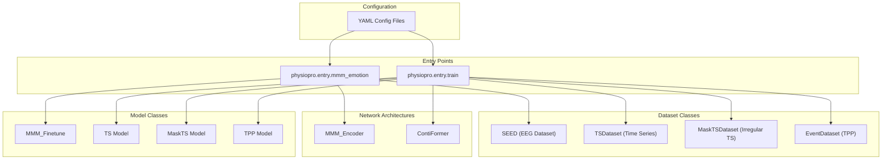

<!-- source: DeepWiki mcp.deepwiki.com · repo microsoft/PhysioPro · page 3 Use Cases and Tutorials · fetched 2026-10-26 -->

# Use Cases and Tutorials

<details>
<summary>Relevant source files</summary>

The following files were used as context for generating this wiki page:

- [README.md](README.md)
- [docs/MMM.md](docs/MMM.md)
- [docs/configs/mmm_emotion_from_ckpt.yml](docs/configs/mmm_emotion_from_ckpt.yml)
- [docs/contiformer.md](docs/contiformer.md)

</details>


This page provides practical examples and tutorials for common tasks that can be performed with the PhysioPro framework. We focus on three main use cases: emotion recognition using MMM (Topology-Agnostic EEG Representations), time series classification using ContiFormer, and temporal point process modeling. Each tutorial includes step-by-step instructions, from data preparation to model training and evaluation.

For information about the underlying system architecture, see [System Architecture](#1.2). For details about specific components, refer to [Core Components](#2).

## Overview of Supported Workflows

PhysioPro supports several key workflows for physiological data analysis:



Sources: [README.md](README.md), [docs/MMM.md](docs/MMM.md), [docs/contiformer.md](docs/contiformer.md)

## Emotion Recognition with MMM

This tutorial demonstrates how to use PhysioPro for EEG-based emotion recognition using the MMM (Topology-Agnostic EEG Representations) model with the SEED dataset.

### Workflow Overview



Sources: [docs/MMM.md](docs/MMM.md)

### Data Preparation

1. **Download the SEED dataset**:
   - Apply for the SEED dataset from the [official website](https://bcmi.sjtu.edu.cn/home/seed/)
   - The dataset contains EEG recordings of subjects watching emotion-eliciting movie clips

2. **Extract DE features**:
   - Use the provided script to extract Differential Entropy features
   - Run `scripts/SEED_DE.py` after modifying the paths for your environment

3. **Optional**: Download the pre-trained checkpoint from [the MMM project page](https://seqml.github.io/MMM/)

### Configuration

The main configuration parameters for emotion recognition with MMM are defined in YAML files:

| Parameter | Description | Example Value |
|-----------|-------------|---------------|
| data.type | Dataset type | SEED |
| data.subject_index | Subject number to process | 3 |
| data.prefix | Path to dataset | /path/to/data/ |
| network.type | Network architecture | MMM_Encoder |
| model.type | Model class | MMM_Finetune |
| model.model_path | Pre-trained checkpoint path | /path/to/checkpoint.pt |
| model.lr | Learning rate | 0.00005 |
| model.max_epochs | Maximum training epochs | 100 |
| runtime.output_dir | Output directory | outputs/MMM_SEED/3/ |

Sources: [docs/configs/mmm_emotion_from_ckpt.yml](docs/configs/mmm_emotion_from_ckpt.yml)

### Running the Training

Execute the following commands to run the emotion recognition training:

```bash
# Create the output directory
mkdir -p outputs/MMM_SEED/7/

# Run the finetuning task (from scratch)
python -m physiopro.entry.mmm_emotion docs/configs/mmm_emotion.yml

# OR run with pre-trained checkpoint 
python -m physiopro.entry.mmm_emotion docs/configs/mmm_emotion_from_ckpt.yml

# View results in TensorBoard
tensorboard --logdir outputs/
```

To train on a different subject, modify the `data.subject_index` parameter in the configuration file.

Sources: [docs/MMM.md](docs/MMM.md)

## Time Series Classification with ContiFormer

This tutorial shows how to use PhysioPro for time series classification using the ContiFormer architecture, which can handle both regular and irregular time series data.

### Workflow Overview



Sources: [docs/contiformer.md](docs/contiformer.md)

### Data Preparation

1. **Download the dataset**:
   ```bash
   mkdir data
   wget http://www.timeseriesclassification.com/aeon-toolkit/Archives/Multivariate2018_ts.zip -P data
   unzip data/Multivariate2018_ts.zip -d data/
   rm data/Multivariate2018_ts.zip
   ```

2. **Dataset Structure**:
   The UEA & UCR Time Series Classification Repository contains multiple datasets. The example uses the "Heartbeat" dataset, which includes multivariate time series data.

### Running Irregular Time Series Classification

For irregular time series (with missing values), use the following commands:

```bash
# Create the output directory
mkdir -p outputs/Multivariate_ts/Heartbeat

# Run the training with masking
python -m physiopro.entry.train docs/configs/contiformer_mask_classification.yml --data.mask_ratio 0.3 --data.name Heartbeat

# View results
tensorboard --logdir outputs/
```

The `mask_ratio` parameter controls the percentage of time points that are randomly masked during training, simulating irregular sampling or missing data.

### Running Regular Time Series Classification

For regular time series (without missing values), use:

```bash
# Create the output directory
mkdir -p outputs/Multivariate_ts/Heartbeat

# Option 1: Using the regular classification config
python -m physiopro.entry.train docs/configs/contiformer_classification.yml --data.name Heartbeat

# Option 2: Using the mask classification config with mask_ratio=0
python -m physiopro.entry.train docs/configs/contiformer_mask_classification.yml --data.mask_ratio 0 --data.name Heartbeat

# View results
tensorboard --logdir outputs/
```

Sources: [docs/contiformer.md](docs/contiformer.md)

## Temporal Point Process Modeling

This tutorial demonstrates how to use PhysioPro for modeling event sequences as temporal point processes using the ContiFormer architecture.

### Workflow Overview



Sources: [docs/contiformer.md](docs/contiformer.md)

### Data Preparation

1. **Download the dataset**:
   - Download the dataset from [Google Drive](https://drive.google.com/drive/folders/1SvHEiNuMH2lauQT5uYvNrdFoHi8ucSzx)
   - Place the downloaded data in the `data` folder of your PhysioPro installation

2. **Dataset Format**:
   The temporal point process datasets contain sequences of events with timestamps, which are used to predict future event occurrences.

### Running Temporal Point Process Modeling

Execute the following commands:

```bash
# Create the output directory
mkdir -p outputs/Temporal_Point_Process/neonate

# Run the training task
python -m physiopro.entry.train docs/configs/contiformer_tpp.yml

# View results
tensorboard --logdir outputs/
```

Sources: [docs/contiformer.md](docs/contiformer.md)

## Common Components Across Workflows

The following diagram shows the common components used across all the workflows, highlighting how they interact with each other:



Sources: [README.md](README.md), [docs/MMM.md](docs/MMM.md), [docs/contiformer.md](docs/contiformer.md)

## Configuration Management

All tutorials use YAML configuration files to specify dataset parameters, network architecture, model hyperparameters, and runtime settings. This approach provides a consistent interface across different use cases.

### Configuration Structure

| Section | Purpose | Example Parameters |
|---------|---------|-------------------|
| data | Dataset configuration | type, window_size, mask_ratio, name |
| network | Network architecture | type, depth, num_heads, encoder_dim |
| model | Model parameters | type, task, optimizer, lr, max_epochs |
| runtime | Runtime settings | seed, use_cuda, output_dir |

### Command-Line Overrides

Parameters in the configuration files can be overridden via command-line arguments:

```bash
python -m physiopro.entry.train config.yml --data.mask_ratio 0.5 --model.lr 0.0001
```

This flexibility allows for quick experimentation without modifying the configuration files.

Sources: [docs/configs/mmm_emotion_from_ckpt.yml](docs/configs/mmm_emotion_from_ckpt.yml), [docs/MMM.md](docs/MMM.md), [docs/contiformer.md](docs/contiformer.md)

## Results Visualization and Evaluation

All tutorials use TensorBoard for visualizing training progress and evaluation metrics:

```bash
tensorboard --logdir outputs/
```

Key metrics saved to TensorBoard include:
- Training and validation loss
- Accuracy metrics for classification tasks
- Specialized metrics for temporal point process tasks

For information about specific metrics and evaluation methodologies, see [BaseModel](#2.3.1).

Sources: [docs/MMM.md](docs/MMM.md), [docs/contiformer.md](docs/contiformer.md)

---

