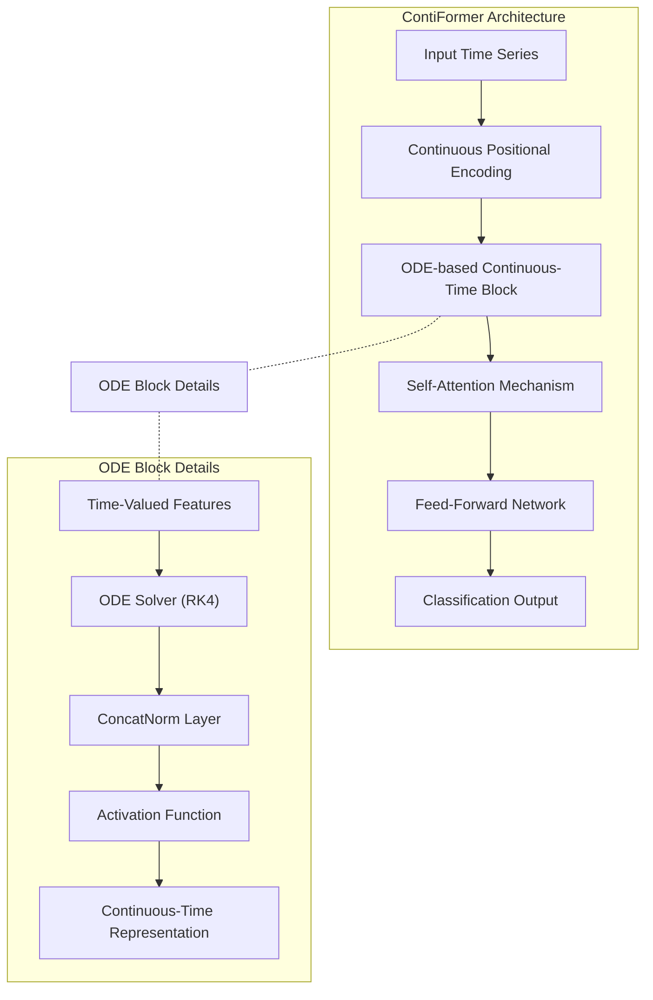
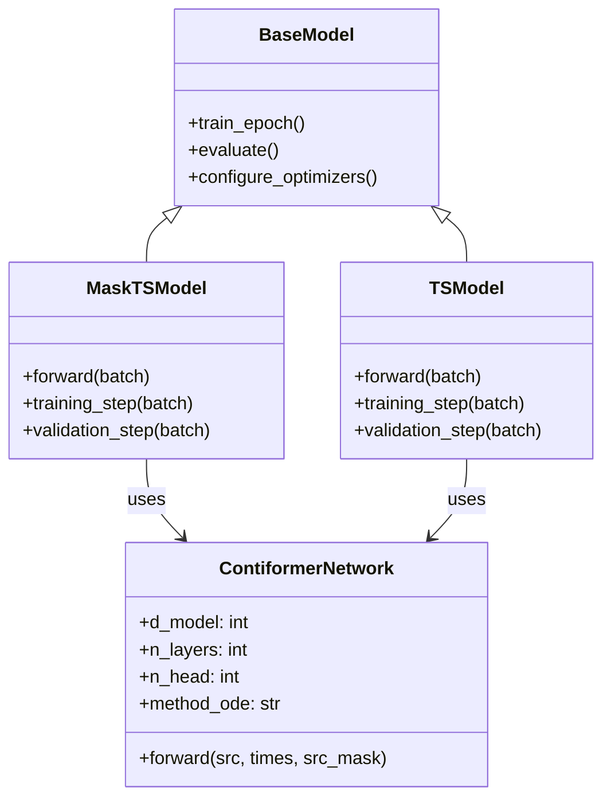

<!-- source: DeepWiki mcp.deepwiki.com · repo microsoft/PhysioPro · page 3.2 Time Series Classification with ContiFormer · fetched 2026-10-26 -->

# Time Series Classification with ContiFormer

<details>
<summary>Relevant source files</summary>

The following files were used as context for generating this wiki page:

- [docs/configs/contiformer_mask_classification.yml](docs/configs/contiformer_mask_classification.yml)
- [docs/contiformer.md](docs/contiformer.md)

</details>


## Purpose and Scope

This document provides a comprehensive guide for performing time series classification using the ContiFormer architecture in PhysioPro. ContiFormer is a continuous-time transformer model specifically designed to handle both regular and irregular time series data. This page focuses on the classification task (as opposed to temporal point process modeling, which is covered in [Temporal Point Process Modeling](#3.3)).

Sources: [docs/contiformer.md:1-4]()

## ContiFormer Architecture Overview

ContiFormer extends traditional transformer architectures to effectively model continuous-time dynamics, making it particularly well-suited for processing physiological time series data with irregular sampling rates or missing values.



Sources: [docs/configs/contiformer_mask_classification.yml:7-26]()

The ContiFormer architecture incorporates several key components that enable effective handling of time series data:

1. **Continuous Positional Encoding**: Encodes time values in a continuous space
2. **ODE-based Blocks**: Utilizes ordinary differential equation (ODE) solvers to model dynamics between observed time points
3. **Self-Attention Mechanism**: Captures dependencies across the entire sequence
4. **Configurable ODE Parameters**: Customizable solver settings and interpolation methods

### Key Advantages for Time Series Classification

- Handles irregular sampling rates naturally
- Performs well on missing data through masking strategies
- Captures temporal dynamics at different scales
- Works effectively with multivariate time series

Sources: [docs/contiformer.md:5-46]()

## Workflow for Time Series Classification

```mermaid
graph LR
    subgraph "Data Processing"
        TS["Time Series Data"] --> Mask["Optional Masking (mask_ratio)"]
        Mask --> Fill["Fill NaN Values (fill_nan_type)"]
        Fill --> Norm["Time Normalization (norm_time_flg)"]
    end

    subgraph "Model Training"
        Norm --> DataLoader["MaskTSDataset/TSDataset"]
        DataLoader --> ContiformerNet["ContiformerNetwork"]
        ContiformerNet --> Model["MaskTS/TS Model"]
        Model --> Train["Training Loop"]
    end

    subgraph "Evaluation"
        Train --> Metrics["Accuracy Calculation"]
        Metrics --> Output["Classification Results"]
    end

    classDef code fill:#f9f9f9,stroke:#333,stroke-width:1px;
    class DataLoader,ContiformerNet,Model,Train code
```



Sources: [docs/configs/contiformer_mask_classification.yml:1-42](), [docs/contiformer.md:19-46]()

## Configuration and Setup

### Dataset Preparation

PhysioPro supports multivariate time series datasets from the UEA & UCR Time Series Classification Repository. The example below uses the Heartbeat dataset:

1. Download the dataset:
   ```bash
   mkdir data
   wget http://www.timeseriesclassification.com/aeon-toolkit/Archives/Multivariate2018_ts.zip -P data
   unzip data/Multivariate2018_ts.zip -d data/
   ```

2. Create an output directory:
   ```bash
   mkdir -p outputs/Multivariate_ts/Heartbeat
   ```

Sources: [docs/contiformer.md:9-18](), [docs/contiformer.md:35-37]()

### Configuration File

ContiFormer classification uses a YAML configuration file with three main sections: data, network, and model.

#### Key Configuration Parameters

| Section | Parameter | Description | Example Value |
|---------|-----------|-------------|--------------|
| data    | type      | Dataset type | `mask_ts` or `ts` |
| data    | name      | Dataset name | `Heartbeat` |
| data    | mask_ratio | Ratio of values to mask (0 for regular TS) | `0.3` |
| data    | fill_nan_type | Method to fill missing values | `merge`, `zero`, `cubic`, `linear` |
| network | type      | Network architecture | `contiformer` |
| network | d_model   | Model dimension | `32` |
| network | n_layers  | Number of transformer layers | `1` |
| network | method_ode | ODE solver method | `rk4` |
| network | interpolate_ode | Interpolation method | `cubic` |
| model   | type      | Model type | `mask_ts` or `ts` |
| model   | task      | Classification task type | `multiclassification` |
| model   | metrics   | Evaluation metrics | `[accuracy]` |
| model   | batch_size | Batch size for training | `16` |
| model   | max_epochs | Maximum training epochs | `500` |

Sources: [docs/configs/contiformer_mask_classification.yml:1-46]()

## Tutorial: Time Series Classification with ContiFormer

PhysioPro supports both regular and irregular time series classification using ContiFormer. The key difference is in the masking strategy.

### Regular Time Series Classification

For regular time series (where all time points are evenly sampled with no missing values):

```bash
python -m physiopro.entry.train docs/configs/contiformer_classification.yml --data.name Heartbeat
```

Alternatively, you can use the mask configuration with a mask ratio of 0:

```bash
python -m physiopro.entry.train docs/configs/contiformer_mask_classification.yml --data.mask_ratio 0 --data.name Heartbeat
```

Sources: [docs/contiformer.md:33-44]()

### Irregular Time Series Classification

For irregular time series, or to simulate missing data in a regular time series:

```bash
python -m physiopro.entry.train docs/configs/contiformer_mask_classification.yml --data.mask_ratio 0.3 --data.name Heartbeat
```

You can adjust the mask ratio (e.g., 0.3, 0.5, 0.7) to control the level of irregularity.

Sources: [docs/contiformer.md:20-31]()

### Visualizing Results

After training, you can visualize the results using TensorBoard:

```bash
tensorboard --logdir outputs/
```

The results will be saved in the specified output directory (`outputs/Multivariate_ts/Heartbeat` in this example).

Sources: [docs/contiformer.md:28-31](), [docs/contiformer.md:43-46]()

## Implementation Details



The ContiFormer implementation in PhysioPro involves several key components:

1. **ContiformerNetwork**: Implements the neural network architecture with ODE-based components
2. **MaskTSModel/TSModel**: Extends BaseModel to handle masked or regular time series data
3. **MaskTSDataset/TSDataset**: Processes and prepares data for the model

The `mask_ts` model type is used for irregular time series classification, while the `ts` model type is for regular time series classification.

Sources: [docs/configs/contiformer_mask_classification.yml:7-26](), [docs/configs/contiformer_mask_classification.yml:27-42]()

## Common Parameters and Best Practices

### ODE Settings

- **method_ode**: ODE solver method (default: `rk4`)
- **atol_ode/rtol_ode**: Absolute and relative tolerance for ODE solver
- **interpolate_ode**: Interpolation method (options: `cubic`, `linear`)

### Masking and NaN Handling

- **mask_ratio**: Percentage of data points to mask (0.0-0.7)
- **fill_nan_type**: Method to fill NaN values:
  - `merge`: Use available values across channels
  - `zero`: Fill with zeros
  - `cubic`: Cubic interpolation
  - `linear`: Linear interpolation

### Training Parameters

- **early_stop**: Number of epochs to wait for improvement (default: 50)
- **norm_time_flg**: Whether to normalize timestamps to [0,1] range (recommended: True)

Sources: [docs/configs/contiformer_mask_classification.yml:1-46]()

---

