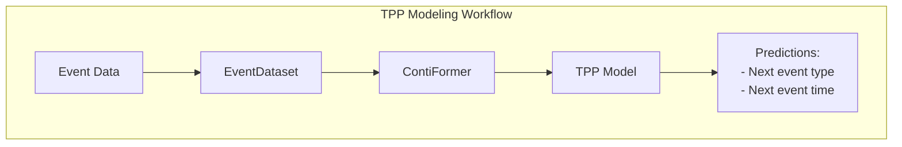
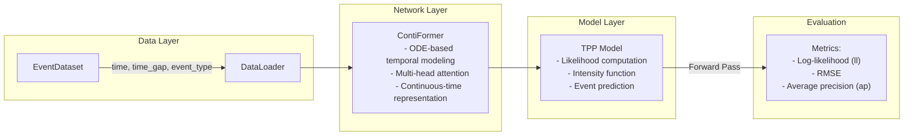
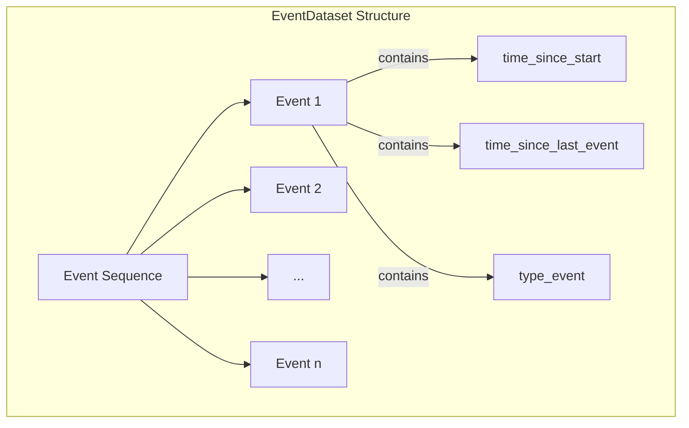
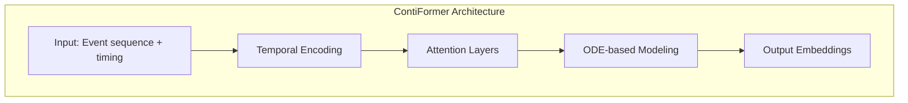
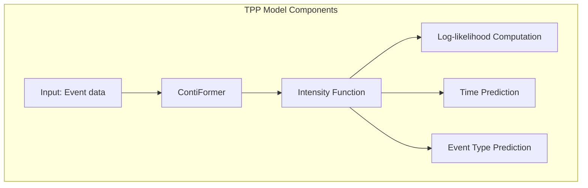
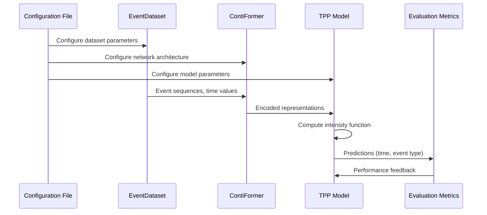

<!-- source: DeepWiki mcp.deepwiki.com · repo microsoft/PhysioPro · page 3.3 Temporal Point Process Modeling · fetched 2026-10-26 -->

# Temporal Point Process Modeling

<details>
<summary>Relevant source files</summary>

The following files were used as context for generating this wiki page:

- [docs/configs/contiformer_tpp.yml](docs/configs/contiformer_tpp.yml)
- [docs/configs/contiformer_tpp_neonate.yml](docs/configs/contiformer_tpp_neonate.yml)
- [physiopro/dataset/tpp.py](physiopro/dataset/tpp.py)

</details>


## Purpose and Scope

This document provides a comprehensive guide to temporal point process (TPP) modeling in PhysioPro. It covers the implementation, configuration, and usage of the TPP system for event prediction tasks. TPP modeling is particularly useful for predicting the timing and types of events in sequential data, such as medical events, user actions, or system alerts.

For information about time series classification with ContiFormer, see [Time Series Classification with ContiFormer](#3.2).

## Introduction to Temporal Point Processes

Temporal point processes are probabilistic models for sequences of discrete events occurring in continuous time. Unlike traditional time series models that operate on regularly sampled data, TPPs model the exact timing of events and their types.

In PhysioPro, TPP modeling is implemented using the ContiFormer architecture (a continuous-time transformer) combined with specialized dataset handling for event sequences.



Sources: [physiopro/dataset/tpp.py:14-102](), [docs/configs/contiformer_tpp.yml:1-52]()

## System Components for TPP Modeling

The TPP modeling system in PhysioPro consists of three main components:

1. **EventDataset**: Specialized dataset class for handling event sequence data
2. **ContiFormer**: Continuous-time transformer architecture for processing events
3. **TPP Model**: Model implementation for training and inference on temporal point processes



Sources: [physiopro/dataset/tpp.py:14-102](), [docs/configs/contiformer_tpp.yml:1-52](), [docs/configs/contiformer_tpp_neonate.yml:1-52]()

## EventDataset: Data Representation

The `EventDataset` class (`tpp.py`) handles data loading and preprocessing for event sequences. Each event sequence is represented as a list of events, where each event contains:

1. `time_since_start`: Absolute time since the start of the sequence
2. `time_since_last_event`: Time elapsed since the previous event
3. `type_event`: Category/type of the event



The dataset provides methods for padding and collating sequences for batch processing:

| Method | Description |
|--------|-------------|
| `pad_time` | Pads time sequences to the same length for batch processing |
| `pad_type` | Pads event type sequences for batch processing |
| `collate_fn` | Collates instances into batches suitable for the network |

Sources: [physiopro/dataset/tpp.py:14-102]()

### Key Features of EventDataset

- **Data Loading**: Loads event sequences from pickle files
- **Sequence Processing**: Extracts time and event type information
- **Batching**: Handles variable-length sequences through padding
- **Maximum Length**: Trims sequences to a configurable maximum length

```python
# Example data format expected by EventDataset
data = [
    [
        {'time_since_start': 0.0, 'time_since_last_event': 0.0, 'type_event': 2},
        {'time_since_start': 1.5, 'time_since_last_event': 1.5, 'type_event': 0},
        {'time_since_start': 3.2, 'time_since_last_event': 1.7, 'type_event': 1}
    ],
    # More event sequences...
]
```

Sources: [physiopro/dataset/tpp.py:42-54]()

## ContiFormer Architecture for TPP

The ContiFormer is a continuous-time transformer architecture that handles irregular time intervals between events. For TPP modeling, it acts as the backbone network, processing event sequences and their timing information.



### Configuration Parameters

The ContiFormer can be configured with various parameters to control its behavior:

| Parameter Category | Parameters | Description |
|--------------------|------------|-------------|
| **Architecture** | `d_model`, `n_layers`, `n_head`, `d_k`, `d_v`, `d_inner` | Basic transformer architecture parameters |
| **ODE-related** | `actfn_ode`, `layer_type_ode`, `zero_init_ode`, `linear_type_ode` | Control the ODE component's behavior |
| **ODE Solver** | `atol_ode`, `rtol_ode`, `itol_ode`, `method_ode` | Control the accuracy and method of ODE solving |
| **Interpolation** | `interpolate_ode`, `nlinspace` | Control how values are interpolated between time points |

Sources: [docs/configs/contiformer_tpp.yml:7-27](), [docs/configs/contiformer_tpp_neonate.yml:7-27]()

## TPP Model Configuration

The TPP model integrates the ContiFormer with specialized components for temporal point process modeling. It computes the intensity function (rate of events over time) and uses it for prediction and likelihood calculation.

### Key Configuration Parameters

| Parameter | Description |
|-----------|-------------|
| `scale_event`, `scale_time` | Scale factors for event types and time values |
| `tmax` | Maximum time horizon for prediction |
| `intensity_type` | Type of intensity function (e.g., "thp") |
| `use_likelihood` | Whether to use likelihood-based training |
| `use_rnn` | Whether to use RNN components alongside transformer |
| `input_time_flag` | Whether to include time as input feature |



Sources: [docs/configs/contiformer_tpp.yml:28-48](), [docs/configs/contiformer_tpp_neonate.yml:28-48]()

## Training and Evaluation

The TPP model is trained using a multitask loss function that typically combines:

1. **Negative log-likelihood (NLL)**: Measures how well the model fits the observed event sequences
2. **RMSE**: Measures the accuracy of time prediction
3. **Average precision (AP)**: Measures the accuracy of event type prediction

### Evaluation Metrics

| Metric | Description |
|--------|-------------|
| `ll` | Log-likelihood of the observed sequences given the model |
| `rmse` | Root mean squared error for time prediction |
| `ap` | Average precision for event type prediction |

The primary metric for model selection is typically the log-likelihood, with higher values indicating better model performance.

Sources: [docs/configs/contiformer_tpp.yml:33-34](), [docs/configs/contiformer_tpp_neonate.yml:33-34]()

## Example Configurations

PhysioPro includes example configurations for different datasets:

### Synthetic Data Configuration

```yaml
data:
  type: tpp
  prefix: ./data/temporal_point_process
  name: data_synthetic
  fold: fold1
  max_len: 100
  
model:
  type: tpp
  optimizer: Adam
  lr: 0.01
  scale_event: 1
  scale_time: 100
  tmax: 5
  intensity_type: thp
```

### Neonate Data Configuration

```yaml
data:
  type: tpp
  prefix: ./data/temporal_point_process
  name: data_neonate
  fold: fold1
  max_len: 100
  
model:
  type: tpp
  optimizer: Adam
  lr: 0.01
  scale_event: 1
  scale_time: 100
  tmax: 20
  intensity_type: thp
```

Sources: [docs/configs/contiformer_tpp.yml:1-52](), [docs/configs/contiformer_tpp_neonate.yml:1-52]()

## Workflow: Using TPP Modeling in PhysioPro



Sources: [docs/configs/contiformer_tpp.yml:1-52](), [physiopro/dataset/tpp.py:14-102]()

## Practical Usage

To use the TPP modeling system in PhysioPro:

1. **Prepare your data**: Format your event sequences according to the expected structure (time_since_start, time_since_last_event, type_event)

2. **Create a configuration file**: Use the provided examples as templates, adjusting parameters as needed for your specific dataset

3. **Run training**: Use the PhysioPro entry point with your configuration file

4. **Evaluate and iterate**: Monitor the log-likelihood and other metrics to assess model performance and refine your configuration

### Data Requirements

Your event sequence data should be organized as a list of sequences, where each sequence is a list of events, and each event is a dictionary with the following keys:
- `time_since_start`: Time elapsed since the beginning of the sequence
- `time_since_last_event`: Time elapsed since the previous event
- `type_event`: Integer representing the event type

Sources: [physiopro/dataset/tpp.py:42-47]()

## Conclusion

Temporal Point Process modeling in PhysioPro provides a powerful framework for analyzing and predicting event sequences in continuous time. By leveraging the ContiFormer architecture, the system can effectively handle irregularly-spaced events and predict both the timing and types of future events.

The system is highly configurable, allowing users to adapt it to various datasets and specific requirements through configuration files, without modifying the underlying code.

---

