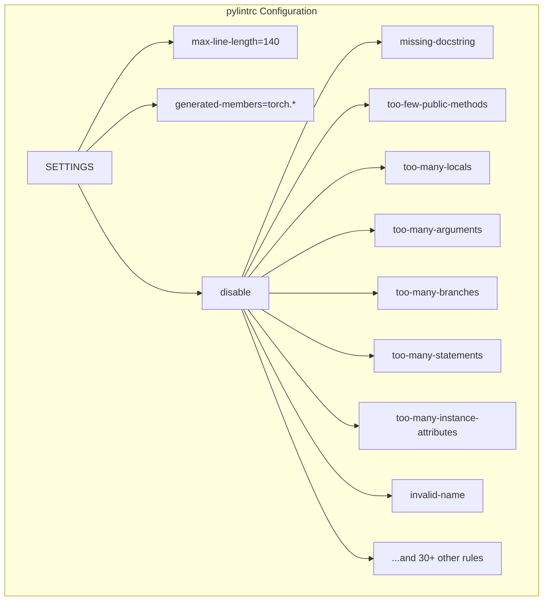
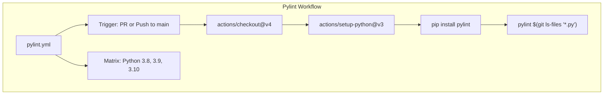
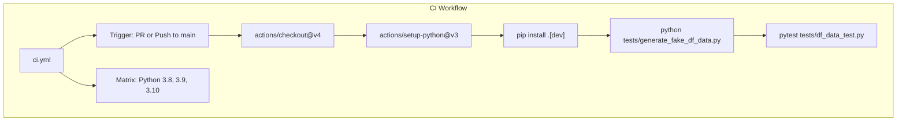
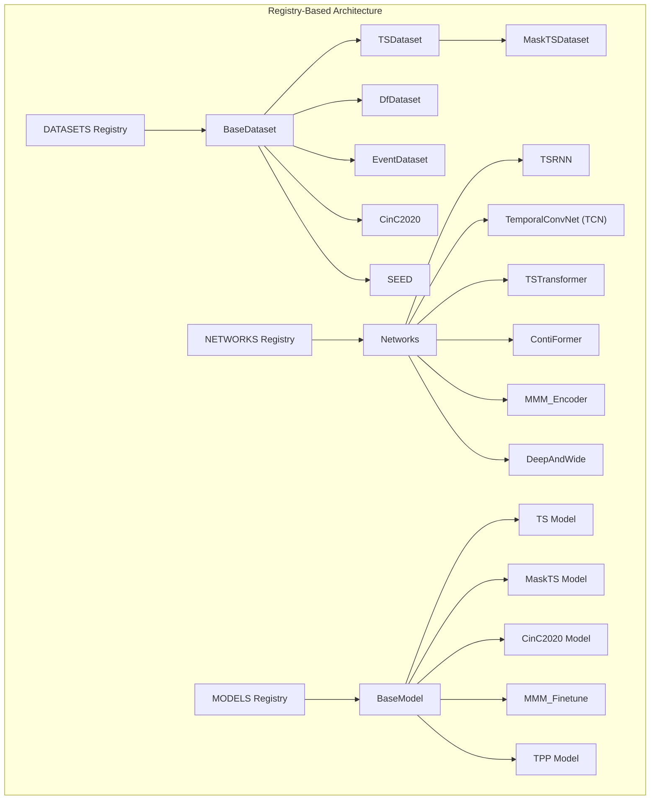
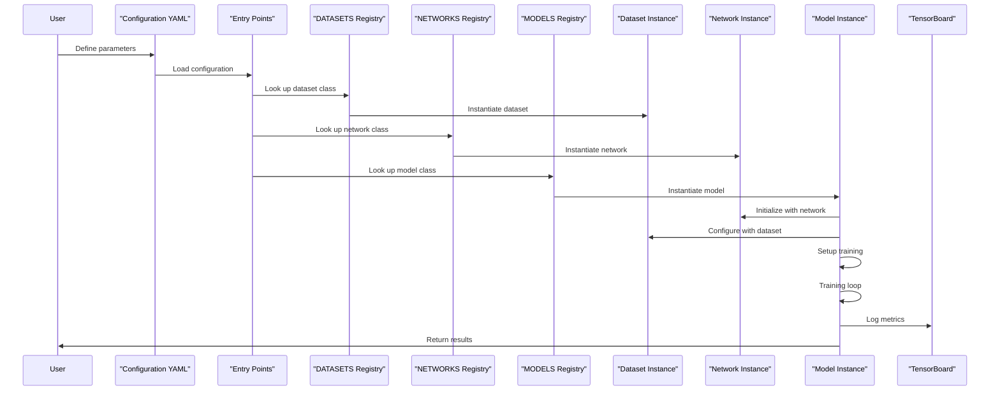

<!-- source: DeepWiki mcp.deepwiki.com · repo microsoft/PhysioPro · page 4 Development and Contribution · fetched 2026-10-26 -->

# Development and Contribution

<details>
<summary>Relevant source files</summary>

The following files were used as context for generating this wiki page:

- [.github/workflows/ci.yml](.github/workflows/ci.yml)
- [.github/workflows/pylint.yml](.github/workflows/pylint.yml)
- [pylintrc](pylintrc)

</details>


This document provides technical guidelines for developers who want to contribute to PhysioPro, a deep learning framework for physiological data processing and analysis. It covers development environment setup, code quality standards, CI/CD pipeline, and how to extend the system with new components.

For information about using PhysioPro for specific tasks, see [Use Cases and Tutorials](#3). For details about the system components, see [Core Components](#2).

## Development Environment Setup

To set up a development environment for PhysioPro:

1. Ensure you have Python 3.8, 3.9, or 3.10 installed (as specified in CI configuration)
2. Clone the repository from GitHub
3. Install development dependencies with `pip install .[dev]`
4. Generate fake data for testing (required for running tests):
   ```bash
   python tests/generate_fake_df_data.py
   ```

Sources: [.github/workflows/ci.yml:20-25]()

## Code Quality Standards

PhysioPro maintains code quality through linting rules defined in the `pylintrc` file. The project uses Pylint for static code analysis.

### Pylint Configuration

The Pylint configuration in PhysioPro is designed to balance code quality with the flexibility needed for scientific computing and deep learning code patterns.

Key settings:

| Setting | Value | Purpose |
|---------|-------|---------|
| `max-line-length` | 140 | Allows longer lines than the PEP 8 standard (80 characters) |
| `generated-members` | torch.* | Prevents false positives for dynamically generated PyTorch attributes |

The configuration disables several checks that would be too restrictive for this type of codebase:



The disabled checks allow for complex functions with many arguments, locals, and branches (common in ML workflows), as well as more flexible naming conventions and documentation requirements.

Sources: [pylintrc:1-43]()

## CI/CD Pipeline

PhysioPro uses GitHub Actions for continuous integration to ensure code quality and functionality across multiple Python versions.

### CI Workflows

The project has two main CI workflows:

#### 1. Pylint Workflow

The Pylint workflow runs the linter on all Python files to ensure they meet the code quality standards:



#### 2. CI Workflow

The CI workflow runs tests to verify functionality:



Sources: [.github/workflows/pylint.yml:1-27](), [.github/workflows/ci.yml:1-29]()

## Extending PhysioPro

PhysioPro employs a modular architecture that makes it highly extensible. This section explains how to extend the system with new components.

### Component Registry System

The architecture follows a registry pattern for key components, allowing them to be registered and accessed by name through configuration files:



The registry pattern allows PhysioPro to be highly configurable through YAML configuration files, where components are specified by name and automatically instantiated by the system.

Sources: System Architecture Diagrams

### Adding New Components

To extend PhysioPro with new components, you need to understand how the registry pattern works and how to create components that integrate with the existing system.

#### Adding a New Dataset

1. Create a new dataset class that inherits from an appropriate base class:
   ```python
   from physioPro.core.datasets import BaseDataset
   
   class MyNewDataset(BaseDataset):
       def __init__(self, **kwargs):
           super().__init__(**kwargs)
           # Initialize your dataset
           
       def __getitem__(self, idx):
           # Return data item at index idx
           
       def __len__(self):
           # Return length of dataset
   ```

2. Register your dataset with the `DATASETS` registry:
   ```python
   from physioPro.core.registry import DATASETS
   
   @DATASETS.register()
   class MyNewDataset(BaseDataset):
       # Implementation as above
   ```

3. Your dataset can now be used in configuration files by name.

#### Adding a New Network

1. Create a new network class that follows PyTorch module patterns:
   ```python
   import torch.nn as nn
   
   class MyNewNetwork(nn.Module):
       def __init__(self, **kwargs):
           super().__init__()
           # Initialize your network layers
           
       def forward(self, x):
           # Implement forward pass
           return output
   ```

2. Register your network with the networks registry:
   ```python
   from physioPro.core.registry import NETWORKS
   
   @NETWORKS.register()
   class MyNewNetwork(nn.Module):
       # Implementation as above
   ```

#### Adding a New Model

1. Create a new model class that inherits from `BaseModel`:
   ```python
   from physioPro.core.models import BaseModel
   
   class MyNewModel(BaseModel):
       def __init__(self, **kwargs):
           super().__init__(**kwargs)
           # Initialize your model
           
       def training_step(self, batch, batch_idx):
           # Implement training logic
           
       def validation_step(self, batch, batch_idx):
           # Implement validation logic
   ```

2. Register your model with the `MODELS` registry:
   ```python
   from physioPro.core.registry import MODELS
   
   @MODELS.register()
   class MyNewModel(BaseModel):
       # Implementation as above
   ```

Sources: System Architecture Diagrams

## Working with the Training Pipeline

PhysioPro's training pipeline is configuration-driven, where YAML files specify dataset, network architecture, and training parameters.

### Configuration-Driven Training Flow

The training pipeline follows this sequence:



This architecture allows for significant flexibility in combining different datasets, networks, and training configurations without changing code.

Sources: System Architecture Diagrams

### Extending the Training Pipeline

To modify or extend the training pipeline:

1. Understand the existing workflow as shown in the diagram
2. Identify the component you need to modify (dataset preprocessing, network architecture, model training logic)
3. Create a new component that inherits from the appropriate base class
4. Register your component with the appropriate registry
5. Update or create a configuration file that uses your new component

## Contribution Workflow

To contribute to PhysioPro:

1. Fork the repository
2. Create a feature branch
3. Make your changes
4. Ensure linting and tests pass locally:
   ```bash
   # Run the linter
   pylint $(git ls-files '*.py')
   
   # Generate test data and run tests
   python tests/generate_fake_df_data.py
   pytest tests/df_data_test.py
   ```
5. Submit a pull request

Your code will be automatically checked by the CI pipeline to ensure it meets the project's standards. The CI workflows will run on your pull request, testing with Python 3.8, 3.9, and 3.10 to ensure compatibility.

Sources: [.github/workflows/pylint.yml:1-27](), [.github/workflows/ci.yml:1-29]()

---

