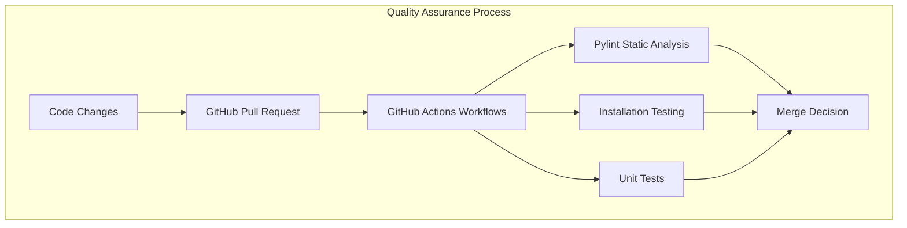
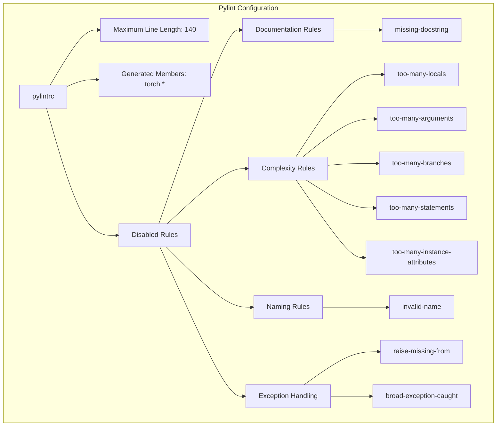
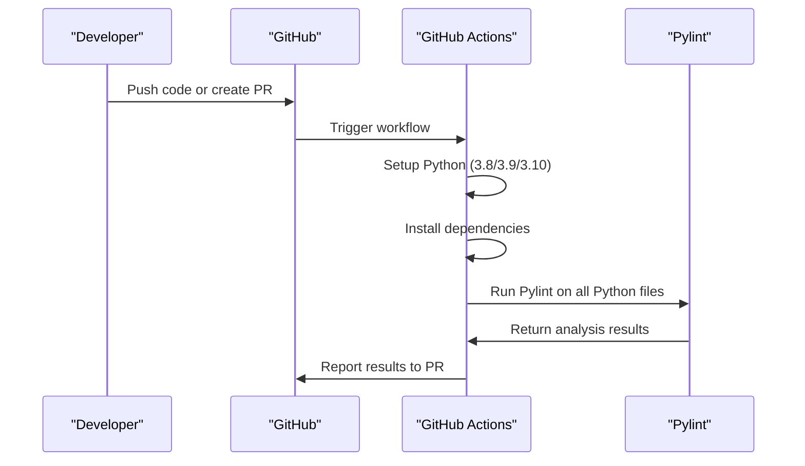
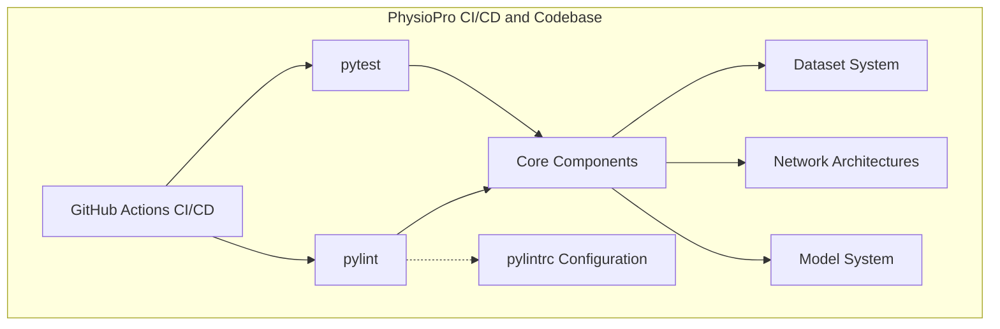

<!-- source: DeepWiki mcp.deepwiki.com · repo microsoft/PhysioPro · page 4.1 Code Quality and CI/CD · fetched 2026-10-26 -->

# Code Quality and CI/CD

Relevant source files

The following files were used as context for generating this wiki page:

- [.github/workflows/ci.yml](.github/workflows/ci.yml)
- [.github/workflows/pylint.yml](.github/workflows/pylint.yml)
- [pylintrc](pylintrc)

This page documents the code quality standards, linting rules, and continuous integration/continuous deployment (CI/CD) pipelines implemented in the PhysioPro repository. For information about extending the codebase with new components, see [Module Extensions](#4.2), and for details on the training pipeline, see [Training Pipeline](#4.3).

## Overview of Code Quality and CI/CD in PhysioPro

PhysioPro maintains code quality and reliability through a combination of static code analysis and automated testing. The CI/CD pipeline automatically validates new contributions against established standards to ensure the stability of the codebase.

Sources: [.github/workflows/pylint.yml](), [.github/workflows/ci.yml]()

## Linting Rules and Code Standards

The repository uses Pylint for static code analysis with a customized configuration that balances code quality with development flexibility.

### Pylint Configuration

The Pylint configuration sets maximum line length to 140 characters and disables several checks to accommodate the needs of a deep learning research codebase:

Sources: [pylintrc:1-43]()

### Key Linting Exceptions

The following categories of rules are disabled to accommodate the specific needs of a deep learning research framework:

1. **Documentation exceptions**: `missing-docstring` allows for code without explicit documentation
2. **Complexity exceptions**: Rules like `too-many-arguments` and `too-many-locals` are relaxed due to the inherently complex nature of deep learning models
3. **Naming flexibility**: `invalid-name` is disabled to allow for domain-specific naming conventions
4. **Modern Python features**: `consider-using-f-string` is disabled for backward compatibility

Sources: [pylintrc:6-42]()

## Continuous Integration Pipeline

PhysioPro uses GitHub Actions to automate testing and code quality verification. The CI pipeline runs on pull requests and pushes to the main branch, ensuring that all changes meet quality standards before being merged.

### CI Workflow Components

| Component | Description | Implementation |
|-----------|-------------|----------------|
| Python Version Testing | Tests compatibility with Python 3.8, 3.9, and 3.10 | Matrix strategy in GitHub Actions |
| Dependency Installation | Installs the package with development dependencies | `pip install .[dev]` |
| Test Data Generation | Creates fake dataframe data for testing | `tests/generate_fake_df_data.py` |
| Unit Testing | Runs tests using pytest | `pytest tests/df_data_test.py` |

Sources: [.github/workflows/ci.yml:8-28]()

### Pylint Workflow

The dedicated Pylint workflow runs in parallel with the main CI workflow to provide detailed feedback on code quality:

Sources: [.github/workflows/pylint.yml:1-26]()

## Integration with Development Workflow

The automated CI/CD pipeline integrates with PhysioPro's development workflow to ensure code quality while minimizing developer friction.

### CI/CD and Code Structure Relationship

Sources: [pylintrc](), [.github/workflows/pylint.yml](), [.github/workflows/ci.yml]()

## Testing Approach

Testing in PhysioPro focuses on functional validation of key components:

1. **Data validation tests**: Verify that datasets are loaded and processed correctly
2. **Installation tests**: Ensure the package can be installed properly across Python versions
3. **Integration tests**: Validate that core components work together as expected

The CI workflow currently runs a specific test for dataframe data handling (`df_data_test.py`), suggesting a focus on data processing validation.

Sources: [.github/workflows/ci.yml:22-28]()

## Development Guidelines

When contributing to PhysioPro, developers should adhere to the following guidelines:

1. **Code quality**: Although some linting rules are relaxed, maintain readable and maintainable code
2. **Test coverage**: Add appropriate tests for new functionality
3. **CI compliance**: Ensure your changes pass all CI checks before requesting review
4. **Python compatibility**: Maintain compatibility with Python 3.8, 3.9, and 3.10

Sources: [.github/workflows/pylint.yml](), [.github/workflows/ci.yml](), [pylintrc]()

## Future Improvements

Based on the current implementation, potential areas for enhancing the CI/CD pipeline include:

1. Expanding test coverage across more components
2. Adding code coverage reporting
3. Implementing automated performance testing for critical components
4. Adding integration tests for end-to-end workflow validation

Sources: [.github/workflows/ci.yml]()

---

