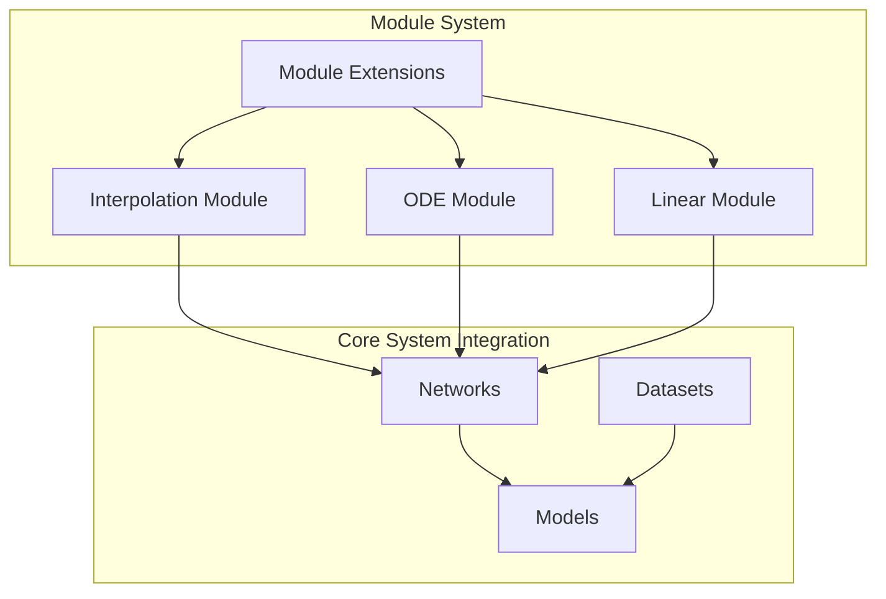
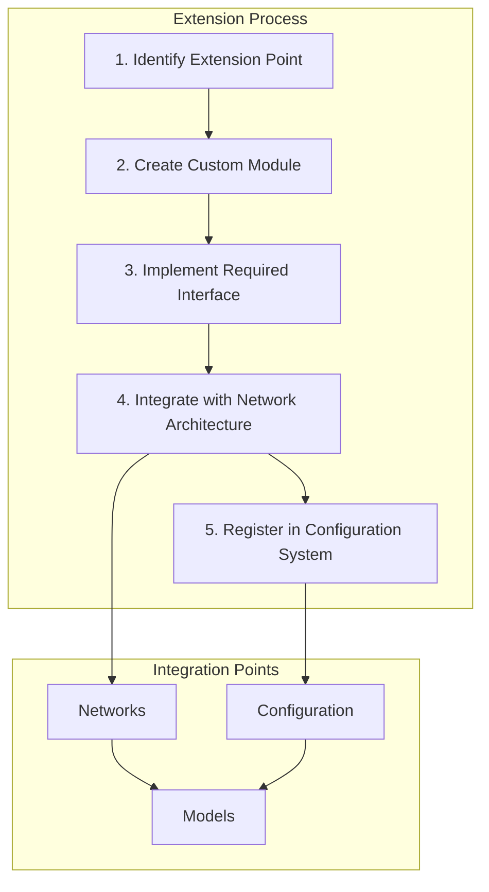

<!-- source: DeepWiki mcp.deepwiki.com · repo microsoft/PhysioPro · page 4.2 Module Extensions · fetched 2026-10-26 -->

# Module Extensions

<details>
<summary>Relevant source files</summary>

The following files were used as context for generating this wiki page:

- [physiopro/module/interpolate.py](physiopro/module/interpolate.py)
- [physiopro/module/linear.py](physiopro/module/linear.py)
- [physiopro/module/ode.py](physiopro/module/ode.py)

</details>


## Purpose and Scope

This document provides guidelines and examples for extending the PhysioPro module system. It covers the extension points available within the modular architecture of PhysioPro, focusing on how to add new functionality to the interpolation, ODE, and linear components. This page is intended for developers who want to contribute to or customize PhysioPro for their specific physiological data processing needs.

For information about using the existing training pipeline, see [Training Pipeline](#4.3).

Sources: [physiopro/module/interpolate.py:1-73](), [physiopro/module/linear.py:1-321](), [physiopro/module/ode.py:1-244]()

## Module System Architecture

The PhysioPro module system provides extensible components that serve as building blocks for handling time series physiological data. These modules are designed to be extended and combined to create complex neural network architectures, particularly for continuous-time modeling.



The module system consists of three primary extension points:

1. **Interpolation Module**: Functions for handling missing or irregularly sampled time series data
2. **ODE Module**: Components for continuous-time modeling using ordinary differential equations
3. **Linear Module**: Advanced linear layers that incorporate time as a variable

Sources: [physiopro/module/interpolate.py:1-73](), [physiopro/module/linear.py:1-321](), [physiopro/module/ode.py:1-244]()

## Extension Points

### Interpolation Extensions

The interpolation module provides functions for processing time series data with missing values or irregular sampling. These functions can be extended to implement new interpolation methods.

```mermaid
classDiagram
    class "Interpolation" {
        +linear_interpolation_coeffs(x, t)
        +hermite_cubic_coefficients_with_backward_differences(x, t)
    }
    
    class "Custom Interpolation" {
        +new_interpolation_method(x, t)
    }
    
    "Interpolation" <|-- "Custom Interpolation"
```

Currently implemented methods:
- `linear_interpolation_coeffs`: Performs linear interpolation for missing values
- `hermite_cubic_coefficients_with_backward_differences`: Implements cubic spline interpolation

Sources: [physiopro/module/interpolate.py:25-46](), [physiopro/module/interpolate.py:49-72]()

### ODE-Based Extensions

The ODE module provides components for building neural networks that use ordinary differential equations (ODEs) to model continuous-time processes. These components are core to the ContiFormer architecture.

```mermaid
classDiagram
    class "TimeVariableODE" {
        +integrate(t0, t1, x0, nlinspace, method, gauss, save, atol)
        +forward(s, state)
    }
    
    class "SequentialDiffEq" {
        +forward(t, x)
    }
    
    class "Custom ODE Layer" {
        +forward(t, x)
    }
    
    "SequentialDiffEq" <|-- "Custom ODE Layer"
```

Key ODE components:
- `TimeVariableODE`: Solves ODEs with time as a variable
- `SequentialDiffEq`: Container for sequential layers that handle differential equations
- Various activation functions and layer types for ODE-based networks

Sources: [physiopro/module/ode.py:109-188](), [physiopro/module/ode.py:65-77]()

### Linear Layer Extensions

The linear module provides specialized linear layers that incorporate time as a variable, either through interpolation or ODEs.

```mermaid
classDiagram
    class "InterpLinear" {
        +forward(x, t, approximate_method)
        +interpolate(x, t, qt, mask, approximate_method)
    }
    
    class "ODELinear" {
        +forward(x, t, approximate_method)
        +interpolate(x, t, qt, approximate_method)
    }
    
    class "Custom Linear" {
        +forward(x, t, approximate_method)
        +interpolate(x, t, qt, approximate_method)
    }
    
    "InterpLinear" <|-- "Custom Linear"
    "ODELinear" <|-- "Custom Linear"
```

Key linear components:
- `InterpLinear`: Linear layer that uses interpolation for continuous-time modeling
- `ODELinear`: Linear layer that uses ODEs for continuous-time modeling

Sources: [physiopro/module/linear.py:13-197](), [physiopro/module/linear.py:200-320]()

## Implementing Custom Extensions

### Creating Custom Interpolation Methods

To implement a custom interpolation method, follow these steps:

1. Create a new function in a module file (or extend `interpolate.py`)
2. Implement logic to handle time series data with missing values
3. Return coefficients compatible with existing network architectures

Example interface pattern for custom interpolation function:

```python
def custom_interpolation_coeffs(x, t=None):
    """
    x: Input tensor with shape [batch_size, sequence_length, features]
    t: Optional time points tensor with shape [sequence_length]
    
    Returns:
        Interpolation coefficients tensor
    """
    # Implementation
    return coeffs
```

Sources: [physiopro/module/interpolate.py:25-46](), [physiopro/module/interpolate.py:49-72]()

### Creating Custom ODE Functions

To implement a custom ODE function for use with `TimeVariableODE`:

1. Create a class that inherits from `nn.Module`
2. Implement a `forward` method that takes `(t, x)` as arguments
3. Use `build_fc_odefunc` to build a neural ODE function or create one manually

Example:

```python
class CustomODEFunc(nn.Module):
    def __init__(self, dim):
        super().__init__()
        self.net = nn.Sequential(
            # layers
        )
    
    def forward(self, t, x):
        # ODE function logic
        return dx
```

Sources: [physiopro/module/ode.py:208-243](), [physiopro/module/ode.py:65-77]()

### Creating Custom Linear Layers

To implement a custom linear layer that incorporates time:

1. Create a class that inherits from `nn.Module`
2. Implement `forward` and `interpolate` methods with consistent signatures
3. Incorporate time-aware processing in the implementation

Example interface pattern:

```python
class CustomTimeLinear(nn.Module):
    def __init__(self, d_model, d_out=None, args=None):
        super().__init__()
        # Initialization
        
    def forward(self, x, t, approximate_method=None):
        """
        x: Input tensor with shape [batch_size, sequence_length, features]
        t: Time points tensor with shape [batch_size, sequence_length]
        approximate_method: Method for approximation
        
        Returns:
            Processed tensor
        """
        # Implementation
        return result
    
    def interpolate(self, x, t, qt, approximate_method=None):
        """
        x: Input tensor with shape [batch_size, sequence_length, features]
        t: Time points tensor with shape [batch_size, sequence_length]
        qt: Query time points tensor with shape [batch_size, query_length]
        approximate_method: Method for approximation
        
        Returns:
            Interpolated tensor
        """
        # Implementation
        return result
```

Sources: [physiopro/module/linear.py:13-197](), [physiopro/module/linear.py:200-320]()

## Integration with PhysioPro

### Layer Types and Activation Functions

PhysioPro supports various layer types and activation functions that can be used with custom ODE functions:

| Layer Type | Description | Class in Code |
|------------|-------------|---------------|
| concat | Linear layer with time-dependent bias | ConcatLinear_v2 |
| concatsquash | Linear layer with time-dependent gate and bias | ConcatSquashLinear |
| concatnorm | Linear layer with time-dependent bias and normalization | ConcatLinearNorm |

| Activation Function | Description | Implementation |
|--------------------|-------------|----------------|
| softplus | SoftPlus activation | nn.Softplus() |
| tanh | Hyperbolic tangent | nn.Tanh() |
| swish | Time-dependent Swish | TimeDependentSwish |
| relu | Rectified Linear Unit | nn.ReLU() |
| leakyrelu | Leaky ReLU | nn.LeakyReLU() |
| sigmoid | Sigmoid function | nn.Sigmoid() |

Sources: [physiopro/module/ode.py:191-198](), [physiopro/module/ode.py:200-205]()

### Interpolation Methods

PhysioPro supports the following interpolation methods, which can be extended with custom implementations:

| Method | Description | Implementation |
|--------|-------------|----------------|
| linear | Linear interpolation between points | linear_interpolation_coeffs |
| cubic | Cubic spline interpolation | hermite_cubic_coefficients_with_backward_differences |

Sources: [physiopro/module/interpolate.py:25-46](), [physiopro/module/interpolate.py:49-72](), [physiopro/module/linear.py:69-73]()

## Extending the Module System



### Best Practices for Module Extensions

1. **Interface Consistency**: Maintain the same method signatures as existing modules
2. **Numerical Stability**: Ensure that custom modules maintain numerical stability for physiological data
3. **Graceful Handling of Missing Data**: Account for missing values in time series data
4. **Documentation**: Document parameters, requirements, and use cases

Sources: [physiopro/module/linear.py:13-197](), [physiopro/module/ode.py:109-188]()

## Example: Creating a Custom ODE-based Module

This example shows the process of creating a custom ODE-based module for time series processing:

1. Define a custom ODE function
2. Create a custom linear layer that uses this ODE function
3. Integrate the custom layer with the network architecture

```python
# 1. Define custom ODE function
custom_ode_func = build_fc_odefunc(
    dim=input_dimension,
    hidden_dims=[64, 64],
    actfn="swish",
    layer_type="concat",
    zero_init=True
)

# 2. Create custom linear layer with ODE function
custom_ode_layer = ODELinear(
    d_model=input_dimension,
    d_out=output_dimension,
    args_ode=ode_args,
    norm=True
)

# 3. Use in network architecture
output = custom_ode_layer(input_tensor, time_tensor)
```

Sources: [physiopro/module/ode.py:208-243](), [physiopro/module/linear.py:200-320]()

## Summary

The PhysioPro module system is designed for extensibility, allowing developers to customize the behavior of the framework for different physiological data processing tasks. The three main extension points are the interpolation module, ODE module, and linear module. By creating custom implementations that follow the established interfaces, developers can add new functionality to PhysioPro while maintaining compatibility with the existing architecture.

For details on how these extended modules are used in the training pipeline, see [Training Pipeline](#4.3).

Sources: [physiopro/module/interpolate.py:1-73](), [physiopro/module/linear.py:1-321](), [physiopro/module/ode.py:1-244]()

---

