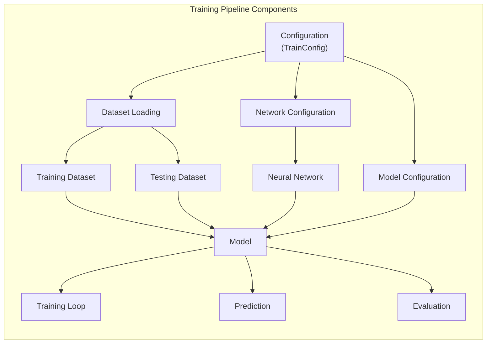
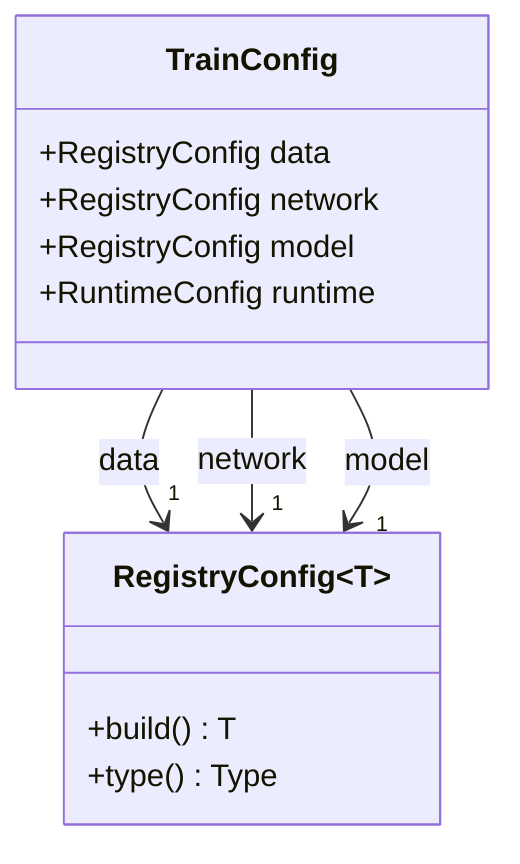
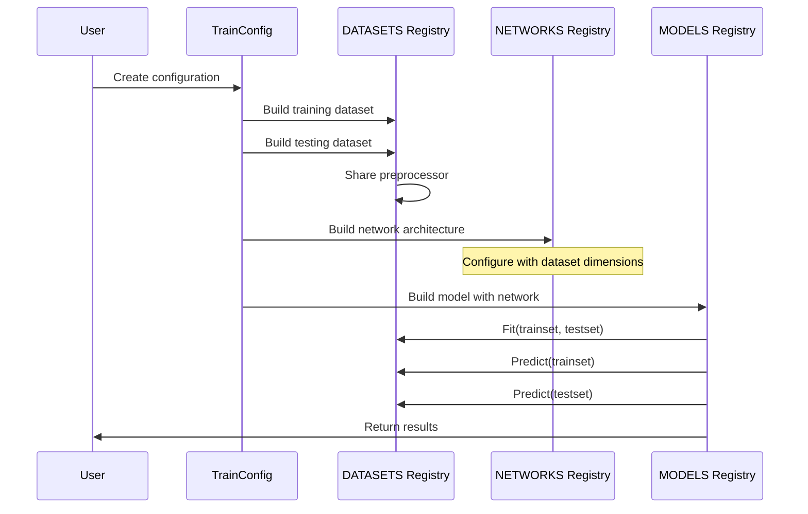
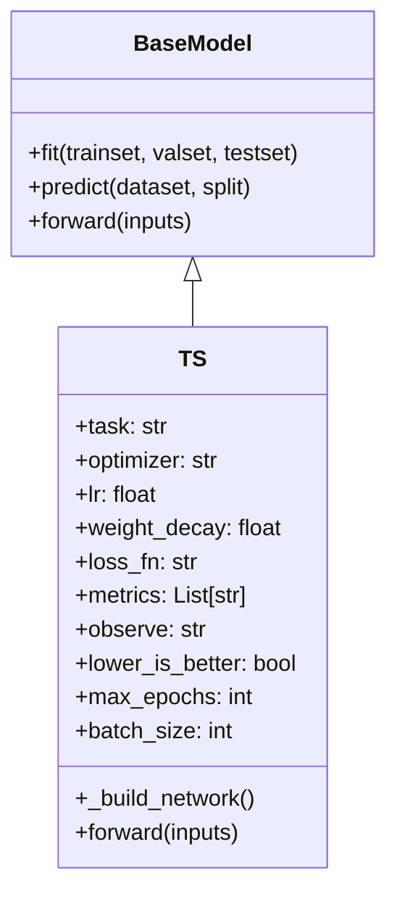
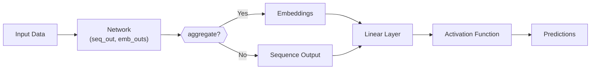

<!-- source: DeepWiki mcp.deepwiki.com · repo microsoft/PhysioPro · page 4.3 Training Pipeline · fetched 2026-10-26 -->

# Training Pipeline

<details>
<summary>Relevant source files</summary>

The following files were used as context for generating this wiki page:

- [physiopro/entry/train.py](physiopro/entry/train.py)
- [physiopro/model/timeseries.py](physiopro/model/timeseries.py)

</details>


The Training Pipeline in PhysioPro provides a streamlined framework for training deep learning models on physiological time series data. This page explains how to use and extend the training pipeline to create and train custom models for various physiological data processing tasks.

For information about adding new model components to PhysioPro, see [Module Extensions](#4.2).

## Overview

The PhysioPro training pipeline orchestrates the end-to-end workflow of loading datasets, building network architectures, configuring models, and executing the training process. It uses a configuration-driven approach, allowing users to specify training parameters in YAML files without modifying code.



Sources: [physiopro/entry/train.py:13-49]()

## Configuration System

The training pipeline is driven by a configuration class that defines all parameters for an experiment.



The `TrainConfig` class expects three main configuration components:

1. **data**: Configuration for dataset loading and preprocessing
2. **network**: Configuration for the neural network architecture
3. **model**: Configuration for the training model, including optimizer, loss function, and training parameters

Sources: [physiopro/entry/train.py:13-18]()

### Example Configuration

A typical YAML configuration file for the training pipeline might look like:

```yaml
data:
  _target_: TSDataset
  # Dataset parameters...

network:
  _target_: TSTransformer
  # Network parameters...

model:
  _target_: ts
  # Model parameters...

runtime:
  experiment_name: eeg_classification
  seed: 42
  # Other runtime parameters...
```

## Pipeline Execution Flow

The training pipeline follows a sequential execution flow:



Sources: [physiopro/entry/train.py:21-44]()

## Key Components

### 1. Dataset Building

The pipeline builds training and testing datasets from the configuration, ensuring that the same preprocessor is used for both:

```python
trainset = config.data.build(dataset="train")
testset = config.data.build(dataset="test", preprocessor=trainset.preprocessor)
```

The dataset objects provide metadata about input dimensions that are used to configure the network:

- `num_variables`: Number of input features
- `max_seq_len`: Maximum sequence length
- `num_classes`: Number of output classes (for classification tasks)

Sources: [physiopro/entry/train.py:24-25](), [physiopro/entry/train.py:27-34]()

### 2. Network Building

The network is constructed based on the dimensions provided by the dataset:

```python
network = config.network.build(
    input_size=trainset.num_variables, 
    max_length=trainset.max_seq_len
)
```

This dynamic approach ensures that network architectures can properly adapt to different dataset dimensions.

Sources: [physiopro/entry/train.py:27-29]()

### 3. Model Building

The model combines the network with training parameters:

```python
model = config.model.build(
    network=network,
    output_dir=get_output_dir(),
    checkpoint_dir=get_checkpoint_dir(),
    out_size=out_size,
)
```

The output size is determined based on the dataset type and task:

- For regression tasks: `out_size = 1`
- For classification tasks: `out_size = trainset.num_classes`

Sources: [physiopro/entry/train.py:31-41]()

### 4. Training and Prediction

The model's `fit` and `predict` methods handle the actual training and prediction processes:

```python
model.fit(trainset, testset, testset)  # Train the model
model.predict(trainset, "train")       # Generate predictions for training set
model.predict(testset, "test")         # Generate predictions for test set
```

Sources: [physiopro/entry/train.py:42-44]()

## Model Types

PhysioPro supports various model types for different time series tasks. The `TS` model is the base model for general time series prediction.



### TS Model Parameters

The time series model (`TS`) accepts several important parameters that control the training process:

| Parameter | Description | Example Values |
|-----------|-------------|---------------|
| `task` | The prediction task | "classification", "multiclassification", "regression" |
| `optimizer` | Optimization algorithm | "adam", "sgd" |
| `lr` | Learning rate | 0.001 |
| `weight_decay` | L2 regularization strength | 1e-5 |
| `loss_fn` | Loss function | "bce", "mse", "cross_entropy" |
| `metrics` | Evaluation metrics | ["accuracy", "f1"] |
| `observe` | Metric for model selection | "accuracy" |
| `lower_is_better` | Whether lower metric is better | true/false |
| `max_epochs` | Maximum training epochs | 100 |
| `batch_size` | Batch size | 32 |
| `early_stop` | Early stopping patience | 10 |
| `aggregate` | Whether to aggregate across sequence | true/false |

Sources: [physiopro/model/timeseries.py:12-77]()

## Network Forward Pass

The `TS` model's forward pass shows how data flows through the network:

1. The input passes through the network to produce sequence outputs and embeddings
2. If `aggregate` is True, the embeddings are used; otherwise, sequence outputs are used
3. The final linear layer and activation function are applied to produce predictions



Sources: [physiopro/model/timeseries.py:128-136]()

## Extending the Training Pipeline

### Creating Custom Models

To create a custom model, inherit from `BaseModel` and register it with the `MODELS` registry:

```python
@MODELS.register_module("my_custom_model")
class MyCustomModel(BaseModel):
    def __init__(self, ...):
        # Initialize your model
        super().__init__(...)
    
    def _build_network(self, network, ...):
        # Build your network
        
    def forward(self, inputs):
        # Define forward pass
```

### Creating Custom Datasets

Similarly, custom datasets can be created by inheriting from base dataset classes and registering them with the `DATASETS` registry.

### Creating Custom Networks

Custom network architectures can be created by inheriting from `nn.Module` and registering them with the `NETWORKS` registry.

## Usage Example

To run a training job using the pipeline:

1. Create a YAML configuration file with your experiment parameters
2. Run the training script with the configuration file:

```bash
python -m physiopro.entry.train --config path/to/config.yaml
```

This will execute the training pipeline according to your specified configuration.

Sources: [physiopro/entry/train.py:47-49]()

## Best Practices

1. **Separate Configurations**: Keep dataset, network, and model configurations separate for better modularity.
2. **Use Early Stopping**: Set appropriate early stopping criteria to prevent overfitting.
3. **Monitor Key Metrics**: Choose relevant metrics for your specific task.
4. **Experiment Tracking**: Use the runtime configuration to name and track experiments.
5. **Checkpoint Management**: Take advantage of automatic checkpoint saving and loading.

## Conclusion

The Training Pipeline in PhysioPro provides a flexible, configuration-driven approach to training deep learning models for physiological data analysis. By separating dataset, network, and model configurations, it enables rapid experimentation with different architectures and parameters without code changes.