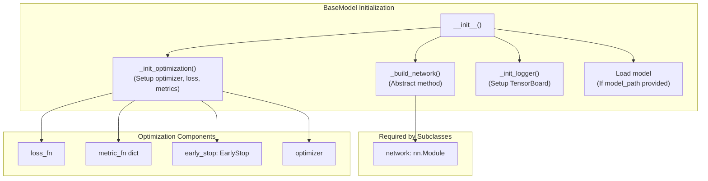
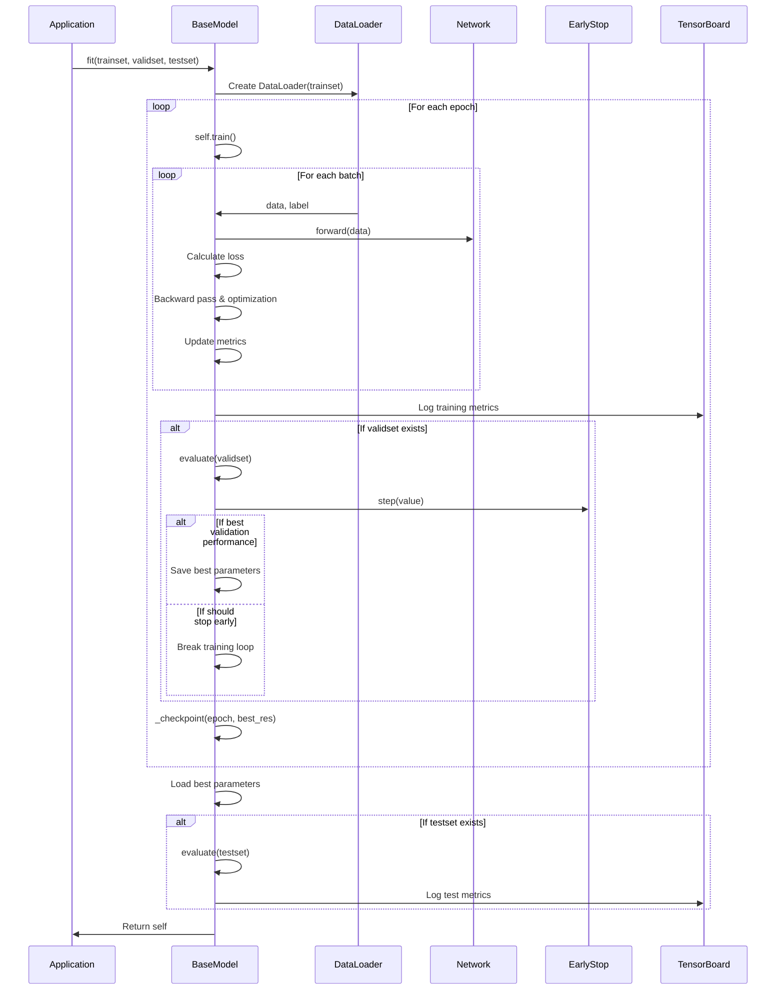
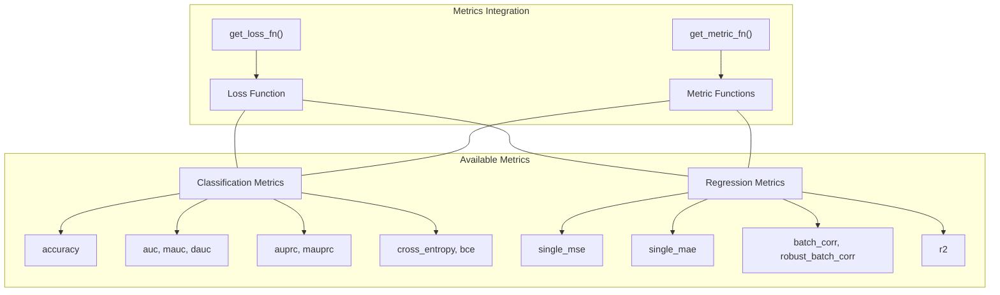
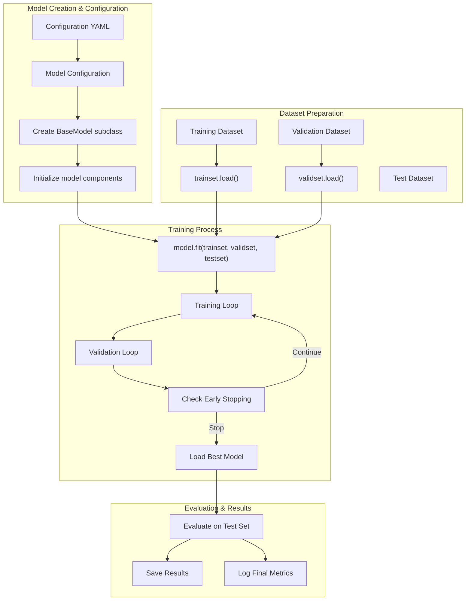

<!-- source: DeepWiki mcp.deepwiki.com · repo microsoft/PhysioPro · extra page BaseModel · fetched 2026-10-26 -->

# BaseModel

<details>
<summary>Relevant source files</summary>

The following files were used as context for generating this wiki page:

- [docs/metrics.md](docs/metrics.md)
- [physiopro/metrics/__init__.py](physiopro/metrics/__init__.py)
- [physiopro/metrics/classification.py](physiopro/metrics/classification.py)
- [physiopro/metrics/kernel.py](physiopro/metrics/kernel.py)
- [physiopro/metrics/regression.py](physiopro/metrics/regression.py)
- [physiopro/metrics/utils.py](physiopro/metrics/utils.py)
- [physiopro/model/base.py](physiopro/model/base.py)

</details>


The BaseModel is the core abstract class in PhysioPro's model system. It provides the foundation for all model implementations in the framework, handling common functionality such as training loops, evaluation, checkpointing, early stopping, and logging. This page documents the architecture, functionality, and extension points of BaseModel.

## Purpose and Scope

BaseModel serves as an abstract base class designed to be extended by specialized model implementations. It implements:
- Model training and evaluation pipelines
- Checkpoint management and model persistence
- Metrics calculation and tracking
- TensorBoard integration for logging
- Early stopping mechanisms

For information about specific model implementations that extend BaseModel, see the [Time Series Models](#2.3.3) and [MMM_Finetune](#2.3.2) pages.

## Architecture Overview

BaseModel is a PyTorch module (`nn.Module`) registered in the MODELS registry using a decorator pattern. This allows for dynamic model instantiation through a configuration system.

```mermaid
classDiagram
    class "nn.Module" {
        +forward()
        +parameters()
        +state_dict()
        +load_state_dict()
    }
    class "MODELS Registry" {
        +register_module()
        +build()
    }
    class "BaseModel" {
        +__init__()
        +_build_network()
        +_init_optimization()
        +_init_logger()
        +forward()
        +fit()
        +evaluate()
        +predict()
        +load()
    }
    class "Derived Models" {
        +_build_network()
        +forward()
        +_post_batch()
    }
    "nn.Module" <|-- "BaseModel"
    "MODELS Registry" ..> "BaseModel" : registers
    "BaseModel" <|-- "Derived Models"
```

Sources: [physiopro/model/base.py:25-30](), [physiopro/model/base.py:29-30]()

## Core Components and Initialization

BaseModel's initialization process sets up several critical components:



Sources: [physiopro/model/base.py:31-74](), [physiopro/model/base.py:80-111]()

### Key Initialization Parameters

| Parameter | Type | Description |
|-----------|------|-------------|
| `loss_fn` | str | Loss function name to use during training |
| `metrics` | List[str] | List of metric names for evaluation |
| `observe` | str | Primary metric to monitor for early stopping |
| `lr` | float | Learning rate for optimizer |
| `lower_is_better` | bool | Whether lower metric value is better (for early stopping) |
| `max_epochs` | int | Maximum number of training epochs |
| `batch_size` | int | Batch size for training and evaluation |
| `early_stop` | Optional[int] | Patience for early stopping |
| `optimizer` | str | Name of optimizer class (e.g., "Adam") |
| `network` | Optional[nn.Module] | Neural network to use |
| `model_path` | Optional[str] | Path to load pre-trained model from |
| `output_dir` | Optional[Path] | Directory for TensorBoard logs |
| `checkpoint_dir` | Optional[Path] | Directory for model checkpoints |

Sources: [physiopro/model/base.py:31-48]()

## Training Pipeline

The `fit()` method implements the complete training pipeline, including:
- Dataset loading
- Training loop
- Validation on evaluation dataset
- Early stopping
- Checkpointing
- Final evaluation on test dataset



Sources: [physiopro/model/base.py:147-284]()

### Key Methods in Training

| Method | Purpose |
|--------|---------|
| `fit()` | Main training loop orchestrating the entire process |
| `evaluate()` | Evaluates model on a dataset and computes metrics |
| `_checkpoint()` | Saves model checkpoint for resuming training |
| `_resume()` | Loads training state from checkpoint |
| `_post_batch()` | Hook for subclasses to execute custom logic after each batch |
| `_post_epoch_valid_best()` | Hook for subclasses to execute when new best validation performance |
| `_early_stop()` | Controls whether early stopping is enabled |

Sources: [physiopro/model/base.py:133-146](), [physiopro/model/base.py:147-284](), [physiopro/model/base.py:318-369]()

## Evaluation and Metrics System

BaseModel integrates with PhysioPro's metrics system, which provides a comprehensive set of evaluation metrics for different tasks.



Sources: [physiopro/metrics/utils.py:16-41](), [physiopro/metrics/classification.py](), [physiopro/metrics/regression.py]()

### Metric and Loss Function Selection

The BaseModel uses string identifiers to select loss functions and metrics at initialization:

```python
self.loss_fn = get_loss_fn(loss_fn)
self.metric_fn = {}
for f in metrics:
    self.metric_fn[f] = get_metric_fn(f)
```

Sources: [physiopro/model/base.py:97-100]()

Common metrics include:
- **Classification**: accuracy, AUC, AUPRC
- **Regression**: MSE, MAE, R2 score, correlation

Sources: [physiopro/metrics/classification.py](), [physiopro/metrics/regression.py]()

## Model Persistence and Checkpointing

BaseModel implements a comprehensive checkpointing system that handles:
- Saving model state during training
- Resuming training from interruptions
- Storing best model parameters based on validation metrics
- Loading pre-trained models

### Checkpoint Contents

| Component | Description |
|-----------|-------------|
| Model state | Complete state dictionary of the model |
| Optimizer state | State of the optimizer for resuming training |
| Early stopping state | State of the early stopping mechanism |
| Current epoch | Current training epoch |
| Best results | Best metrics achieved so far |
| Best parameters | Parameters that achieved the best results |

Sources: [physiopro/model/base.py:286-303](), [physiopro/model/base.py:304-316]()

## Extension Points for Subclasses

BaseModel is designed to be extended by subclasses. It provides several methods that should be overridden:

| Method | Purpose | Implementation Requirement |
|--------|---------|----------------------------|
| `_build_network()` | Initialize network architecture | **Required** |
| `forward()` | Define forward pass of the model | **Required** |
| `_post_batch()` | Custom logic after each batch | Optional |
| `_post_epoch_valid_best()` | Actions when best validation performance | Optional |
| `_init_scheduler()` | Setup learning rate scheduler | Optional |
| `_early_stop()` | Control early stopping behavior | Optional |

Sources: [physiopro/model/base.py:75-78](), [physiopro/model/base.py:122-127](), [physiopro/model/base.py:133-145]()

## Complete Workflow Example

The following diagram illustrates a complete training workflow using BaseModel:



Sources: [physiopro/model/base.py:147-284]()

## Practical Usage

To use BaseModel, developers need to:

1. Create a subclass that implements at minimum:
   - `_build_network()` - to set up the neural network architecture
   - `forward()` - to define the forward pass logic

2. Configure the model with appropriate parameters:
   - Loss function
   - Evaluation metrics
   - Optimization parameters
   - Checkpoint directory

3. Call the `fit()` method with training, validation, and (optionally) test datasets.

Sources: [physiopro/model/base.py:29-74](), [physiopro/model/base.py:147-284]()

## Summary

BaseModel provides the foundation for implementing machine learning models in PhysioPro by:
- Handling the common training and evaluation workflows
- Providing metrics calculation and monitoring
- Managing model persistence and checkpointing
- Offering clear extension points for custom behavior

It serves as a bridge between the neural network architectures and the training pipeline, allowing researchers to focus on model architecture while reusing robust training components.

---

