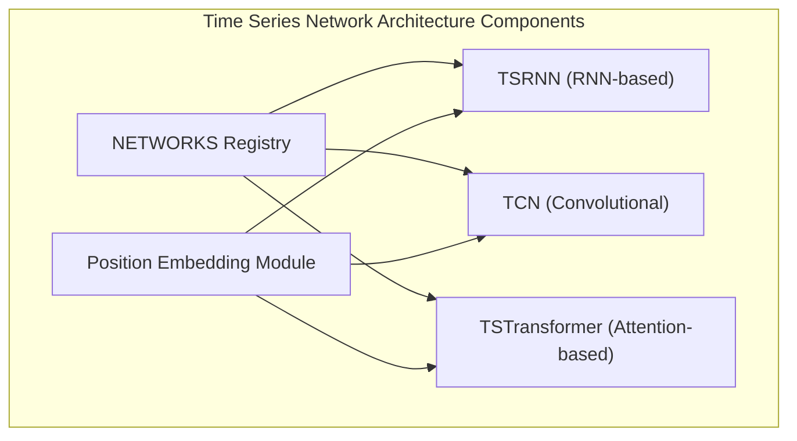
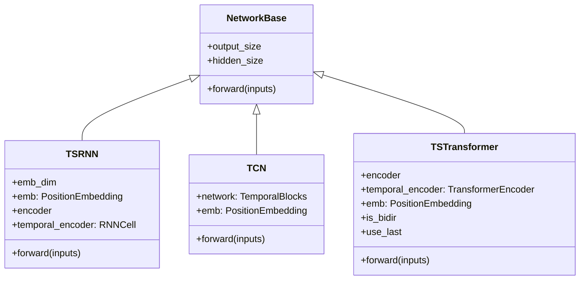
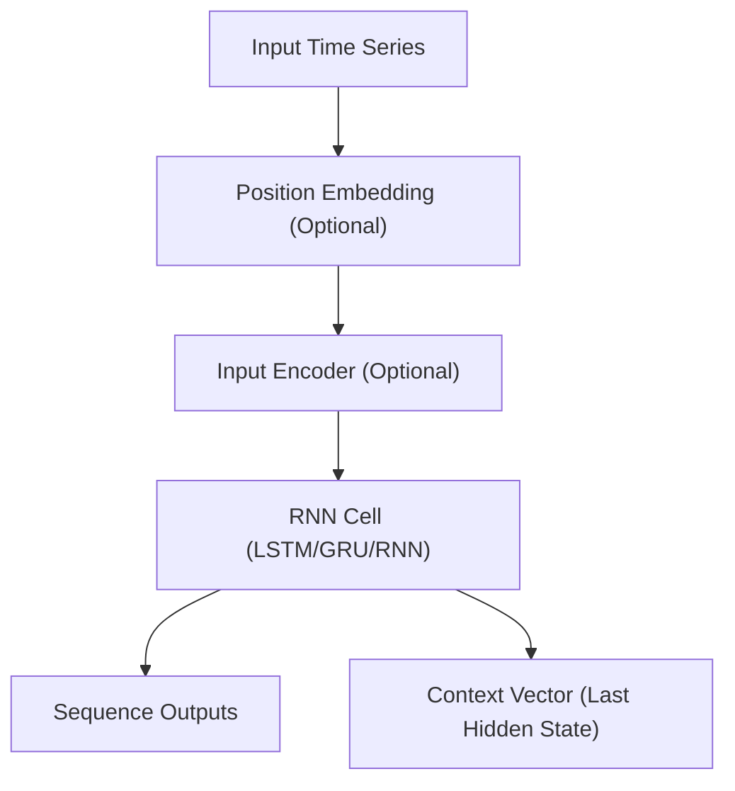
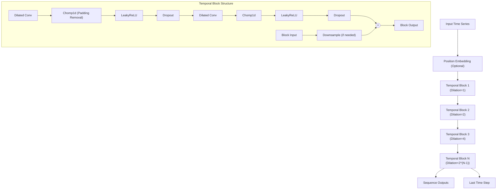
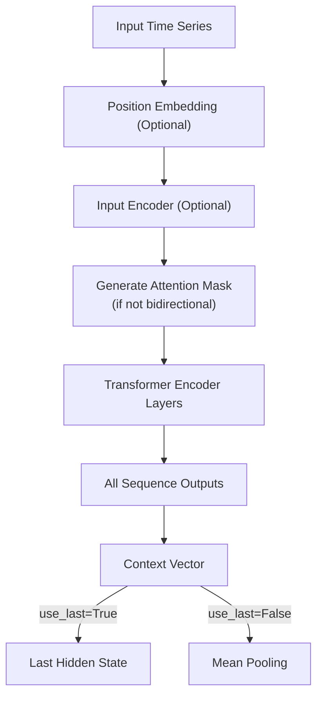
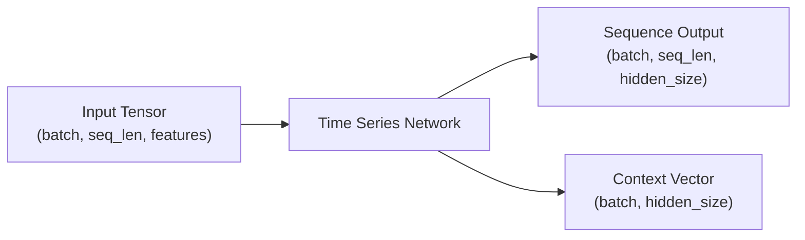

<!-- source: DeepWiki mcp.deepwiki.com · repo microsoft/PhysioPro · extra page Time Series Networks · fetched 2026-10-26 -->

# Time Series Networks

<details>
<summary>Relevant source files</summary>

The following files were used as context for generating this wiki page:

- [physiopro/network/tcn.py](physiopro/network/tcn.py)
- [physiopro/network/tsrnn.py](physiopro/network/tsrnn.py)
- [physiopro/network/tstransformer.py](physiopro/network/tstransformer.py)

</details>


This document details the fundamental time series neural network architectures in PhysioPro. These networks serve as building blocks for processing sequential physiological data and are designed to handle various types of time series inputs. For information about advanced transformer-based architectures, see [ContiFormer](#2.2.2) and [MMM_Encoder](#2.2.1).

## Overview

PhysioPro implements three primary time series network architectures:

1. **TSRNN** - Recurrent Neural Network for time series data
2. **TCN** - Temporal Convolutional Network
3. **TSTransformer** - Transformer-based architecture for time series

All these networks are registered with the `NETWORKS` registry and share common interface patterns, making them interchangeable in model configurations.



Sources: [physiopro/network/tsrnn.py:14-15](), [physiopro/network/tsrnn.py:18-19](), [physiopro/network/tcn.py:51-52](), [physiopro/network/tstransformer.py:32-33]()

## Common Architecture Elements

### Network Registry

All time series networks are registered using the `NETWORKS` registry, which allows them to be instantiated dynamically from configuration files:

```python
@NETWORKS.register_module()
class TSRNN(nn.Module):
    # Implementation
```

### Position Embedding

All three network architectures support positional embeddings through the `PositionEmbedding` module, which can be:
- **Static**: Fixed positional encodings
- **Learnable**: Trainable positional embeddings

### Common Interface

All networks implement a consistent interface with:
- A `forward()` method that returns both sequence outputs and a context vector
- `output_size` and `hidden_size` properties
- Support for loading pretrained weights



Sources: [physiopro/network/tsrnn.py:18-99](), [physiopro/network/tcn.py:51-115](), [physiopro/network/tstransformer.py:32-120]()

## TSRNN Architecture

TSRNN implements a recurrent neural network approach for time series data, supporting multiple RNN cell types.

### Key Features

- Support for different RNN cell types (LSTM, GRU, RNN)
- Optional bidirectional processing
- Optional input encoding layer
- Positional embeddings

### Implementation



The TSRNN network processes input data through these steps:
1. Optional position embedding if `emb_dim > 0`
2. Optional input encoding through a linear layer if `input_size` is provided
3. Processing through the recurrent cell (LSTM, GRU, or RNN)
4. Returning both the full sequence of outputs and the final hidden state

### Configuration Parameters

| Parameter | Description |
|-----------|-------------|
| `cell_type` | Type of RNN cell ("lstm", "gru", "rnn") |
| `emb_dim` | Embedding dimension (0 for no embedding) |
| `emb_type` | "static" or "learn" for position embedding |
| `hidden_size` | Hidden size of the RNN cell |
| `dropout` | Dropout rate |
| `num_layers` | Number of RNN layers |
| `is_bidir` | Whether to use bidirectional RNN |
| `max_length` | Maximum length of input sequence |
| `input_size` | Input size of time series data |
| `weight_file` | Path to pretrained weights |

Sources: [physiopro/network/tsrnn.py:18-99]()

## TCN Architecture (Temporal Convolutional Network)

TCN implements a temporal convolutional network based on dilated causal convolutions, following the architecture described in [Bai et al. (2018)](https://arxiv.org/abs/1803.01271).

### Key Features

- Dilated causal convolutions for capturing long-range dependencies
- Residual connections for better gradient flow
- Increasing receptive field with depth
- No information leakage from future to past

### Implementation



The TCN network processes input data through these steps:
1. Optional position embedding
2. Transpose input from (batch, seq_len, features) to (batch, features, seq_len) for 1D convolutions
3. Process through a sequence of Temporal Blocks with increasing dilation
4. Transpose back to original shape and return both sequence and final output

### TemporalBlock

Each TemporalBlock contains:
- Two dilated convolutional layers with weight normalization
- Chomp1d layers to ensure causal convolutions (no information from future)
- Residual connection with optional dimension matching
- LeakyReLU activations and dropout

### Configuration Parameters

| Parameter | Description |
|-----------|-------------|
| `num_channels` | List of channel numbers for each level |
| `position_embedding` | Whether to use position embedding |
| `emb_type` | Type of position embedding ("learn" or "static") |
| `kernel_size` | Kernel size of convolutional layers |
| `dropout` | Dropout rate |
| `max_length` | Maximum sequence length |
| `input_size` | Input feature dimension |
| `weight_file` | Path to pretrained weights |

### TemporalConvNetLayer

A simplified variant of TCN that uses a fixed channel size across all layers, configured by:
- `num_levels`: Number of temporal blocks
- `channel`: Number of channels in each block
- `dilation`: Base dilation factor (scales by dilation^i for layer i)

Sources: [physiopro/network/tcn.py:15-187]()

## TSTransformer Architecture

TSTransformer implements a transformer-based approach for time series data, utilizing self-attention mechanisms.

### Key Features

- Based on the transformer encoder architecture
- Support for causal attention (via masking) or bidirectional attention
- Multi-head self-attention
- Option to use the last output or average all outputs

### Implementation



The TSTransformer processes input data through these steps:
1. Optional position embedding if `emb_dim > 0`
2. Optional input encoding if `input_size` is provided
3. Generate an attention mask (for causal attention) if not bidirectional
4. Process through transformer encoder layers
5. Output the full sequence and a context vector (either the last state or mean of all states)

### Attention Masking

The TSTransformer uses causal masking by default, ensuring each position can only attend to itself and earlier positions. When `is_bidir=True`, no masking is applied, allowing bidirectional attention.

### Configuration Parameters

| Parameter | Description |
|-----------|-------------|
| `emb_dim` | Embedding dimension (0 for no embedding) |
| `emb_type` | Type of position embedding |
| `hidden_size` | Hidden size of transformer layers |
| `dropout` | Dropout rate |
| `num_layers` | Number of transformer layers |
| `num_heads` | Number of attention heads |
| `is_bidir` | Whether to use bidirectional attention (no masking) |
| `use_last` | Whether to use last output (True) or mean pooling (False) |
| `max_length` | Maximum sequence length |
| `input_size` | Input feature dimension |
| `weight_file` | Path to pretrained weights |

Sources: [physiopro/network/tstransformer.py:32-120]()

## Usage and Configuration

Time series networks in PhysioPro are designed to be configurable through YAML configurations and accessed via the `NETWORKS` registry.

### Example Network Selection in Configuration

```yaml
network:
  type: TSRNN  # or "TCN" or "TSTransformer"
  cell_type: lstm
  emb_dim: 32
  emb_type: learn
  hidden_size: 128
  dropout: 0.2
  num_layers: 2
  is_bidir: false
```

### Forward Pass Data Flow



All time series networks follow a consistent interface, returning both:
1. Full sequence outputs for each time step
2. A context vector summarizing the sequence (last state or mean pooling)

This uniform interface allows these networks to be used interchangeably in higher-level model architectures.

Sources: [physiopro/network/tsrnn.py:85-99](), [physiopro/network/tcn.py:103-107](), [physiopro/network/tstransformer.py:86-112]()

---

