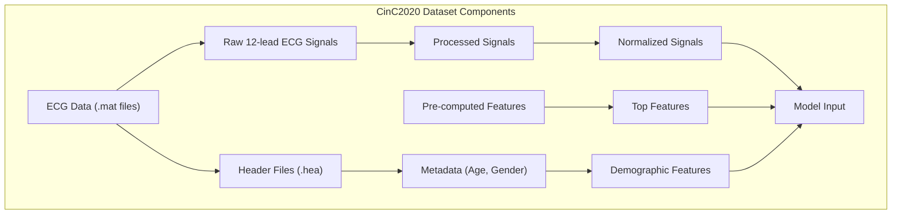
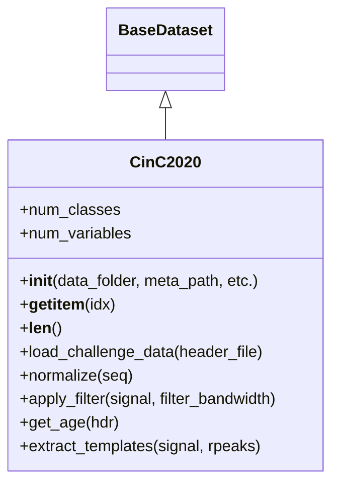
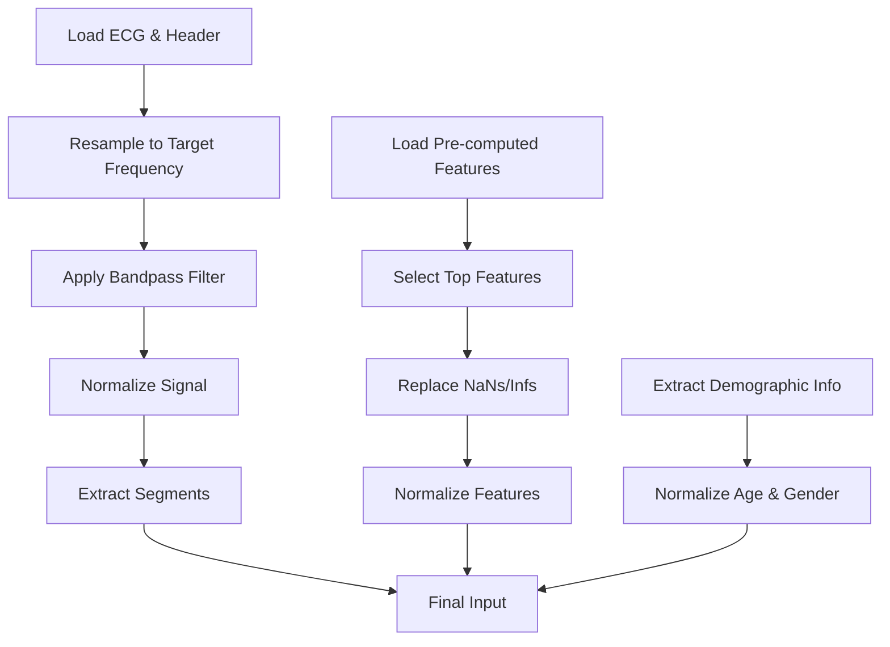
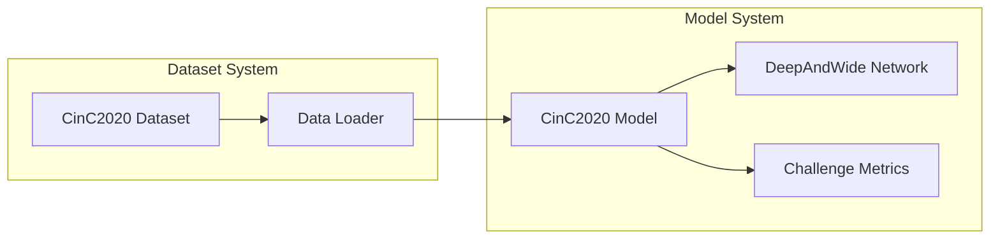

<!-- source: DeepWiki mcp.deepwiki.com · repo microsoft/PhysioPro · extra page CinC2020 Dataset · fetched 2026-10-26 -->

# CinC2020 Dataset

<details>
<summary>Relevant source files</summary>

The following files were used as context for generating this wiki page:

- [docs/cinc2020.md](docs/cinc2020.md)
- [docs/configs/cinc2020.yml](docs/configs/cinc2020.yml)
- [physiopro/dataset/cinc2020.py](physiopro/dataset/cinc2020.py)
- [physiopro/model/cinc2020.py](physiopro/model/cinc2020.py)

</details>


This document provides a comprehensive overview of the CinC2020 dataset implementation in PhysioPro. It covers the dataset structure, preprocessing pipeline, integration with models, and configuration details for working with 12-lead ECG classification data from the PhysioNet/Computing in Cardiology Challenge 2020. For information about using this dataset in training, see [Use Cases and Tutorials](#3).

## Dataset Purpose and Origin

The CinC2020 dataset is an implementation for processing and analyzing data from the PhysioNet/Computing in Cardiology Challenge 2020, which focused on classification of 12-lead ECGs. The implementation is based on the solution from the 1st ranked team "Prna" in the challenge, as described in their paper "A Wide and Deep Transformer Neural Network for 12-Lead ECG Classification".

The dataset provides functionality for loading, preprocessing, and feature extraction from ECG signals, with support for both the raw waveform data and pre-extracted features.

Sources: [physiopro/dataset/cinc2020.py:17-24]()

## Dataset Structure



The CinC2020 dataset consists of:

1. **ECG Signals**: 12-lead ECG recordings stored in .mat files
2. **Header Files**: Metadata stored in .hea files including demographic information
3. **Features**: Pre-computed features derived from the ECG signals
4. **Labels**: 27 different cardiac abnormality classes

Sources: [physiopro/dataset/cinc2020.py:25-40](), [physiopro/dataset/cinc2020.py:81-87]()

## Implementation Details

The dataset is implemented as the `CinC2020` class in PhysioPro, registered in the DATASETS registry for seamless integration with the framework.



The class inherits from `BaseDataset` and provides methods for loading, preprocessing, and accessing the ECG data.

Sources: [physiopro/dataset/cinc2020.py:17-18](), [physiopro/dataset/cinc2020.py:25-88]()

### Key Parameters

The dataset initialization accepts several parameters that control its behavior:

| Parameter | Description |
|-----------|-------------|
| `data_folder` | Path to folder containing ECG data files |
| `meta_path` | Path to CSV file with metadata |
| `featname_path` | Path to file with feature names |
| `feats_path` | Path to folder with pre-computed features |
| `test_fold` | Fold index for test set selection |
| `dataset` | Data split selection ("train", "test", or "valid") |
| `window` | Window size for ECG segments |
| `fs` | Target sampling frequency |
| `nb_windows` | Number of windows to sample per recording |
| `nb_feats` | Number of top features to use |
| `max_seq_len` | Maximum sequence length |

Sources: [physiopro/dataset/cinc2020.py:25-40]()

## Data Processing Pipeline



The dataset performs several preprocessing steps:

1. **Loading**: Reads ECG signals from .mat files and headers from .hea files
2. **Resampling**: Adjusts the sampling rate to the target frequency (default 500Hz)
3. **Filtering**: Applies a bandpass filter (default 3-45Hz)
4. **Normalization**: Normalizes ECG signals to range [-1, 1]
5. **Feature Processing**: Normalizes pre-computed features using means and standard deviations
6. **Demographic Processing**: Normalizes age and encodes gender

Sources: [physiopro/dataset/cinc2020.py:90-132](), [physiopro/dataset/cinc2020.py:137-213]()

### Signal Loading and Resampling

The `load_challenge_data` method handles loading signals and adjusting their sampling rate:

```
1. Load signal from .mat file
2. Read header information
3. If sampling rate > target rate: decimate the signal
4. If sampling rate < target rate: resample the signal
```

Sources: [physiopro/dataset/cinc2020.py:137-150]()

### Signal Filtering and Normalization

```
1. Apply bandpass filter (typically 3-45Hz) using FIR filter
2. Normalize each channel to range [-1, 1]
```

Sources: [physiopro/dataset/cinc2020.py:152-154](), [physiopro/dataset/cinc2020.py:197-204]()

### Feature Processing

```
1. Load pre-computed features for the patient
2. Replace infinities with NaNs
3. Replace NaNs with feature means
4. Normalize features using pre-computed means and standard deviations
```

Sources: [physiopro/dataset/cinc2020.py:96-106]()

## Configuration and Usage

The CinC2020 dataset is configured using YAML files. Here's an example of how it's configured:

```yaml
data:
  type: CinC2020
  data_folder: data/CinC2020/training_data
  meta_path: data/CinC2020/records_stratified_10_folds_v2.csv
  feats_path: data/CinC2020/feats/
  featname_path: data/CinC2020/top_feats.npy
  test_fold: 3
```

This configuration specifies:
- The dataset type
- Paths to data files and folders
- Cross-validation fold settings

Sources: [docs/configs/cinc2020.yml:1-6]()

## Integration with Model

The CinC2020 dataset is designed to work with the `CinC2020` model class, which implements specialized metrics for the challenge.



The model includes custom evaluation metrics specific to the CinC2020 challenge:
1. `cinc2020_metric_valid`: Used during validation to find optimal thresholds
2. `cinc2020_metric_test`: Used during testing with the best threshold
3. `compute_cinc2020_metric_with_preds`: Core implementation of the challenge scoring metric

Sources: [physiopro/model/cinc2020.py:12-148]()

## Data Preparation

To prepare the CinC2020 dataset, the following steps are required:

1. Download the challenge data from PhysioNet
2. Download pre-computed features from the Prna solution
3. Set up the file structure as expected by the dataset class

A complete script for downloading and preparing the data is provided:

Sources: [docs/cinc2020.md:10-27]()

## Example Usage

To use the CinC2020 dataset for training a model:

1. Prepare the dataset as described above
2. Create a configuration file similar to the provided example
3. Run the training script:

```bash
python -m physiopro.entry.train docs/configs/cinc2020.yml
```

Sources: [docs/cinc2020.md:30-33]()

## Related Components

The CinC2020 dataset is typically used with:

1. **DeepAndWide Network**: A transformer-based architecture for ECG classification
2. **CinC2020 Model**: A specialized model class for the challenge metrics
3. **Multi-label Classification**: The challenge involves 27 different cardiac conditions

Sources: [docs/configs/cinc2020.yml:8-18](), [physiopro/model/cinc2020.py:12-13]()

---

