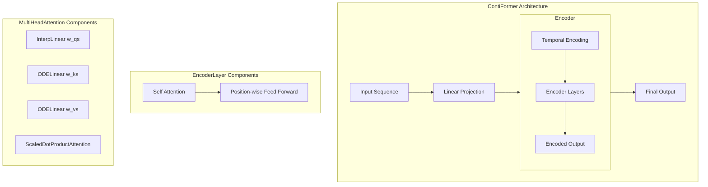
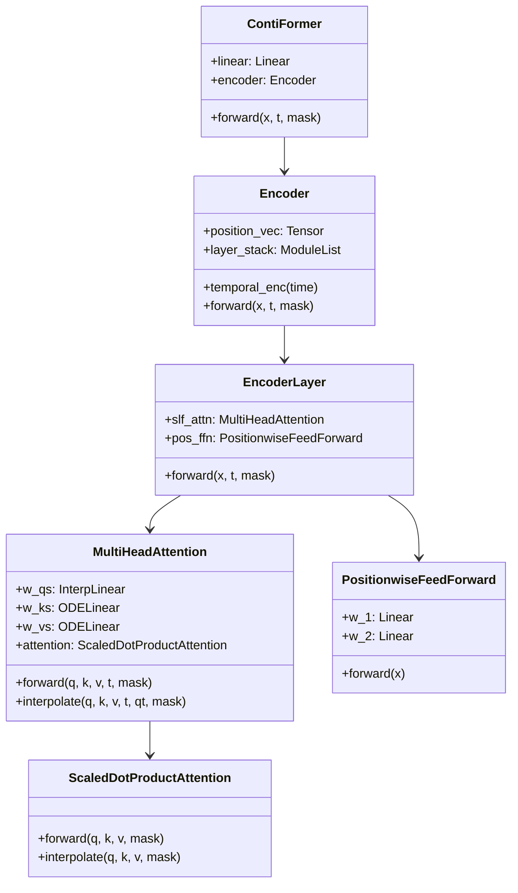
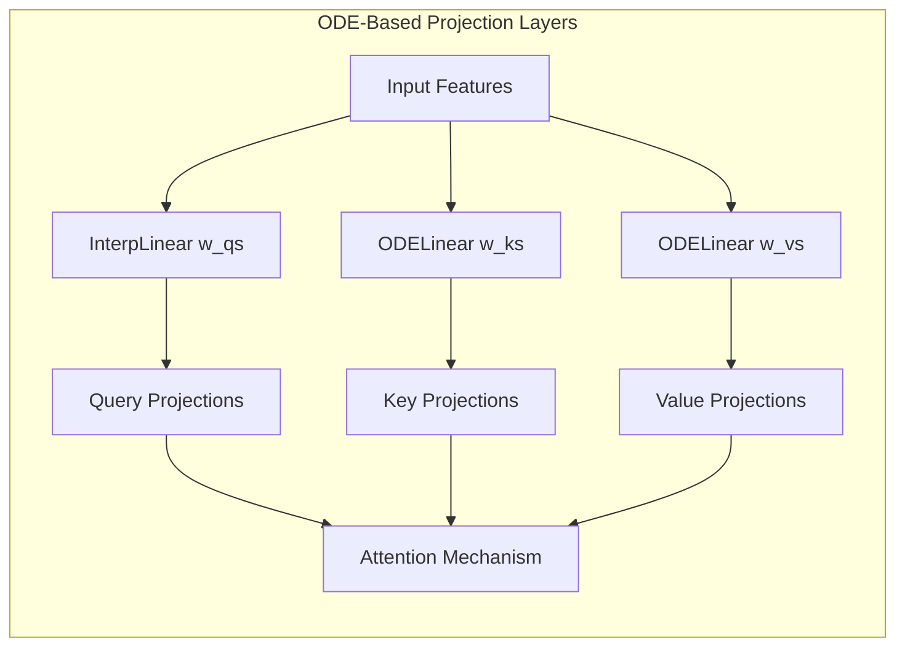
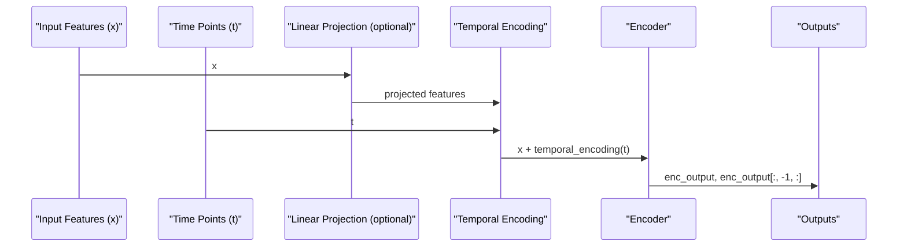
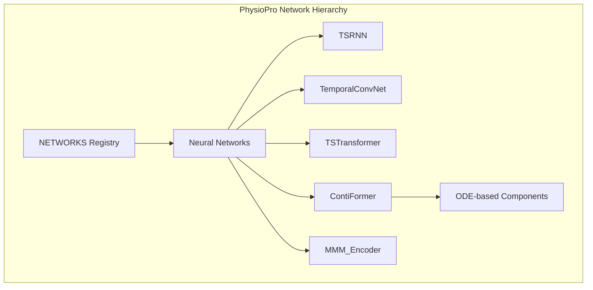

<!-- source: DeepWiki mcp.deepwiki.com · repo microsoft/PhysioPro · extra page ContiFormer · fetched 2026-10-26 -->

# ContiFormer

<details>
<summary>Relevant source files</summary>

The following files were used as context for generating this wiki page:

- [docs/contiformer.md](docs/contiformer.md)
- [physiopro/network/contiformer.py](physiopro/network/contiformer.py)

</details>


## Overview

ContiFormer is a continuous-time transformer architecture within PhysioPro designed specifically for modeling irregular time series data. It extends traditional transformer architectures by incorporating ordinary differential equation (ODE) components to handle irregularly sampled time points and continuous-time representations. For information about other time series networks available in PhysioPro, see [Time Series Networks](#2.2.3).

Sources: [physiopro/network/contiformer.py:243-315](). [docs/contiformer.md:1-4]()

## Architecture

### Architectural Overview



Sources: [physiopro/network/contiformer.py:243-333](), [physiopro/network/contiformer.py:167-200]()

### ContiFormer Components Hierarchy



Sources: [physiopro/network/contiformer.py:20-333]()

## ODE-Based Components

ContiFormer achieves continuous-time modeling through special ODE-based linear layers that are used in its attention mechanism:

1. **InterpLinear** - Used for query projection in the attention mechanism
2. **ODELinear** - Used for key and value projections in the attention mechanism

These components enable ContiFormer to model irregularly sampled time series by incorporating time information directly into the attention mechanism. This approach allows the model to understand temporal relationships between data points regardless of their irregular sampling intervals.



Sources: [physiopro/network/contiformer.py:33-35](), [physiopro/network/contiformer.py:10]()

## Implementation Details

### Class Structure

The ContiFormer architecture is implemented as a PyTorch module registered in the NETWORKS registry, allowing it to be easily instantiated through configuration files. The main class is [`ContiFormer`](physiopro/network/contiformer.py:243-333), which contains an encoder and an optional linear projection layer.

Key components include:

| Component | Purpose |
|-----------|---------|
| Encoder | Processes input sequences through multiple encoder layers with self-attention |
| EncoderLayer | Combines self-attention and feed-forward networks |
| MultiHeadAttention | Implements multi-head attention with ODE-based projection |
| ScaledDotProductAttention | Performs scaled dot-product attention calculations |
| PositionwiseFeedForward | Implements position-wise feed-forward networks |

Sources: [physiopro/network/contiformer.py:20-333]()

### Key Parameters

ContiFormer has numerous configurable parameters that control its architecture and behavior:

| Parameter | Description | Default |
|-----------|-------------|---------|
| input_size | Dimension of input features | None |
| d_model | Dimension of model | 256 |
| d_inner | Dimension of inner feed-forward layer | 1024 |
| n_layers | Number of encoder layers | 4 |
| n_head | Number of attention heads | 4 |
| d_k | Dimension of key | 64 |
| d_v | Dimension of value | 64 |
| dropout | Dropout rate | 0.1 |
| actfn_ode | Activation function for ODE | "softplus" |
| method_ode | ODE solver method | "rk4" |
| add_pe | Whether to add positional encoding | False |
| max_length | Maximum sequence length | 100 |

Sources: [physiopro/network/contiformer.py:247-312]()

### ODE Configuration Options

The ODE-based components in ContiFormer offer several configuration options to control their behavior:

```python
args_ode = {
    "actfn": actfn_ode,            # Activation function for ODE
    "layer_type": layer_type_ode,  # Layer type for ODE
    "zero_init": zero_init_ode,    # Whether to initialize ODE weights as zero
    "atol": atol_ode,              # Absolute tolerance for ODE solver
    "rtol": rtol_ode,              # Relative tolerance for ODE solver
    "method": method_ode,          # ODE solver method (e.g., "rk4")
    "regularize": regularize,      # Whether to apply regularization
    "approximate_method": approximate_method,  # Approximation method
    "nlinspace": nlinspace,        # Number of points in linear space
    "linear_type": linear_type_ode,  # Linear type for ODE
    "interpolate": interpolate_ode,  # Interpolation method
    "itol": itol_ode,              # Interpolation tolerance
}
```

Sources: [physiopro/network/contiformer.py:275-289]()

## Forward Pass

During the forward pass, ContiFormer processes input sequences along with their corresponding time points:

1. If time points are not provided, regular time points are generated (`t = torch.linspace(0, 1, x.shape[1])`)
2. Input features are optionally projected through a linear layer
3. The encoder processes the inputs with temporal encoding
4. The output includes both the full sequence representation and the final hidden state



Sources: [physiopro/network/contiformer.py:315-324]()

## Use Cases

ContiFormer excels in several time series analysis tasks:

### 1. Irregular Time Series Classification

ContiFormer's ability to handle irregularly sampled data makes it well-suited for classification tasks where observations are not uniformly spaced. This is achieved by passing explicit time stamps for each observation to the model.

Example configuration:
```bash
python -m physiopro.entry.train docs/configs/contiformer_mask_classification.yml --data.mask_ratio 0.3 --data.name Heartbeat
```

### 2. Regular Time Series Classification

For regularly sampled time series, ContiFormer can use evenly spaced time points or automatically generate them:

```bash
python -m physiopro.entry.train docs/configs/contiformer_classification.yml --data.name Heartbeat
```

### 3. Temporal Point Process Modeling

ContiFormer can model temporal point processes, which describe sequences of events occurring over time:

```bash
python -m physiopro.entry.train docs/configs/contiformer_tpp.yml
```

Sources: [docs/contiformer.md:5-63]()

## Integration with PhysioPro

ContiFormer is registered with the NETWORKS registry in PhysioPro using the `@NETWORKS.register_module("contiformer")` decorator, allowing it to be easily instantiated through configuration files.



In the PhysioPro framework, ContiFormer can be used with various datasets and models, particularly those dealing with irregularly sampled time series or event data. It integrates with:

1. **Dataset System** - Works with both regular and masked time series datasets
2. **Model System** - Can be used within various models for time series classification and event prediction
3. **Configuration System** - Instantiated and configured via YAML configuration files

Sources: [physiopro/network/contiformer.py:9](), [physiopro/network/contiformer.py:243-244]()

---

