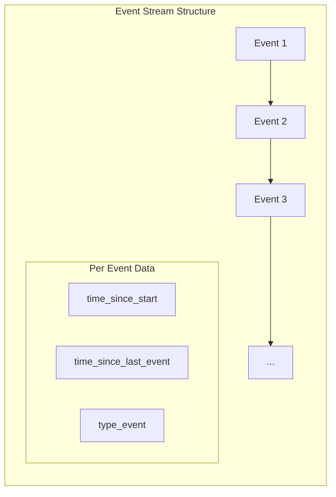
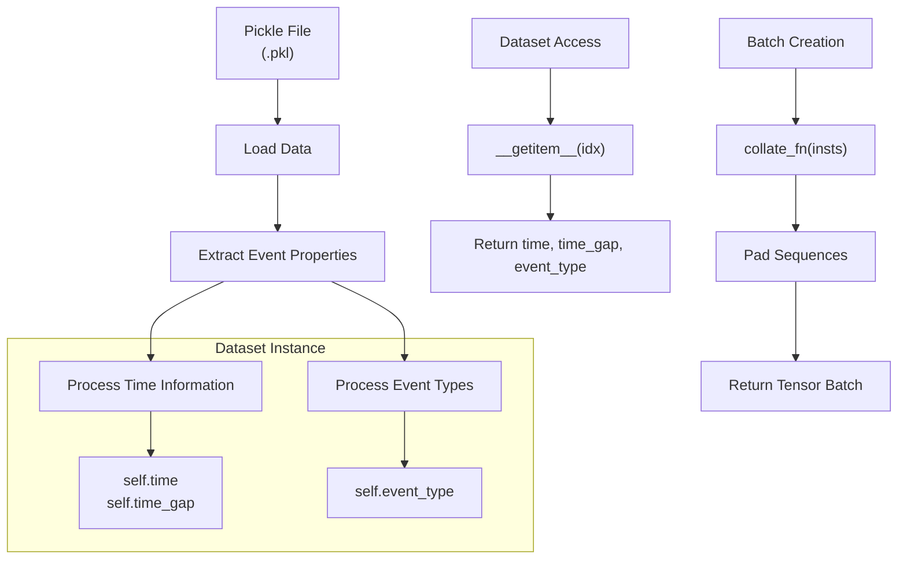
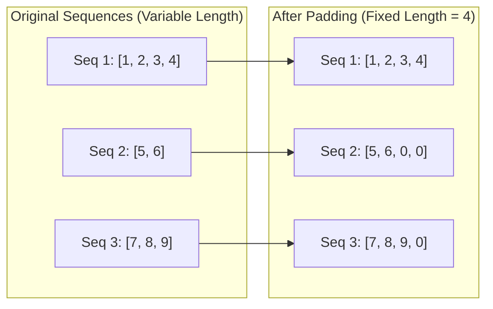
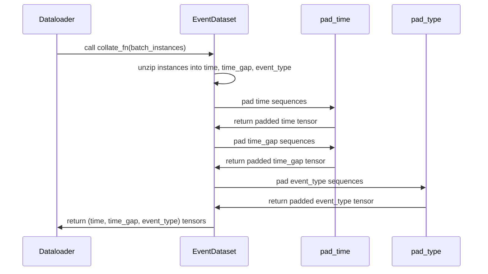
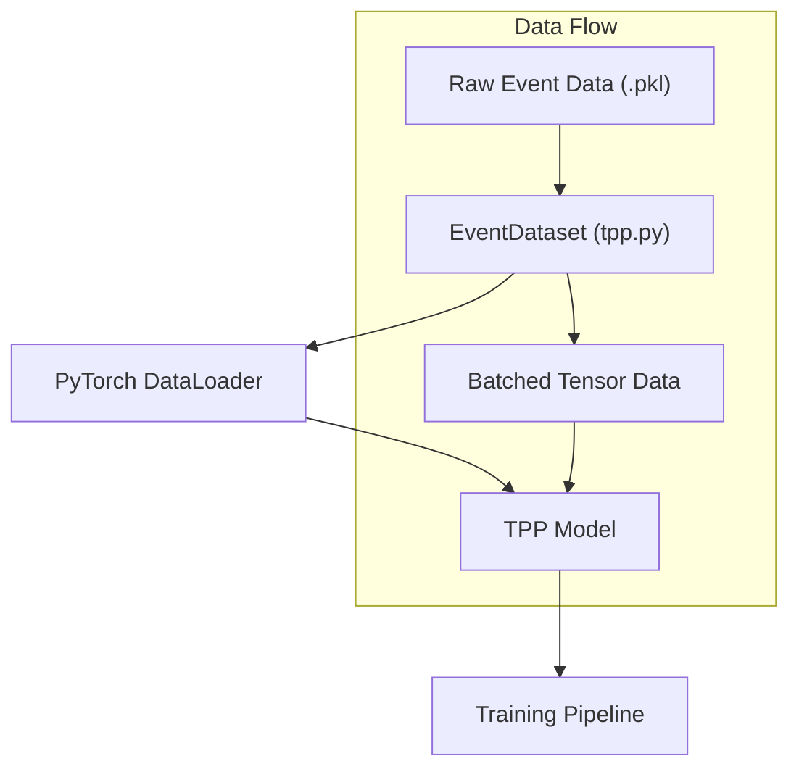

<!-- source: DeepWiki mcp.deepwiki.com · repo microsoft/PhysioPro · extra page EventDataset for Temporal Point Processes · fetched 2026-10-26 -->

# EventDataset for Temporal Point Processes

Relevant source files

The following files were used as context for generating this wiki page:

- [physiopro/dataset/tpp.py](physiopro/dataset/tpp.py)

## Purpose and Scope

The `EventDataset` class provides functionality for loading, processing, and batching temporal point process (TPP) data within the PhysioPro framework. This dataset class is specifically designed to handle event sequences where each event has an associated timestamp and type, making it ideal for modeling event occurrence patterns over time.

For information about other dataset types available in PhysioPro, see the main [Dataset System](#2.1) documentation.

Sources: [physiopro/dataset/tpp.py:14-15]()

## Overview of Temporal Point Process Data

Temporal point processes model discrete events occurring in continuous time. In the `EventDataset` implementation, each data instance is represented as a sequence of events with the following properties:

- Absolute time since the start of the sequence
- Time gap since the previous event
- Event type (category)

Sources: [physiopro/dataset/tpp.py:43-46]()

## Class Architecture

The `EventDataset` class inherits from the `BaseDataset` class and is registered in the DATASETS registry module under the identifier "tpp".

```mermaid
classDiagram
    BaseDataset <|-- EventDataset
    
    class BaseDataset {
        +preprocessor
        +__init__(preprocessor)
    }
    
    class EventDataset {
        +PAD: int = 0
        +time: list
        +time_gap: list
        +event_type: list
        +num_types: int
        +max_len: int
        +length: int
        
        +__init__(prefix, name, fold, dataset, preprocessor, max_len, clip_max)
        +__len__()
        +__getitem__(idx)
        +collate_fn(insts)
        +pad_time(insts)
        +pad_type(insts)
        
        +num_classes: property
        +max_seq_len: property
        +num_variables: property
    }
```

Sources: [physiopro/dataset/tpp.py:14-15](), [physiopro/dataset/tpp.py:19-28]()

## Data Loading and Processing

The `EventDataset` loads event sequence data from pickle files with a specific structure and processes them for use in training temporal point process models.

Sources: [physiopro/dataset/tpp.py:35-55](), [physiopro/dataset/tpp.py:72-74](), [physiopro/dataset/tpp.py:96-102]()

## Constructor Parameters

The `EventDataset` constructor accepts several parameters to configure the dataset:

| Parameter | Type | Default | Description |
|-----------|------|---------|-------------|
| `prefix` | str | "data/temporal_point_process" | Base directory path |
| `name` | str | "Neonate" | Dataset name |
| `fold` | str | "folder1" | Dataset fold |
| `dataset` | str | "train" | Dataset split (must be 'train' or 'test') |
| `preprocessor` | Preprocessor | None | Optional data preprocessor |
| `max_len` | int | 500 | Maximum sequence length |
| `clip_max` | int | -1 | Maximum time gap value (-1 means no clipping) |

Sources: [physiopro/dataset/tpp.py:19-28]()

## Data Structure Details

The `EventDataset` loads and processes event data with the following structure:

1. **Time Information**:
   - `time`: List of absolute timestamps since the start of the sequence
   - `time_gap`: List of time gaps between consecutive events

2. **Event Type Information**:
   - `event_type`: List of event type identifiers (incremented by 1 since 0 is reserved for padding)

3. **Data Organization**:
   - Each instance is a list of events
   - Each event has associated time and type information
   - Sequences with only one event are filtered out

Sources: [physiopro/dataset/tpp.py:47-54]()

## Special Handling Features

### Padding Mechanism

For batch processing, sequences need to be padded to equal length. The `EventDataset` uses two static methods for padding:

- `pad_time`: Pads time-related sequences with zeros
- `pad_type`: Pads event type sequences with zeros (the `PAD` constant)

Sources: [physiopro/dataset/tpp.py:76-94]()

### Time Clipping

The dataset can optionally clip time gaps to a maximum value to prevent extremely large gaps from skewing the model:

- If `clip_max` is set to a positive value, all time gaps larger than this value are clipped
- If `clip_max` is -1 (default), no clipping is performed

Sources: [physiopro/dataset/tpp.py:48-52]()

## Batch Creation Process

The `collate_fn` method handles the creation of batches from multiple event sequences:

1. Unzip the time, time_gap, and event_type from individual instances
2. Pad each sequence type to the maximum length in the batch
3. Convert the padded sequences to PyTorch tensors
4. Return a tuple of (time, time_gap, event_type) tensors

Sources: [physiopro/dataset/tpp.py:96-102]()

## Integration with PhysioPro

The `EventDataset` class serves as the foundation for training temporal point process models in PhysioPro. It integrates with other components as follows:

For a complete tutorial on event prediction using `EventDataset`, see the [Temporal Point Process Modeling](#3.3) guide.

Sources: [physiopro/dataset/tpp.py:14-15]()

## Properties and Accessors

The `EventDataset` class provides several properties for accessing dataset information:

- `num_classes`: Returns the number of event types (equal to `num_types`)
- `max_seq_len`: Returns the maximum allowed sequence length
- `num_variables`: Returns None (not applicable for event data)

The `__getitem__` method returns a tuple of (time, time_gap, event_type) for a specific event sequence.

Sources: [physiopro/dataset/tpp.py:57-74]()

## Usage Example

The `EventDataset` is typically instantiated through the configuration system and used with a PyTorch DataLoader. The collate_fn method ensures proper batching of variable-length event sequences.

When accessing data from the dataset:
1. Each call to `__getitem__` returns a tuple of (time, time_gap, event_type) for an event sequence
2. The `collate_fn` method automatically handles padding and tensor conversion when used with a DataLoader

Sources: [physiopro/dataset/tpp.py:96-102]()

---

