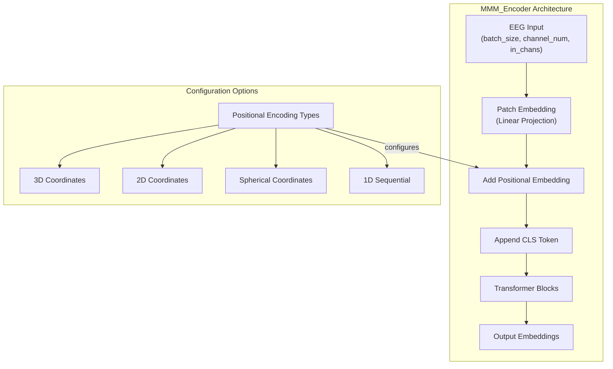
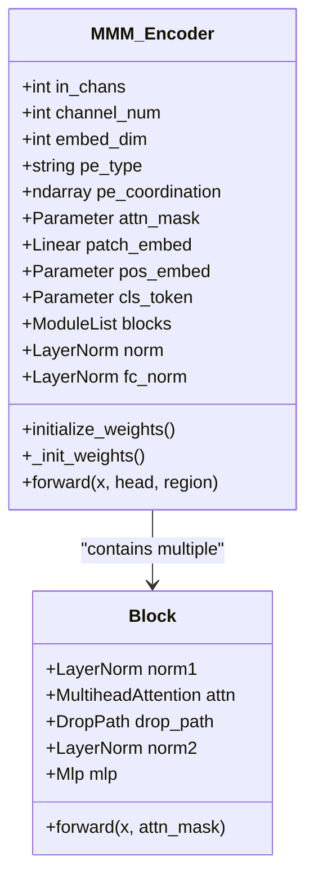
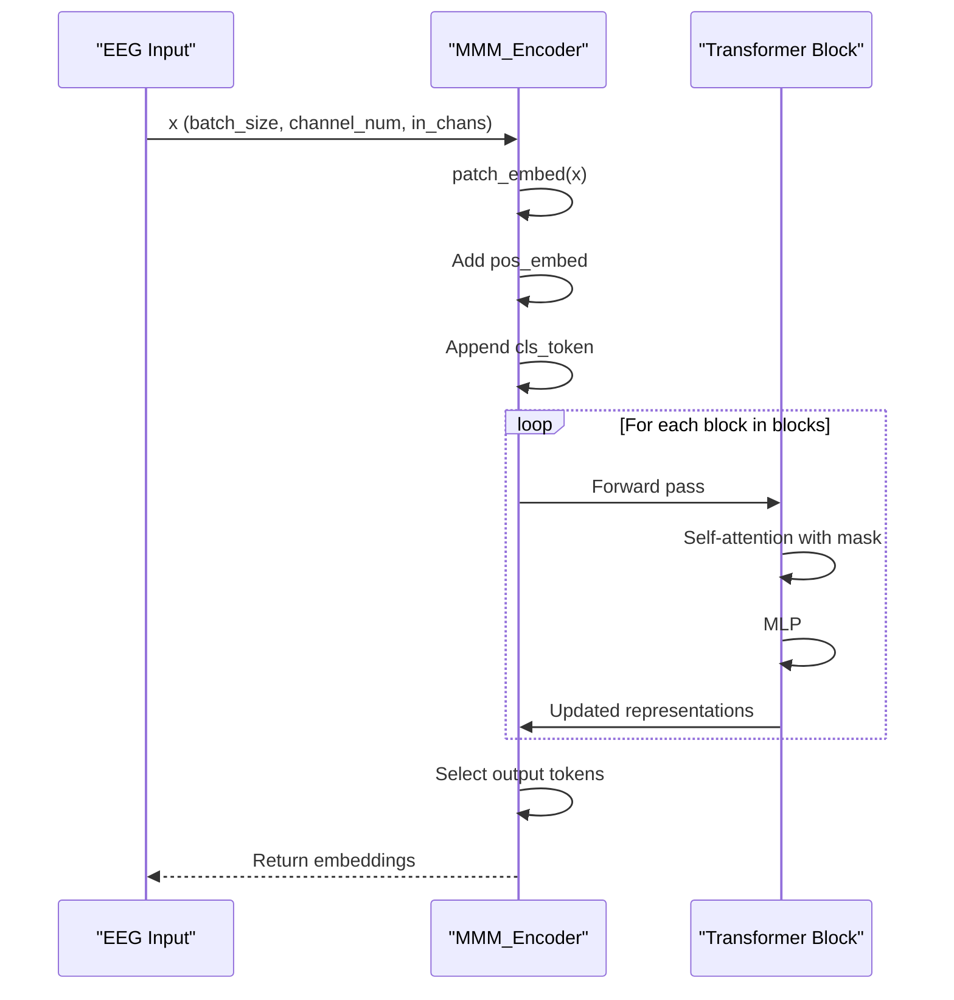
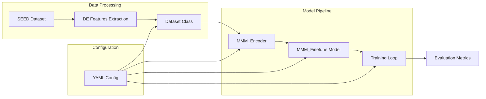
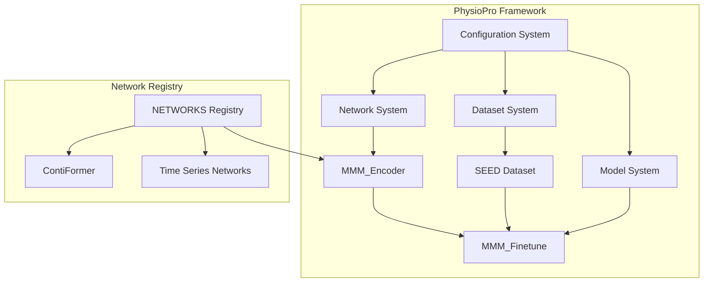

<!-- source: DeepWiki mcp.deepwiki.com · repo microsoft/PhysioPro · extra page MMM_Encoder · fetched 2026-10-26 -->

# MMM_Encoder

<details>
<summary>Relevant source files</summary>

The following files were used as context for generating this wiki page:

- [docs/MMM.md](docs/MMM.md)
- [physiopro/network/mmm_encoder.py](physiopro/network/mmm_encoder.py)
- [physiopro/network/utils.py](physiopro/network/utils.py)
- [scripts/SEED_DE.py](scripts/SEED_DE.py)

</details>


## Overview

The MMM_Encoder is a neural network architecture designed for processing electroencephalogram (EEG) data in PhysioPro. It implements a transformer-based encoder from the paper "Learning Topology-Agnostic EEG Representations with Geometry-Aware Modeling." The encoder specializes in understanding the spatial relationships between EEG channels through various positional encoding schemes, which makes it particularly effective for tasks like emotion recognition from EEG signals.

For information about other network architectures in PhysioPro, see [Network Architectures](#2.2). For specific details about using MMM_Encoder for emotion recognition tasks, see [Emotion Recognition with MMM](#3.1).

Sources: [physiopro/network/mmm_encoder.py:11-96](). [docs/MMM.md:1-37]().

## Architecture Overview

The MMM_Encoder follows a transformer-based architecture with specialized adaptations for EEG data. It processes multi-channel EEG data through a series of transformer blocks while incorporating geometry-aware positional encodings.



Sources: [physiopro/network/mmm_encoder.py:11-96]().

## Implementation Details

The MMM_Encoder is implemented as a PyTorch module registered in the PhysioPro framework's `NETWORKS` registry, allowing it to be easily configured and instantiated through YAML configuration.



### Key Components

1. **Patch Embedding**: A linear projection layer that maps the input channels to the encoder's embedding dimension.
   ```python
   self.patch_embed = nn.Linear(in_chans, encoder_dim, bias=True)
   ```

2. **Positional Embedding**: Learnable positional embeddings initialized with sinusoidal patterns based on the provided spatial/positional information.
   ```python
   self.pos_embed = nn.Parameter(torch.zeros(self.channel_num + 1, encoder_dim), requires_grad=True)
   ```

3. **Class Token**: Similar to Vision Transformers, a learnable token is appended to the sequence for classification tasks.
   ```python
   self.cls_token = nn.parameter.Parameter(torch.zeros(1,1,encoder_dim))
   ```

4. **Transformer Blocks**: A sequence of transformer blocks that process the embedded sequence.
   ```python
   self.blocks = nn.ModuleList(
      Block(encoder_dim,num_heads,mlp_ratio=mlp_ratio,qkv_bias=True,
          norm_layer=norm_layer) for _ in range(depth))
   ```

Sources: [physiopro/network/mmm_encoder.py:12-96](). [physiopro/network/utils.py:277-298]().

## Initialization and Forward Pass

The MMM_Encoder follows a specific initialization process:

1. **Weight Initialization**: 
   - Positional embeddings are initialized based on the specified encoding type
   - Patch embedding weights are initialized using Xavier uniform initialization
   - Other linear layers and layer norms are initialized with standard approaches

2. **Forward Pass**:
   - Input data is projected through the patch_embed layer
   - Positional embeddings are added
   - The class token is appended to the sequence
   - The sequence is processed through transformer blocks
   - The output can be either the full sequence or just the class token (and region tokens if specified)



Sources: [physiopro/network/mmm_encoder.py:51-84](). [physiopro/network/mmm_encoder.py:85-96]().

## Positional Encodings

A key feature of MMM_Encoder is its support for different types of positional encodings, which allow it to incorporate spatial information about EEG electrodes:

| Encoding Type | Description | Use Case |
|---------------|-------------|----------|
| 3D | Uses 3D coordinates (x,y,z) | For EEG data with precise 3D electrode positions |
| 2D | Uses 2D coordinates (x,y) | For topographic EEG representations |
| Spherical | Uses spherical coordinates (theta, phi) | For head-based spherical representations |
| 1D | Uses sequential positions | For when spatial information is unavailable |

The positional encoding is selected through the `pe_type` parameter and initialized using the provided `pe_coordination` coordinates.

Sources: [physiopro/network/mmm_encoder.py:52-66](). [physiopro/network/utils.py:6-126]().

## Usage in PhysioPro

The MMM_Encoder is designed to be used for EEG processing tasks, particularly emotion recognition with the SEED dataset. The following diagram illustrates its position in the PhysioPro framework and typical usage flow:



### Parameters and Configuration

When configuring the MMM_Encoder in a YAML configuration file, the following parameters can be specified:

| Parameter | Description | Default |
|-----------|-------------|---------|
| in_chans | Number of input features per channel | 5 |
| channel_num | Number of EEG channels | 79 |
| encoder_dim | Embedding dimension | 16 |
| depth | Number of transformer blocks | 6 |
| num_heads | Number of attention heads | 8 |
| mlp_ratio | Ratio for MLP hidden dimension | 4.0 |
| pe_type | Type of positional encoding | None |
| pe_coordination | Coordinates for positional encoding | None |

Sources: [docs/MMM.md:1-37](). [physiopro/network/mmm_encoder.py:12-34]().

## Example: Emotion Recognition with SEED Dataset

The MMM_Encoder is particularly useful for emotion recognition tasks using the SEED dataset. The workflow involves:

1. Preparing the SEED dataset by extracting DE (Differential Entropy) features
2. Configuring the MMM_Encoder with appropriate parameters
3. Using the MMM_Finetune model for training on emotion recognition tasks

This workflow is supported through:
- A script for converting SEED data to the required format
- Pre-configured YAML files for emotion recognition tasks
- Support for loading pre-trained checkpoints

Sources: [scripts/SEED_DE.py:7-37](). [docs/MMM.md:7-32]().

## Integration with PhysioPro

Within the PhysioPro framework, MMM_Encoder is part of the advanced network architectures, alongside ContiFormer. It integrates with other components:



The MMM_Encoder is registered in the NETWORKS registry through the `@NETWORKS.register_module()` decorator, making it available for use in configuration files. This allows flexible integration with different datasets and training pipelines within PhysioPro.

Sources: [physiopro/network/mmm_encoder.py:11](). [docs/MMM.md:1-37]().

---

