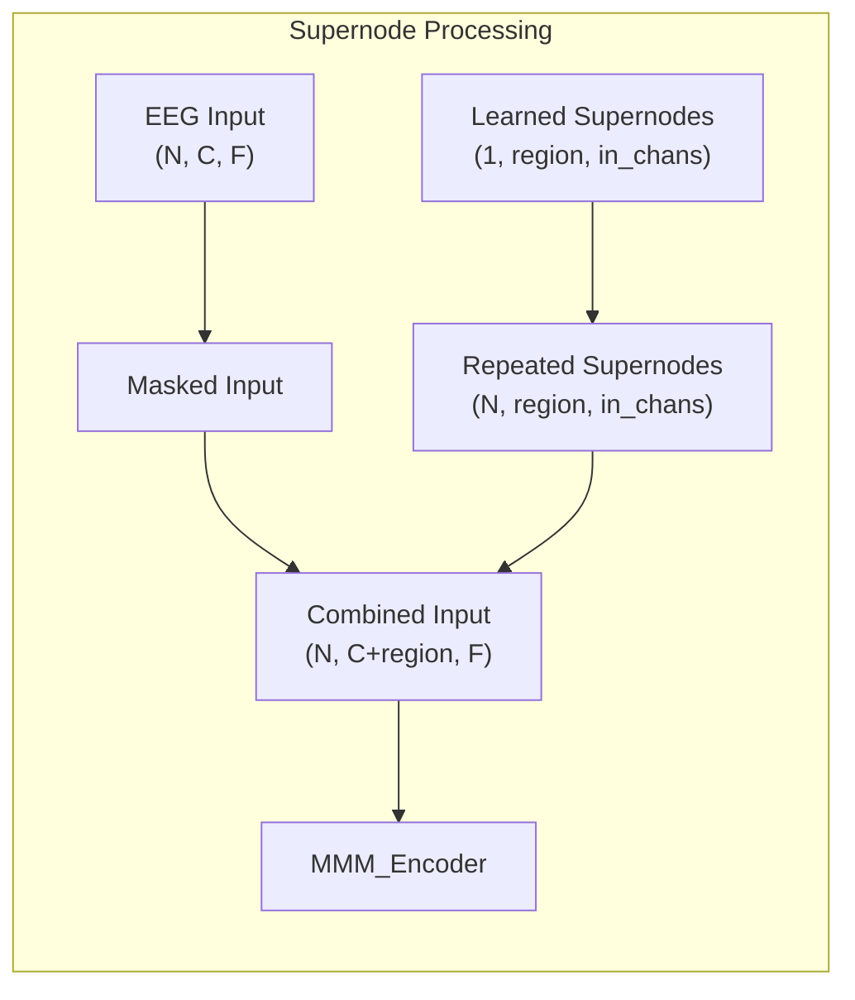
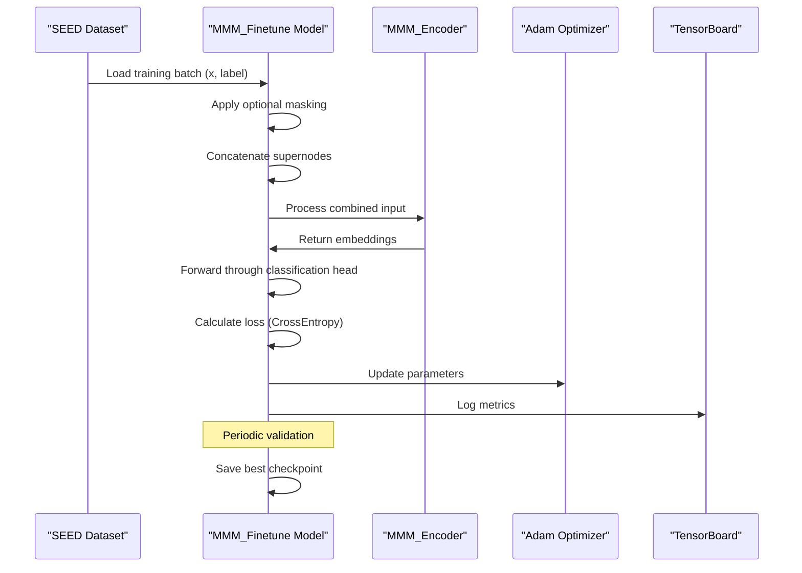
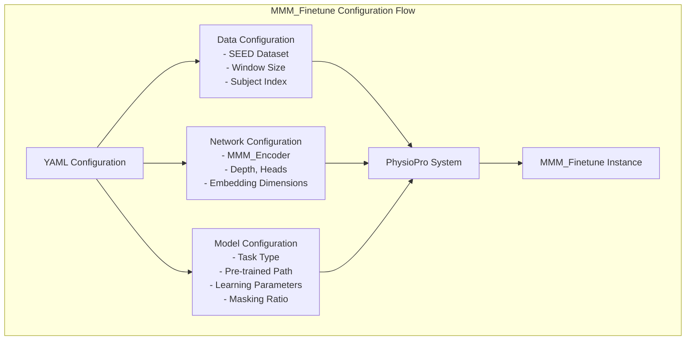
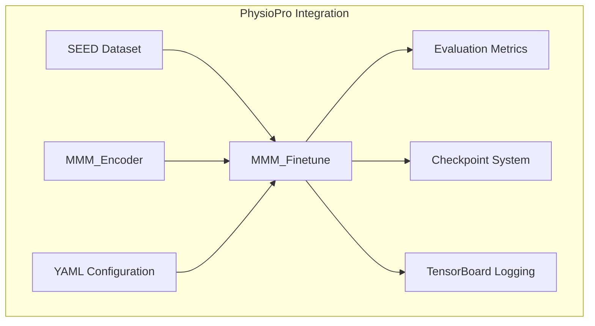

<!-- source: DeepWiki mcp.deepwiki.com · repo microsoft/PhysioPro · extra page MMM_Finetune · fetched 2026-10-26 -->

# MMM_Finetune

Relevant source files

The following files were used as context for generating this wiki page:

- [docs/configs/mmm_emotion.yml](docs/configs/mmm_emotion.yml)
- [physiopro/model/mmm.py](physiopro/model/mmm.py)

## Purpose and Overview

The MMM_Finetune model is a specialized fine-tuning model for EEG-based emotion recognition tasks in PhysioPro. It builds upon the MMM_Encoder architecture (for details on the encoder itself, see [MMM_Encoder](#2.2.1)) and enables fine-tuning of pre-trained EEG representations for downstream classification tasks like emotion recognition. This page documents the architecture, implementation, and usage of the MMM_Finetune model.

Sources: [physiopro/model/mmm.py:18-19]()

## Architecture

The MMM_Finetune model extends the BaseModel class ([BaseModel](#2.3.1)) and implements a fine-tuning approach for the MMM_Encoder. The architecture incorporates several key components:

1. **Base MMM_Encoder**: The pre-trained encoder that processes EEG signals
2. **Supernodes**: Learnable parameters that enable regional processing of EEG data
3. **Masking Mechanism**: Optional random or block-based masking during training
4. **Classification Head**: Output layers for classification tasks

```mermaid
flowchart TD
    subgraph "MMM_Finetune Architecture"
        input["Input EEG Data (N, C, F)"] --> mask["Optional Masking Layer"]
        mask --> concat["Concatenate with Supernodes"]
        concat --> encoder["MMM_Encoder"]
        encoder --> reshape["Reshape Output"]
        reshape --> norm1["BatchNorm1d"]
        norm1 --> fc1["FC Layer (to 64 units)"]
        fc1 --> act1["Activation"]
        act1 --> norm2["BatchNorm2d"]
        norm2 --> fc2["FC Layer (to out_size)"]
        fc2 --> out["Output (class probabilities)"]
    end
```

Sources: [physiopro/model/mmm.py:67-99](), [physiopro/model/mmm.py:151-186]()

### Supernodes

A key architectural feature is the use of supernodes - learned parameters that represent functional areas of the brain. These are concatenated with the input data before being fed to the encoder, enabling the model to better handle the spatial relationships in EEG data across different brain regions.

Sources: [physiopro/model/mmm.py:85-87](), [physiopro/model/mmm.py:176-178]()

## Initialization and Configuration

The MMM_Finetune class is registered with the MODELS registry and can be instantiated through PhysioPro's configuration system. Here's how the model components are initialized:

### Core Parameters

| Parameter | Description |
|-----------|-------------|
| task | Classification task type ("classification" or "multiclassification") |
| out_size | Number of output classes (default: 3 for emotion recognition) |
| region | Number of functional brain regions (default: 17) |
| mask_ratio | Ratio of input to mask during training (default: 0.0) |
| aggregate | Method to aggregate sequence outputs (default: "mean") |
| model_path | Path to pre-trained model for transfer learning (optional) |

Sources: [physiopro/model/mmm.py:20-47]()

### Network Building

The `_build_network` method initializes:
1. The base network (MMM_Encoder)
2. Supernode parameters
3. Output classification layers with appropriate activation functions based on the task

Sources: [physiopro/model/mmm.py:67-99]()

## Training and Inference

### Forward Pass

The forward method implements:
1. Optional masking (random or block-based)
2. Supernode concatenation
3. Encoder processing
4. Classification head

The model supports two masking strategies:
- Random masking: Randomly masks individual EEG channels
- Block masking: Masks entire functional areas of the brain

Sources: [physiopro/model/mmm.py:151-186](), [physiopro/model/mmm.py:418-439]()

### Training Pipeline

Sources: [physiopro/model/mmm.py:199-318]()

### Evaluation and Checkpointing

The model implements:
- Comprehensive evaluation metrics (accuracy, loss)
- Checkpoint saving and resumption
- Early stopping based on validation performance
- TensorBoard logging

Sources: [physiopro/model/mmm.py:320-361](), [physiopro/model/mmm.py:363-416]()

## Usage and Configuration

The MMM_Finetune model is typically configured using a YAML file. Below is an overview of a typical configuration:

Sources: [docs/configs/mmm_emotion.yml:1-47]()

### Sample Configuration

A typical configuration for emotion recognition includes:

1. **Dataset Configuration**:
   - Type: SEED (EEG emotion dataset)
   - Window size and subject index parameters

2. **Network Configuration**:
   - MMM_Encoder with specific depth, heads, and dimensions
   - Positional encoding type

3. **Model Configuration**:
   - Task: multiclassification (for 3-class emotion recognition)
   - Learning parameters (optimizer, learning rate, weight decay)
   - Early stopping criteria

Sources: [docs/configs/mmm_emotion.yml:1-47]()

## Integration with PhysioPro

The MMM_Finetune model integrates with other PhysioPro components as follows:

Sources: [physiopro/model/mmm.py:18-19](), [docs/configs/mmm_emotion.yml:25-42]()

## Practical Considerations

- **Transfer Learning**: The model allows loading pre-trained weights via the `model_path` parameter
- **Masking Strategies**: The `mask_ratio` and masking type can be used for data augmentation and robustness
- **Early Stopping**: Prevents overfitting through patience-based monitoring of validation metrics
- **Checkpointing**: Automatically saves and can resume from the best model state

For a complete example of using MMM_Finetune for emotion recognition, see [Emotion Recognition with MMM](#3.1).

Sources: [physiopro/model/mmm.py:188-197](), [docs/configs/mmm_emotion.yml:25-42]()

---

