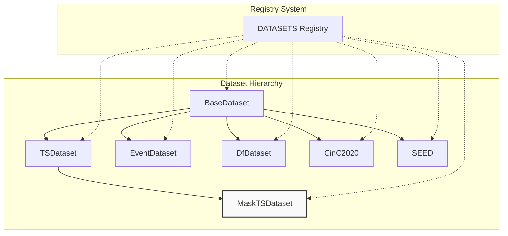
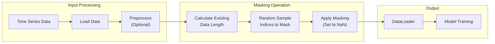

<!-- source: DeepWiki mcp.deepwiki.com · repo microsoft/PhysioPro · extra page Masked Time Series Dataset · fetched 2026-10-26 -->

# Masked Time Series Dataset

<details>
<summary>Relevant source files</summary>

The following files were used as context for generating this wiki page:

- [physiopro/dataset/maskts.py](physiopro/dataset/maskts.py)

</details>


## Purpose and Scope

The `MaskTSDataset` class is a specialized dataset component in PhysioPro designed for handling time series data with masked (missing) values. This dataset is particularly useful for:

1. Training models that can handle missing data in time series
2. Data augmentation through artificial masking
3. Implementing masked prediction tasks in self-supervised learning scenarios

For general time series processing without masking, see [Time Series Dataset System](#2.1).

Sources: [physiopro/dataset/maskts.py:14-21]()

## Position in the Dataset Hierarchy

`MaskTSDataset` extends the base time series dataset capabilities with masking functionality.



The `MaskTSDataset` is registered in the DATASETS registry with the identifier "mask_ts", allowing it to be instantiated through the configuration system.

Sources: [physiopro/dataset/maskts.py:15]()

## Architecture and Processing Flow

The following diagram illustrates how `MaskTSDataset` processes time series data:



The masking process in `MaskTSDataset` applies after standard preprocessing and involves:
1. Determining the available data points in each time series
2. Randomly selecting a subset of these points (based on `mask_ratio`)
3. Setting the selected points to NaN values

Sources: [physiopro/dataset/maskts.py:36-41]()

## Configuration Parameters

The `MaskTSDataset` accepts the following parameters:

| Parameter | Type | Default | Description |
|-----------|------|---------|-------------|
| `prefix` | str | "data/Multivariate_ts" | Base directory for dataset files |
| `name` | str | "Heartbeat" | Name of the dataset |
| `max_seq_len` | int | 0 | Maximum sequence length (0 = no limit) |
| `dataset` | str | "train" | Dataset split to use (train/val/test) |
| `dataset_split_ratio` | float | 0.0 | Custom split ratio if needed |
| `task` | str | "classification" | Task type (classification/regression) |
| `preprocessor` | Optional[Preprocessor] | None | Optional preprocessing module |
| `mask_ratio` | float | 0.3 | Proportion of data points to mask |

The unique parameter for `MaskTSDataset` is `mask_ratio`, which defines the fraction of time points to mask in each sequence.

Sources: [physiopro/dataset/maskts.py:21-31]()

## Masking Implementation Details

The masking procedure is implemented in the initialization method and happens after the base class initialization:

1. For each time series in the dataset, the code:
   - Calculates the actual length of available data (excluding already-null values)
   - Randomly selects indices to mask based on the `mask_ratio`
   - Sets the selected indices to `np.nan` in the feature dataframe

The implementation ensures that only valid data points are considered for masking, preventing masking of already-null values.

```
For each sample i:
  1. Calculate valid length = max_seq_len - count of existing NaN values
  2. Randomly select (valid_length * mask_ratio) indices from valid positions
  3. Set selected indices to NaN in the feature dataframe
```

Sources: [physiopro/dataset/maskts.py:36-41]()

## Usage in Model Training

When used with models designed to handle masked data, `MaskTSDataset` enables several training approaches:

1. **Missing Data Handling**: Training models to perform well despite missing values
2. **Data Imputation**: Training models to predict the missing values
3. **Self-Supervised Learning**: Using the masked values as training targets

This dataset particularly complements the `MaskTS` model in PhysioPro's model system (see [Time Series Models](#2.3.3)).

Sources: [physiopro/dataset/maskts.py:15-41]()

## Configuration Example

To use `MaskTSDataset` in a PhysioPro configuration file:

```yaml
dataset:
  type: mask_ts
  prefix: data/Multivariate_ts
  name: Heartbeat
  max_seq_len: 100
  dataset: train
  task: classification
  mask_ratio: 0.2  # 20% of points will be masked
  preprocessor:
    type: standard_scaler
```

This configuration creates a `MaskTSDataset` instance for the Heartbeat dataset with 20% of the valid time points randomly masked.

Sources: [physiopro/dataset/maskts.py:21-31]()

## Implementation Notes

- The masking is applied during dataset initialization, not dynamically during batch generation.
- The class uses NumPy's random sampling (`np.random.choice`) to ensure unbiased selection of points to mask.
- Masking is represented by NaN values, which need to be handled appropriately by subsequent model components.
- The implementation builds upon TSDataset's capabilities, only adding the masking functionality.

Sources: [physiopro/dataset/maskts.py:36-41]()

## Related Components

`MaskTSDataset` is designed to work with:

1. Time series neural network architectures in PhysioPro
2. The `MaskTS` model class, which handles masked prediction tasks
3. Preprocessing components through the optional `preprocessor` parameter

Together, these components provide a complete pipeline for working with incomplete or deliberately masked time series data.

Sources: [physiopro/dataset/maskts.py:15-41]()

---

