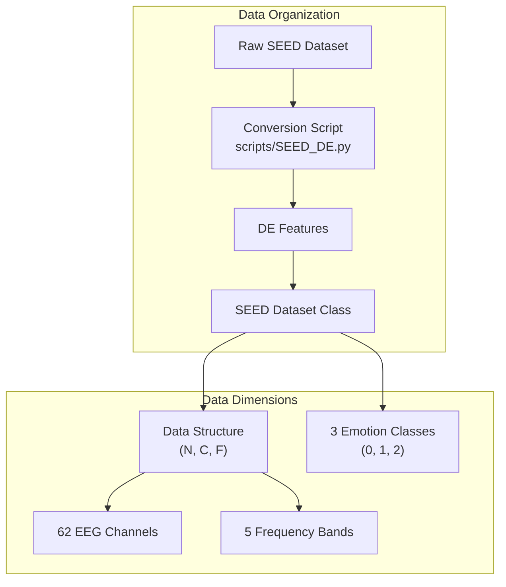
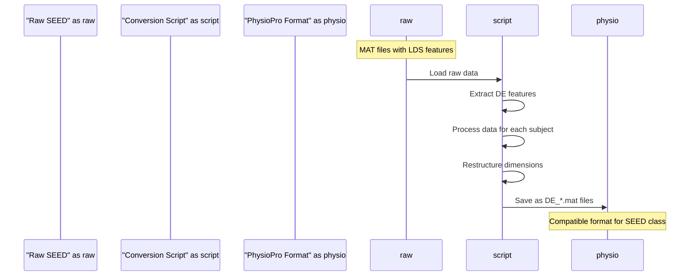
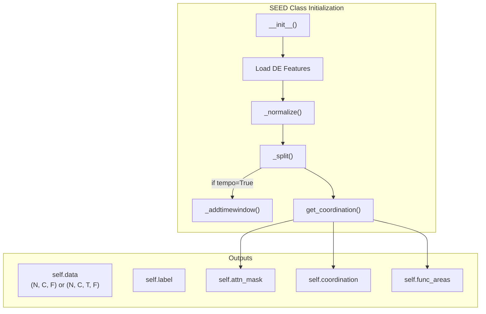
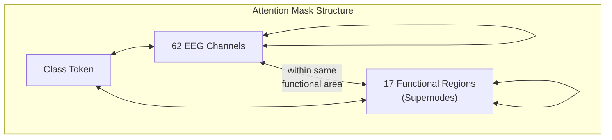
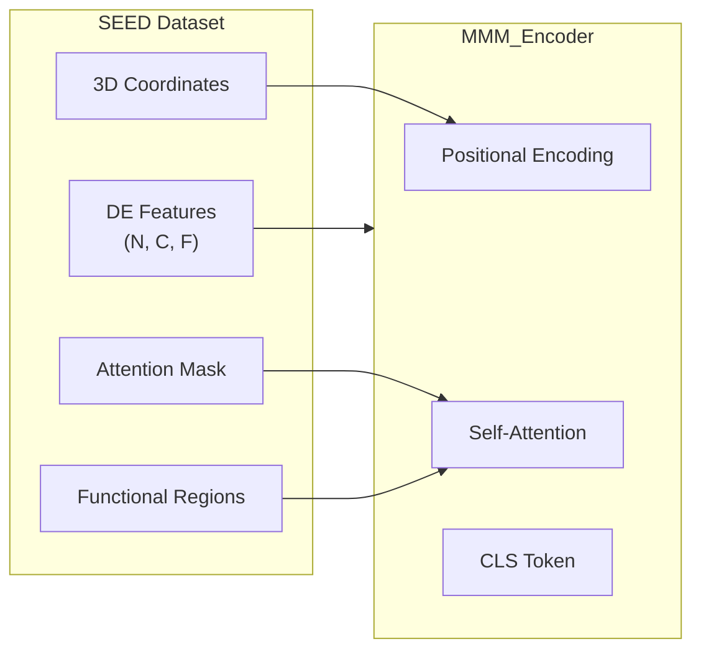

<!-- source: DeepWiki mcp.deepwiki.com · repo microsoft/PhysioPro · extra page SEED Dataset · fetched 2026-10-26 -->

# SEED Dataset

<details>
<summary>Relevant source files</summary>

The following files were used as context for generating this wiki page:

- [physiopro/dataset/SEED.py](physiopro/dataset/SEED.py)
- [physiopro/network/mmm_encoder.py](physiopro/network/mmm_encoder.py)
- [physiopro/network/utils.py](physiopro/network/utils.py)
- [scripts/SEED_DE.py](scripts/SEED_DE.py)

</details>


## Purpose and Overview

The SEED (SJTU Emotion EEG Dataset) dataset implementation in PhysioPro provides EEG-based emotion recognition capabilities to the framework. This module handles loading, preprocessing, and structuring of EEG data with differential entropy features for deep learning tasks. The SEED dataset contains EEG recordings of subjects watching emotional film clips, with signals labeled for three emotional states: negative, neutral, and positive.

For information about other dataset implementations, see [Dataset System](#2.1).

Sources: [physiopro/dataset/SEED.py:1-13]()

## Dataset Structure

The SEED dataset in PhysioPro uses differential entropy (DE) features extracted from EEG signals. These features have been preprocessed from the raw SEED dataset using a conversion script.



Sources: [physiopro/dataset/SEED.py:40-53](), [scripts/SEED_DE.py:1-38]()

### Key Components

The SEED dataset implementation includes:

1. **DE Features**: Differential Entropy features are used as input representations for the EEG signals
2. **62 EEG Channels**: The dataset processes 62 EEG channel recordings
3. **5 Frequency Bands**: Each channel contains data for 5 different frequency bands
4. **3-class Labels**: The dataset is labeled for three emotional states (negative, neutral, positive)
5. **Spatial Information**: 3D coordinates of EEG channels and functional brain regions

Sources: [physiopro/dataset/SEED.py:36-53](), [physiopro/dataset/SEED.py:165-189]()

## Data Preparation and Conversion

The raw SEED dataset must be converted to a format compatible with PhysioPro. This is done through the `scripts/SEED_DE.py` script which:

1. Loads the original MAT files from the SEED dataset
2. Extracts the DE features and labels
3. Restructures the data into the required format
4. Saves the processed data as DE feature files



Sources: [scripts/SEED_DE.py:7-37]()

## SEED Dataset Class Implementation

The `SEED` class inherits from PyTorch's `Dataset` and is registered in the PhysioPro dataset registry using the `@DATASETS.register_module()` decorator, making it available through the configuration system.

### Initialization Parameters

| Parameter | Type | Default | Description |
|-----------|------|---------|-------------|
| prefix | str | "/dataset" | Base directory where dataset is stored |
| name | str | "DE" | Folder name where DE features are stored |
| window_size | int | 1 | Size of the temporal window for sequence processing |
| tempo | bool | False | Whether to use temporal windows |
| subject_index | Optional[int] | -1 | Subject index to use (-1 for all subjects) |
| dataset_name | Optional[str] | None | "train" or "valid" to specify the split |
| normalize | str | "gaussian" | Normalization method ("minmax" or "gaussian") |
| region | int | 17 | Number of functional brain regions |

Sources: [physiopro/dataset/SEED.py:13-23]()

### Data Loading and Processing

The dataset class performs several key operations during initialization:

1. **Data Loading**: Loads DE features from MAT files
2. **Normalization**: Applies Gaussian standardization or min-max normalization
3. **Data Splitting**: Splits data into training (2010 samples) and validation (1384 samples) sets
4. **Channel Reordering**: Reorders channels by functional brain regions
5. **Spatial Information**: Extracts 3D coordinates of EEG channels
6. **Attention Masking**: Creates an attention mask for the MMM_Encoder



Sources: [physiopro/dataset/SEED.py:30-80](), [physiopro/dataset/SEED.py:82-156](), [physiopro/dataset/SEED.py:157-218]()

## Functional Brain Regions and Attention Mask

A key feature of the SEED dataset implementation is its organization of the 62 EEG channels into 17 functional brain regions. This organization is critical for the topological processing in the MMM_Encoder.

### Channel Organization

The 62 EEG channels are arranged into 17 functional areas, with each area containing channels that are spatially and functionally related. This organization is defined in the `get_coordination()` method:

```
func_areas = [[0,1,2,3,4],[5,6,7],...,[59,60,61]]
```

Sources: [physiopro/dataset/SEED.py:159-162]()

### Attention Mask

The dataset creates an attention mask that defines which nodes can attend to each other in the MMM_Encoder's self-attention mechanism:



The attention mask is a boolean tensor where:
- `True` indicates the position is not allowed to attend
- `False` indicates the position is allowed to attend

The mask enables:
1. All channels to attend to each other
2. All supernodes (functional regions) to attend to each other
3. Each supernode to attend to channels in its functional area
4. The class token to attend to all channels and supernodes

Sources: [physiopro/dataset/SEED.py:191-214]()

## Integration with MMM_Encoder

The SEED dataset is designed to work seamlessly with the MMM_Encoder architecture for EEG emotion recognition. The dataset provides:

1. **Spatial Coordinates**: 3D coordinates for EEG channels used for positional encoding
2. **Attention Mask**: Defines the topology-aware attention patterns in the MMM_Encoder
3. **Functional Regions**: Groups channels into brain regions for hierarchical processing



The MMM_Encoder uses the SEED dataset's data and metadata to create topology-aware EEG representations that capture both channel interactions and functional region relationships.

Sources: [physiopro/dataset/SEED.py:218-225](), [physiopro/network/mmm_encoder.py:13-96]()

## Data Access and Sample Format

The dataset returns tuples of (data, label) when indexed, with data being a tensor of shape:
- `(C, F)` when `tempo=False` (C=channels, F=frequency bands)
- `(C, T, F)` when `tempo=True` (T=time window)

Labels are integer tensors with values 0, 1, or 2 representing negative, neutral, and positive emotions respectively.

Sources: [physiopro/dataset/SEED.py:225-235]()

## Usage Example

To use the SEED dataset in PhysioPro:

```python
from physiopro.dataset import DATASETS

# Initialize the dataset
dataset = DATASETS.build(dict(
    type="SEED",
    prefix="/path/to/data",
    dataset_name="train",
    normalize="gaussian",
    tempo=False
))

# Create a DataLoader
from torch.utils.data import DataLoader
dataloader = DataLoader(dataset, batch_size=32, shuffle=True)

# Access data
for data, labels in dataloader:
    # data shape: [batch_size, 62, 5] or [batch_size, 62, window_size, 5]
    # labels shape: [batch_size]
    ...
```

For more information on how to use this dataset for emotion recognition tasks, see [Emotion Recognition with MMM](#3.1).

---

