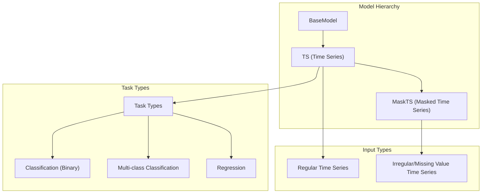
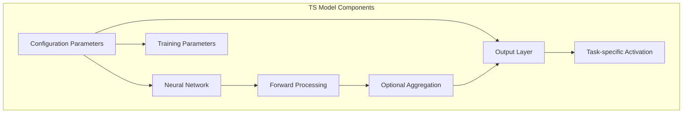
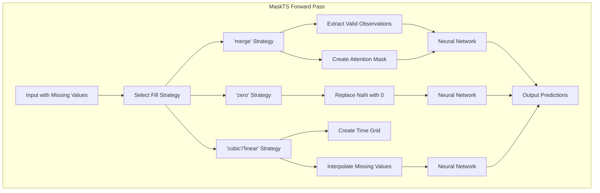
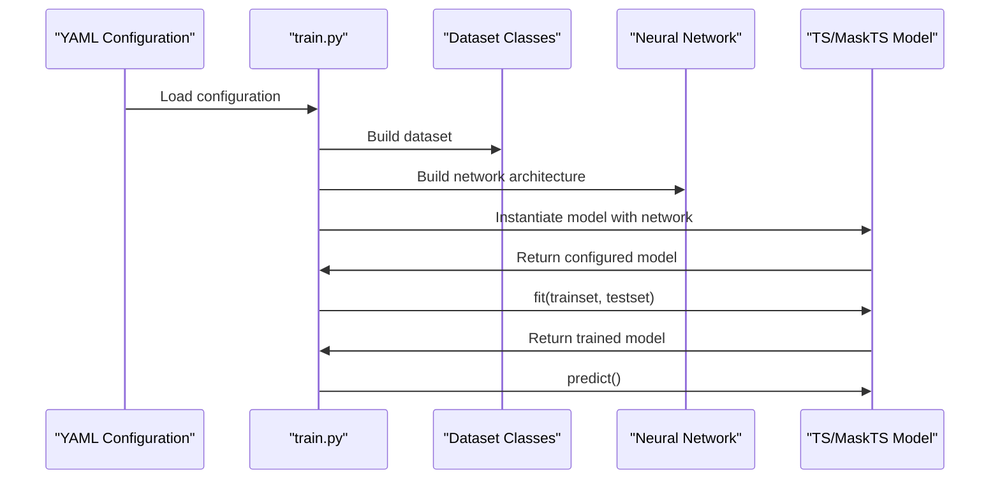

<!-- source: DeepWiki mcp.deepwiki.com · repo microsoft/PhysioPro · extra page Time Series Models · fetched 2026-10-26 -->

# Time Series Models

<details>
<summary>Relevant source files</summary>

The following files were used as context for generating this wiki page:

- [physiopro/entry/train.py](physiopro/entry/train.py)
- [physiopro/model/masktimeseries.py](physiopro/model/masktimeseries.py)
- [physiopro/model/timeseries.py](physiopro/model/timeseries.py)

</details>


This document provides a detailed overview of the Time Series Models in PhysioPro, which handle the training, evaluation, and inference pipelines for time series prediction tasks. The page covers the base TS (Time Series) model and its extension MaskTS (Masked Time Series) for handling data with missing values. For information about the neural network architectures these models use, see [Network Architectures](#2.2) and [Time Series Networks](#2.2.3).

## Model Architecture Overview

Time Series Models in PhysioPro follow a hierarchical design pattern, inheriting from the BaseModel class. There are two primary model classes for time series data:



Sources: [physiopro/model/timeseries.py](), [physiopro/model/masktimeseries.py]()

## TS (Time Series) Model

The TS model serves as the base implementation for time series prediction tasks. It is registered in the MODELS registry with the name "ts" and handles regular time series data where all observations are present.

### Key Features

- Supports classification (binary and multi-class) and regression tasks
- Configurable to produce either sequence-level predictions (aggregate=True) or time-point-level predictions (aggregate=False)
- Flexible output activation functions based on the task type
- Integrates with any compatible neural network architecture

### Implementation Details

The TS class initializes with numerous parameters that control the model behavior:



Sources: [physiopro/model/timeseries.py:12-137]()

### Key Methods

- **`_build_network`**: Initializes the network and output layers based on the task type
- **`forward`**: Processes inputs through the network and applies appropriate activation
- Inherits training, evaluation, and prediction methods from `BaseModel`

### Output Configuration

The model configures its output layer differently depending on the task:

| Task Type | Activation Function | Output Size |
|-----------|---------------------|-------------|
| classification | Sigmoid | 1 |
| multiclassification | LogSoftmax | Number of classes |
| regression | Identity | 1 or custom |

Sources: [physiopro/model/timeseries.py:80-126]()

## MaskTS (Masked Time Series) Model

The MaskTS model extends the base TS model to handle time series with missing values. It is registered in the MODELS registry with the name "mask_ts" and provides several strategies for handling missing data.

### Key Features

- Inherits all capabilities from the TS model
- Provides multiple strategies for handling missing values:
  - **merge**: Extracts and processes only valid observations (designed for ContiFormer)
  - **zero**: Simple imputation by replacing NaN values with zeros
  - **cubic/linear**: Interpolation-based approaches for continuous representations

### Implementation Details



Sources: [physiopro/model/masktimeseries.py:15-157]()

### Missing Value Handling Strategies

1. **merge** (lines 101-131):
   - Creates a mask of missing values
   - Extracts only valid observations for each sequence
   - Creates attention masks for transformer-based networks
   - Designed specifically for ContiFormer architecture

2. **zero** (lines 132-134):
   - Replaces NaN values with zeros
   - Simple but effective for many networks like transformers and state space models

3. **cubic/linear** (lines 135-147):
   - Creates a uniform time grid
   - Uses torchcde package to perform interpolation
   - Suitable for CDE-based, GRU-based, and ODE-RNN models

Sources: [physiopro/model/masktimeseries.py:100-157]()

## Integration with Training Pipeline

The Time Series Models are integrated into PhysioPro's training pipeline through the registry pattern. The entry point for training constructs the appropriate model based on configuration:



Sources: [physiopro/entry/train.py:13-45]()

## Usage Examples

### Model Configuration

Time Series Models are typically configured through YAML files:

```yaml
model:
  type: ts  # or mask_ts for masked time series
  task: classification  # or multiclassification, regression
  optimizer: adam
  lr: 0.001
  weight_decay: 0.0001
  loss_fn: cross_entropy
  metrics: [accuracy, f1]
  observe: accuracy
  lower_is_better: false
  max_epochs: 100
  batch_size: 32
  early_stop: 10
  aggregate: true
  # Additional parameters for MaskTS
  fill_nan_type: merge  # or zero, cubic, linear
  norm_time_flg: true
```

### Decision Guide for Model Selection

| Data Characteristics | Recommended Model | Fill Strategy |
|----------------------|-------------------|---------------|
| Complete time series | TS | N/A |
| Missing values (uniform sampling) | MaskTS | zero or cubic |
| Irregular time series | MaskTS | merge |
| Time series with temporal dependencies | MaskTS | cubic/linear |

## Implementation Notes

- Both models require a neural network object that implements a forward method returning sequence outputs and embedding outputs
- The choice between sequence-level (aggregate=True) and time-point-level (aggregate=False) prediction depends on the task requirements
- For MaskTS, the choice of fill strategy significantly impacts model performance and should be selected based on data characteristics and the underlying network architecture

Sources: [physiopro/model/timeseries.py:12-137](), [physiopro/model/masktimeseries.py:15-157]()

---

