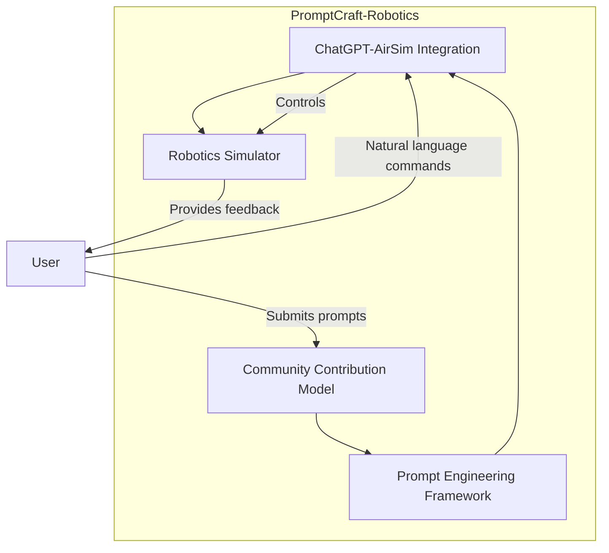
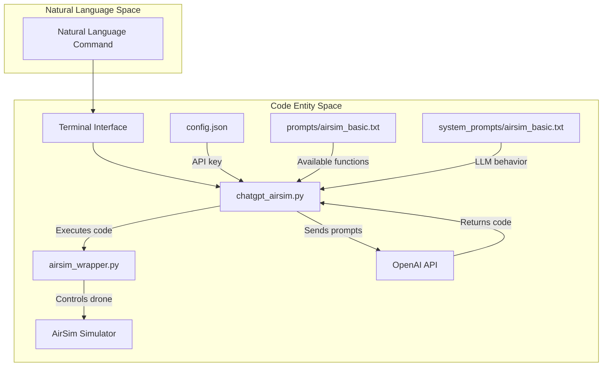
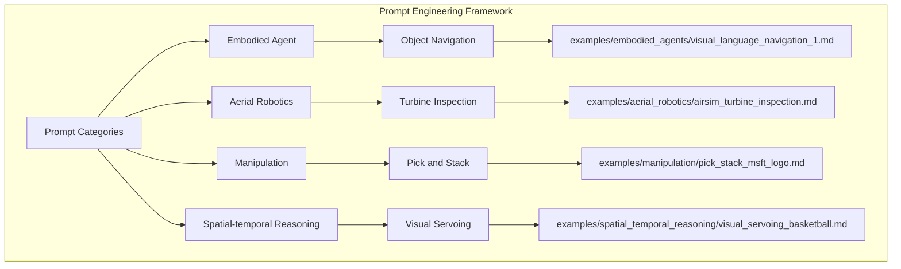
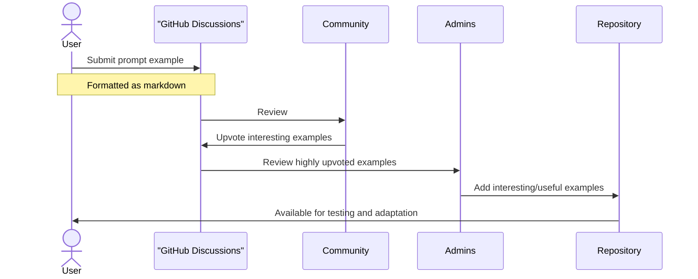
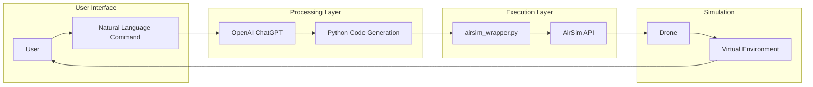
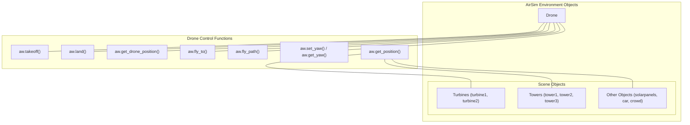

<!-- source: DeepWiki mcp.deepwiki.com · repo microsoft/PromptCraft-Robotics · page 1 Overview · fetched 2026-10-26 -->

# Overview

Relevant source files

The following files were used as context for generating this wiki page:

- [README.md](README.md)

## Purpose and Scope

PromptCraft-Robotics is a community-driven repository designed to explore and demonstrate the applications of large language models (LLMs) in robotics. This repository serves as a platform for users to test, share, and collaborate on prompt engineering examples for robotics tasks. The primary focus is on utilizing OpenAI's ChatGPT, though examples from other LLMs are welcome.

This overview document provides a high-level understanding of the PromptCraft-Robotics system, its architecture, and key components. For detailed setup instructions, see [Installation and Setup](#3.1). For information on contributing new prompts, see [Community Contribution Guidelines](#2).

Sources: [README.md:1-11]()

## System Architecture Overview

The PromptCraft-Robotics repository consists of three main components that work together to enable natural language control of robotic systems:

1. **ChatGPT-AirSim Integration**: The core technical component that connects language models to a robotics simulator
2. **Prompt Engineering Framework**: A structured approach for creating effective prompts for various robotics tasks
3. **Community Contribution Model**: A process for users to submit, review, and share interesting prompt examples

Sources: [README.md:3-11](), [README.md:55-59]()

## ChatGPT-AirSim Integration

The ChatGPT-AirSim integration is the primary technical implementation in the repository, allowing users to control a simulated drone using natural language commands.

The system works as follows:
1. User enters a natural language command
2. The command is sent to ChatGPT with context from system prompts
3. ChatGPT generates Python code to accomplish the task
4. The code is executed through the AirSim wrapper to control the drone
5. Results are returned to the user

Sources: [README.md:55-57]()

## Prompt Engineering Framework

The repository organizes prompts into categories based on different robotics domains, providing a structured approach to prompt engineering for robotics applications.

The framework includes example prompts across various domains:

| Category | Example Tasks | File Path |
|----------|---------------|-----------|
| Embodied Agents | Object navigation, RGBD navigation | examples/embodied_agents/* |
| Aerial Robotics | Turbine inspection, obstacle avoidance | examples/aerial_robotics/* |
| Manipulation | Picking, stacking, building | examples/manipulation/* |
| Spatial-temporal | Visual servoing | examples/spatial_temporal_reasoning/* |

Sources: [README.md:35-53]()

## Community Contribution Model

PromptCraft-Robotics follows a community-driven approach where users can contribute prompts through GitHub Discussions.

The contribution process:
1. Users submit prompts to the GitHub Discussions section
2. Prompts are categorized in appropriate robotics domains
3. The community reviews and upvotes interesting examples
4. Repository admins add selected prompts to the main repository
5. Submissions should be formatted in markdown with LLM details and visuals

Sources: [README.md:7-11]()

## Data and Control Flow

The following diagram illustrates how user commands flow through the system to control the simulated drone:

This architecture enables a natural language interface for robotics control, removing the need for users to write code directly. Instead, the LLM interprets commands and generates appropriate code to accomplish the desired tasks.

Sources: [README.md:55-57]()

## AirSim Environment Objects

The AirSim environment includes various objects that can be interacted with using the drone:

Through the AirSim wrapper functions, users can control the drone to perform various tasks like inspecting wind turbines, avoiding obstacles, or navigating to specific objects.

For more information on the available functions and environment objects, see [Drone Control API](#3.4) and [AirSim Environment Objects](#3.5).

Sources: [README.md:45-47]()

## Research and Resources

PromptCraft-Robotics is accompanied by research publications and additional resources:

- **Research Paper**: "ChatGPT for Robotics: Design Principles and Model Abilities"
- **Blog Post**: Available at aka.ms/ChatGPT-Robotics
- **Demo Videos**: Available on YouTube showing various applications

The project welcomes contributions from the community to expand the range of prompts, robotic applications, and integrations with other simulators.

Sources: [README.md:13-33](), [README.md:61-67]()

## Getting Started

To get started with PromptCraft-Robotics:

1. Explore the existing prompt examples in different categories
2. Set up the ChatGPT-AirSim integration for testing your own prompts
3. Contribute your interesting prompt examples through GitHub Discussions

For detailed setup instructions, see [Installation and Setup](#3.1). For information on using the system with examples, see [Using the System](#4).

Sources: [README.md:55-59]()

---

